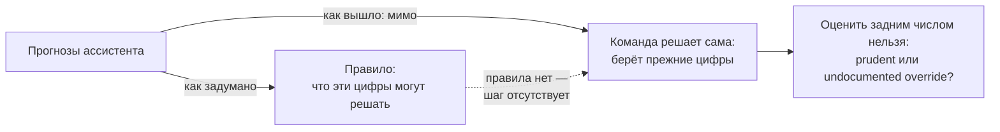

# 1.2 Four Perspectives on One Problem — четыре взгляда на одну инициативу

Related: [[1.2-Four-Perspectives-One-Problem-Flashcards]] · [[1.1-Unscoped-Decision-Work]]

> [!summary] TL;DR
> Один и тот же буксующий forecasting-ассистент четыре роли видят по-разному: у каждой своя зона ответственности (**accountability**) и свой диагноз. Общие слова — **capability**, **ready** — каждая роль определяет из своей зоны. Ход консультанта: согласовать определения в одной комнате, затем спросить каждую функцию, какого решения она ждёт.

## Простыми словами

Четырём сотрудникам задают один вопрос: «проект в порядке?» Спонсор: «да — программа пять месяцев выдаёт цифры, ставим её на второй завод». Технический руководитель: «нет — она работает на копии данных, а одна из выгрузок вообще не рассчитана на решения». Владелец правил: «меня не спрашивали, и правила, что могут решать эти цифры, нет». Хранитель данных: «цифры не надёжны — программа закрывает пробел в данных догадкой; я знаю, где расходятся цифры, и починю за две недели». Все четверо правы на своём участке и говорят о разном: пока они по-разному понимают слово «готово», проект нельзя ни оценить, ни продолжать.

## 1. Одна инициатива — четыре диагноза

У каждой роли своя зона ответственности (**accountability**), поэтому каждая видит в инициативе свою проблему. Рамка лекции: «Nobody solves a team problem alone» — консультант сначала собирает перспективы, а не выбирает одну из них.

| Роль                         | Отвечает за                                                     | Диагноз                                                                               | Возможность есть, когда…                   |
| ---------------------------- | --------------------------------------------------------------- | ------------------------------------------------------------------------------------- | ------------------------------------------ |
| Операционный спонсор         | Обязательства по выпуску; дата, данная руководству              | Трудная работа сделана; расхождение — притирка; нужен второй завод                    | инструмент установлен и работает на заводе |
| IT- и data-лид               | Системы, на которых работает ассистент                          | Работает на копии данных; одна из выгрузок не рассчитана на решения; систем 4–5, не 1 | функция работает в заданной конфигурации   |
| Владелец governance и рисков | Правила использования выхода модели; объяснимость задним числом | Мимо неё: правила, что цифры могут решать, нет                                        | есть разрешение использовать выход модели  |
| Хранитель данных             | Система-первоисточник; сверки                                   | Цифры не надёжны и не ошибочны; причина известна; починка — две недели                | выход подтверждается реальными данными     |

## 2. Расщепление общих слов

Слово **capability** («возможность» — что считается «у нас это уже есть») каждая роль проверяет по своему критерию, совпадающему с её зоной ответственности: спонсор — возможность есть, если инструмент установлен и работает на заводе; технический лид — если функция работает в заданной конфигурации; владелец governance — если есть разрешение использовать выход модели; хранитель данных — если выход подтверждается реальными данными. Значения слова **ready** («готово») расходятся так же: расхождение не в словах, а в том, какой критерий считать достаточным.

Следствие: совещание о готовности без общих определений — четыре ответа на четыре разных вопроса. Лекция даёт консультанту два шага: сначала согласовать определения в одной комнате, затем спросить каждую функцию, какого решения она ждёт. Ответ показывает, какое решение блокирует функцию, — материал для сортировки из [[1.1-Unscoped-Decision-Work]].

## 3. Отсутствующий шаг: правило делает действия оцениваемыми

Владелец governance отвечает за то, как выход модели может использоваться в решении, и за объяснимость решения задним числом. Инициатива дошла до результата, миновав её. Её слова: «I am not the break. I am the missing step» — она не тормозит проект; её шаг в проекте отсутствует.

Без правила выбор команды пользоваться прежними цифрами не поддаётся оценке: это благоразумие (**prudent**) или незадокументированное отклонение (**undocumented override**) — определить нельзя. Правило устраняет неопределённость: по нему решение можно принять и проверить задним числом. Так работает «правило использования» из сортировки [[1.1-Unscoped-Decision-Work]].

## Ловушки / квиз-моменты

- «Самая трудная работа уже сделана»: стабильность выдачи не равна готовности нести решения.
- «Расхождение — притирка»: у него есть причина и цена (две недели); само оно не исчезнет.
- «Цифры в порядке?» — вопрос-заверение; полезный вопрос: где и почему цифры расходятся.
- Одна система со слов спонсора — фактически 4–5: копия и выгрузка-не-система тоже считаются.
- Отсутствие governance — не отсутствие тормозов: без правила действия команды неоцениваемы.

## История напоследок

На совещании о готовности каждый ответил «да» — про своё: спонсор — про наличие инструмента, технический лид — про конфигурацию, которую ещё собрать, владелец правил — «когда будет правило», хранитель данных — «через две недели». Никто не соврал: каждый отвечал на свой вопрос. Пока значения слова «готово» не сведены в одно, «мы готовы» — четыре разных ответа под одним словом.

## Связано

- [[1.2-Four-Perspectives-One-Problem-Flashcards]] — карточки лекции
- [[1.1-Unscoped-Decision-Work]] — сортировка работы на решения и build; предусловия
- [[Decisions-Vs-Management-Flashcards]] — разбор ошибки квиза
