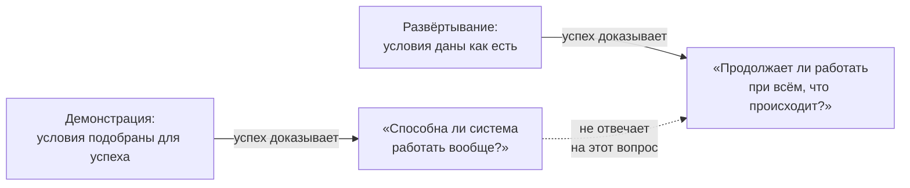

# 1.3 Demonstration vs Deployment — две проверки готовности

Related: [[1.3-Demonstration-Vs-Deployment-Flashcards]] · [[1.2-Four-Perspectives-One-Problem]] · [[1.1-Unscoped-Decision-Work]]

> [!summary] TL;DR
> Демонстрация (**demonstration**) и развёртывание (**deployment**) — разные проверки, отвечающие на разные вопросы: «способна ли система работать вообще?» и «продолжает ли она работать при всём, что происходит на самом деле?». Условия демонстрации подобраны для успеха, поэтому её результат не предсказывает работу при реальных данных, объёмах и пользователях. Первое действие с заявлением о готовности (**readiness claim**) — определить, на какой из двух вопросов оно отвечает.

## Простыми словами

Знакомый показывает приложение: «смотри, работает». Он прав — но он сам подобрал десять аккуратных примеров, сам их подготовил и сам стоял рядом. Настоящий вопрос появится в конце квартала, когда файлы придут кривыми, случаев станет в сто раз больше, а рядом никого не будет. Глава — о разнице между этими двумя «работает»: показ и жизнь системы в организации — разные проверки, и первая не доказывает вторую.

## 1. Две проверки — два вопроса

Смешение демонстрации и развёртывания — одна из самых частых ошибок при оценке готовности AI-системы.

| | Демонстрация | Развёртывание |
|---|---|---|
| Условия | Подобраны для успеха: чистые отобранные данные, ограниченный сценарий (**bounded case**), контролируемая аудитория | Даны как есть: неаккуратные данные, незапланированные исключения, необъявленные изменения, пользователи, обязанные действовать по результатам системы |
| Режим | Один показ | Непрерывная работа внутри реальной организации |
| Вопрос | Способна ли система работать вообще? | Продолжает ли она работать при всём, что происходит на самом деле? |
| Успех означает | Система возможна | Система выдерживает реальность |

## 2. Почему результаты расходятся

Результаты двух проверок могут резко расходиться, потому что демонстрация построена отвечать на первый вопрос, а не на второй. Подбор условий — не недостаток демонстрации, а её назначение: она и должна дать системе шанс показать максимум. Ошибка возникает позже — когда успех демонстрации читают как доказательство готовности к развёртыванию. Например: классификатор документов даёт точность 98% на отобранной тысяче писем и не справляется с потоком, где треть писем — сканы с повёрнутыми страницами, которых в отборе не было.

Поэтому первое действие с любым заявлением о готовности — доказательством концепции (**proof of concept**) вендора или рабочим прототипом коллеги — одно: определить, на какой из двух вопросов оно отвечает.

## 3. Навык: назвать разрыв до бюджета

Упражнение лекции для случая, когда показывают работающую систему. Шаг первый — восстановить условия успеха: какими были данные, кто выбирал проверяемые случаи, кто наблюдал. Шаг второй — сравнить с самой неаккуратной реальной версией той же ситуации: другое качество данных, незапланированный объём, пользователи, ведущие себя не как в тесте. Шаг третий — назвать разрыв вслух до того, как под решение выделен бюджет. Навык, который предлагает строить лекция, — именно третий: разрыв, названный до решения, меняет решение; разрыв, обнаруженный после, приходится оплачивать.

## 4. Связь с кейсом предыдущих лекций

Критерий спонсора из [[1.2-Four-Perspectives-One-Problem]] — «инструмент установлен и работает на заводе» — ответ демонстрационного уровня: он подтверждает «может работать». Вопросы развёртывания в кейсе не заданы: система питается с копии данных, а люди по её результатам не действуют. Отсюда же лёгкость, с которой финансируется второй завод: заявление «работает» выглядит как готовность, хотя отвечает не на тот вопрос.

## Ловушки / квиз-моменты

- Успех демонстрации принят за готовность к развёртыванию — смешение двух вопросов, самая частая ошибка оценки.
- «Работает» без названных условий — не аргумент: условия и есть информация.
- Подбор условий в демонстрации — не обман, а её назначение; ошибка не в показе, а в чтении показа как проверки реальности.
- Разрыв, названный после выделения бюджета, ничего уже не решает — называть до.

## История напоследок

Вендор показал систему обработки счетов: тридцать отобранных счетов, ни одной ошибки, зал доволен. Через месяц после контракта первый же счёт с опечаткой в реквизитах — случай, которого среди отобранных не было, — отправил платёж не туда. Демонстрация честно ответила на свой вопрос: система может работать. Платёж не туда — цена подмены вопроса: покупали ответ на «будет ли работать», а показали «может ли».

## Связано

- [[1.3-Demonstration-Vs-Deployment-Flashcards]] — карточки лекции
- [[1.2-Four-Perspectives-One-Problem]] — критерии готовности по ролям
- [[1.1-Unscoped-Decision-Work]] — сортировка работы на решения и build; предусловия
