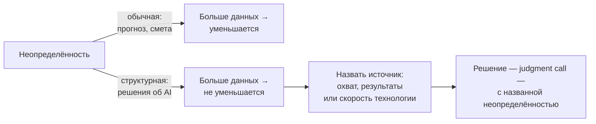

# 1.4 Structural Uncertainty — неопределённость, которую не уменьшают данные

Related: [[1.4-Structural-Uncertainty-Flashcards]] · [[1.1-Unscoped-Decision-Work]] · [[1.2-Four-Perspectives-One-Problem]]

> [!summary] TL;DR
> Неопределённость в решениях об AI — структурная (**structural uncertainty**): она не уменьшается от дополнительных данных, потому что создаётся тремя свойствами ситуации — неясным охватом (**scope**), непредвидимыми результатами (**unforeseeable outcomes**) и быстро меняющейся технологией. Правильный ответ — решение с названной неопределённостью (**judgment call**), а не запрос ещё одного анализа. Отсюда отличие AI-консультирования: система меняется после сдачи, поэтому внимание консультанта — на наблюдении и управлении в течение всей жизни системы, а не только на установке.

## Простыми словами

Прогноз погоды уточняется, когда приходят новые данные, а смета — когда проведена дополнительная сверка. Но есть вопросы, которые новые данные не проясняют: сколько процессов и людей заденет новая система, как она поведёт себя в ситуациях, которых никто не описывал, и какой она будет к моменту запуска — ведь сама технология меняется быстрее планов. Глава о разнице между этими двумя видами неопределённости: первая уменьшается исследованием, вторая — нет, и на неё отвечают не отчётом, а решением.

## 1. Два вида неопределённости

Обычная деловая неопределённость уменьшается сбором информации: рыночный прогноз становится точнее с данными, оценка бюджета — с дополнительной проработкой. Неопределённость в решениях об AI — другого рода: она создаётся тремя свойствами ситуации, и ни одно из них не устраняется новыми данными.

| Источник | В чём состоит | Почему не устраняется данными |
|---|---|---|
| Неясный охват (**scope**) | В момент решения о построении нельзя перечислить все процессы и всех людей, которых затронет выход системы | Полная карта влияния появляется только после запуска — до него её неоткуда собрать |
| Непредвидимые результаты (**unforeseeable outcomes**) | Даже создатели не могут предсказать поведение системы: она будет отвечать на ситуации, для которых никто не писал правило | Прошлые данные не содержат ещё не случившихся ситуаций и правил для них |
| Быстро меняющаяся технология (**fast-moving capability**) | План, написанный сегодня, к моменту исполнения описывает уже слегка устаревшую возможность | Исследование фиксирует состояние на сегодня; технология меняется быстрее цикла исследования |

## 2. Ответ — решение, а не анализ

Поскольку ни один из трёх источников не закрывается дополнительным исследованием, правильный ответ — решение (**judgment call**): решение, принятое с названной неопределённостью, а не запрос ещё одного анализа. Запросить «ещё немного данных» там, где неопределённость структурная, — значит потратить время, не приблизив решение.

## 3. Почему консультирование по AI — не консультирование по IT

Обычный IT-проект или проект бизнес-аналитики сдаёт одну фиксированную вещь и завершается. AI-система продолжает меняться после сдачи: дрейфует — поведение меняется с новыми данными, требует дообучения (**retraining**) и управления на протяжении всего срока работы. Поэтому внимание AI-консультанта остаётся на том, как система будет наблюдаться и управляться в течение её жизни, — не только на том, как она устанавливается.

## 4. Практика: назвать источник сомнения

Когда решение об AI-инициативе ощущается неопределённым, лекция предлагает не просить данные, пока не назван источник сомнения — один из трёх: неясный охват, непредвидимые результаты или быстро меняющаяся технология. Назвать одним предложением, например: «мы не можем полностью предсказать результаты здесь». После этого решать, помогло бы дополнительное исследование или момент требует оценочного решения.

## Ловушки / квиз-моменты

- «Соберём ещё данных» при структурной неопределённости — анализ, не приближающий решение.
- Оценка AI-проекта по модели сдачи: «установили — закончили»; после установки система живёт и меняется.
- План без срока годности: написанный сегодня, он описывает уже устаревающую технологию.
- Неназванная неопределённость не делает решение осторожнее — выбор просто происходит без её учёта.

## История напоследок

Комитет запросил «ещё одно исследование» перед запуском системы поддержки клиентов. Через три месяца исследование вернулось: данные те же, вопрос тот же, — потому что сомнение вызывало не отсутствие данных, а то, что поведение системы на вопросах, которых ещё не было, не предскажет никакое исследование. Назови председатель источник сомнения вслух — «мы не можем предсказать результаты на будущих вопросах» — решение приняли бы на три месяца раньше.

## Связано

- [[1.4-Structural-Uncertainty-Flashcards]] — карточки лекции
- [[1.1-Unscoped-Decision-Work]] — решения versus build; judgment здесь — тот же механизм
- [[1.2-Four-Perspectives-One-Problem]] — владелец governance: управление системой на протяжении жизни
