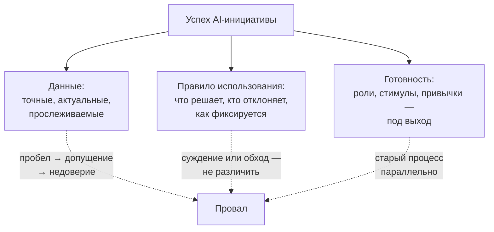

# 1.5 Data, Rules, and Readiness — три фундамента AI-инициативы

Related: [[1.5-Data-Rules-Readiness-Flashcards]] · [[1.2-Four-Perspectives-One-Problem]] · [[1.1-Unscoped-Decision-Work]]

> [!summary] TL;DR
> Успеху AI-инициативы нужны три отдельных фундамента, и каждый способен остановить её в одиночку, даже при сильных двух: управляемые доверенные данные (**governed and trustworthy data**), письменное правило использования (**rule of use**), организационная готовность (**organizational readiness**). Данные — точные, актуальные и прослеживаемые до источника; правило — письменное: что выход может решать, кто вправе отклонить и как отклонение фиксируется; готовность — перестроенные под выход роли, стимулы и привычки. Диагностический ход при «не работает» — проверить все три и назвать недостающий, а не считать по умолчанию виноватой технологию.

## Простыми словами

Фирма ввела систему планирования доставки, а через полгода результата нет. Причины могут быть три, и они не заменяют друг друга: карты устарели и адреса расходятся между складами (данные); никто не сказал, в каких случаях диспетчер вправе не слушать систему и как это оформить (правило); либо курьеры возят по привычным маршрутам, а система работает «на бумаге» (готовность). Любая из трёх валит проект сама по себе — даже если остальные две в полном порядке.

## 1. Три фундамента

| Фундамент                                                         | Что требуется                                                                           | Как останавливает инициативу                                                                                                                                                                                             |
| ----------------------------------------------------------------- | --------------------------------------------------------------------------------------- | ------------------------------------------------------------------------------------------------------------------------------------------------------------------------------------------------------------------------ |
| Управляемые доверенные данные (**governed and trustworthy data**) | Информация точная, актуальная и прослеживаемая до источника                             | Системы не связаны или изменение не перенесено — модель заполняет пробел допущением, и люди, знающие реальные цифры, перестают доверять выходу; модель при этом может быть построена хорошо                              |
| Правило использования (**rule of use**)                           | Письменно: что выход может решать; кто вправе его отклонить; как отклонение фиксируется | Без него нельзя установить задним числом, было ли игнорирование системы ответственным суждением (**judgment call**) или несанкционированным обходом, — неопределённость тормозит принятие при годных данных и технологии |
| Организационная готовность (**organizational readiness**)         | Роли, стимулы и ежедневные привычки перестроены вокруг использования выхода             | Старый процесс работает параллельно «на всякий случай» — готовности нет, сколько бы система ни была жива                                                                                                                 |

## 2. Фундаменты разделимы

Пробел в любом одном останавливает инициативу, сильную в двух других. Отличные данные без правила использования проваливаются по другой причине, чем отличное управление поверх несведённых данных, — но проваливаются так же. Следствие для диагностики: слабое место нельзя угадать по общему впечатлению от проекта, каждый фундамент проверяется отдельно.

## 3. Практика: три диагностических вопроса

Когда говорят, что AI-инициатива «не работает», проверяют все три фундамента, а не только самый знакомый. Вопросы: управляемы ли данные и доверяют ли им; есть ли письменное правило о том, что выход может решать; изменилась ли организация вокруг выхода на самом деле. Диагностический ход — назвать недостающий фундамент вместо допущения «виновата технология».

## 4. Связь с кейсом предыдущих лекций

Три фундамента — это кейс forecasting-ассистента, разложенный по полочкам. Проблема хранителя данных из [[1.2-Four-Perspectives-One-Problem]] — фундамент данных: изменение нумерации деталей не дошло до выгрузки, и модель заполнила пробел допущением. «Отсутствующий шаг» владельца governance — фундамент правила использования: без правила решение команды не различить — суждение это или обход. Параллельная таблица планировщиков из [[1.1-Unscoped-Decision-Work]] — фундамент готовности: старый процесс живёт «на всякий случай», поэтому готовности нет, сколько система ни работает.

## Ловушки / квиз-моменты

- Диагноз по умолчанию «виновата технология» — вместо проверки трёх фундаментов.
- Параллельный старый процесс «на всякий случай» означает отсутствие готовности независимо от срока жизни системы.
- Хорошая модель на несведённых данных — провал: качество модели не компенсирует фундамент данных.
- Без правила использования отклонение от системы не оценивается задним числом — и это тормозит принятие само по себе.

## История напоследок

«Отчётная система не работает», — сказали консультанту. Данные проверили: точные, свежие, источник прослеживается. Правило проверили: записано, что система решает, кто отклоняет, где фиксируется. Осталась готовность: отдел по-прежнему вёл свои таблицы «на всякий случай». «Не работает» означало «работает, но ей не пользуются» — и недостающим фундаментом оказался третий.

## Связано

- [[1.5-Data-Rules-Readiness-Flashcards]] — карточки лекции
- [[1.2-Four-Perspectives-One-Problem]] — роли кейса: хранитель данных, владелец governance, готовность спонсора
- [[1.1-Unscoped-Decision-Work]] — параллельная таблица планировщиков как признак неготовности
