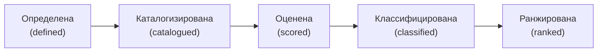

# 2.1 Обзор модуля — карта AI-возможностей, которую можно защитить

Related: [[2.1-Module-Overview-Capability-Map-Flashcards]] · [[1.2-Four-Perspectives-One-Problem]] · [[1.5-Data-Rules-Readiness]]

> [!summary] TL;DR
> Модуль строит профессиональное суждение советника: знать, что организация уже может делать с AI, до того, как кто-либо рекомендует, что ей покупать. Результат модуля — один документ: карта AI-возможностей предприятия (**enterprise AI capability map**), составленная по устойчивым категориям (**durable categories**), а не по названиям продуктов. Модуль отвечает на четыре вопроса — от критерия AI-возможности до порядка закрытия пробелов бюджетом — и доводит карту до пяти состояний: определена, каталогизирована, оценена, классифицирована, ранжирована.

## Простыми словами

К компании приглашают советника по AI, и первый вопрос — не «что купить», а «что вы уже умеете». Опытный консультант умеет провести инвентаризацию, взвесить компромисс и вести совещание заинтересованных сторон, но ему обычно не хватает двух вещей: словаря, чтобы определить незнакомую AI-систему без звонка специалисту, и привычки записать, что именно мы считаем, прежде чем что-либо подсчитывать. Модуль даёт оба умения — и ни для одного не требуется становиться инженером. Результат — карта возможностей, по которой можно отвечать на вопросы руководства.

## 1. Назначение модуля и результат

Модуль формирует суждение (**judgment**), на котором работает AI Transformation Advisor: знать, что организация уже может делать с AI, до того, как кто-либо рекомендует, что ей покупать. Результат сведён к одному поставляемому документу (**deliverable**): карта AI-возможностей предприятия, составленная по устойчивым категориям, а не по названиям продуктов. Название продукта привязано к конкретному поставщику и устаревает при его смене; категория остаётся, поэтому карта по категориям отвечает на вопрос «что мы можем» и после замены продуктов.

## 2. Две недостающие вещи у опытных профессионалов

Модуль рассчитан на опытных бизнес- и консалтинговых профессионалов: инвентаризацию, взвешивание компромиссов и ведение совещаний они уже умеют. Не хватает, как правило, двух умений:

1. **Словарь** — способность определить место незнакомой AI-системы без привлечения специалиста.
2. **Привычка письменно фиксировать, что считается, до какого-либо подсчёта** («write down what counts before counting anything»).

Оба умения строятся в модуле, и ни одно не требует становиться инженером.

## 3. Четыре вопроса модуля

Вопросы модуля задают его структуру: каждому, по всей видимости, соответствует отдельная тема.

| Вопрос | Чему учит ответ |
|---|---|
| Что делает систему AI-возможностью, а не обычным ПО? | Критерий различения AI-возможности и обычного программного обеспечения |
| Почему инвентаризация возможностей (**capability inventory**) и оценка зрелости (**maturity assessment**) отвечают на разные вопросы о разных объектах? | Различение двух инструментов анализа |
| Когда возможность отстаёт, в каком из трёх состояний она находится — и почему состояние определяет средство исправления? | Связь диагноза и средства |
| Когда несколько пробелов конкурируют за один бюджет, какие факторы решают, какой пункт закрывается первым? | Приоритизация бюджета |

## 4. Путь модуля: пять состояний карты

К концу модуля слушатель переходит от чтения отчётов, подготовленных другими, к созданию собственной карты, по которой можно вести разговор. Карта проходит пять состояний:

## Ловушки / квиз-моменты

- Карта по названиям продуктов: привязана к текущим поставщикам, устаревает при их смене и не отвечает на вопрос «что мы можем».
- Подсчёт до письменного определения, что считается: числа без зафиксированного критерия невозможно защитить.
- Инвентаризация возможностей и оценка зрелости — не один инструмент: разные вопросы о разных объектах.

## История напоследок

Новый директор по данным попросил: «Составьте список всего нашего ИИ». Через неделю ему принесли таблицу из сорока строк — названия продуктов, версии, даты покупки. «Если всё это завтра отключат, что мы разучимся делать?» — спросил директор. Таблица не отвечала: названия продуктов не сообщают о возможностях. Карта, которую строит этот модуль, отвечает: возможности разложены по категориям, каждая каталогизирована, оценена, классифицирована и ранжирована — и на вопрос директора у карты есть ответ, который можно защитить.

## Связано

- [[2.1-Module-Overview-Capability-Map-Flashcards]] — карточки обзора
- [[1.2-Four-Perspectives-One-Problem]] — слово capability расщеплялось по ролям; модуль учит определять его единообразно
- [[1.5-Data-Rules-Readiness]] — организационная готовность как один из фундаментов возможности
