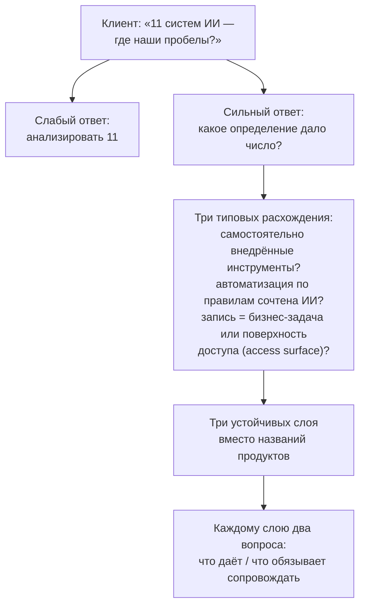

# 2.10 Win the Role — определить, что считается, до подсчёта

Related: [[2.10-Win-The-Role-Flashcards]] · [[2.2-The-Number-Came-Back]] · [[2.3-One-Entry-Four-Readings]] · [[1.6-Follow-The-Decision-Not-The-Deployment]]

> [!summary] TL;DR
> Навык модуля: определить, что считается, до подсчёта — каждое число получено по правилу, которое почти никогда не записано, и спор о числе обычно является спором о правиле, а не о фактах; названное вслух правило превращает неразрешимый спор в разрешимый. На интервью («у клиента 11 систем ИИ — где пробелы?») сильный ответ спрашивает определение, породившее число, называет три типовых расхождения (самостоятельно внедрённые инструменты; автоматизация по правилам; одна запись — одна бизнес-задача или одна поверхность доступа, **access surface**) и раскладывает названное по трём устойчивым слоям вместо названий продуктов, задавая каждому два вопроса: что даёт и что обязывает сопровождать. В первые три месяца работы советником спор о «управляемости» разрешается двумя колонками (соответствие внешней обязанности и внутренний путь утверждения), навык подаётся как усиливающий существующую роль аналитика, а условия данных и надзора записываются в перечень письменно в момент составления — потому что при ошибке ответственность ложится на того, кто сделал последний видимый шаг.

## Простыми словами

Почти каждое число в компании кем-то посчитано по какому-то правилу — и правило почти никогда не записано. Когда двое спорят о числе, факты у них, как правило, одинаковые; спорят они о правиле, которое число породило. Поэтому первый вопрос к любому числу — «по какому правилу оно получено?»: он превращает неразрешимый спор в разрешимый. На интервью это проверяют вопросом «у клиента 11 систем ИИ — где пробелы?». Слабый ответ берёт одиннадцать как данность и начинает их разбирать. Сильный сначала спрашивает, по какому правилу считали: среди названного могут оказаться боты, работающие по записанным правилам, — не ИИ, — а самодельные инструменты сотрудников могли в счёт не попасть. Затем он раскладывает названное не по названиям продуктов, а по трём устойчивым слоям — по тому, у кого находится модель, кто её обучает и где данные: пустой слой и есть пробел, по списку названий его не видно. Каждому слою задаются два вопроса: что он даёт и что заставит сопровождать после себя.

## 1. Принцип: у каждого числа — правило

Каждый подсчёт наследует определение (**every count inherits a definition**), и большинство определений никто не записывает. Паттерн универсален: он появляется везде, где тебе вручают число и просят по нему действовать — сколько систем? сколько инцидентов? сколько часов сэкономлено? Спор о числе — почти всегда согласие о фактах и несогласие о правиле; произнесённое вслух правило подсчёта делает спор разрешимым. Перечень возможностей — один из случаев этого паттерна, а не уникальный документ.

## 2. Интервью: «11 систем ИИ — где пробелы?»

Три вопроса-расхождения, которые сильный ответ называет до анализа числа: считаются ли инструменты, внедрённые командами самостоятельно; попала ли в число автоматизация по записанным правилам (не ИИ по пропускному вопросу из [[2.4-Gate-Question-Four-Zones]]); означает ли одна запись одну бизнес-задачу (какую работу делает инструмент) или одну поверхность доступа (**access surface** — одно место соединения с чужими системами или данными: API, интерфейс, внешнее соединение). Единицы не совпадают один к одному: один инструмент может делать одну задачу через три поверхности доступа, а одна поверхность — служить нескольким бизнес-задачам; от выбора единицы зависит число записей.

## 3. Три устойчивых слоя

Названное клиентом раскладывается по слоям, устойчивым к смене продуктов, — а не по названиям продуктов. Слои различаются тем, у кого находится модель, кто её обучает и где данные:

| Слой | Что это (у кого модель, обучение, данные) | Что даёт | Что обязывает сопровождать |
|---|---|---|---|
| Готовые управляемые сервисы | Вендор поставляет готовую возможность: его модель уже обучена, клиент посылает вход и получает результат (пример: сервис чтения документов) | Возможность без построения и обучения модели | Интеграцию с сервисом и зависимость от вендора — вопросы переключения из [[2.7-Ranking-Multiple-Inputs]] |
| Готовые среды построения моделей | Вендор поставляет среду — инструменты и вычисления, — а клиент обучает в ней собственные модели на собственных данных (пример: платформа, где аналитик компании обучает прогноз спроса на истории продаж) | Модель, заточенную под собственные данные и задачи | Конвейер данных, жизненный цикл модели и переобучение — сопровождение существенно больше, чем в первом слое |
| Управляемая генеративная инфраструктура | Доступ к генеративным моделям вендора, но политика и допустимое использование остаются на стороне клиента (пример: корпоративный доступ к генеративным моделям с правилами, кто и какие данные может отправлять) | Генеративные возможности под собственными правилами | Поддержание самих правил: допустимое использование, контроль доступа, журналирование |

Пара «что даёт / что обязывает» — из [[2.7-Ranking-Multiple-Inputs]]: обязательство сопровождения решает и способ закрытия, и приоритет. Конкретное содержание обязательств в таблице следует из природы каждого слоя.

## 4. Первые три месяца на роли: спор о «управляемости»

В первые три месяца работы советником этот спор встретится лично: коллега-комплаенс и коллега-операции оценят одну возможность противоположно по управляемости — и это будет ощущаться как фактический спор, который кто-то должен проиграть. Это не так: слово указывает на два объекта — соответствие внешней обязанности и внутренний путь решения с назначенным утверждающим (из [[2.3-One-Entry-Four-Readings]]). Обе оценки верны — неверна карта: одна колонка там, где нужны две. Назвать оба смысла, занести оба — и спор превращается в зафиксированное различие.

## 5. Как говорить о навыке

Бизнес-проблема курса (из [[1.6-Follow-The-Decision-Not-The-Deployment]]): предприятия не понимают, какая помощь им нужна, и покупают мощности разработки, когда нужен консультативное суждение. Этот навык ловит ошибку раньше всех: компания неверно очерчивает проект, когда не установила, что у неё уже есть. Спрос на работу живёт внутри существующих вакансий аналитиков и операционных ролей, а не под собственным названием — поэтому навык подаётся как делающий существующую роль ценнее, а не как новая профессия.

## 6. Подотчётность последнего шага

Когда решение, принятое с участием ИИ, оборачивается ошибкой, ответственность ложится на того, кто сделал последний видимый шаг. Поэтому условия данных и надзора, стоящие выше по цепочке, фиксируются в перечне письменно и в момент составления — а не восстанавливаются потом, когда искать виноватого уже поздно.

## Ловушки / квиз-моменты

- Анализ числа без вопроса об определении — слабый ответ интервью.
- Спор о числе как спор о фактах: обычно это спор о правиле подсчёта.
- Перечень в названиях продуктов вместо устойчивых слоёв.
- Слой без пары вопросов: что даёт / что обязывает сопровождать.
- Одна колонка управляемости вместо двух: обе оценки верны, неверна карта.
- Подача навыка отдельной профессией вместо усиления существующей роли.
- Условия данных и надзора «в голове» вместо записи в момент: ответственность упадёт на последний видимый шаг.

## История напоследок

На совещании вспыхнул спор: сколько инцидентов безопасности было за квартал — четыре или сорок? Обе стороны называли цифры уверенно, и обе казались фактами. Советник спросил: «По какому правилу считаем?» Выяснилось: служба безопасности считает только эскалированные инциденты, поддержка — все обращения с пометкой «безопасность». Оба числа были верны — каждое против своего правила. Спор закончился за минуту, а таблица получила две колонки вместо одной и примечание с определениями. Пока правило подсчёта не произнесено, спор о числе — это спор о словах.

## Связано

- [[2.10-Win-The-Role-Flashcards]] — карточки лекции
- [[2.2-The-Number-Came-Back]] — кейс «11» и правило подсчёта до подсчёта
- [[2.3-One-Entry-Four-Readings]] — два значения «управляемости» и две колонки
- [[2.4-Gate-Question-Four-Zones]] — автоматизация по правилам — не ИИ
- [[2.7-Ranking-Multiple-Inputs]] — обязательство сопровождения
- [[1.6-Follow-The-Decision-Not-The-Deployment]] — как говорить о работе: решения, не результаты
