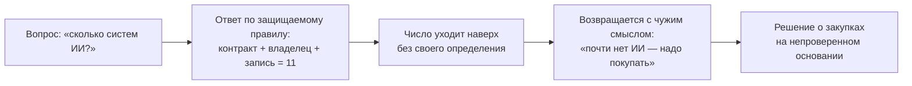

# 2.2 The Number Came Back — число, вернувшееся со смыслом

Related: [[2.2-The-Number-Came-Back-Flashcards]] · [[2.1-Module-Overview-Capability-Map]] · [[1.2-Four-Perspectives-One-Problem]]

> [!summary] TL;DR
> На вопрос «сколько у компании систем ИИ» руководитель корпоративных систем ИИ (владелец платформы, **platform owner**) ответил тем, что можно защитить: системы, по которым есть контракт, назначенный владелец и строка в архитектурной записи — 11; число ушло к руководству без определения, по которому собрано, и вернулось с смыслом, которого никто не придавал: «у компании этого размера почти нет ИИ, надо начинать покупать». Счёт не ошибочен: он полон относительно собственного определения и неполон относительно фактического положения — команды получали возможности втихую, внедрение обогнало учёт. Корень проблемы — никто не записал до подсчёта, что считается, поэтому число нельзя ни оспорить, ни исправить; исправление не требует продукта и разработки: определение, каталогизация, оценка по независимым осям, классификация отставаний, ранжирование.

## Простыми словами

Спросите в крупной компании: «сколько у вас систем на ИИ?» — и вам назовут число, которое можно подтвердить документами: только официально закупленное. А команды тем временем давно сами скачали и настроили рабочие инструменты — в число они не попали. Число уходит руководству без пояснения, по какому правилу собрано, и по дороге получает смысл: «у нас почти нет ИИ». Оспорить его нельзя — оно честное относительно своего правила; исправить нельзя — самого правила никто не записал. Поэтому правило записывают до подсчёта.

## 1. Кейс: как число получило смысл

Советник сопровождает глобального производителя перед сессией совета директоров по AI-инвестициям. Руководителя корпоративных систем ИИ (**platform owner** — менеджера, отвечающего за внедрённые в компании системы ИИ) спросили, сколько таких систем работает. Он ответил тем, что может защитить: системы, по которым есть контракт, назначенный владелец и строка в архитектурной записи. Ответ: 11.

По прибытии советник находит: 11 строк закупок, 2 остановившихся пилота, очередь заявок (**intake** — единственный официальный канал, через который команды запрашивают новые инструменты), о подаче которых никто не помнит. Никто не может одним предложением сказать, что компания умеет с AI сегодня. Формулировка лекции: «The number travels up alone and comes back carrying a meaning nobody attached to it» — число уходит наверх само и возвращается, неся смысл, которого ему никто не придавал.

## 2. Диагноз: верное число против неверного вопроса

Счёт не ошибочен. Он полон относительно собственного определения — закуплено, санкционировано, записано — и неполон относительно фактического присутствия AI в компании: команды, которым была нужна возможность, получали её тихо, и внедрение шло быстрее, чем учёт (**adoption ran ahead of visibility**).

Проблема формулируется прямо: никто не записал до подсчёта, что будет считаться (**nobody wrote down what would count before counting**). Следствие: число нельзя ни оспорить, ни исправить — нет критерия, по которому проверять. Второе следствие опаснее: каждый анализ пробелов (**gap analysis**), построенный на этом инвентаре, незаметно наследует его слепое пятно, потому что инвентарь внутренне непротиворечив — внутри документа противоречия нет, и неполнота не видна.

## 3. Почему ситуация неловка для каждого

Каталогизация затрагивает трёх людей, и ни один из них не создавал проблему.

| Кто это | В чём неудобное положение |
|---|---|
| Руководитель корпоративных систем ИИ (platform owner) — отвечает за официальный перечень систем | Должен подтвердить полноту перечня, которую не может проверить: системы, установленные командами в обход официальной процедуры, ему просто не видны |
| Руководитель команды, чей ассистент планирования (**planning assistant**) работает вне официального перечня — установлен командой для собственной работы, без заявки | Ничего не нарушил: инструмент нужен для дела. Но после каталогизации инструмент, не прошедший официальную процедуру, придётся либо остановить, либо заново провести через приём заявок (**intake**) — а это недели согласований вместо работы |
| Руководитель комплаенс-функции — отвечает за соблюдение компанией нормативных требований | Компания обязана по закону вести полный реестр систем ИИ: закон требует знать и показать регулятору, какие системы работают и с каким классом риска. Руководителю передали таблицу одиннадцати систем, которая внешне выглядит как этот реестр, но собрана по правилу «только контракты» и полноты не гарантирует. Если на неё сослались бы как на реестр, компания официально подтвердила бы неполный перечень |

Все трое отвечают честно — конфликт создан не людьми, а отсутствием определения.

## 4. Исправление: пять шагов без продукта и разработки

Для исправления не нужны продукт или разработка. Пять шагов лекции один к одному разворачивают пять состояний карты из [[2.1-Module-Overview-Capability-Map]]:

| Шаг | Содержание | Состояние карты (2.1) |
|---|---|---|
| 1 | До любого подсчёта письменно зафиксировать, что считается возможностью | определена (defined) |
| 2 | Каталогизировать против этого определения — список выходит за пределы санкционированных строк закупок | каталогизирована (catalogued) |
| 3 | Оценивать каждую запись по осям, остающимся независимыми друг от друга | оценена (scored) |
| 4 | Для каждого отставания назвать одно из трёх состояний | классифицирована (classified) |
| 5 | Ранжировать более чем по одному критерию — до решения, которое совет директоров считает принимаемым | ранжирована (ranked) |

## Ловушки / квиз-моменты

- «Можно защитить» не означает «отражает положение»: ответ по защищаемому определению молча отбрасывает всё, что не проходило через контракты.
- Вопрос «сколько» без определения, что считается: по умолчанию побеждает самое узкое защищаемое определение.
- Анализ пробелов на внутренне непротиворечивом инвентаре наследует неполноту незаметно.
- Каталогизация без объяснения выглядит для команд наказанием, хотя никто из них не нарушал правил.

## История напоследок

На годовом совещании директор спросил: «Сколько у нас систем на ИИ?» Юрист ответил по своему реестру — семь. Владелец платформы — по контрактам — одиннадцать. Руководитель планирования промолчал: его команда два года пользовалась инструментом, которого нет ни в одном списке. Директор попросил «одну цифру», получил одиннадцать — и цифра ушла в презентацию без пояснения, по какому правилу она собрана. Через месяц она вернулась строкой бюджета на «догоняющие закупки». Цифра не была ложной — она была без определения; записать определение до подсчёта стоило часа работы, а не пересмотра бюджета.

## Связано

- [[2.2-The-Number-Came-Back-Flashcards]] — карточки лекции
- [[2.1-Module-Overview-Capability-Map]] — пять состояний карты; привычка «записать, что считается, до подсчёта»
- [[1.2-Four-Perspectives-One-Problem]] — зоны ответственности ролей в аналогичном конфликте
