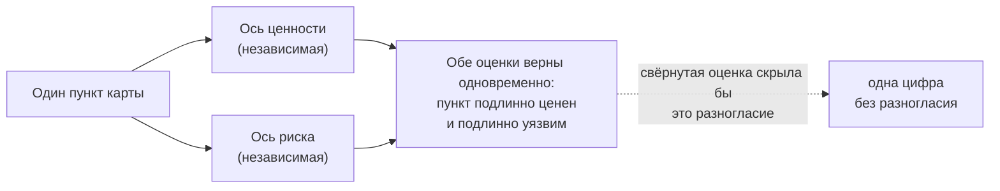

# 2.3 One Cataloged Assistant, Four Accountable Readings — одна запись, четыре взгляда, у каждого своя ответственность

Related: [[2.3-One-Entry-Four-Readings-Flashcards]] · [[2.2-The-Number-Came-Back]] · [[1.2-Four-Perspectives-One-Problem]]

> [!summary] TL;DR
> В черновике перечня (карты) систем ИИ спор вызвал один пункт — инструмент, который команда планирования внедрила сама, без официальной заявки, для подготовки еженедельного отчёта. Три руководителя оценили его по-разному, и каждый прав в своей зоне ответственности: юрист вычеркнул — инструмента нет в обязательном по закону реестре; руководитель операций признал управляемым — каждый черновик отчёта уходит с подписью; руководитель платформы признал неуправляемым — инструмент работает с тремя системами компании без проверки границ доступа. Разногласие разрешается средствами самой карты: заранее записывается правило, что считается одной записью; слово «управляемость» (**governance**) получает отдельную колонку на каждое значение — соответствие закону, внутреннее утверждение, контроль доступа; ценность и риск оцениваются двумя разными оценками, потому что пункт может быть одновременно полезным и уязвимым, — одна сводная оценка скрыла бы это, а не показала.

## Простыми словами

Компания составила черновик перечня своих систем ИИ, и один пункт вызвал спор: инструмент, который готовит команде еженедельный отчёт. Юрист говорит: «вычёркиваю — у нас нет записи о нём в обязательном по закону реестре». Руководитель операций: «оставляю — у нас есть подпись на каждом его черновике». Руководитель платформы: «помечаю как неуправляемый — он лазит в три системы». А руководитель самой команды вздыхает: ему теперь недели пересогласований. Спорят не о фактах — факты у всех одни. Спорят о том, что считать одной записью и какое значение вкладывать в слово «управляемость»; и то и другое можно просто записать в самом перечне — двумя колонками.

## 1. Один пункт — четыре взгляда

Компания из кейса лекции составила черновик перечня систем ИИ — рабочего документа, отвечающего на вопрос «что компания умеет». При составлении перечня в нём обнаружился инструмент, не проходивший официальной заявки: помощник для подготовки еженедельного отчёта (**briefing assistant**), внедрённый командой планирования поставок по собственной инициативе. Четверо руководителей посмотрели на этот один пункт — каждый из своей зоны ответственности:

| Кто и за что отвечает                                                                                                                                                                                                                                                                                                                                                                                        | Оценка пункта                                    | Обоснование                                                                                                                                                                                                                                                                                                                                                                                                                                                                                                                                                                                                                                                                          |
| ------------------------------------------------------------------------------------------------------------------------------------------------------------------------------------------------------------------------------------------------------------------------------------------------------------------------------------------------------------------------------------------------------------ | ------------------------------------------------ | ------------------------------------------------------------------------------------------------------------------------------------------------------------------------------------------------------------------------------------------------------------------------------------------------------------------------------------------------------------------------------------------------------------------------------------------------------------------------------------------------------------------------------------------------------------------------------------------------------------------------------------------------------------------------------------ |
| Руководитель комплаенса и рисков — отвечает за реестр систем ИИ, который компания по закону обязана вести. Зачем реестр: закон требует, чтобы компания знала и могла показать регулятору, какие системы ИИ у неё работают и какой класс риска у каждой; системы регулируемых классов требуют оценки и надзора. Класс риска определяется тем, что система делает и каких данных касается, — не её полезностью | Вычеркнул пункт из черновика карты               | «Неуправляемый» в его словаре значит «не соответствует требованиям закона»: даже полезный инструмент, обрабатывающий данные компании, обязан получить класс риска и попасть в реестр — пропуск означает, что компания фактически заявляет «мы эту систему не используем», используя её. Его страх: реестр силён только полнотой, а пополнять его станут из похожей карты возможностей, построенной по другому правилу (по пользе, а не по классу риска). Системы, вычеркнутые из карты или в ней не найденные, останутся пропущенными и в реестре — и при проверке регулятором компания предъявит неполный реестр; юридические последствия возникнут именно у него                   |
| Руководитель операций и продукта — за еженедельный брифинг: вовремя и достаточно точный для действий                                                                                                                                                                                                                                                                                                         | Управляемый; одна запись                         | «Управляемость» в его словаре — путь принятия решений с назначенным утверждающим: ни один черновик ассистента не уходит из команды без подписи. Одна запись, потому что инструмент делает одну работу. И только у него есть твёрдое доказательство ценности: два квартала отдел работал без штатной единицы, и брифинг ни разу не сорвался                                                                                                                                                                                                                                                                                                                                           |
| Руководитель платформы — ведёт приём заявок (**intake**): единый официальный канал, через который команды запрашивают новые инструменты; до внедрения каждая заявка проходит проверку — каких данных касается инструмент и доступ к каким системам ему нужен. Отвечает за знание того, куда идут данные компании и доступы к ним                                                                             | Неуправляемый                                    | Ассистент затрагивает хранилище документов, систему планирования и внешний путь получения данных: три поверхности доступа (**access surfaces**) — три места, где граница защиты может отказать, и ни одна не проверялась, потому что инструмент шёл в обход приёма заявок. Он не требует замедлять внедрение — он требует, чтобы каждое внедрение шло через единый канал заявок. Довод: пока инструмент живёт в обход канала, вокруг него накапливаются настройки (интеграции, конфигурации) и привычки сотрудников — и чем дольше, тем дороже изменить или объединить его с другими инструментами. Канал проверяет каждый инструмент до внедрения и сохраняет компании возможность наводить порядок потом |
| Руководитель команды планирования поставок — за то, чтобы брифинг был готов к понедельнику; и именно он несёт затраты от самой инвентаризации                                                                                                                                                                                                                                                                | Оценки не даёт — несёт затраты от самой проверки | Ему предстоят: пересогласование инструмента заново, ручной запасной путь в рабочем состоянии, объяснение 11 месяцев использования перед тремя проверяющими — «я планирую затраты, а не сопротивляюсь». Только он знает поведение ассистента на данных команды: надёжен на исходной продуктовой линии, слабее на заметках заводов с другим оформлением; на вопрос о точности ответит, как проверяли и где слабейшее место                                                                                                                                                                                                                                                             |

## 2. Почему спор разрешим без уступок

Никто из четверых не оспаривает факт — расхождение не в данных. Спор идёт о двух вещах, которые карта может зафиксировать явно:

1. **Правило подсчёта** — что считается одной записью (здесь: инструмент, делающий одну работу, — одна запись). Средство: написать правило до подсчёта — то же правило, которого не хватило в [[2.2-The-Number-Came-Back]].
2. **Значение слова «управляемость» (governance)** — каждый вкладывал своё: соответствие обязательному по закону реестру, наличие утверждающего внутри компании, контроль доступа к системам. Средство: в карте заводится отдельная колонка на каждое значение — тогда «зарегистрирован по закону: нет» и «утверждается внутри компании: да» не спорят друг с другом, а соседствуют в одной строке.

## 3. Ценность и риск движутся независимо

Под спором все четверо согласны в главном: ценность и риск движутся независимо, поэтому пункт может быть одновременно подлинно ценным и подлинно уязвимым. Одна сводная оценка (**blended score**) скрыла бы разногласие вместо того, чтобы вывести его на поверхность; раздельные оси — соответствуют шагу «оценивать по осям, остающимся независимыми» из [[2.2-The-Number-Came-Back]].

## Ловушки / квиз-моменты

- Сводная оценка ценности и риска прячет разногласие вместо его обнаружения.
- Спор о числе записей без письменного правила подсчёта неразрешим в принципе.
- Слово «управляемость» означало для трёх ролей три разные вещи (закон, утверждение, доступ); карта указывает, какое значение используется, — отдельной колонкой на каждое.
- Карта и юридический реестр — два похожих документа; без явного разделения смешивается именно тот, у которого юридические последствия.
- Сопротивление команды инвентаризации — часто не сопротивление, а учёт своих затрат: пересогласование, запасной путь, объяснения проверяющим.

## История напоследок

На разборе перечня систем ИИ заговорили об одном пункте — инструменте, которым команда планирования пользовалась год. Руководитель комплаенса сказал: «Вычёркиваю — его нет в обязательном реестре». Руководитель операций: «Оставляю — каждый его черновик уходит с подписью». Руководитель платформы: «Помечаю как неуправляемый — он проходит в три системы». Спор шёл по кругу, пока ведущий не вынес на доску две колонки: «соответствие внешней обязанности — нет» и «путь утверждения внутри команды — есть». Оба утверждения оказались верны одновременно — и спор закончился не чьей-то победой, а второй колонкой. Когда сверху добавили третью — «ценность: два квартала без срыва брифинга», — стало видно: ценность вообще не спорит с риском, они живут в разных колонках.

## Связано

- [[2.3-One-Entry-Four-Readings-Flashcards]] — карточки лекции
- [[2.2-The-Number-Came-Back]] — правило подсчёта до подсчёта; цена инвентаризации для команды
- [[1.2-Four-Perspectives-One-Problem]] — параллель модуля 1: слово capability расщеплялось по ролям
- [[2.1-Module-Overview-Capability-Map]] — независимые оси оценки в конвейере карты
