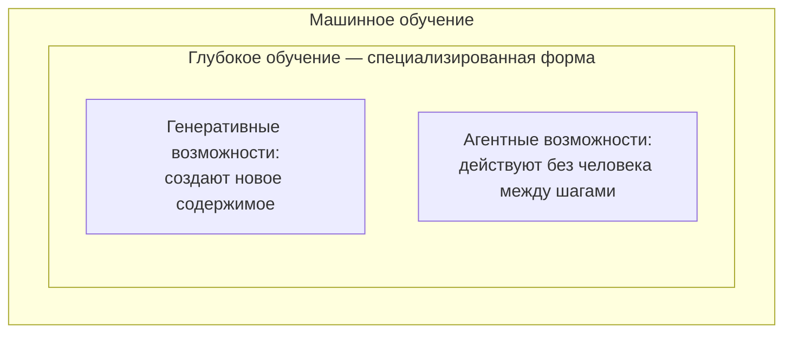

# 2.4 The Gate Question and the Four Zones — пропускной вопрос и четыре зоны

Related: [[2.4-Gate-Question-Four-Zones-Flashcards]] · [[2.1-Module-Overview-Capability-Map]] · [[2.3-One-Entry-Four-Readings]]

> [!summary] TL;DR
> Прежде чем система попадает в перечень AI-возможностей компании, она проходит один проверочный вопрос (**gate question**): действует ли система по закономерностям, которые сама извлекла из данных, или исполняет правила, написанные человеком. Обучающаяся система требует того, чего программе с правилами не нужно: данных для обучения; она может ошибаться способами, невозможными для программы с фиксированными правилами; ей нужен постоянный надзор. Всё прошедшее проверку размещается в четырёх вложенных зонах — машинное обучение, внутри него глубокое обучение, поверх него генеративные и агентные возможности, — причём внешние зоны отличаются от внутренних не «уровнем интеллекта», а полномочиями (**authority**): сколько система может сделать без человека между шагами.

## Простыми словами

Калькулятор складывает два числа одинаково всегда — так работает обычная программа: она исполняет то, что написал программист. Другое дело система, которой показали тысячи примеров и которая сама нашла в них закономерности: на новом случае она решает по накопленному опыту, а не по готовому правилу. Отсюда простой тест для любого инструмента: «он сам учился или исполняет чужие правила?» Если правила — это не ИИ: маршрут письма для счёта проложит и обычная программа, и следить за ней как за ИИ незачем. А если учился — у него свои требования: данные для обучения, непривычные ошибки и постоянный присмотр. И ещё один вопрос — сколько ему позволено делать без человека: написать черновик письма — одно, самому отправить письмо и перенести встречу — совсем другое.

## 1. Пропускной вопрос

Прежде чем что-либо займёт место в перечне AI-возможностей, оно проходит один тест — пропускной вопрос (**gate question**): действует ли система по закономерностям, извлечённым из данных, или исполняет правила, написанные человеком вручную.

| | Программа с записанными правилами | Обучающаяся система |
|---|---|---|
| Как решает | Исполняет инструкции программиста одинаково при каждом запуске — как калькулятор, складывающий числа безотносительно контекста | Изучает примеры, находит в них статистические закономерности и применяет их к данным, которых никогда не видела |
| Что требует для работы | Только код | Данные для обучения — не только код |
| Как ошибается | Ошибки объясняются кодом | Может ошибаться способами, недоступными программе с фиксированными правилами |
| Какой надзор нужен | Не требуется | Постоянный надзор — фиксированным правилам надзор никогда не требовался |

## 2. Выигрыш от пропускного вопроса

Вопрос сразу приносит практическую выгоду: программы с записанными правилами — маршрутизатор, раскладывающий счета по отделам, или проверка формы на пустое обязательное поле — перестают считаться AI-возможностью.

Ложная метка «ИИ» не безобидна. Каждый час, потраченный на проверку такой программы на дрейф данных (постепенное изменение данных со временем), каждый бюджет, заложенный на дообучение, которое ей никогда не понадобится, — это управление риском, которого не существует.

## 3. Четыре вложенные зоны

Всё, что прошло пропускной вопрос, размещается в одной из четырёх вложенных зон — одна внутри другой:

**Генеративная модель** — модель глубокого обучения, обученная создавать новое содержимое, а не только классифицировать показанное. Она наследует требования глубокого обучения к данным и вычислениям и добавляет собственные сверх них. **Агентные возможности** также строятся поверх архитектур глубокого обучения — как и генеративные, это внешние зоны, а не отдельные «виды интеллекта».

## 4. Внешние зоны отличают полномочия, а не интеллект

Внешние кольца отличаются от внутренних не «сырым интеллектом», а полномочиями (**authority**): сколько система может сделать без человека между шагами; что она фиксирует в журнале; куда передаёт вопрос, когда встречает то, что не может разрешить.

| Пример | Действия без человека между шагами | Что карта обязана показать |
|---|---|---|
| Генеративный инструмент готовит черновик документа; человек читает и отправляет сам | Нет: каждый итог проверяет человек | Полномочия ограниченные |
| Агентный инструмент сам отправляет документ, обновляет календарь и уведомляет поставщика | Да: ни один шаг не подтверждается человеком | Полномочия широкие; в карте — что система пишет в журнал и куда передаёт неразрешаемое |

Разница между этими двумя инструментами — не в «умении», а в праве действовать; перечень возможностей обязан её показывать, иначе читатель карты не отличит черновик от самостоятельной отправки.

## Ловушки / квиз-моменты

- Считать программу с записанными правилами AI-возможностью: часы и бюджет уходят на управление несуществующим риском.
- Судить о зоне по названию вендора: сначала пропускной вопрос, вслух, потом названия.
- Принимать генеративность за признак широких полномочий: черновик для человека и самостоятельная отправка — разные полномочия при одной технологической зоне.
- Перечень без колонки полномочий скрывает главное различие внешних зон.

## История напоследок

В компанию принесли на оценку две покупки и одну уже сделанную. Первая — система, раскладывающая входящие счета по отделам; советник выяснил: внутри сто двенадцать правил, написанных бухгалтерами, — система ничего не выучила. В перечень ИИ она не попала, и часы на контроль дрейфа данных закладывать не стали. Вторая — помощник, пишущий проекты ответов клиентам: он обучался на переписке, значит ИИ, но каждый ответ перед отправкой читает оператор — полномочия узкие. Третья — помощник, который сам отправляет письма и переносит встречи: обучение то же, что у второй, но ни один шаг не проходит через человека. Все три строчки в перечне оказались разными, хотя вендор называл все три «ИИ-платформой».

## Связано

- [[2.4-Gate-Question-Four-Zones-Flashcards]] — карточки лекции
- [[2.1-Module-Overview-Capability-Map]] — первый из четырёх вопросов модуля: что делает систему AI-возможностью
- [[2.3-One-Entry-Four-Readings]] — правило подсчёта: что считается одной записью перечня
- [[1.4-Structural-Uncertainty]] — почему обучающейся системе нужен постоянный надзор: непредвидимые результаты
