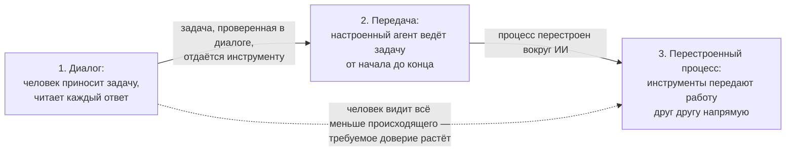

# 2.5 How Much of the Loop the Tool Runs — какую часть цикла инструмент выполняет сам

Related: [[2.5-How-Much-Of-The-Loop-Flashcards]] · [[2.4-Gate-Question-Four-Zones]] · [[2.2-The-Number-Came-Back]]

> [!summary] TL;DR
> Зона системы (из предыдущей лекции) говорит, что за система перед нами, но не говорит, какую часть работы она реально взяла на себя, — а перечню возможностей нужны оба измерения. Использование раскладывается на три ступени: диалог (человек приносит задачу и контекст, читает каждый ответ и решает, что взять), передача (организация отдаёт уже проверенную задачу настроенному агенту, и тот выполняет её от начала до конца без проверки каждого случая) и перестроенный процесс (инструменты передают работу друг другу напрямую, без людей между шагами). С каждой ступенью человек видит всё меньшую часть происходящего — поэтому требуется всё больше доверия, и именно поэтому карта, построенная на подсчёте лицензий, завышает реальную автоматизацию: лицензия говорит, кому разрешено открыть инструмент, а не кто реально работает на второй-третьей ступени.

## Простыми словами

Одно дело — что за инструмент перед нами, другое — сколько работы он реально забрал у человека. Один и тот же мощный инструмент один сотрудник использует как собеседника: попросил, прочитал, переделал сам. Другой настроил его так, что тот сам ходит в две системы и рассылает отчёты. А компания может вообще перестроить процесс так, что инструменты передают работу друг другу без людей. Чем выше ступень, тем меньше человек видит из происходящего — и тем больше нужно доверия. Поэтому число купленных лицензий ничего не говорит о реальном использовании: лицензия разрешает открыть инструмент, но не заставляет работать по-настоящему.

## 1. Зона отвечает «что за система», ступень — «сколько работы взял»

Знание зоны (четыре вложенные зоны из [[2.4-Gate-Question-Four-Zones]]) определяет тип системы. Оно не определяет, какую часть фактической работы система взяла на себя: один и тот же инструмент у одних работает собеседником, у других — автономным исполнителем. Перечню возможностей нужно второе чтение так же, как первое.

## 2. Три ступени использования

| Ступень | Кто приносит задачу | Что делает инструмент | Что остаётся человеку |
|---|---|---|---|
| 1. Диалог | Человек — задачу и контекст | Собеседник в режиме чередования: сжать, переработать, предложить | Читает каждый результат и решает, что взять. Пример: черновик абзаца → «сожми» → чтение → решение |
| 2. Передача | Организация — задачу, уже проверенную и заслужившую доверие в диалоге первой ступени | Настроенный агент или поток работ выполняет её от начала до конца | Человек не проверяет каждый случай |
| 3. Перестроенный процесс | Задачи движутся между инструментами напрямую | Связующий слой передаёт работу инструментов друг другу; сам процесс спроектирован вокруг ИИ | Человек видит ещё меньшую часть происходящего; ступень требует наибольшего доверия |

## 3. Почему подсчёт лицензий завышает картину

Лицензия сообщает, кому разрешено открыть инструмент, способный на работу третьей ступени, — и не сообщает, кто реально работает на второй или третьей ступени. Большинство сотрудников любой организации проводит большинство времени на первой ступени: черновики и проверки, а не передача задач. Поэтому карта, построенная только на числе мест, описывает значительно более автоматизированную организацию, чем существует фактически.

Это то же семейство ошибок, что и число «11» из [[2.2-The-Number-Came-Back]]: метрика внутренне верна относительно своего определения (лицензий действительно куплено столько-то) и ложна относительно фактического положения (реальные ступени использования).

## 4. Практика

Для одной системы, лицензии на которую есть у всех в команде, спросить трёх-четырёх пользователей, на какой ступени они реально работают, — и сравнить ответ с тем, что подразумевает число лицензий.

## Ловушки / квиз-моменты

- Зона ≠ степень: тип системы не говорит, сколько работы она взяла.
- Карта по числу лицензий описывает организацию автоматизированнее существующей.
- Лицензия — право открыть инструмент, не факт работы на второй-третьей ступени.
- Подъём по ступеням без роста доверия: человек видит всё меньше, а основания доверять не выросли.

## История напоследок

Руководитель похвалился: «У нас пятьсот человек работают с ИИ — купили пятьсот лицензий». Советник опросил четверых обладателей. Первый: «Прошу сжать письма перед отправкой». Второй: «Разбираю его варианты, выбираю лучший». Третий: «Настроил агента на рассылку отчётов — он сам ходит в две системы». Четвёртый: «Руки не доходят зайти». В перечне рядом со строкой «500 лицензий» появилась вторая колонка: трое на первой ступени, один на второй, один не заходил. Организация из презентации и организация по факту оказались разными — и разрыв стал виден только вопросом о ступенях.

## Связано

- [[2.5-How-Much-Of-The-Loop-Flashcards]] — карточки лекции
- [[2.4-Gate-Question-Four-Zones]] — зоны: первое измерение (тип системы)
- [[2.2-The-Number-Came-Back]] — то же семейство: верная против своего определения метрика, ложная против фактов
- [[1.3-Demonstration-Vs-Deployment]] — демонстрация третьей ступени не равна работе на ней
