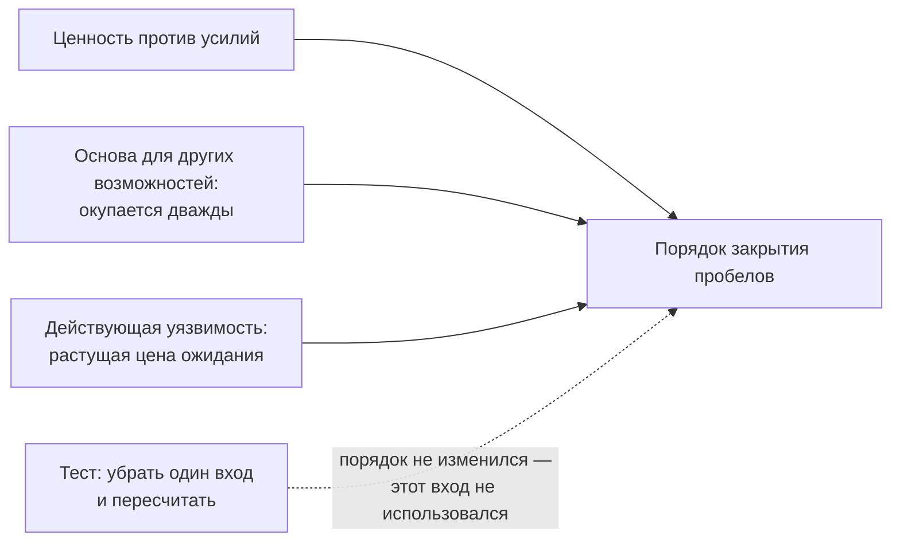

# 2.7 Ranking Takes More Than One Input — ранжирование пробелов требует больше одного входа

Related: [[2.7-Ranking-Multiple-Inputs-Flashcards]] · [[2.6-Capability-Gap-Conditions]] · [[2.2-The-Number-Came-Back]]

> [!summary] TL;DR
> Выбор, какой пробел закрывать первым, чаще всего делают по одному соотношению — ценность против усилий, — а настоящий выбор зависит от трёх отдельных входов: ценность против усилий; основа для других возможностей (закрытие окупается дважды — на нём построятся другие возможности); действующая уязвимость (данные уже идут туда, куда никто не смотрит, — цена ожидания выше). Честность списка проверяется тестом: убрать один вход и пересчитать порядок — если порядок не меняется, какой вход ни убирай, использовался только один. Четвёртый вход, который пропускают чаще всего, — что организации придётся сопровождать после закрытия: он же решает, как закрывать — массовая и решённая на рынке потребность по умолчанию закрывается готовым решением, специфическая и глубоко связанная со своими системами — собственной разработкой, с планом вывода из эксплуатации с первого дня.

## Простыми словами

Какой пробел закрыть первым? Обычный ответ: посчитать пользу и усилия, взять самый выгодный. Но бывают пробелы-«фундаменты»: прямой пользы меньше, а закроешь — другие возможности построятся на этом дальше, окупается дважды. Бывают пробелы-«пожары»: польза скромная, но прямо сейчас данные текут туда, куда никто не смотрит, — ждать дороже, чем закрыть. Честная проверка списка: убери один фактор и пересчитай — если порядок не шевельнулся, ты этим фактором и не пользовался. И к каждому пробелу ещё один вопрос: что нам потом сопровождать? Массовая потребность, которую рынок уже решил, — берём готовое; потребность, вросшая в нашу систему, — строим сами, но с планом выхода с первого дня: поставщики платформ с каждым релизом встраивают то, что мы построили, и надо уметь уйти без потерь.

## 1. Три входа ранжирования

После определения состояния пробела ([[2.6-Capability-Gap-Conditions]]) остаётся решить, какой закрывать первым. Большинство ранжирований останавливается на соотношении ценности и усилий — и теряет реальные случаи.

| Вход | Что учитывает | Когда побеждает более высокую «ценность» |
|---|---|---|
| Ценность против усилий | Сколько пользы на единицу работы | Базовый вход; сам по себе упускает два случая ниже |
| Основа для других возможностей | Создаёт ли закрытие пробела базу, на которой другие возможности будут строиться | Пробел с меньшей прямой ценностью оправдан перед более ценным одиночным: закрытие окупается дважды — прямая польза плюс всё, что на нём построят |
| Действующая уязвимость | Есть ли риск прямо сейчас — данные уже идут туда, куда никто не смотрит | Цена ожидания различна: действующая уязвимость оправдана перед ценным, но безопасным пробелом |

Ранжирование по одному входу не может представить решение, которое на самом деле зависит от всех трёх.

## 2. Тест «убери один вход»

Механика: вход убирается из расчёта **сразу для всего списка** — считаем, что этого фактора нет ни у одного пробела, — затем порядок всех пробелов пересчитывается и сравнивается с исходным. После этого то же повторяется со вторым входом и с третьим: три пересчёта. Если относительные позиции не меняются, какой вход ни убери, — этот вход не влиял на ранжирование.

Пример: онлайн-магазин «дом и сад». Три задачи — рекомендации товаров, разбор документов поставщиков и чат-бот поддержки, который год отправляет данные клиентов во внешний сервис без наблюдения. Оценки по каждому входу:

| Задача | Ценность | Основа | Уязвимость |
|---|---|---|---|
| Рекомендации товаров | 4 | 2 | 1 |
| Разбор документов поставщиков | 3 | 5 | 1 |
| Чат-бот поддержки | 2 | 1 | 5 |

Первая версия таблицы, которую показывали руководству, была однофакторной: по «риску» у всех задач стояло «среднее», по переиспользованию — числа на глазок, и порядок определяла ценность: рекомендации, документы, бот. Тест это вскрыл: изъятие «основы» или «уязвимости» порядка не меняло — заявленная многофакторность не работала, и бот с уходящими наружу данными клиентов стоял последним.

После честной оценки суммы дают: документы 9, бот 8, рекомендации 7 — документы первые, бот поднялся на второе место за счёт уязвимости. Тест на новой таблице показывает чувствительность:

- Убрали «основу»: бот 7, рекомендации 5, документы 4 — документы падают с первого места на последнее. Первое место документов держится на переиспользовании: до бюджета спросить владельцев инвойсинга и таможни, будут ли они реально использовать этот сервис.
- Убрали «уязвимость»: документы 8, рекомендации 6, бот 3 — бот падает на последнее. Его второе место держится целиком на оценке уязвимости: до бюджета выгрузить логи внешнего API за месяц и проверить, какие поля уходят.

Что даёт результат. Тест — аудит не списка, а процесса ранжирования, и два исхода читаются по-разному:

- **Порядок не изменился, какой вход ни убери:** список всё время ранжировался одним фактором, а заявленная многофакторность — ложная (факторы числились, но не влияли). Вывод: либо осознанно принять однофакторность, либо реально оценить недостающие входы.
- **Порядок изменился при изъятии входа X:** решение чувствительно к X — первое место держится на оценках X. Вывод: проверить обоснованность именно этих оценок до выделения бюджета; спор о списке — это спор о X, и уточнять в первую очередь нужно X. Если №1 стоит на «уязвимости», оценённой на слух, позиция держится на самом ненадёжном из данных.

По построению это анализ чувствительности: одно допущение шевелят и смотрят, держится ли вывод.

## 3. Четвёртый вход: обязательство сопровождения

Вход, который пропускают чаще всего: **что организации придётся сопровождать после закрытия пробела**. Он же определяет способ закрытия:

| Потребность | Как закрывать по умолчанию |
|---|---|
| Массовая, уже решённая на рынке, слабо связанная с собственными системами | Брать готовое решение, а не строить |
| Специфическая, повторяющаяся, глубоко связанная с работающей собственной системой | Строить — исключение, которое имеет смысл |

## 4. План вывода из эксплуатации и цена переключения

Каждая собственная разработка несёт план вывода из эксплуатации (**deprecation plan**) с первого дня. Причина: поставщики платформ почти в каждом релизовом цикле встраивают соседние возможности — то, что построено самостоятельно, рано или поздно поглощается платформой, и нужно уметь уйти.

Способность переключиться не бесплатна: она требует постоянных вложений. Организация, которая никогда не принимала решения сохранять гибкость, обычно уже заперта в зависимости — и не заметила, как это произошло.

## 5. Практика

Взять первый пункт собственного бэклога команды и записать, какой из трёх входов фактически поставил его на первое место.

## Ловушки / квиз-моменты

- Ранжирование только по ценности и усилиям: два реальных случая (основа, уязвимость) потеряны.
- Уверенность «мы учитываем три входа» без теста: убрать один вход и пересчитать.
- Закрытие пробела без вопроса о сопровождении.
- Строить там, где рынок решил; брать готовое там, где потребность вросла в свою систему.
- Собственная разработка без плана вывода из эксплуатации: платформа поглотит возможность, а выхода нет.
- Считать гибкость бесплатной: переключение — постоянные вложения; нерешённость быть гибким — незаметная запертость.

## История напоследок

В онлайн-магазине чат-бот поддержки год отправлял данные клиентов во внешний сервис, и в списке приоритетов он стоял последним: ценность низкая, жалоб нет. Когда таблицу пересчитали тремя входами, бот поднялся на второе место — за счёт оценки «действующей уязвимости», поставленной на слух. Тест показал: убери эту оценку — и бот снова последний; значит, всё его место в списке держится на ней. Выгрузили логи внешнего API за месяц: уходили телефоны и адреса клиентов. Канал отключили в тот же день — решение принял не тест, но именно тест сказал, какой лог смотреть.

## Связано

- [[2.7-Ranking-Multiple-Inputs-Flashcards]] — карточки лекции
- [[2.6-Capability-Gap-Conditions]] — состояние пробела определяет средство; эта лекция — порядок закрытия
- [[2.2-The-Number-Came-Back]] — шаг 5 конвейера: ранжирование
- [[2.1-Module-Overview-Capability-Map]] — четвёртый вопрос модуля закрыт
- [[1.4-Structural-Uncertainty]] — технология меняется быстрее планов — отсюда план вывода из эксплуатации
