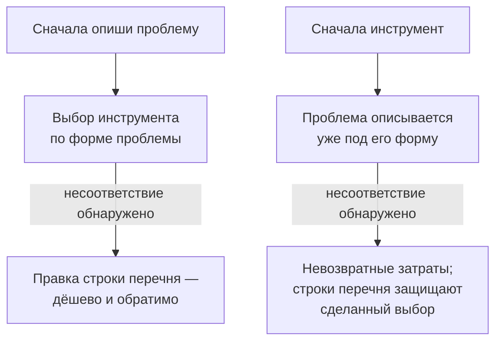

# 2.8 Map the Problem Before You Choose the Tool — сначала опиши проблему, потом выбирай инструмент

Related: [[2.8-Problem-Before-Tool-Flashcards]] · [[1.1-Unscoped-Decision-Work]] · [[2.2-The-Number-Came-Back]]

> [!summary] TL;DR
> О месте выбора инструмента в последовательности существует настоящий профессиональный спор: одна сторона описывает процесс и его трение до рекомендации инструмента, другая сознательно сжимает это описание ради скорости — обе опираются на работающую практику, и это оценочное решение (**judgment call**), а не решённый вопрос. Курс учит подходу «сначала проблема» по структурной причине: инструмент, выбранный до характеристики проблемы, загоняет все сценарии в свою форму — то, чего он не умеет, тихо становится сценарием, который никто не предлагает; ошибка в описании исправляется правкой, ошибка в инструменте превращает несоответствия в невозвратные затраты (**sunk cost**), а строки перечня — в позиции для защиты. Клиент часто уже стоит в позиции «сначала инструмент», не заметив выбора: просит оценить платформы до соглашения, зачем они нужны, — распознавание этой позиции отдельный навык, и первая реакция на совещание, открытое названием продукта, — вопрос «какую проблему продукт должен решить».

## Простыми словами

Есть два рабочих порядка. Первый: сначала опиши, как устроена работа и где она буксует, потом выбирай инструмент. Второй: не трать время на описание — бери инструмент и начинай, частью точности поделимся. Оба живут в реальной практике, и спор между ними — дело профессионального суждения, а не готового ответа. Курс учит первому не из вкуса, а по устройству вещей: выбери инструмент раньше, чем проблема описана, — и все задачи начнут принимать форму инструмента; то, чего он не умеет, просто перестанут предлагать. Ошибка в описании проблемы правится одной строкой; ошибка в выбранном инструменте — это деньги и позиция, которую приходится защищать. А клиент часто уже стоит во втором порядке, сам того не заметив: просит сравнить платформы раньше, чем договорились, зачем они нужны.

## 1. Профессиональный спор

| Позиция | Что утверждает | Чем платит |
|---|---|---|
| Сначала опиши проблему | Процесс и его трение (места, где работа замедляется и где люди обходят процесс) описываются и характеризуются до рекомендации инструмента | Точность за счёт времени |
| Сначала инструмент | Детальное описание сознательно сжимается или пропускается | Скорость за счёт части точности |

За обеими позициями — реальная работающая практика. Выбор между ними — профессиональное оценочное решение (**judgment call**, термин из [[1.4-Structural-Uncertainty]]), а не решённый вопрос.

## 2. Структурная причина подхода «сначала проблема»

Курс преподаёт подход «сначала проблема» (**mapping-first**) не из предпочтения, а по структуре последствий.

Три звена аргумента:

1. **Форма.** Инструмент, выбранный до характеристики проблемы, загоняет каждый следующий сценарий в свою форму: то, чего инструмент не умеет, тихо становится сценарием, который никто больше не предлагает. Например, выбрали платформу для работы с документами — и сценарий «читать рукописные заметки с заводов» просто перестаёт звучать на совещаниях.
2. **Обратимость.** Исследование проблемы до обязательства стоит мало: ошибочная строка перечня исправляется правкой одной строки.
3. **Невозвратность.** Обязательство до исследования превращает каждое несоответствие в невозвратные затраты (**sunk cost**), а каждую строку перечня, нарисованную после покупки, — в позицию, которую кто-то обязан защищать, вместо честного наблюдения: выбор уже сделан, и факты описывают не то, что есть, а то, что оправдывает покупку.

## 3. Клиент в позиции «сначала инструмент»

Клиент часто уже стоит в позиции «сначала инструмент», не осознавая, что сделал этот выбор. Внешне это выглядит как просьба оценить платформы до того, как кто-либо договорился, для чего эти платформы нужны. Распознавание этой позиции — отдельный навык, отличный от рассуждений о её причинах: заметить, что запрос начинается с названия продукта, а не с проблемы.

## 4. Практика

На этой неделе: когда совещание открывают названием продукта, спросить, какую проблему продукт должен решить, — до того, как разговор пойдёт дальше.

## Ловушки / квиз-моменты

- Совещание, открытое названием продукта: первый вопрос — «какую проблему он должен решить».
- Считать спор о порядке решённым: обе позиции рабочие, выбор — оценочное решение.
- Выбранный инструмент молча сужает множество предлагаемых сценариев.
- Строки перечня после покупки защищают покупку, а не наблюдают факты.
- Просьба «сравните платформы» без соглашения о назначении — признак позиции «сначала инструмент».

## История напоследок

Совещание открылось словами: «Нам нужна платформа Y». Советник записал название и спросил: «Какую проблему она должна решить?» — «Ну… автоматизация отчётов». — «А какие отчёты сбоют чаще всего?» За двадцать минут выяснилось: сбоют не отчёты, а ручной перенос цифр из двух систем, и делает его один человек, который скоро уходит на пенсию. Платформа Y рисует отчёты, но перенос не устраняет. Совещание закончилось без выбора платформы — и со строкой в перечне пробелов: «перенос цифр — риск одного сотрудника». Ошибка в той строке стоила бы правки; ошибка с платформой — годовой подписки.

## Связано

- [[2.8-Problem-Before-Tool-Flashcards]] — карточки лекции
- [[1.1-Unscoped-Decision-Work]] — та же пара: заявленный запрос против бизнес-проблемы под ним
- [[1.4-Structural-Uncertainty]] — оценочное решение (judgment call) как ответ на нерешаемый анализом вопрос
- [[2.2-The-Number-Came-Back]] — строка перечня и цена её правки
- [[2.7-Ranking-Multiple-Inputs]] — готовое решение или разработка: выбор способа после описания проблемы
