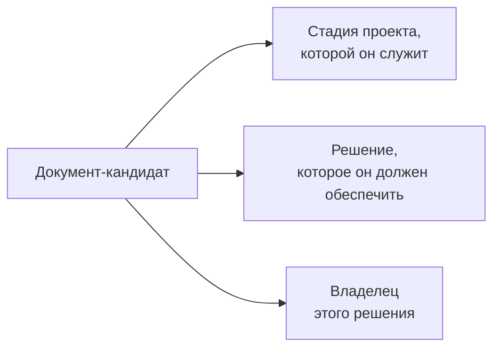

# 3.1 Обзор модуля — The Advisory Toolkit: документы и решения, которые они должны обеспечивать

Related: [[3.1-Module-Overview-Advisory-Toolkit-Flashcards]] · [[1.6-Follow-The-Decision-Not-The-Deployment]] · [[2.10-Win-The-Role]]

> [!summary] TL;DR
> Модуль сужает кресло советника (между общим консалтингом и техническим внедрением) до одной части: документы, которые производит проект, и назначение каждого. Новое умение для опытного профессионала — не написание документов (оно предполагается данным), а способ их видеть: каждый документ ставится против стадии проекта, решения, которое он должен обеспечить, и владельца этого решения. Четыре вопроса модуля: что отличает артефакт от отчёта; какие записи организация обязана вести независимо от советника; как коммерческая форма проекта меняет значение «готово» для каждого документа; что делать с папкой грамотных документов, которые ничего не закрывают.

## Простыми словами

Умение писать документы у тебя, скорее всего, есть: грамотный документ под дедлайном ты сдашь. Этот модуль учит другому — смотреть на уже знакомые документы и спрашивать: какое решение каждый из них должен двигать и кто его принимает? Отчёт, который никто не открывал, и план, после которого ничего не решили, — это не про качество текста. К концу модуля каждый документ — готовый или только задуманный — встаёт на своё место: стадия проекта, решение, которое он обеспечивает, владелец этого решения. На выходе не набор шаблонов, а карта.

## 1. Место модуля

Консультирование по AI — не общий консалтинг и не техническое внедрение; советник занимает место между ними ([[1.6-Follow-The-Decision-Not-The-Deployment]] — та же рамка). Этот модуль сужает это место до одной части: **документы, которые производит проект, и то, для чего каждый из них фактически существует** — привязка документов к решениям, которые они должны обеспечивать.

## 2. Что добавляется к опыту

Модуль рассчитан на опытных: ты знаешь, что такое поставляемый результат (**deliverable**), работал в фазовых проектах, умеешь производить грамотный документ под давлением сроков. Добавляется не навык письма, а **способ видеть** уже знакомые документы — тот же ход, что в модуле 2 со словом capability: не новое слово, а новое различение.

## 3. Четыре вопроса модуля

| Вопрос | О чём спрашивает |
|---|---|
| Что отличает артефакт (**artefact**) от отчёта (**report**)? | Различение типов документов по их назначению |
| Какие записи организация обязана вести независимо от того, спрашивает ли советник? | Долг организации, не зависящий от проекта (реестры, журналы — как в [[2.3-One-Entry-Four-Readings]]) |
| Как коммерческая форма проекта меняет значение «готово» для каждого документа набора? | «Готово» определяется не полнотой текста, а формой обязательства |
| Что делать с папкой грамотных документов, которые ничего не закрывают? | Диагностика набора: документы без привязки к решениям |

## 4. Результат: карта, не шаблоны

К концу модуля берёшь список документов-кандидатов — написанных или только предполагаемых — и ставишь каждый против трёх позиций:

Выход модуля — не набор шаблонов (**templates**), а карта: та же логика, что у перечня возможностей из [[2.10-Win-The-Role]] — не форма документа, а его место в системе решений.

## Ловушки / квиз-моменты

- «Грамотный документ» как самоцель: качество текста не заменяет отсутствующего решения.
- Набор шаблонов вместо карты: форма без места в решениях.
- Смешение записей-долгов организации с документами проекта: первые существуют независимо от советника.

## История напоследок

Консультант унаследовал от прошлого проекта папку: анализ рынка, архитектурный обзор, план внедрения, расчёт выгоды — все документы грамотные, все сданные в срок. Он спросил у заказчика: «Какое решение приняли по итогам архитектурного обзора?» — «Никакое». — «А расчёт выгоды открывал кто-нибудь?» — «Ни разу». Папка закрывала прошлое обязательство — сдать документы; ни один документ не был привязан к решению и его владельцу. Новую папку консультант начал не с шаблонов, а с трёх колонок: документ — решение — кто решает. Шаблоны потом нашлись старые.

## Связано

- [[3.1-Module-Overview-Advisory-Toolkit-Flashcards]] — карточки обзора
- [[1.6-Follow-The-Decision-Not-The-Deployment]] — «описывай работу через решения»: источник логики модуля
- [[2.10-Win-The-Role]] — перечень возможностей как карта; здесь — карта документов
- [[2.3-One-Entry-Four-Readings]] — записи, которые организация обязана вести по закону
