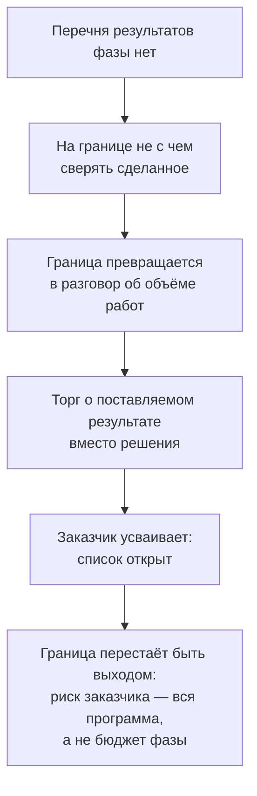

# 3.2 Проблема: проект, который пересматривают на каждой границе

Related: [[3.1-Module-Overview-Advisory-Toolkit]] · [[1.6-Follow-The-Decision-Not-The-Deployment]] · [[1.1-Unscoped-Decision-Work]]

> [!summary] TL;DR
> Граница фазы (**boundary**) — момент, в который заказчик сверяет полученное с обещанным перечнем результатов и может выйти из проекта, потеряв только бюджет фазы, а не всей программы. Если до начала фазы не записан перечень её результатов, сверять на границе нечего, и обсуждение превращается в торг о поставляемых результатах (**deliverables**) вместо решений. Раз перечень можно пересмотреть на каждой границе, заказчик не может окончательно отказаться от продолжения — граница перестаёт быть точкой выхода. Положение исправляют три записи для каждого документа: решение, которое он закрывает, — как действие, а не тема; фактический владелец — тот, кто может и одобрить работу, и остановить её; и что останется у организации при ответе «нет».

## Простыми словами

Руководитель компании оплатил первую партию работ по искусственному интеллекту. Перед очередным совещанием, где решают — продолжать или нет, он задаёт два вопроса: что дальше и что у компании останется, когда деньги кончатся. Консультант открывает папку: начальник одного отдела прислал таблицу идей в терминах своего отдела, компьютерная служба — три страницы про доступ к данным без всякого вывода, продавец систем — рассказ о собственных испытаниях, а отдел контроля качества завода — замечание, которое никто не переслал дальше. Всё написано грамотно, но после ни одного документа никто ничего не решает. Причина проста: никто заранее не записал, что каждая партия работ обязана выдать. Пока перечня нет, любой результат можно оспорить — и на каждом стыке спор возникает заново. Закрывается это тремя записями: какой документ, какое решение по нему должно состояться, кто его принимает.

Разбор четырьмя шагами: **ситуация** (§1) → **причина** (§2) → **симптомы** (§3) → **приёмы** (§4).

## 1. Ситуация: папка, в которой всё грамотно и ничего не закрыто

Кейс: советник работает с производителем, у которого заводы в нескольких странах. **Спонсор** (**sponsor**) — руководитель клиента, профинансировавший первую фазу работ и отвечающий за неё перед руководством. Перед следующим заседанием **управляющего комитета** (**steering committee**) — периодического совещания руководителей, утверждающего переходы проекта между фазами, — спонсор ждёт от советника двух ответов: что происходит дальше и что останется у организации, когда деньги потрачены.

Советник открывает папку проекта. В ней четыре документа:

| Документ | Автор | Почему не закрывает ничего |
|---|---|---|
| Таблица кандидатов-сценариев использования, записанных в терминах своего подразделения | руководитель функционального подразделения (финансы, логистика, качество) | перечисляет темы для разговора; из неё не следует, кто и что решает |
| Три страницы о доступе к данным, конце — без рекомендации | ИТ-служба (внутренняя служба систем и данных) | анализ не доведён до вывода, адресующего решение |
| Отчёт о собственном испытании системы | поставщик ИИ-систем | описывает опыт продавца, а не решения клиента |
| Замечание о качестве, которое никто не передал по назначению | служба качества завода | не дошло до человека, способного решать по нему |

Каждый документ компетентен: написан грамотно и по делу. Ни один ничего не закрывает — после него не предстоит решения, ради которого документ существовал бы. Характерный признак причины: спроси, почему граница открывается снова и снова, ответ обнаружится в разговорах, а не в документах, — сама причина нигде не записана.

## 2. Причина: у границы нет перечня результатов

**Перечень результатов фазы** — записанные до её начала документы и артефакты, которые фаза обязана выдать. Признак согласованного перечня: изменение любой строки — отдельное решение сторон, а не предмет торга на границе.

Если перечня нет, события на границе развиваются по одной цепочке:

Проверка на границе состоит в сличении полученного с обещанным. Обещанного списка нет — проверять нечего, и предметом обсуждения молчаливо становится сам предложенный документ: советник называет результат, заказчик спрашивает, почему именно этот. Представьте: советник предлагает «дорожную карту внедрения», заказчик возражает «а почему не план обучения?» — и полчаса совещания уходит на спор о названии документа, а не о том, что по нему решат.

Трение растёт от границы к границе, потому что каждый такой торг подтверждает заказчику: список можно расширить в любой момент.

Последнее звено цепочки — потеря выхода. Граница фазы совмещает две функции: сверку и выход. Выход есть, если заказчик может отказаться от продолжения и потерять только бюджет фазы. У пересматриваемой границы выхода нет: «окончательно» отказаться нельзя, любую позицию можно вызвать на новый торг. Тогда обязательства заказчика перестают ограничиваться фазой: отказаться от следующего бюджета — значит объявить потерянными деньги предыдущих, поэтому одобряется каждый следующий шаг, и обязательства растут до размера всей программы.

## 3. Симптомы: как это выглядит до диагноза

Эти сигналы ощущаются раньше, чем причину удаётся сформулировать.

1. **Спонсор обосновывает ценность заново на каждом управляющем комитете.** Вместо сверки с перечнем каждое утверждение шага требует обоснования с чистого листа. Ценность, которую доказывают каждый раз заново, выглядит как ценность, которой нет: коллеги начинают читать постоянные обоснования как сомнение в самой программе.
2. **ИТ-служба выдаёт анализ, который не может закрыть.** Работа заканчивается текстом, а не выводом; текст не адресован ничьему решению, поэтому его нельзя ни принять, ни отклонить — такие тексты копятся.
3. **Руководители заводов соразмеряют усилия.** Насмотревшись на инициативы, которые приходили и растворялись, они вкладываются ровно настолько, насколько верят в продолжение, — то есть по минимуму.

Ничто из этого не выглядит как провал. Выглядит как занятость. Занятость скрывает отсутствие закрытых вопросов так же, как график исполнения сроков скрывал буксование в [[1.1-Unscoped-Decision-Work]].

## 4. Приёмы: действие, владелец, отказ

Из этого положения выводят три навыка, и ни один не требует инструмента — только записи.

| Приём | Что записывается | Проверка записи |
|---|---|---|
| Решение как действие | для документа — решение, которое он закрывает | формулировка отвечает на вопрос «что кто-то сделает», а не «о чём документ» |
| Фактический владелец | человек, который может и одобрить работу, и остановить её | владелец назван; полномочие остановки — у того, кто распоряжается бюджетом или доступом |
| Смысл отказа | что означал бы ответ «нет» на этой границе и что осталось бы у организации | перечислено сохраняемое: перечень сценариев, протокол доступа, данные, обученные люди |

**Действие, а не тема.** Тема называет предмет описания — «состояние данных о браке». Действие называет выбор — «служба качества выбирает, какую из трёх линий перевести на новую схему контроля». Документ, привязанный к теме, грамотен; документ, привязанный к действию, закрывает решение.

**Фактический владелец.** Владелец определяется двумя полномочиями: одобрить работу и остановить её. Штатная структура подсказывает того, кто должен одобрить; остановить работу обычно может тот, у кого бюджет или доступ, — в кейсе производителя таковы руководители заводов, а не директор по ИИ-программе. Проверка: спросить, кто способен прекратить финансирование или доступ, — это и есть владелец.

**Смысл отказа.** Отказ — штатный исход границы, если заранее записано, что при «нет» остаётся у организации. Эта запись отвечает на второй вопрос спонсора: что останется у организации, когда деньги потрачены. Без записи отказ означает потерю всего вложенного, и граница не работает как выход.

Решения-действия закрывают и первый вопрос спонсора — «что происходит дальше»: следующая фаза открывается перечнем решений, которые должны в ней состояться, а не списком документов, которые в ней напишут. Три приёма разворачивают карту из [[3.1-Module-Overview-Advisory-Toolkit]] в записи, закрывающие границу: документ — решение как действие — владелец, способный остановить, — плюс ветка отказа, показывающая, что остаётся при «нет».

## Ловушки / квиз-моменты

- «Грамотный документ» ≠ «закрытый вопрос»: грамотность — свойство текста, закрытие — свойство решения, состоявшегося после документа.
- Первым сигналом служит торг о поставляемом результате: как только на границе обсуждают форму документа вместо действия за ним, перечня результатов нет.
- Занятость — не здоровье: проект без закрытых вопросов выглядит активным, и именно поэтому проблема живёт долго.
- Владелец по штатной структуре: одобряющий часто не может остановить работу; проверять полномочием остановки.
- Ответ «нет» без перечня сохраняемого — не выход, а признание полной потери; такие границы пересматривают бесконечно.

## История напоследок

Финансовый директор завода полгода платил за работы по искусственному интеллекту, и на первом совещании, где решали — продолжать или нет, он утвердил продолжение: обоснование звучало убедительно. На втором совещании обоснование пришлось повторять с нуля, на третьем — снова; коллеги слушали уже со снисхождением: то, что доказывают каждый раз заново, звучит как то, чего никто так и не доказал. Выйти он тоже не мог: в папке проекта всё было грамотно, но при отказе у него не оставалось ничего, кроме самой папки, — и отказ выглядел бы как признание, что деньги ушли впустую. С новой партией работ он потребовал сначала записать, что компания сохранит, если после первого совещания скажет «нет», — перечень задач, данные и двух обученных людей; через год так и случилось, и никто не назвал это провалом: у компании оставалось ровно то, что было записано.

## Связано

- [[3.1-Module-Overview-Advisory-Toolkit]] — четвёртый вопрос модуля и карта «документ — решение — владелец»
- [[1.6-Follow-The-Decision-Not-The-Deployment]] — описывать работу через решения, а не через поставляемые результаты
- [[1.1-Unscoped-Decision-Work]] — занятость без результата: буксование, скрытое графиком сроков
