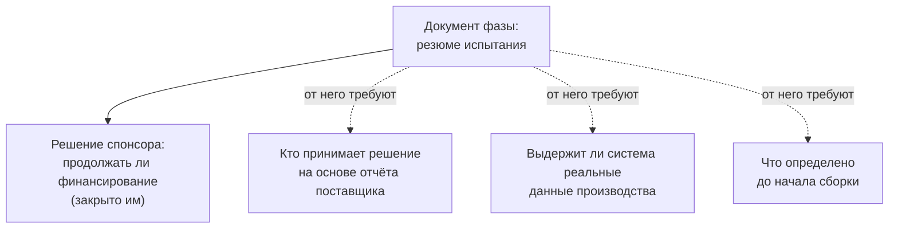

# 3.3 Одна подпись — четыре взгляда: «доказано», «поставлено», «закончено»

Related: [[3.2-Problem-Renegotiated-Boundary]] · [[1.2-Four-Perspectives-One-Problem]] · [[1.3-Demonstration-Vs-Deployment]]

> [!summary] TL;DR
> Подпись спонсора под итогом фазы (**sign-off**) — по содержанию решение продолжать финансирование; её основание — резюме испытания: отчёт компании-поставщика о проверке системы до внедрения. Подпись поставлена, а следующий шаг не начинается: команда сборки говорит «начинать не с чего», потому что четверо участников — спонсор, менеджер компании-поставщика, инженер по качеству завода, руководитель внедрения — читают слова «доказано» (**proven**), «поставляемый результат» (**deliverable**) и «закончено» (**done**) по-разному, каждый по критерию своей зоны ответственности; противоречия между взглядами нет. Резюме испытания закрыло решение спонсора, но от него требуют закрыть ещё три: кто должен принимать решение на основе отчёта, выдержит ли система реальные данные производства, какими они приходят на линию, что определено до начала сборки. Выход — маленькое общее соглашение: значения трёх слов плюс владелец каждого решения; финальная формула: у следующего документа названы решение, которое он закрывает, человек, который его принимает, и что произойдёт при ответе «нет».

Разбор четырьмя шагами: **ситуация** (§1) → **взгляды** (§2) → **разрешение** (§3) → **соглашение** (§4).

## Простыми словами

Фаза закончилась, директор подписал продолжение — деньги на следующий шаг даны, — а строить систему, оказывается, не с чего. За столом четверо, и каждый говорит своё. Директор: «Я подписал, потому что получил вещь и выбор — продолжать или нет; наверху мне за неё не стыдно». Продавец системы: «Моя фирма проверила свой продукт у себя, на данных завода, и поставила под эту проверку имя — но никто не сказал, чьё решение в компании эта проверка должна была двигать». Специалист по качеству: «Испытание шло на чистых данных у продавца, а у нас на линии переналадки и записи рабочих — за пропущенный брак спросят с меня, письменно». Строитель системы: «Для меня ваш итог — не итог, а задание: в нём нет ни линии, ни данных, ни условия, по которому работу примут». Никто не врёт: лист делал одну работу — оправдать деньги, — а ждали от него четырёх. Помирила всех маленькая запись: что значит «доказано», «поставлено», «закончено» — и кто какое решение принимает.

## 1. Ситуация: подпись поставлена, а начинать сборку не с чего

Граница фазы из [[3.2-Problem-Renegotiated-Boundary]] превратилась в разговор об объёме работ без выхода. Эта лекция показывает ту же границу изнутри команды.

Подпись спонсора под итогом фазы (**sign-off**) — утверждение спонсором результатов фазы; по содержанию это решение продолжать финансирование. Основание подписи — резюме испытания (**trial summary**): отчёт компании-поставщика — внешнего продавца системы ИИ — о проверке этой системы до внедрения. Испытание шло на территории поставщика, в контролируемых условиях, на выгрузке заводских данных. Для спонсора этот отчёт — доказательство: он отвечает за капитал перед советом директоров, и доказательство достаточно, когда выдержит проверку совета.

Подпись поставлена, а следующий шаг не начинается: команда, которая должна собирать систему, отвечает — начинать не с чего. Спонсор спрашивает: какой документ должен был содержать недостающее? Чтобы ответить, лекция выслушивает четверых участников — каждый говорит из своей зоны ответственности, и никто не решает командную проблему в одиночку ([[1.2-Four-Perspectives-One-Problem]] — тот же ход). Разговор об итогах идёт на трёх обычных словах — «доказано», «поставлено», «закончено»: так участники сами говорят о фазе («система доказана», «результат поставлен», «фаза закончена»); это их язык границы, не термины советника. Слово одно, критериев четыре: каждый монолог лекции построен по схеме «доказано **для меня** означает…», и ответ всегда берётся из зоны ответственности говорящего.

## 2. Взгляды: свой критерий у каждого совпадает с его ответственностью

Каждый из четверых оценивает один и тот же лист по мерке своей ответственности — то же расщепление слова, что с capability в [[1.2-Four-Perspectives-One-Problem]].

| Участник | Отвечает за | Как читает итоги фазы | Своё слово и критерий |
|---|---|---|---|
| Спонсор (**sponsor**) — руководитель, оплативший фазу | вложенный капитал и отчёт о нём совету директоров (высшему органу управления компанией) | фаза дала актив и реальный выбор — продолжать или нет; подписал | «доказано»: испытание выдержит проверку совета директоров; за ответ не будет стыдно |
| Менеджер по работе с клиентом в компании-поставщике системы (**account executive**) | референсное внедрение (**reference deployment**) — работающее внедрение у клиента, на которое поставщик ссылается при продажах | его резюме испытания — запись настоящего решения: выбора его компании поставить имя под эту конфигурацию для конкретного клиента; но никто не сказал, чьё решение в компании клиента оно должно двигать | «доказано»: проверено в контролируемом внедрении, за которое компания ставит своё имя |
| Инженер по процессам и качеству завода | письменный ответ за каждый пропущенный дефект (**escape**) — дефект, прошедший мимо контроля | считает две среды, где остальные — одну: среду поставщика, где шло испытание, и производственный поток, которого оно не касалось | «доказано»: выдерживает контакт с данными, какими они реально приходят |
| Руководитель внедрения (**delivery lead**) — отвечает за сборку системы и срок | сборка и дата | итог фазы для него — бриф (задание на следующую работу), а не закрытие | «закончено»: записано всё, без чего сборка не начнётся |

Инженер может назвать, что исключала проверочная выгрузка — чистая выборка шести недель с одной линии: переналадки (переход линии с одного изделия на другое), варианты изделий, порождающие переделку, записи операторов, которые никто не привёл к структуре. Его «доказано» кончается там, где начинается непроверенное — граница проверенной области из [[2.9-Validated-In-A-Domain]].

Руководитель внедрения перечисляет, что открыто в брифе: на какой производственной линии, по какому пути данных, кто владелец модели, каково условие приёмки. Его формула: их финиш — мой старт.

## 3. Разрешение: противоречия нет

Четыре взгляда не противоречат друг другу. Документ строился под одно решение — продолжать ли финансирование — и закрыл его: спонсор получил актив и выбор. Теперь от него требуют закрыть ещё три решения, у которых нет своих документов:

Представьте совещание: лист один, и каждый, глядя на него, отвечает на свой вопрос. Спор идёт не о словах листа, а о том, чей вопрос он обязан закрывать.

Отсюда афоризм лекции: неверный вопрос не ломает документ — ломается проект (**engagement**). Самому документу ничего не делается: для своего решения он полон. Разрушается работа с клиентом, потому что три чужих решения остаются незакрытыми.

## 4. Соглашение: маленькое и общее

Команде нужно соглашение из двух частей: значения трёх слов (шаг 2) и владелец каждого решения (шаги 3–5). Порядок действий:

**1. Карта решений — советник.** Выписать все решения, которые должна закрыть граница, каждое — как действие. В кейсе: «продолжать ли финансирование» (закрыто подписью спонсора); «допускать ли систему к производственным данным»; «начинать ли сборку». Результат: решения без владельцев видны сразу — они и питают спор.

**2. Значения слов — против решений, не вообще.** Для каждого решения из карты зафиксировать, чей критерий слова действует. В кейсе: для решения «допускать ли систему к производственным данным» слово «доказано» получает значение инженера — «переживёт контакт с реальными данными линии», а не значение спонсора «выдержит совет директоров». Общего значения, как показал спор, не существует; слово получает смысл только через решение — вывод из устройства кейса. Результат: связка «слово → решение → критерий» — в листе ниже это колонка «Критерий (норма)».

**3. Владелец каждого решения — спонсор.** Для каждого решения назвать человека, который может и принять его, и остановить работу. В кейсе: допуск к производственным данным — инженер по качеству, потому что за пропущенный дефект спросят письменно с него; начало сборки — руководитель внедрения. Результат: у каждого решения есть имя; решение без имени возвращается спонсору.

**4. Предусловия сборки — руководитель внедрения.** Выписать, без чего сборка не начнётся, и привязать каждый пункт к решению из карты. В кейсе: на какой производственной линии, по какому пути данных, кто владелец модели, каково условие приёмки. Результат: «их финиш — мой старт» становится проверяемым списком — старт возможен, когда каждый пункт закрыт его владельцем.

**5. Границы доказательств — инженер по качеству и менеджер компании-поставщика.** Каждый записывает, что его доказательство покрывает и что исключает. В кейсе: инженер — «выборка шести недель с одной линии; исключены переналадки, варианты-источники переделки, записи операторов»; менеджер — «резюме испытания гарантирует конфигурацию в контролируемых условиях у поставщика, работу в производственной среде клиента оно не доказывает». Результат: для каждого решения видно, каким доказательством оно обосновано и где это доказательство кончается.

**6. Подпись — все четверо.** Лист из карты решений, владельцев и границ доказательств подписывают все: каждый видит своё имя и свою часть — что именно от него зависит. Для каждого следующего документа — те же три записи, что закрывают границу в [[3.2-Problem-Renegotiated-Boundary]]: решение, которое он закрывает; человек, который его принимает; что произойдёт при ответе «нет».

**Пример: лист соглашения на материале кейса** (собран из реплик участников; сама лекция описывает его словами, но не рисует). Колонка «Критерий (норма)» отвечает на вопрос: какое из трёх слов разговора об итогах — «доказано», «поставлено», «закончено» — работает в этом решении, чей это критерий и что он требует. Колонка «Доказательство (факт)» — какой материал есть на руках и что он покрывает:

| Решение (как действие)                                                  | Владелец — может принять и остановить                          | Критерий (норма) — слово и его требование                                                               | Доказательство (факт) — что существует сейчас и где оно кончается                                                                                                                                  | Что при ответе «нет»                                                                          |
| ----------------------------------------------------------------------- | -------------------------------------------------------------- | ------------------------------------------------------------------------------------------------------- | ------------------------------------------------------------------------------------------------------------------------------------------------------------------------------------- | --------------------------------------------------------------------------------------------- |
| Продолжать ли финансирование следующей фазы (закрыто подписью спонсора) | спонсор                                                        | «доказано»: испытание выдержит проверку совета директоров                                               | резюме испытания — покрывает проверку в контролируемых условиях у поставщика                                                                                                          | фаза закрыта; у организации остаются перечень сценариев и данные испытания — записано заранее |
| Допускать ли систему к производственным данным завода                   | инженер по качеству — письменно отвечает за пропущенный дефект | «доказано»: система переживает реальные данные линии — переналадки, варианты изделий, записи операторов | выборка шести недель с одной линии; переналадки и записи исключены — доказательство это решение не покрывает, нужно испытание на производственном потоке                              | доступ к производственным данным не открывается; система остаётся в контуре испытаний         |
| Начинать ли сборку                                                      | руководитель внедрения — отвечает за сборку и срок             | «закончено»: записаны линия, путь данных, владелец модели, условие приёмки                            | записи нет: ни один документ фазы не фиксирует четыре пункта — единственный, бриф, называет только направление, какую систему внедрять; «закончено» не выполнено | сборка не стартует; граница переносится до закрытия четырёх пунктов                           |

Резюме испытания в этом листе получает место: оно обслуживает решение спонсора и не обслуживает решение инженера. С этого момента менеджер компании-поставщика знает, какое доказательство от него ждут дальше — испытание на производственном потоке — и чьё решение оно будет двигать.

Колонки «Критерий (норма)» и «Доказательство (факт)» не повторяют друг друга: первая — что должно выполняться, чтобы решение можно было принять; вторая — какой материал существует и что он покрывает. Факт — не проверка критерия и не способ проверки, а то, что проверяют: документ, данные, запись — или их отсутствие. Критерий — мерка, доказательство — то, что мерка измерила, и место, где мерки не хватило; вердикт рождается сравнением. Одно и то же резюме испытания достаточно для критерия спонсора (проверка в контролируемых условиях её покрывает) и недостаточно для критерия инженера (выборка исключила переналадки): доказательство одно, вердикт разный, потому что мерка разная. Направление всегда одно: сначала критерий, потом оценка доказательства против него. Строка 3 фиксирует третий исход сравнения: требуемой записи не существует вовсе — единственный документ фазы фиксирует только направление; отсутствие записи — тоже факт, и решение без записи закрыть нельзя.

**Откуда брать слова в своём кейсе** (вывод из устройства лекции; слова берутся из речи участников, не из словаря — все монологи лекции построены по схеме «доказано **для меня** означает…»):

- слова-кандидаты — те, которыми на границе объявляют результат: «готово», «проверено», «работает», «сдано», «закрыто»;
- сигнал найденного слова: его произносят все, а спор на нём не заканчивается — за ним разные критерии;
- проверка: спросить каждого, что для него означает слово; расхождение ответов означает, что слово найдено;
- места поиска: язык подписи и приёмки, язык статусов («в производстве», «работает»), язык качеств («надёжно», «точно») — как capability и ready в [[1.2-Four-Perspectives-One-Problem]] и «управляемость» в [[2.3-One-Entry-Four-Readings]].

## Ловушки / квиз-моменты

- «Четыре взгляда — конфликт людей»: конфликт не между людьми, а между одним документом и четырьмя решениями.
- Подпись спонсора закрывает все вопросы: она закрывает решение о финансировании; решения о сборке, данных и доказательствах остаются без своих документов.
- Одна среда испытания: испытание у поставщика не доказывает работу в производственном потоке ([[1.3-Demonstration-Vs-Deployment]], [[2.9-Validated-In-A-Domain]]).
- «Закончено» без имени: финиш одного участника — старт другого; слово «закончено» требует названного владельца решения.
- Диагноз «документ неполный»: документ полон для своего решения — неполна карта решений.

## История напоследок

На разборе фазы четверо спорили об одном листе — отчёте об испытании системы. Хозяин денег говорил: «Я подписал: у меня есть что показать наверху»; строитель системы возражал: «Мне не с чего начинать: в листе нет ни линии, ни условия, по которому работу примут»; специалист по качеству добавлял: «Испытание шло на чистой выборке, а на линии — переналадки и записи рабочих»; продавец системы молчал — он поставил имя своей фирмы под испытание и так и не узнал, чьё решение в компании клиента это должно было двигать. Советник записал против листа единственное решение, которое тот закрывает, — «продолжать ли финансирование», — и оно оказалось закрыто хорошо. Остальные три решения в тот же день расписали по владельцам, и спор кончился: лист не нужно было переделывать — нужно было перестать ждать от него чужих ответов.

## Связано

- [[1.2-Four-Perspectives-One-Problem]] — тот же метод: четыре роли, у каждой свой критерий одного слова (там capability и ready, здесь proven, deliverable, done)
- [[3.2-Problem-Renegotiated-Boundary]] — граница фазы и три записи: решение — владелец — отказ
- [[1.3-Demonstration-Vs-Deployment]] — две среды: испытание у поставщика против производственного потока
- [[2.9-Validated-In-A-Domain]] — граница доказательства: выборка исключала переналадки и записи операторов
- [[2.3-One-Entry-Four-Readings]] — одна запись перечня, четыре прочтения по зонам ответственности
