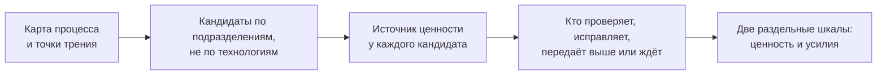

# 1.1 Проблема: сорок идей — сорок единиц измерения

Related: [[1.1-Forty-Ideas-Forty-Units-Flashcards]] · [[2.2-The-Number-Came-Back]] · [[2.7-Ranking-Multiple-Inputs]]

> [!summary] TL;DR
> Подразделения производственной компании прислали свои лучшие идеи применения ИИ в одну таблицу, и каждую строку оценило само подразделение — показателем своей работы: запасы в днях, дефекты на миллион, время обработки обращений. Общего мерила ценности и затрат в таблице нет, поэтому ранжировать строки нечем: сравнение сначала строят — договариваются, что считать ценностью и что усилием, — и только потом упорядочивают. Свести показатели к одному баллу нельзя: по баллу не видно, занимает ли идея место из-за крупной выгоды или из-за лёгкой работы, и при первом же споре список нечем защитить. Решение строится на суждении раньше технологии: карта процесса с точками трения, кандидаты по подразделениям, источник ценности у каждого, имя того, кто после перемены проверяет и исправляет, и две раздельные шкалы — ценность и усилия.

Разбор шестью шагами: **ситуация** (§1) → **первая находка** (§2) → **вторая находка** (§3) → **цена составного балла** (§4) → **люди в комнате** (§5) → **пять шагов суждения** (§6).

## Простыми словами

Представьте конкурс на общий бюджет: каждый отдел приносит свою лучшую заявку и сам её оценивает. У одних выгода измеряется «днями», у других — «штуками на миллион», у третьих — «минутами», и поставить их в один ряд нельзя, пока нет общей меры. Организатору завтра на совет, и он просит «просто сложить всё в один балл» — но тогда непонятно, почему заявка победила: потому что польза большая или потому что делать легко; первый же несогласный развалит список. А самая ходовая покупка — кулер, которым пользуются уже год, — в конкурс вообще не попала: никто не предлагает то, чем уже пользуется каждый день. Честный отбор начинается с двух вопросов к каждой заявке — сколько пользы и чьей работы она стоит, — и с разговора с тем, кто эту работу будет делать.

## 1. Ситуация: сбор лучших идей в одну таблицу

Советник (**advisor**) — приглашённый специалист по применению ИИ — работает с транснациональной производственной компанией. Спонсор (**executive sponsor**) — руководитель, заказавший сбор идей и отвечающий за финансирование, — попросил каждое подразделение прислать свои лучшие идеи применения ИИ: от цепочки поставок и качества до заводов, продаж с сервисом, финансов и кадровой службы. Через несколько недель заявки легли в один общий файл: несколько десятков строк, и каждую оценил тот, кто её прислал.

Споткнулся сбор на одной колонке — ожидаемой пользе. Каждое подразделение честно описало свою работу, но заполнило колонку показателем своей области:

| Подразделение | Показатель в колонке «польза» |
|---|---|
| Цепочка поставок | запасы в днях (**days of inventory**) |
| Качество | пропущенные дефекты на миллион изделий (**escapes per million**) |
| Сервисная служба | среднее время обработки обращения (**average handle time**) |
| Финансы | денежная сумма без описания способа её расчёта |

Каждый показатель уместен в своей области и ничего не говорит о чужой работе: запасы в днях не скажут, во что обходится пропущенный дефект, а минуты обработки — сколько товаров простаивает на складе.

## 2. Первая находка: уже работающее невидимо для сбора

Советник задаёт вопросы по таблице, и приходят два ответа. Первый: рабочий процесс, которого нет ни в одной строке, уже распространился сам. Одна из команд построила помощника черновиков (**drafting assistant**) — инструмент, готовящий черновики документов, — и теперь им пользуются несколько сотен человек.

Причина невидимости — форма приёма заявок (**intake form**): анкета, в которую вносятся предложения. Она собирает то, что предлагают, а никто не предлагает то, чем уже пользуется. Представьте: инструмент, экономящий каждому час в неделю, воспринимается как часть обстановки — «а что тут предлагать, все так работают».

Вывод: перечень заявок — не перечень использования ИИ в компании. В курсе 1 была обратная сторона того же расхождения: перечень по числу лицензий завышал автоматизацию ([[2.5-How-Much-Of-The-Loop]]); перечень заявок, наоборот, использование занижает — не видит уже работающего.

## 3. Вторая находка: ранжировать нечем, и это структурно

Второй ответ: присланных кандидатов — строк таблицы — нельзя ранжировать вовсе. Это не претензия к качеству заявок, а структурный факт: в строках нет общего мерила ни для ценности, ни для затрат. Сравнение нельзя взять готовым — его сначала строят: договариваются, что считать ценностью и что усилием, и только после этого упорядочивают.

От советника при этом ждут ранжирования раньше, чем согласовано, что ранжируют. Это та же дисциплина, что «правило до подсчёта» курса 1 ([[2.10-Win-The-Role]]): каждая колонка таблицы честная, а правила сведения единиц нет; спор о порядке строк — несогласие о правиле, и разрешается оно записью правила, а не убедительностью голосов ([[2.2-The-Number-Came-Back]]).

## 4. Составной балл теряет след обоснования

Показатели несравнимы — и возникает соблазн назначить веса и свести всё к составному баллу (**composite score**). На бумаге список упорядочится, но защитить его станет невозможно.

Цена свёртки — потеря проверяемого следа обоснования (**audit trail**): записей, по которым посторонний восстанавливает, почему кандидат занял своё место. По одному баллу не видно, почему строка стоит выше: из-за крупной выгоды или из-за лёгкой работы.

Спонсору нужен короткий список, который можно защитить на встрече о финансировании. Защищают его не баллом: по каждой строке показывают, на чём держится её место в списке и чего она стоит.

## 5. Три человека в комнате

Дискомфорт каждого участника — не помеха отбору, а требование к его результату.

| Человек | Положение | Требование к списку |
|---|---|---|
| Спонсор — руководитель, заказавший сбор | идёт на встречу о финансировании | короткий список, который можно защитить: каждая строка объяснима |
| Владелец процесса (**process owner**) — руководитель конкретного участка работы | уже год ждёт одну правку своего участка | объяснимого сравнения: почему его правку вообще сравнивают с чужими заявками |
| Сотрудница, разбирающая очередь обращений | уже выполняет проверок больше, чем должна была добавить предлагаемая перемена; её никто не спросил | чтобы человек, который примет на себя последствия, был назван до утверждения списка |

Требования не спорят между собой: объяснимая строка даёт спонсору защиту, владельцу процесса — обоснование сравнения, а названный исполнитель последствий делает то же объяснение проверяемым.

## 6. Решение: суждение раньше технологии — пять шагов

Решение начинается не с технологии, а с профессионального суждения (**judgment**). Пять шагов:

1. **Карта процесса и точки трения.** Составить карту рабочего процесса и отметить на ней точки трения (**friction points**) — места, где работа тормозится и требует лишних усилий. Шаг даёт: кандидаты ищутся там, где работа действительно буксует, а не там, где яркая технология.
2. **Кандидаты по подразделениям.** Искать кандидатов по подразделениям и их работе, а не по технологиям (**by business function rather than by technology**). Шаг даёт: список говорит о работе компании; одна технология может дать кандидатов в нескольких подразделениях, а одному подразделению могут служить разные технологии.
3. **Источник ценности у каждого кандидата.** Связать каждого кандидата с конкретным источником бизнес-ценности — измеримым изменением в работе: меньше запасов, меньше пропущенных дефектов, короче обработка. Шаг даёт: общая мера ценности складывается из самих источников, а не из перевода чужих единиц одна в другую.
4. **Имя рядом с кандидатом.** Назвать, кто после перемены проверяет, исправляет, передаёт выше по инстанции или ждёт (**verifies, corrects, escalates, or waits**). Шаг даёт: у усилий появляется носитель; сотрудница очереди обнаруживается при составлении списка, а не после утверждения.
5. **Ценность и усилия раздельно.** Вести две шкалы — ценность и усилия — не сводя их к одной. Шаг даёт: сравнение выдерживает первого, кто с ним спорит, — по каждой строке видно, почему кандидат занимает место и чего он стоит.

Порядок шагов обратен порядку кейса: в кейсе список собрали раньше, чем описали работу, — отсюда обе находки; шаги описывают работу до списка. Карта — документ, списка она не составляет; список собирают, работая с ней: карту проходят шаг за шагом и на каждой точке трения задают вопрос «что здесь можно улучшить» — каждый ответ становится кандидатом. Так в списке оказываются те, кого в заявках нет: помощник черновиков — это точка трения «каждый черновик кто-то проверяет вручную», и вопрос на этой точке дал бы его без всякой заявки. По отношению к пришедшему списку карта делает три дела, по возрастанию: присваивает каждой строке адрес — процесс, шаг, точку трения (функция в шапке заявки говорит, кто подал, а адрес — где в работе идея живёт); проверяет — ложится ли строка на карту, и если нет, то либо кандидата нет, либо карту надо дописать; дополняет список проходом по карте. Пришедшие заявки — сырьё и один из источников, и одна категоризация их не спасает: разложенные по папкам строки остаются измеренными в днях, дефектах и минутах — меру дают шаги 3–5, а неподавленных находят проходом, а не сортировкой заявок.

Каждая находка закрывается своими шагами. Невидимость работающего — шагами 1–2: на карте уже работающий процесс занимает место, и вопросы на его точках трения дают кандидатов, которых в заявках нет. Несравнимость — шагами 3–5: источник ценности даёт общую меру пользы, имя рядом с кандидатом — меру затрат, две шкалы — сравнение, которое можно защитить.

## Ловушки / квиз-моменты

- «Составной балл решает задачу»: упорядочивает список на бумаге и лишает его защиты — теряется след обоснования, выгода и лёгкость не различимы.
- «Перечень заявок = использование ИИ»: сбор не видит уже работающего — никто не предлагает то, чем уже пользуется.
- «Достаточно назначить веса»: веса и есть несогласованное правило; спор о весах — спор о том, что ранжируют, до всякого ранжирования.
- «Дискомфорт участников — сопротивление, которое надо преодолеть»: дискомфорт — это требования к списку: защитимость, объяснимое сравнение, названный исполнитель последствий.
- «Проблема в качестве заявок»: каждая строка честная; проблема структурная — нет общего мерила ценности и затрат.

## История напоследок

Руководитель собрал от отделов сорок заявок на общий бюджет, а денег дадут только на три. Всю субботу он переписывал каждую заявку в две строки — сколько пользы и кто будет делать добавившуюся работу, — и у половины заявок вторая строка не писалась: заявку подавал один, а работать по ней — другому. На совете директор спросил: «Почему эти три?» — и он ответил: «Вот польза, вот работа и вот кто её будет делать; спорьте с любой строкой — остальные объяснят себя сами».

## Связано

- [[2.2-The-Number-Came-Back]] — число без определения получает чужой смысл; здесь несогласованное правило проявляется как несравнимые единицы
- [[2.7-Ranking-Multiple-Inputs]] — «ценность против усилий» уже был входом ранжирования; курс 2 строит из этой пары главный каркас
- [[2.10-Win-The-Role]] — правило до подсчёта и защищаемый перечень; спонсор с коротким списком
- [[2.5-How-Much-Of-The-Loop]] — обратное расхождение перечня и факта: лицензии завышали автоматизацию, заявки занижают использование
- [[3.4-Advisory-Artifact]] — короткий список спонсора — артефакт: за ним решение о финансировании
