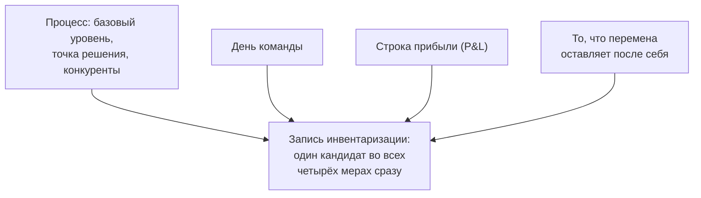

# 1.2 Один процесс — четыре взгляда, каждый со своей мерой

Related: [[1.2-One-Workflow-Four-Readings-Flashcards]] · [[1.1-Forty-Ideas-Forty-Units]] · [[1.6-Follow-The-Decision-Not-The-Deployment]]

> [!summary] TL;DR
> Помощник черновиков из лекции 1.1 работает без владельца, и каждый из четверых вокруг него — аналитик, владелец процесса, финансирующий руководитель, сотрудница очереди — прав в видимой ему части. Разделяет их не спор о фактах, а мера, по которой каждый отчитывается: сравнимость кандидата на общей шкале, день команды, число в отчёте о прибылях и убытках, то, что перемена оставляет после себя. До всякого решения команде нужны общие слова: что считать возможностью и что считать воздействием; у владельца процесса спрашивают о повторяющейся работе, у финансирующей роли — какое определение ценности признает бизнес. Четыре счёта сходятся, когда одного кандидата записывают сразу во всех четырёх мерах, — в этом и есть назначение записи инвентаризации.

Разбор пятью шагами: **постановка** (§1) → **четыре взгляда на помощника черновиков** (§2) → **что их разделяет** (§3) → **общие слова до решения** (§4) → **запись, которую подпишут все** (§5).

## Простыми словами

На семейном совете решают, оставлять ли доставку продуктов, — только каждый меряет своё. Тот, кто готовит: «Стало быстрее». Та, кто ведёт бюджет: «В деньгах не видно — мы не записывали, сколько тратили раньше». Старший: «Сначала сравните с другими тратами». А бабушке досталась проверка чужих заказов: все заказывают быстро, а разбирать замены некому. Никто не врёт, но совет заходит в тупик — пока лист не разделили на четыре строки: время, деньги, сравнение, проверки. Когда все четыре числа записали, спорить стало не о чем: стало ясно, о чём именно спорили.

## 1. Постановка: спорный процесс без владельца

Продолжение кейса [[1.1-Forty-Ideas-Forty-Units]]: список кандидатов не ранжируется, а рабочий процесс, которого в списке нет, — помощник черновиков — уже работает и никем не принят на баланс. Такую проблему не решают в одиночку: каждый в команде видит свою часть. Лекция даёт слово четверым и называет их толкования подотчётными (**accountable**): каждый читает процесс через меру, по которой отчитывается. Один спорный процесс — четыре толкования.

## 2. Четыре взгляда на помощника черновиков

Предмет разговора у всех один — помощник черновиков: инструмент из лекции 1.1, который распространился сам, без заявки и владельца. Список из сорока идей здесь только фон; каждая строка таблицы отвечает, чем оказался этот один инструмент для участника, — после таблицы каждый разворачивает свой взгляд.

| Участник                                               | Чем владеет                                      | Его мера воздействия                                                                            | Вердикт о помощнике черновиков                                                                   |
| ------------------------------------------------------ | ------------------------------------------------ | ----------------------------------------------------------------------------------------------- | ------------------------------------------------------------------------------------------------ |
| Аналитик (**transformation analyst**)                  | коротким списком кандидатов и его обоснованием   | сравнимость на одной общей шкале                                                                | ещё не возможность: нет базового уровня, точки решения, конкурентов за бюджет                    |
| Владелец процесса — в сервисной службе                 | пропускной способностью процесса и его качеством | изменение в дне команды                                                                         | результат с первого дня                                                                          |
| Финансирующий руководитель (**funding function head**) | годовым планом, под который взят бюджет          | число, приписываемое отчёту о прибылях и убытках                                                | ноль: базового уровня «до» не снимали, приписать нечего                                          |
| Сотрудница сервисной службы, разбирающая очередь       | тем, что получает клиент                         | то, что перемена оставляет после себя — работа, переданная другим (**the residue left behind**) | не выигрыш, а переданная ей нагрузка: проверка, пропущенная авторами черновиков, переехала к ней |

Четвёртая колонка — вердикт: чем помощник черновиков оказался, когда его оценивают мерой из третьей колонки той же строки. Мера первых трёх выносит вердикт — «не возможность», «результат», «ноль»; мера сотрудницы очереди выносит не число, а перечень работы, оставленной другим. Отдельный факт её строки — три версии инструмента: подразделения приспособили его по-своему, и к клиенту приходят три разных формата.

### Аналитик: возможность — это сделанная сравнимость

Аналитик — член команды советника, отвечающий за короткий список и его обоснование. Его определение: возможность есть кандидат, сделанный сравнимым с другими на одной общей шкале (**an opportunity is a candidate made comparable to others on one shared scale**) — у кандидата есть базовый уровень (**baseline**, зафиксированное состояние «до»), точка решения и сравнение с тем, что конкурирует за те же деньги. По этой мере помощник — ещё не возможность. Аналитик признаёт, что его сбор пропустил инструмент: он собирал предложения, а предложений о том, чем уже пользуются, не бывает. Но и добровольное принятие (**voluntary adoption**) для него не довод: оно доказывает, что принявшим стало удобнее, и не говорит ни о ценности, ни о том, чего это стоит в других местах.

### Владелец процесса: воздействие — это день команды

Владелец процесса — здесь в сервисной службе; он отвечает за пропускную способность процесса и его качество. Его мера: воздействие есть то, что меняется в дне его команды, — и по этой мере помощник дал результат в день появления. Сбор идей, по его словам, задал неправильный вопрос. Попроси его рассказать, что он делает повторно и что съедает его часы, — он ответит по делу; попроси «идеи ИИ» — он будет угадывать технологии вместо описания своей работы. Инструмент работает, его люди им пользуются, и его раздражает упражнение, которое требует обосновывать рабочее исправление как гипотезу.

### Финансирующий руководитель: воздействие — это число в отчёте о прибылях и убытках

Финансирующий руководитель — руководитель направления, из бюджета которого оплачивается работа; он отвечает за план, обещанный на год. Его мера: воздействие — число, которое можно приписать отчёту о прибылях и убытках (**P&L** — финансовому отчёту, сводящему доходы и расходы периода). По этой мере помощник не дал ничего: базовый уровень до его появления никто не зафиксировал, приписывать нечего. Острее денег для него другое: неподтверждённое внедрение работает в процессе, результат которого уходит клиенту, — без названного владельца и без шага проверки. Финансировать как положено он готов при одном условии: назвать, куда ложится выгода и кто принимает нагрузку, которую перемена передаёт дальше по цепочке, — сегодня никто не обязан говорить об этом.

### Сотрудница очереди: то, что приходит клиенту

Сотрудница сервисной службы, разбирающая очередь, отвечает за то, что получает клиент. К ней приходят не одна, а три версии помощника: версия её команды и две, приспособленные другими группами, каждая в своём формате. Коллеги присылают материалы гладкие, но на вопросы о них ответить не могут — и пропущенную ими проверку теперь выполняет она. Её формулировка — итог всех четырёх: она не сказала бы, что инструмент провалился; черновики стали быстрее, а принятие решения переместилось — и переместилось оно к ней.

## 3. Что разделяет четыре верных взгляда

Все четверо описывают один процесс, и никто не ошибается в видимой ему части. Спорят они не о фактах: разделяет их мера, по которой каждый отчитывается. Представьте совещание, где звучат четыре верных числа — «стало быстрее», «в деньгах ноль», «сравнивать не с чем», «три версии и чужая проверка»: все правы, а общего разговора нет, потому что каждый отвечает на свой вопрос.

Это та же механика, что в курсе 1: многозначное слово расщепляется по зонам ответственности ([[2.3-One-Entry-Four-Readings]] — слово «управляемость»; [[3.3-One-Signoff-Four-Readings]] — слова «доказано», «поставлено», «закончено»). Здесь расщепляется слово «воздействие»: день команды, строка прибыли и то, что перемена оставляет после себя, — разные меры, и противоречия между ними нет.

## 4. Общие слова до решения

Команда принимает решение общими словами, и договориться о них нужно до решения:

1. **Что такое возможность и что такое воздействие.** Определения согласуются до сравнения кандидатов — «правило до подсчёта» из курса 1 ([[2.10-Win-The-Role]]).
2. **У владельца процесса спрашивать о работе, а не о технологиях.** Вопрос «что вы делаете повторно и что съедает ваши часы» получает описание работы; вопрос «какие у вас идеи ИИ» получает догадку о технологиях.
3. **У финансирующей роли спрашивать, какое определение ценности признает бизнес.** Пока неясно, какую меру примет тот, кто даёт деньги, любое «воздействие» останется словом спора.

## 5. Запись, которую подпишут все

Четыре счёта сходятся в момент, когда одного кандидата записывают сразу во всех четырёх мерах: процесс (базовый уровень, точка решения, конкуренты за бюджет), день команды, строка прибыли и то, что перемена оставляет после себя.

В этом и есть назначение записи инвентаризации (**inventory entry**): удерживать одного кандидата во всех мерах одновременно, не выбирая одну за счёт остальных. Запись с одной мерой подпишет один участник, а спор продолжат остальные. Так замыкается перечень с колонками из курса 1 ([[2.10-Win-The-Role]]): колонки существуют не для порядка, а чтобы у каждой меры было своё место, которое нельзя занять чужим числом.

## Ловушки / квиз-моменты

- «Инструментом пользуются — значит, он ценен»: добровольное принятие доказывает пользу только для принявших; ни ценности, ни затрат в других местах оно не показывает.
- «Правильный вопрос сбору — про технологии»: вопрос «какие идеи ИИ» превращает владельца процесса в угадывателя; спрашивать надо о повторяющейся работе.
- «По прибыли ноль — инструмент бесполезен»: верно только для меры P&L; по мере «день команды» результат есть с первого дня. Оба утверждения верны про свою меру.
- «Проверка переехала — инструмент провалился»: инструмент не провалился; черновики быстрее, а принятие решения переместилось к другому человеку — счёт переехал, а не исчез (курс 1, [[1.6-Follow-The-Decision-Not-The-Deployment]]).
- «Четверо спорят о фактах»: факты не оспариваются никем; разделяет мера подотчётности.
- «Выбрать из четырёх мер главную»: запись инвентаризации держит все четыре сразу — выбор одной меры снова развяжет спор.

## История напоследок

Семья месяц жила с доставкой продуктов и на совете решала, оставлять ли. Готовивший говорил: «Стало быстрее»; ведущая бюджет: «В деньгах не видно, мы не записывали, сколько тратили раньше»; старший: «Сравните сначала с другими тратами»; а бабушка молчала — ей каждую неделю присылали разбирать чужие замены. Взяли лист, провели четыре строки — время, деньги, сравнение, бабушкины проверки — и вписали в каждую своё число. Спор кончился не чьей-то победой: стало видно, о чём именно спорили.

## Связано

- [[1.1-Forty-Ideas-Forty-Units]] — кейс продолжен: несравнимые единицы стали четырьмя мерами подотчётности; невидимость сбора получила голос аналитика
- [[1.2-Four-Perspectives-One-Problem]] — курс 1, та же драматургия: четыре роли об одной проблеме; там расщеплялась «способность», здесь — «воздействие»
- [[1.6-Follow-The-Decision-Not-The-Deployment]] — «принятие решения переместилось ко мне» = счёт переехал, а не исчез
- [[2.3-One-Entry-Four-Readings]] — многозначное слово расщепляется по зонам ответственности; запись с колонкой на каждое значение
- [[3.3-One-Signoff-Four-Readings]] — противоречия нет: каждый прав в своей мере; общий документ сводит толкования
- [[2.10-Win-The-Role]] — определение до подсчёта; перечень с колонками как место каждой меры
