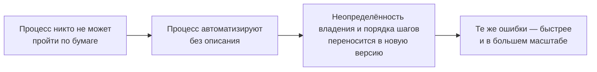

# 1.3 Якорь возможности — описанный процесс

Related: [[1.3-Workflow-Anchor-Flashcards]] · [[1.1-Forty-Ideas-Forty-Units]] · [[1.2-One-Workflow-Four-Readings]]

> [!summary] TL;DR
> Кандидат на применение ИИ есть утверждение о процессе (**claim**): в нём назван существующий рабочий процесс и обещано, что изменение одного его шага даст ценности больше, чем будет стоить. Утверждение опирается на процесс, описанный настолько точно, чтобы его можно было измерить; поэтому предусловие этой работы — грамотность в процессах (**process literacy**), а не грамотность в ИИ (**AI literacy**). Процесс, который нельзя пройти по бумаге (шаг за шагом, с названным владельцем в каждой точке), — не слабый кандидат, а ещё не кандидат (**not yet a candidate**): это не нехватка деталей, а иная задача — картографирование (**mapping**), и она выполняется до сравнения. Автоматизация такого процесса не исправляет его: неопределённость владения и последовательности шагов переносится в автоматизированную версию и усиливается — те же ошибки воспроизводятся быстрее и в большем масштабе.

Разбор четырьмя шагами: **понятие** (§1) → **грамотность в процессах** (§2) → **ошибка отбора** (§3) → **практика** (§4).

## Простыми словами

Обещание «с этим инструментом станет лучше» нельзя проверить, пока никто не может рассказать, как работа устроена сейчас. Представьте: вы обещаете ускорить сборку шкафа новой дрелью, но инструкции нет и никто не помнит порядок деталей. Дрель не исправит порядок — она быстрее насверлит дырок не там, где нужно. Так же и на работе: пока процесс не расписан по шагам — кто что делает, что идёт после чего, кто заметит пропуск, — обещание пользы проверить нечем. А если расписать не получается, потому что непонятно, кто за что отвечает, дело не в инструменте: настоящая работа — описать сам процесс.

## 1. Возможность — утверждение о процессе

Кандидат на применение ИИ есть по существу утверждение о процессе, и у утверждения две части: оно называет существующий рабочий процесс и утверждает, что изменение одного шага в нём даст ценности больше, чем будет стоить. Обещание «больше ценности, чем затрат» — пара шкал из [[1.1-Forty-Ideas-Forty-Units]], приложенная здесь к одному шагу названного процесса.

Утверждению не на что опереться, пока сам процесс не описан настолько подробно, чтобы его можно было измерить. Эта опора — якорь процесса (**workflow anchor**): описанный процесс, к которому прикрепляется утверждение о ценности.

## 2. Грамотность в процессах: четыре вопроса к описанию

Отсюда предусловие всей работы: не грамотность в ИИ (**AI literacy**), а грамотность в процессах (**process literacy**) — дисциплина описания процесса настолько точного, что становится возможным сравнение «до и после».

Описание достаточно точно, если по процессу можно ответить на четыре вопроса:

1. **Каковы шаги?** Каждый шаг процесса назван.
2. **Кто владеет каждым шагом?** Для каждого шага назван человек, который его выполняет и отвечает за него.
3. **Каков объём процесса?** Известно, сколько примерно случаев (**cases** — обращений, заказов, заявок) проходит через процесс за период.
4. **Что запускает каждый шаг?** Для каждого шага названо событие, которое его начинает (**trigger**).

Процесс, который можно так пройти по бумаге (**walk a workflow on paper**) — шаг за шагом, с названным владельцем в каждой точке, — готов к настоящему измерению (**genuine measurement**). Именно отсюда берётся базовый уровень (**baseline**) из [[1.2-One-Workflow-Four-Readings]]: у помощника черновиков его никто не зафиксировал — и в отчёте о прибылях и убытках оказался ноль.

## 3. Ошибка отбора: «ещё не кандидат» — не «слабый кандидат»

Ошибка отбора — принять процесс, который нельзя пройти по бумаге, за слабого кандидата. Это два разных состояния кандидата:

| | Слабый кандидат (**weak candidate**) | Ещё не кандидат (**not yet a candidate**) |
|---|---|---|
| Состояние процесса | описан настолько, что измерим | не описан настолько, чтобы его измерить |
| Место в отборе | участвует в сравнении на общих основаниях | в сравнении не участвует: требуется картографирование (**mapping**) |
| Последствие смешения | проигрывает по шкалам — корректный исход | при пропуске в сравнение плохая автоматизация проходит отбор |

То, что процесс нельзя пройти по бумаге, — не проблема документации, ожидающая дополнительных деталей. Это иная задача — картографирование, и она выполняется до всякого сравнения.

Автоматизация процесса, который никто не может пройти по бумаге, не исправляет то, что в нём не так, — в этом и состоит ошибка, из-за которой плохая автоматизация проходит отбор (**lets bad automation through the door**). Существующая неопределённость владения и последовательности шагов переносится в автоматизированную версию и усиливается в ней (**amplified**): те же ошибки воспроизводятся быстрее и в большем масштабе.

## 4. Практика: пройти одну задачу по бумаге

Механика: взять одну задачу, которую вы регулярно выполняете, и пройти её по бумаге. Для каждого шага ответить на три вопроса: кто первым приступает к задаче; что должно произойти, прежде чем следующий человек сможет действовать; кто заметил бы пропуск шага.

Чтение исходов:

- **Владелец назван у каждого шага** — процесс описан; ИИ-кандидат на этом процессе может быть измерен и войти в сравнение.
- **Владельца назвать нельзя** — найдена настоящая работа недели: картографирование. До его завершения ни одному ИИ-кандидату, построенному на этом процессе, доверять нельзя.

## Ловушки / квиз-моменты

- «Процесс, который нельзя пройти по бумаге, — слабый кандидат»: нет — он ещё не кандидат; слабость измеряется по шкалам, а здесь нечем измерять.
- «Не хватает документации, детали соберём потом»: невозможность пройти процесс по бумаге — не проблема документации; это отдельная задача — картографирование.
- «Автоматизация наведёт порядок»: автоматизация неописанного процесса воспроизводит его ошибки быстрее и в большем масштабе: неопределённость владельцев и порядка шагов переносится в новую версию и усиливается.
- «Для этой работы нужен опыт в ИИ»: предусловие — грамотность в процессах; измерение строится на описании шагов, владельцев, объёма и запусков.
- «Кандидат обещает перестройку всего процесса»: кандидат обещает изменение одного шага; ценность и затраты прикладываются к этому шагу.

## История напоследок

Отчёт для клиента собирали в складчину, и когда предложили автоматизировать сборку, никто не возразил. Через месяц выяснилось: исходные числа вносили двое, каждый по-своему, а проверял тот, кто увидел первым. Автоматическая сборка стала выпускать те же ошибки — но каждую неделю, аккуратно и вовремя, пока не заметил клиент. Сели расписывать отчёт по шагам и владельцам; к автоматизации вернулись, когда на каждый шаг нашлось имя.

## Связано

- [[1.1-Forty-Ideas-Forty-Units]] — первый из пяти шагов суждения (карта процесса) получил обоснование: без карты нет ни меры, ни сравнения
- [[1.2-One-Workflow-Four-Readings]] — базовый уровень, отсутствие которого обнулило помощника в отчёте о прибылях, берётся из описания процесса
- [[2.2-The-Number-Came-Back]] — конвейер «определить → каталогизировать → … → ранжировать»: картографирование — состояние «определена»
- [[2.8-Problem-Before-Tool]] — инструмент до описания проблемы загоняет сценарии в свою форму; автоматизация до описания процесса воспроизводит его ошибки
- [[2.10-Win-The-Role]] — описать, что считается, до подсчёта; здесь — описать процесс до измерения
