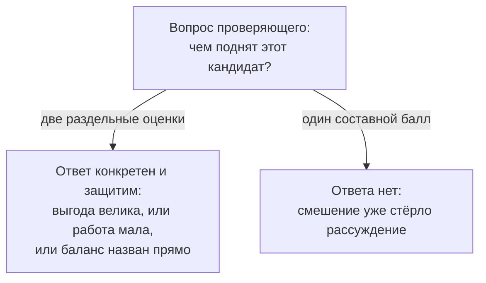

# 1.4 Ценность и усилия — две раздельные меры

Related: [[1.4-Value-And-Effort-Two-Measures-Flashcards]] · [[1.1-Forty-Ideas-Forty-Units]] · [[2.3-One-Entry-Four-Readings]]

> [!summary] TL;DR
> У каждого кандидата две отдельные меры — ценность (**value**), то, что он может дать, и усилия (**effort**), то, что потребуется для его построения; раздельность мер и делает ранжированный перечень кандидатов — короткий список для разговора о финансировании — защитимым (**defensible**) в споре. Меры опираются на разные доказательства (**evidence**): ценность — на понимание, кто выигрывает и насколько; усилия — на понимание самого процесса и цены его безопасного изменения. Свести два вопроса в один составной балл (**combined score**) — значит не дать чистого ответа ни на один: смешение скрывает, какая именно мера произвела число. Список из двух открытых, независимо обоснованных оценок проверяет любой участник совещания — вопрос «чем поднят кандидат» получает конкретный ответ; в списке из одного балла рассуждение уже стёрто, и в разговоре о финансировании защищать нечего, кроме самого числа.

Разбор пятью шагами: **две меры** (§1) → **цена смешения** (§2) → **проверяемость** (§3) → **спор о месте** (§4) → **практика** (§5).

## Простыми словами

Выбираете, что сделать в квартире первым: душевую или шкаф. Продавец предлагает «итоговую оценку» — и у обоих вариантов выходит по восьмёрке. По восьмёрке непонятно, что вы покупаете: большое удобство или лёгкую установку. Пока польза и хлопоты записаны двумя отдельными строками, любой член семьи может спросить: «Эта вещь наверху из-за пользы или из-за простоты?» — и получить ответ. А на «восемь из десяти» ответить нечего: цифра есть, рассуждения за ней нет.

## 1. Две меры: два вопроса и две доказательные базы

У каждого кандидата две меры: ценность (**value**) — что кандидат может дать, и усилия (**effort**) — что потребуется для его построения. Это разные вопросы, и опираются они на разные доказательства.

Применение мер — ранжирование: их сводят в ранжированный перечень кандидатов, тот самый короткий список, который аналитик из [[1.2-One-Workflow-Four-Readings]] готовит спонсору к разговору о финансировании. Раздельность мер — условие защищимости перечня в этом разговоре.

| | Ценность (**value**) | Усилия (**effort**) |
|---|---|---|
| Вопрос | что кандидат может дать? | что потребуется для построения? |
| Доказательная база (**evidence**) | кто выигрывает (**who benefits**) и насколько (**by how much**) | сам рабочий процесс и то, что стоит за его безопасным изменением (**change it safely**) |

## 2. Цена смешения: балл не отвечает ни на один вопрос

Свести эти два вопроса в один составной балл (**combined score**) — не дать чистого ответа ни на один из них: смешение скрывает, какая именно мера произвела число перед вами.

Это развитие запрета из [[1.1-Forty-Ideas-Forty-Units]], где свёртка теряла проверяемый след обоснования (**audit trail**). Здесь назван точный механизм потери: исчезает различение — какая из двух мер работает в числе; число остаётся, основание исчезает.

## 3. Проверяемость: свойство двух открытых оценок

Список, построенный из двух открытых, независимо обоснованных оценок (**independently argued figures**), может проверить любой участник совещания (**checked by anyone in the room**). Вопрос проверки: какая ось (**axis**) определяет место данного кандидата (**which axis is driving a candidate's position**) — и ответ конкретен и защитим: кандидат поднят, потому что выгода (**payoff**) велика, или потому что требуемая работа мала, или это баланс того и другого, названный прямо (**stated plainly**).

Список из одного смешанного балла (**blended score**) так не проверяется вовсе: смешение уже стёрло рассуждение, которое произвело число.

## 4. Спор о месте кандидата: где раздельность решает

Разница между двумя способами важнее всего ровно в тот момент, когда кто-то не согласен с местом своего кандидата — в разговоре о финансировании (**funding conversation**). Это почти каждый участник, чей кандидат оказался возле низа списка.

Две независимые, самостоятельно обоснованные оценки такой разговор выдерживают: каждая защищается на собственных основаниях (**defended on its own terms**). Один составной балл — нет: защищать нечего, кроме самого числа.

Это прямое продолжение людей из [[1.1-Forty-Ideas-Forty-Units]] и [[1.2-One-Workflow-Four-Readings]]: спонсору нужен список, который можно защитить на встрече о деньгах, а несогласный владелец процесса получает предмет спора — какую из двух оценок он оспаривает, а не «цифру вообще».

## 5. Практика: два предложения до вердикта

Механика: при следующем сравнении двух вариантов — любых, на работе или вне его — написать два предложения: одно оценивает выгоду (**payoff**), отдельное — трудность (**difficulty**). Усреднять их в единый вердикт можно только после того, как оба предложения существуют независимо (**until both sentences exist independently**).

Смысл задержки: вердикт, сформулированный раньше двух предложений, существует только как смешение в голове — проверить его нельзя, пока оценки не записаны по отдельности.

## Ловушки / квиз-моменты

- «Составной балл отвечает на оба вопроса сразу»: он не даёт чистого ответа ни на один — смешение скрывает, какая мера произвела число.
- «Проверить список может только его автор»: две открытые оценки проверяет любой в комнате; вопрос — какая ось поднимает кандидата.
- «Дискуссия о списке неизбежна, ничего не поделать»: при двух оценках несогласие получает конкретный предмет — какая из оценок оспаривается; при балле предмета нет.
- «Ценность и усилия оцениваются из одного источника»: это разные вопросы с разными доказательствами — кто выигрывает и насколько против процесса и цены его безопасного изменения.
- «Баланс нельзя выражать»: баланс допустим, но называется прямо, а не прячется в балле.

## История напоследок

На семейном совете выбирали, что сделать в квартире первым: душевую или шкаф. Отец предложил ставить оценки от одного до десяти, и у обоих вариантов вышло по восьмёрке — спор не утих. Тогда дочь попросила записать две строки: сколько это изменит жизнь и сколько недель продлится ремонт. Душевая: жизнь меняет сильно, ремонт шесть недель; шкаф: удобство скромное, соберут за день. Выбрали душевую — и когда сосед спросил, почему не шкаф, отец ответил двумя строками, а не восьмёркой.

## Связано

- [[1.1-Forty-Ideas-Forty-Units]] — пятый шаг суждения («ценность и усилия раздельно») и запрет составного балла; здесь он получил механизм и проверку
- [[1.2-One-Workflow-Four-Readings]] — разговор о финансировании и несогласный владелец процесса; усилия видит тот, кто принимает последствия перемены
- [[2.3-One-Entry-Four-Readings]] — курс 1: ценность и риск независимы, сводная оценка прячет спор — та же механика на другой паре мер
- [[2.7-Ranking-Multiple-Inputs]] — курс 1: «ценность против усилий» как вход ранжирования
- [[2.10-Win-The-Role]] — защищаемый перечень; [[3.4-Advisory-Artifact]] — список, за которым решение о финансировании, — артефакт
