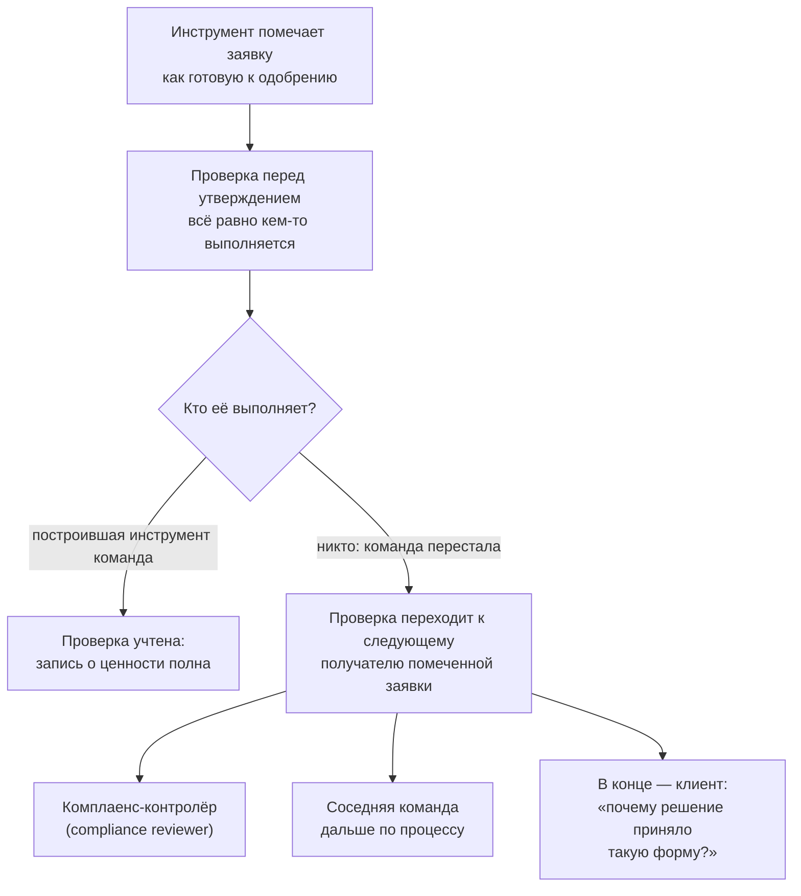

# 1.5 Учёт ценности: куда переходит оставшаяся работа

Related: [[1.5-The-Ledger-Flashcards]] · [[1.1-Forty-Ideas-Forty-Units]] · [[1.2-One-Workflow-Four-Readings]]

> [!summary] TL;DR
> Полное утверждение о ценности (**value claim**) отвечает на два вопроса: что перемена производит и куда переходит оставшаяся после неё работа (**leftover work**). В кейсе лекции инструмент банка помечает (**flags**) кредитные заявки, выглядящие достаточно полными для быстрого одобрения; экономия времени на проверке учтена, а сама проверка не исчезла — построившая инструмент команда незаметно перестала её выполнять, и она перешла к следующему получателю помеченной заявки: комплаенс-контролёру, соседней команде дальше по процессу или в конце концов клиенту. Перемещение легко пропустить: переехавшая работа выглядит гладкой и завершённой, и помеченный файл вызывает доверие именно тем, что выглядит готовым. Кандидат, чья ценность — рост выработки (**producing more output**), обязан назвать, кто теперь проверяет, исправляет, передаёт выше или ждёт; честный ответ «никто» означает, что прежняя проверка тихо прекратилась.

Разбор пятью шагами: **второй вопрос** (§1) → **кейс: куда переходит проверка** (§2) → **почему перемещение незаметно** (§3) → **правило кандидата** (§4) → **практика** (§5).

## Простыми словами

Начальник хвалится: новая программа сама собирает отчёты, секретарь экономит два часа в день. Через месяц выясняется, что программа ошибается в каждой третьей таблице, а правит её ошибки всё тот же секретарь — только теперь это занимает три часа: два прежних сборки плюс час правки. В отчёте записана экономия, а прибавка не записана, потому что её никто не считал. Прежде чем верить «сэкономили время», спрашивают: сэкономили кому — и что теперь делает тот, кто получает готовый результат.

## 1. Второй вопрос полного утверждения о ценности

Утверждение о ценности — обещание, что перемена даст выгоды больше, чем будет стоить; его устройство разобрано в [[1.4-Value-And-Effort-Two-Measures]]. Лекция добавляет условие полноты: полное утверждение о ценности отвечает на второй вопрос рядом с первым — не только что перемена производит, но и куда переходит оставшаяся работа после того, как перемена сделана.

Название раздела — учёт (**ledger**) — берётся из бухгалтерии: запись сходится, когда у неё заполнены обе стороны. Экономия считается легко и попадает в отчёт; переехавшая работа в чью-либо отчётность не попадает — тот, к кому она перешла, часто не знает, что ему её передали. Поэтому запись о ценности по умолчанию неполна: в ней есть приход, но нет того, кто его оплачивает своим временем.

## 2. Кейс: куда переходит проверка

Кредитная команда (**lending team**) — подразделение банка, рассматривающее заявки на кредит. Она принимает инструмент, который автоматически помечает заявки, выглядящие достаточно полными, чтобы одобрять их быстро. На бумаге — чистая экономия времени на проверке. На деле заявки это не отменяет: каждую помеченную заявку всё ещё кто-то проверяет, прежде чем утвердить по ней решение (**sign off**).

Если команда, построившая инструмент, незаметно перестаёт выполнять эту проверку сама, проверка переходит к следующему получателю помеченной заявки. Получатели идут по цепочке: комплаенс-контролёр — сотрудник, проверяющий соответствие решений правилам; соседняя команда дальше по процессу; в конце — клиент, которому приходится разбираться, почему решение по его заявке приняло такую форму.

Итог кейса в терминах учёта: в учётную запись «сэкономленное время проверки» попала работа, которая не исчезла, а сменила исполнителя.

## 3. Почему перемещение незаметно

Работа, которая переходит к другому, часто выглядит гладкой и завершённой (**fluent and finished**) на поверхности. Помеченный файл, выглядящий готовым к одобрению, вызывает доверие именно потому, что выглядит готовым: внешний признак готовности принимают за саму готовность.

Когда тот, кто пометил файл, не может ответить на вопрос «почему так», пропущенное им обдумывание становится проблемой следующего человека. Момент при этом хуже прежнего: вопрос возникает, когда решение уже почти принято, а не тогда, когда его ещё можно было дёшево поправить.

## 4. Правило кандидата: имя получателя работы

Кандидат, чьё обоснование ценности (**value case**) держится на росте выработки, обязан назвать конкретно: кто теперь проверяет, исправляет, передаёт выше или ждёт (**verifies, corrects, escalates, or waits**). Это тот же четвёртый шаг суждения из [[1.1-Forty-Ideas-Forty-Units]], но с ужесточением: имя нужно не для полноты карточки, а для того, чтобы утверждение о ценности сходилось.

Честный ответ «никто» — не отсутствие усилий. Это симптом: прежняя проверка не стала ненужной — она тихо прекратилась, и её последствия накапливаются без исполнителя.

## 5. Практика: «сэкономлено кому?»

Механика: когда идею представляют только как сэкономленное время (**time saved**), задать один вопрос в ответ — сэкономлено кому (**saved for whom**)? — и второй: что теперь должен делать человек, получающий этот результат, чего ему не приходилось делать раньше?

Чтение исходов:

- **Названы конкретные новые действия получателя, и они дешевле сэкономленного** — перед вами настоящая ценность: запись сходится.
- **Получателю передалась проверка, исправление или ожидание** — это перемещение, выдаваемое за ценность (**relocation dressed up as value**): экономия одного оплачена прибавкой другого.

## Ловушки / квиз-моменты

- «Экономия времени — уже ценность»: экономия — только одна сторона учётной записи; без имени получателя переехавшей работы утверждение о ценности неполно.
- «Файл выглядит готовым — значит, готов»: внешний признак готовности вызывает доверие сам по себе; именно на него и полагаются, пропуская проверку.
- «Проверять стало некому — значит, проверка не нужна»: ответ «никто» означает, что прежняя проверка тихо прекратилась, а не исчезла необходимость в ней.
- «Переехавшая работа — мелочь»: она возвращается в худший момент, когда решение почти принято; цена исправления выше, чем при раннем обнаружении.
- «Клиент вне процесса, его можно не считать»: клиент — конечный получатель переехавшей проверки; вопрос «почему решение такое» достаётся ему.

## История напоследок

Бухгалтер перевёл рассылку счетов на скрипт и записал в отчёт: час в день сэкономлен. Через две недели у клиента вышел спор о номере счёта — скрипт брал номера из устаревшей таблицы, а вычитывать письма перед отправкой было больше некому: тот, кто делал это раньше, решил, что теперь письмо проверяет машина. Час из отчёта убрали: сэкономлен он не был — был переложен на бухгалтерию, которая разбиралась со спорами.

## Связано

- [[1.1-Forty-Ideas-Forty-Units]] — четвёртый шаг суждения («имя рядом с кандидатом») получил обоснование: без него учётная запись о ценности не сходится
- [[1.2-One-Workflow-Four-Readings]] — сотрудница очереди: «черновики стали быстрее, а принятие решения переместилось ко мне» — та же перемещённая работа со своим носителем
- [[1.6-Follow-The-Decision-Not-The-Deployment]] — курс 1: затраты переехали, а не исчезли — та же арифметика на другом объекте
- [[2.7-Ranking-Multiple-Inputs]] — обязательство сопровождения как четвёртый вход ранжирования: усилия получателя учитываются до бюджета
