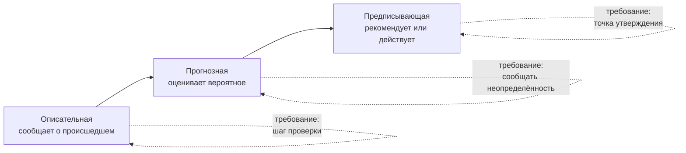

# 1.7 Спектр «отчёт — прогноз — предписание»

Related: [[1.7-Descriptive-Predictive-Prescriptive-Flashcards]] · [[1.1-Forty-Ideas-Forty-Units]] · [[2.4-Gate-Question-Four-Zones]]

> [!summary] TL;DR
> Каждого кандидата размещают на спектре по одному вопросу — для чего на самом деле его результат: описательная (**descriptive**) система сообщает, что уже произошло, прогнозная (**predictive**) оценивает, что вероятно произойдёт, предписывающая (**prescriptive**) рекомендует или сама совершает действие. Позиция ещё до всякой оценки задаёт требование: описательной — шаг проверки, прогнозной — способ сообщать неопределённость, предписывающей — точку утверждения. Результат прогнозной — вероятность, и процесс обязан обращаться с ней как с вероятностью; результат предписывающей — указание, а люди следуют указаниям независимо от их правильности, поэтому на предписывающей самая тяжёлая нагрузка управления (**governance**). Практика: вопрос «отчёт, прогноз или предписание?» называет нужный надзор до того, как идею начнут строить, — расплывчатое намерение превращается в проверяемое требование.

Разбор пятью шагами: **один вопрос спектра** (§1) → **три позиции** (§2) → **вероятность — не достоверность** (§3) → **указание — не совет** (§4) → **практика** (§5).

## Простыми словами

Три инструмента одной службы поддержки. Первый просто считает: сколько заявок закрыто за неделю — полезно, но это счётчик, а не искусственный интеллект. Второй предсказывает: вот эти заявки, скорее всего, не уложатся в срок ответа — и «скорее всего» здесь главное слово. Третий сам переназначает заявку другому сотруднику — это уже указание, а указания люди выполняют, даже когда они неверны. Чем дальше инструмент от «посчитать» к «сам решает», тем сильнее его нужно контролировать.

## 1. Один вопрос спектра

Каждого кандидата можно разместить на спектре (**spectrum**), определяемом одним вопросом: для чего на самом деле его результат (**what is its output actually for**)? Три позиции: инструмент, сообщающий, что уже произошло, — один конец; инструмент, оценивающий, что вероятно произойдёт, — середина; инструмент, рекомендующий или непосредственно совершающий действие, — дальний конец. Позиция на спектре сообщает практику что-то конкретное о требованиях кандидата ещё до начала всякой оценки (**before any scoring begins**).

## 2. Три позиции: очередь заявок

Кейс: команда поддержки хочет применить ИИ к очереди заявок (**ticket queue**). Одна и та же очередь даёт кандидатов всех трёх позиций:

| Позиция | Что делает результат | Пример | Требование |
|---|---|---|---|
| Описательная (**descriptive**) | сообщает, что уже произошло | панель со счётом заявок, закрытых за прошлую неделю | шаг проверки (**review step**) |
| Прогнозная (**predictive**) | оценивает, что вероятно произойдёт | модель помечает открытые заявки, которые, вероятно, нарушат целевой срок ответа (**breach**) | способ сообщать неопределённость |
| Предписывающая (**prescriptive**) | рекомендует или сама совершает действие | система сама переназначает заявку, которую прогнозирует под срыв срока | точка утверждения (**approval gate**) |

Показательная деталь кейса: описательная панель полезна сама по себе (**genuinely useful**) и обычно не требует машинного обучения вовсе — подсчёта и агрегирования достаточно. Это перекличка с пропускным вопросом курса 1 ([[2.4-Gate-Question-Four-Zones]]): программы, работающие по написанным правилам, — не ИИ, и позиция «описательная» чаще всего как раз такая.

## 3. Вероятность — не достоверность

Результат прогнозной системы — вероятность, и процесс вокруг неё обязан обращаться с ней как с вероятностью. Команда, которая читает 80% likelihood как достоверность и действует так, будто оставшиеся 20% не существуют, неправильно использует инструмент (**misusing the tool**) — она не обнаружила его дефект.

Отсюда требование позиции: в процессе должен существовать способ сообщать неопределённость (**communicating uncertainty**) — чтобы решение принималось с виду на «80%», а не на «гарантированно».

## 4. Указание — не совет

Предписывающая система несёт самую тяжёлую нагрузку управления из трёх, и причина проста: её результат — указание (**instruction**), а люди склонны следовать указаниям независимо от того, верны они или нет. Ошибочный прогноз, представленный как совет, человек ещё проверит; ошибочный прогноз, превращённый в автоматическое переназначение заявки, выполняется сам.

Поэтому позиции соответствует точка утверждения: названный человек решает, состоится ли действие, — конструкция та же, что точка решения курса 1 ([[3.4-Advisory-Artifact]]), с критериями, записанными заранее.

## 5. Практика: вопрос до постройки

Механика: на чужую ИИ-идею ответить одним первым вопросом — её результат сообщает (**report**), прогнозирует (**predict**) или предписывает (**prescribe**)? Ответ называет, какой надзор идее понадобится, до того как её начнут строить.

Чтение исходов:

- **Сообщает** — шаг проверки результата.
- **Прогнозирует** — способ сообщать неопределённость.
- **Предписывает** — точка утверждения.

Размещение до всякой оценки превращает расплывчатое намерение (**vague ambition**), вроде «применить ИИ к очереди заявок», в конкретное проверяемое требование (**checkable requirement**).

## Ловушки / квиз-моменты

- «Описательная панель — это ИИ»: обычно нет — подсчёт и агрегирование достаточны, машинного обучения не требуется.
- «Описательная бесполезна»: она полезна сама по себе; у позиции другое требование — шаг проверки, а не защита от вероятности.
- «80% — почти достоверность»: это ошибка пользователя; вероятностный результат обязывает процесс сообщать неопределённость.
- «Прогнозная и предписывающая — одно и то же»: разница в том, кто действует — человек решает по вероятности или система совершает действие сама.
- «Надзор назначают после сборки»: надзор вытекает из позиции на спектре и известен до постройки.
- «Ошибка автопереноса — дефект модели»: при предписывающей проверяется ещё и точка утверждения; указание выполняется, даже когда неверно, — в этом нагрузка позиции, а не только точность модели.

## История напоследок

Начальник службы поддержки попросил ИИ «для очереди заявок». Ему показали три вещи: счётчик закрытых заявок, список заявок под риском срыва срока с процентами и настройку автопереноса просроченных к старшему. Он выбрал третье — «чтобы само работало» — и через месяц разбирал жалобу: система перенесла заявку не тому сотруднику, а остановить её было некому. Вернулись и добавили одно правило: перед автопереносом заявку утверждает дежурный.

## Связано

- [[2.4-Gate-Question-Four-Zones]] — курс 1: программы по написанным правилам — не ИИ; описательная позиция чаще всего такая; полномочия растут к предписывающему концу
- [[2.5-How-Much-Of-The-Loop]] — курс 1: ступени «диалог → передача → перестроенный процесс» — второе измерение того же движения «человек решает меньше»
- [[3.4-Advisory-Artifact]] — точка утверждения предписывающей — точка решения с критериями, записанными заранее
- [[1.1-Forty-Ideas-Forty-Units]] — спектр уточняет шаг 2: кандидаты по подразделениям различаются ещё и позицией на спектре
