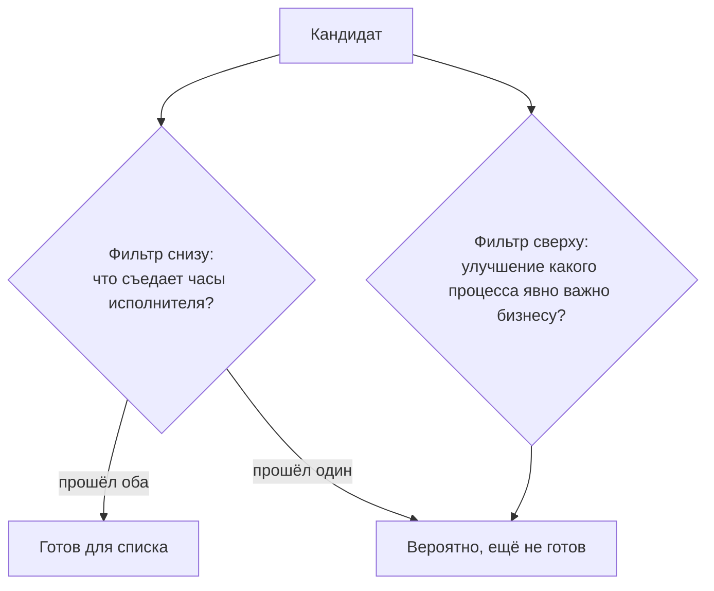

# 1.8 Поиск снизу и поиск сверху

Related: [[1.8-Bottom-Up-Top-Down-Discovery-Flashcards]] · [[1.1-Forty-Ideas-Forty-Units]] · [[1.2-One-Workflow-Four-Readings]]

> [!summary] TL;DR
> Практики спорят, где начинать поиск возможностей, и способные опытные люди стоят по обе стороны: лагерь снизу (**bottom-up**) говорит напрямую с исполнителями и считает их самодельные инструменты самой надёжной картой трения; лагерь сверху (**top-down**) выбирает процесс, улучшение которого явно важно бизнесу, рассуждает от ценности в обратную сторону и о роли ИИ спрашивает в конце. Каждая сторона называет слабость другой: интервью-поиск усиливает голос того, кто жалуется громче всех, независимо от того, обходится ли его проблема организации дороже всех; стратегический поиск проходит мимо трения, которое никто ещё не назвал словами, — таких проблем нет и в стратегических документах. Курс не требует выбора: оба подхода обязательны, поскольку поиск снизу находит настоящее (**real**) — проблемы, которые действительно существуют, потому что кто-то терпит их каждый день, а сверху — финансируемое (**fundable**) — проблемы, решение которых распорядитель бюджета (**budget holder**) может обосновать в разговоре о финансировании. Перечень из одного источника отказывается предсказуемым образом: снизу — настоящее трение, за исправление которого никто не заплатит; сверху — финансируемые идеи, не совпадающие ни с чьим действительным рабочим днём; практика — прогнать каждого кандидата через оба фильтра, и кандидат, прошедший только один разговор, вероятно, ещё не готов.

Разбор пятью шагами: **спор** (§1) → **два подхода** (§2) → **взаимные упрёки** (§3) → **синтез: настоящее и финансируемое** (§4) → **практика** (§5).

## Простыми словами

Два начальника искали идеи для улучшений. Первый ходил по рабочим местам и спрашивал, что больше всего мешает; его список состоял из настоящих мучений — но на половину никто не дал бы денег. Второй читал годовой план и выбирал, что важнее всего фирме; его список выглядел красиво, но половина пунктов не совпадала с тем, чем люди занимались каждый день. Потом они договорились брать в план только то, что прошло оба разговора: и реальную боль, и деньги.

## 1. Спор: где начинается поиск

Практики в этой области расходятся в том, где должны начинаться находки поиска (**opportunity findings**). Расхождение глубокое: по обе стороны стоят способные, опытные люди. Курс не предлагает выбирать сторону — оба подхода объявляются обязательным тестом, который должен пройти перечень кандидатов.

## 2. Два подхода

| | Поиск снизу (**bottom-up**) | Поиск сверху (**top-down**) |
|---|---|---|
| Старт | люди, выполняющие работу | процесс, улучшение которого явно важно бизнесу |
| Механика | говорить с исполнителями напрямую; их самодельные инструменты — карта трения | рассуждать от ценности в обратную сторону; роль ИИ спрашивают в конце |
| Обоснование | только исполнители по-настоящему знают, что стоит им времени и усилий | значение для бизнеса задано заранее; технология — не исходная точка |
| Находит | настоящее (**real**) | финансируемое (**fundable**) |

В лагере снизу особое место занимают инструменты, которые люди уже незаметно построили себе сами: они считаются самой надёжной из доступных карт того, где находится настоящее трение. Логика та же, что в [[1.1-Forty-Ideas-Forty-Units]]: никто не предлагает то, чем уже пользуется, — поэтому самодельный инструмент указывает на проблему точнее любой анкеты.

## 3. Взаимные упрёки

Каждая сторона быстро называет конкретную слабость другой.

**Слабость поиска снизу**: интервью-поиск усиливает того, кто жалуется громче всех (**amplifies whoever complains loudest**), — независимо от того, действительно ли его проблема обходится организации дороже всех. Громкость жалобы не равна её стоимости.

**Слабость поиска сверху**: стратегический поиск проходит мимо трения, которое никто ещё не назвал словами. Если проблемы нет в чьих-либо словах, её нет и в стратегических документах — а поиск сверху читает именно документы.

## 4. Синтез: настоящее и финансируемое

Вместо выбора стороны оба подхода объявляются обязательными, потому что каждый находит своё:

- **Настоящее** — поиск снизу хорош в нахождении того, что реально существует: проблем, с которыми кто-то терпит ежедневно.
- **Финансируемое** — поиск сверху хорош в нахождении того, за что дадут деньги: проблем, решение которых распорядитель бюджета может обосновать в разговоре о финансировании.

Перечень, построенный одним методом, отказывается двумя предсказуемыми способами:

| Источник перечня | Предсказуемый отказ |
|---|---|
| только снизу | настоящее трение, за исправление которого никто не заплатит |
| только сверху | финансируемые идеи, не совпадающие ни с чьим действительным рабочим днём |

## 5. Практика: два фильтра, два разговора

Механика: прежде чем считать перечень кандидатов готовым, прогнать каждого через оба фильтра. Разговор первый — с человеком, выполняющим работу: что съедает ваши часы? Разговор второй, отдельный, — с распорядителем бюджета: улучшение какого процесса явно было бы важно для бизнеса?

Чтение исходов:

- **Кандидат прошёл оба разговора** — он одновременно настоящий и финансируемый: готов для списка.
- **Кандидат прошёл только один** — он, вероятно, ещё не готов: либо боль без денег, либо деньги без боли.

## Ловушки / квиз-моменты

- «Надо выбрать правильную сторону спора»: выбор не требуется — по обе стороны опытные люди; курс объявляет оба подхода обязательными.
- «Самодельные инструменты сотрудников — обход правил, а не сигнал»: в лагере снизу это самая надёжная карта трения — то, чем уже пользуются, никто не предлагает.
- «Кто жалуется громче всех, у того и самая дорогая проблема»: интервью-поиск усиливает громких; громкость не равна стоимости.
- «Чего нет в стратегическом документе, того не существует»: поиск сверху пропускает неназванное трение; отсутствие слов у проблемы не делает её отсутствующей.
- «Кандидат, прошедший один разговор, почти готов»: вероятно, ещё не готов — у него либо боль без денег, либо деньги без боли.

## История напоследок

Советник принёс спонсору список из двадцати идей — все из разговоров с сотрудниками. Спонсор спросила про первую же: «Кто за это заплатит?» — и ответа не было: идея была настоящей болью кладовщика, но в бюджете за неё не отвечал никто. Во второй раз каждый пункт списка прошёл два разговора: исполнители назвали боль, распорядители бюджета — ценность, и двадцать идей превратились в шесть. Эти шесть и профинансировали.

## Связано

- [[1.1-Forty-Ideas-Forty-Units]] — самодельный помощник черновиков как карта трения, которую пропустил сбор заявок
- [[1.2-One-Workflow-Four-Readings]] — вопрос «что повторяете и что съедает часы» — фильтр снизу; финансирующий руководитель — носитель фильтра сверху
- [[1.4-Value-And-Effort-Two-Measures]] — разговор о финансировании, где кандидату нужны две раздельные оценки
- [[2.8-Problem-Before-Tool]] — курс 1: роль инструмента спрашивают в конце — позиция лагеря сверху
