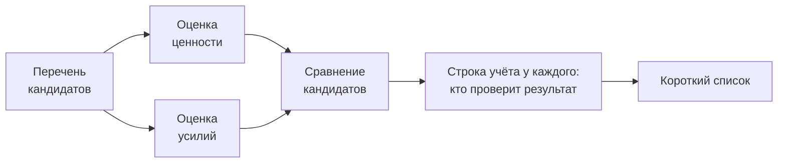

# 1.9 Win the Role: построй линейку раньше списка

Related: [[1.9-Win-The-Role-Ruler-Before-List-Flashcards]] · [[1.1-Forty-Ideas-Forty-Units]] · [[2.10-Win-The-Role]]

> [!summary] TL;DR
> Сборный навык модуля — «построй линейку раньше списка» (**build the ruler before the list**): доверие получает тот, кто производит не разовый список, а измерительный инструмент (**instrument**) — повторяемый способ делать несравнимое сравнимым по фиксированному порядку: перечень строится до всяких оценок, обе оценки завершены до сравнения любых двух кандидатов, ценность и усилия аргументируются раздельно, и у каждого кандидата есть строка учёта с именем того, кто проверит результат. Инструмент не зависит от кандидатов в комнате и потому работает в следующей функции и следующей организации: короткий список устаревает с приходом новых кандидатов, механизм — нет. Сильный ответ на интервью-тест («сорок идей, к концу месяца пять финалистов») называет инструмент: кандидатов берут из трёх источников — то, чем люди уже пользуются, есть проверенный спрос (**validated demand**), которого заявка никогда не фиксирует; каждого привязывают к процессу с владельцем на каждом шаге, отсеивая до всякой оценки; ценность и усилия аргументируют раздельно. В роли тем же инструментом решается спонсор с уже выбранным кандидатом — без противостояния; о навыке говорят в порядке работы — ценность раньше технологии.

Разбор шестью шагами: **навык** (§1) → **фиксированный порядок** (§2) → **интервью-тест** (§3) → **спонсор с готовым кандидатом** (§4) → **как говорить о навыке** (§5) → **профессиональная запись** (§6).

## Простыми словами

Вас просят выбрать лучший вариант из сотни. Плохой ответ — сразу назвать любимчика. Хороший — достать линейку: сначала описать, что вообще сравнивается; потом каждому выставить две оценки, польза и трудозатраты, по отдельности; потом сравнивать; и у каждого записать, кто будет проверять результат. Линейка переживает список: варианты приходят и уходят, а способ сравнивать остаётся.

## 1. Навык: инструмент вместо списка

Навык серии **Win the Role** — «построй линейку раньше списка»: линейка (**ruler**) — измерительный инструмент, и строится она до того, как что-либо измерено, то есть до списка. Практик, которому доверяют эту работу, производит инструмент (**instrument**) — повторяемый способ делать несравнимое сравнимым. Противоположность — короткий список: разовый результат одного применения, устаревающий с приходом новых кандидатов.

## 2. Фиксированный порядок инструмента

Инструмент — не только способ, но и порядок. Четыре правила следуют в строгой последовательности:

1. **Перечень до всяких оценок.** Сначала строится инвентарь кандидатов, потом что-либо оценивается.
2. **Обе оценки до сравнения.** Оценки ценности и усилий должны быть завершены для всех кандидатов до начала сравнения любых двух из них.
3. **Ценность и усилия — раздельно, никогда вместе.** Два случая аргументируются отдельно ([[1.4-Value-And-Effort-Two-Measures]]).
4. **Строка учёта у каждого кандидата.** Для каждого пишется строка учёта с именем того, кто проверит результат после ([[1.5-The-Ledger]]).

Порядок даёт инструменту переносимость: он не зависит от кандидатов в комнате, поэтому продолжает работать в следующей функции и следующей организации. Короткий список устаревает в момент прихода новых кандидатов; механизм работает долго после.

## 3. Интервью-тест: сорок идей, пять финалистов

Проверяющий спрашивает: «Мы собрали 40 идей ИИ со всей компании. Исполнительный комитет хочет пять финалистов к концу месяца. С чего начнёте?» Слабый ответ называет конкретный сценарий; сильный называет инструмент.

Элементы сильного ответа:

1. **Сначала территория поиска — и с причиной.** Кандидатов берут из трёх источников (**feeds**), потому что то, чем люди уже пользуются, — проверенный спрос (**validated demand**), которого заявка (**submission**) никогда не фиксирует. (Сами три источника в транскрипте не перечислены; по модулю это заявки, уже используемые самовольные инструменты — [[1.1-Forty-Ideas-Forty-Units]] — и процессные интервью с отбором от ценности — [[1.8-Bottom-Up-Top-Down-Discovery]]; реконструкция, не материал лекции.)
2. **Привязка к процессу с владельцем на каждом шаге.** Всё, что не прошло, отсеивается до всякой оценки (**disqualifying before it is scored**) — различение «слабый кандидат / ещё не кандидат» из [[1.3-Workflow-Anchor]].
3. **Ценность и усилия — раздельно, никогда слитно.**

## 4. Первые месяцы: спонсор с готовым кандидатом

Ситуация первых месяцев: спонсор приходит с уже выбранным кандидатом и просит построить под него обоснование. Инструмент решает это без противостояния (**without confrontation**): привязать кандидата к процессу и пройти его вместе с людьми самого спонсора; найти, для чего на самом деле его результат ([[1.7-Descriptive-Predictive-Prescriptive]]); аргументировать ценность отдельно, затем усилия отдельно; назвать учёт — по нему и видно, останется ли обещанная экономия экономией или переехает проверяющей команде, соседней функции или клиенту.

Иногда итог — «это ещё не кандидат»: у названного шага процесса нет владельца. Инструмент позволяет сказать это как результат проверки, а не как возражение спонсору.

## 5. Как говорить о навыке: ценность раньше технологии

О навыке говорят в том порядке, в каком идёт работа. Ценность называется раньше технологии: выделить процесс, улучшение которого имеет понятную ценность; рассуждать в обратную сторону от того, почему это ценно; и только затем спросить, какую роль играет ИИ.

В такой формулировке закрыт вопрос, который действительно беспокоит корпоративного заказчика (**enterprise buyer**): не «как найти ИИ-возможности», а «как выбирать из их избытка и защищать выбор».

## 6. Профессиональная запись управленческого аналитика

Профессиональная запись (**occupational record**) — описание профессии в справочнике. Для управленческих аналитиков (**management analysts**) она называет: сбор информации о проблемах и процедурах; её анализ; консультации с людьми, выполняющими работу; документирование находок. Задачи об эксплуатации ИИ-системы запись не называет.

Вывод тот же, что в курсе 1 ([[2.10-Win-The-Role]]): навык усиливает существующую профессию, а не требует новой — спрос искать внутри существующих ролей аналитика, а не в отдельном названии должности.

## Ловушки / квиз-моменты

- «Доверие приносит короткий список»: список — разовый результат; доверие приносит повторяемый инструмент.
- «Сильный ответ на интервью называет сценарий»: называет инструмент; сценарий — слабый ответ.
- «Порядок шагов инструмента можно переставить»: порядок фиксированный — перечень до оценок, обе оценки до сравнения, ценность и усилия раздельно, строка учёта у каждого.
- «Список и инструмент устаревают одинаково»: список устаревает с приходом новых кандидатов; механизм работает долго после — он не зависит от кандидатов в комнате.
- «Спонсор с готовым кандидатом — повод для спора»: инструмент решает без противостояния; итог «ещё не кандидат» подаётся как результат проверки, а не как возражение.
- «Навык требует роли по эксплуатации ИИ»: профессиональная запись управленческого аналитика не называет ни одной такой задачи; навык усиливает существующую профессию.

## История напоследок

На собеседовании двум кандидатам дали одну задачу: «Собрали сорок идей, комитет хочет пять к концу месяца — с чего начнёте?» Первый начал описывать любимую идею — чат-бот поддержки казался ему самым сильным. Второй ответил: «Со способа сравнивать: перечень, две раздельные оценки, строка учёта — и только потом пятёрка», — и интервьюер попросил подробностей именно у него. Пятёрку к сроку собирают оба; роль получают за линейку.

## Связано

- [[2.10-Win-The-Role]] — курс 1, та же серия сборных навыков: правило до подсчёта и защищаемый перечень
- [[1.1-Forty-Ideas-Forty-Units]] — исходная проблема модуля: несравнимые единицы; инструмент — её систематическое решение
- [[1.3-Workflow-Anchor]] — привязка к процессу с владельцами и отсев до оценки
- [[1.4-Value-And-Effort-Two-Measures]] — правило «раздельно, никогда вместе»
- [[1.5-The-Ledger]] — строка учёта: кто проверит результат
- [[1.7-Descriptive-Predictive-Prescriptive]] — «для чего результат» — шаг разбора кандидата спонсора
- [[1.8-Bottom-Up-Top-Down-Discovery]] — источники кандидатов: настоящее и финансируемое
