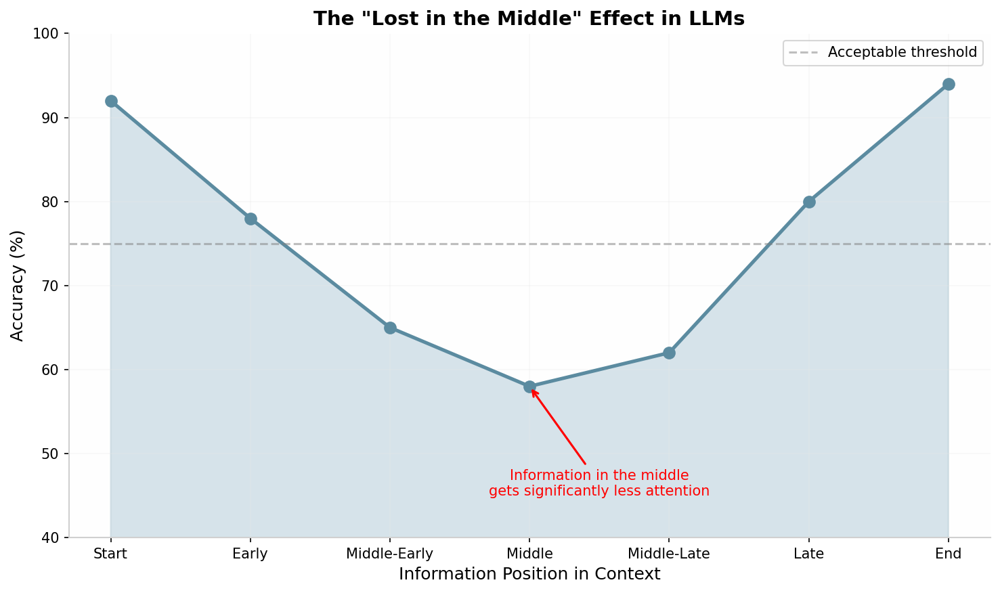
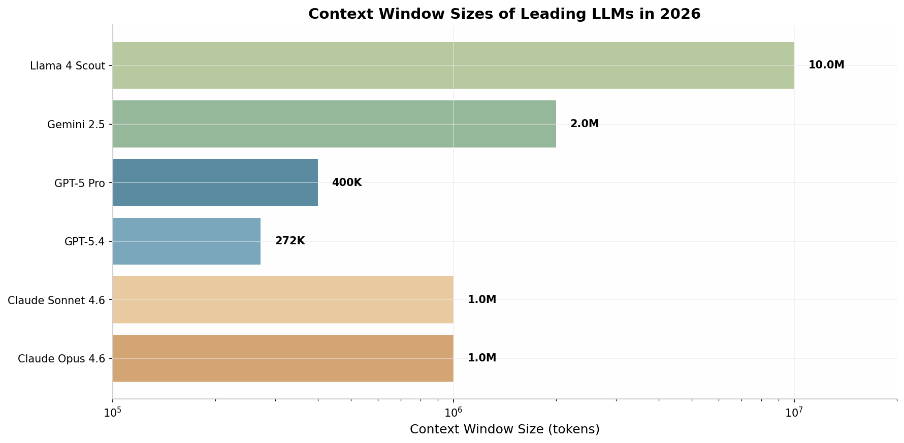
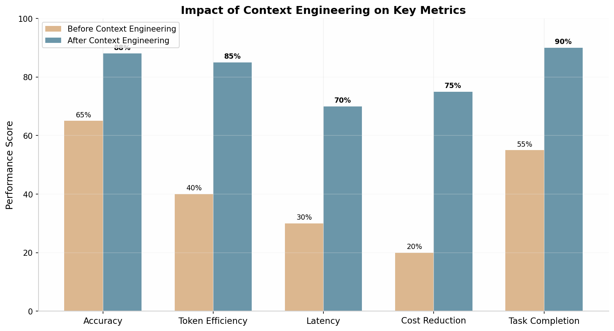

# Context Engineering: Структурные Практики для LLM в 2026 Году

## Краткое Резюме

К 2026 году дисциплина **context engineering** окончательно вышла на первый план как ключевой фактор успешного развертывания LLM-систем в продакшене. Если prompt engineering занимается формулировкой инструкций, то context engineering проектирует всю информационную среду, в которой работает модель — системные промпты, извлечённую документацию, историю разговоров, определения инструментов и долговременную память. Исследования показывают, что **82% ИТ-руководителей** считают prompt engineering недостаточным для масштабирования AI-агентов, а **95%** планируют инвестировать в context engineering в 2026 году  [(datahub)](https://datahub.com/blog/context-engineering-vs-prompt-engineering/) . Главные вызовы — феномен **"lost in the middle"** (потеря информации в середине контекста), **context rot** (деградация качества при переполнении окна) и **context poisoning** (отравление контекста ошибочной информацией). Ведущие компании (Anthropic, OpenAI, Google, Sourcegraph) разработали системные подходы: четыре столпа context engineering (инструкции, retrieval, память, инструменты), паттерн прогрессивного раскрытия (progressive disclosure), иерархическую структуризацию контекста и адаптивное сжатие. Правильное применение этих техник даёт **40-70% снижение API-затрат**, **2-3x рост завершаемости задач** и **до 54% улучшение точности** на агентных бенчмарках  [(Sourcegraph)](https://sourcegraph.com/blog/context-engineering) .

---

## 1. Эволюция от Prompt Engineering к Context Engineering

### 1.1 Почему prompt engineering больше не достаточно

К середине 2025 года стало очевидно: даже идеально сформулированный prompt не спасает, если модель получает неправильную, избыточную или конфликтующую информацию в контексте. Как отмечают исследователи Sourcegraph, опытные AI-инженеры осознали, что главный bottleneck — не формулировка инструкций, а то, как агенту подавать правильные файлы, определения инструментов, фрагменты истории разговоров и извлечённые факты на каждом шаге, не перегружая при этом контекстное окно  [(Sourcegraph)](https://sourcegraph.com/blog/context-engineering) . Этот сдвиг парадигмы отражает зрелость индустрии: от демо-чатботов к продакшен-агентам, работающим в циклах из десятков и сотен шагов.

Prompt engineering оперирует на уровне отдельной инструкции — он спрашивает: *"Как правильно сформулировать запрос?"*. Context engineering поднимается на уровень системы и спрашивает: *"Что модели нужно знать прямо сейчас?"*  [(datahub)](https://datahub.com/blog/context-engineering-vs-prompt-engineering/) . В многократных агентных взаимодействиях каждый шаг генерирует новые данные: выводы инструментов, извлечённые документы, промежуточные рассуждения, ответы пользователя. Context engineering — это дисциплина, решающая, что из этого вселенского объёма информации попадает в рабочую память модели в каждый конкретный момент  [(Sourcegraph)](https://sourcegraph.com/blog/context-engineering) .

Практические данные подтверждают масштаб проблемы. Согласно отчёту DataHub State of Context Management Report 2026, **66% организаций** сообщают, что их AI-модели генерируют предвзятые или вводящие в заблуждение выводы из-за недостаточной зрелости инфраструктуры данных  [(datahub)](https://datahub.com/blog/context-engineering-vs-prompt-engineering/) . При этом **90% организаций** заявляют о своей "готовности к AI", но **87%** называют готовность данных главным препятствием для внедрения AI в продакшен. **61%** регулярно откладывают AI-инициативы из-за отсутствия надёжных данных  [(datahub)](https://datahub.com/blog/context-engineering-vs-prompt-engineering/) . Этот разрыв между амбициями и реальностью стал катализатором перехода к context engineering как основной дисциплине.

| Аспект | Prompt Engineering | Context Engineering |
|---|---|---|
| **Ключевой вопрос** | "Как сформулировать запрос?" | "Что модели нужно знать?" |
| **Масштаб** | Одно взаимодействие | Системный поток информации |
| **Состояние** | Stateless (без состояния) | Stateful (с состоянием, многошаговый) |
| **Источник знаний** | Встроен в инструкцию | Извлекается и управляется в runtime |
| **Режим отказа** | Модель не понимает задачу | У модели слишком много, мало или не та информация |
| **Масштабируемость** | Ломается при масштабировании | Спроектировано для масштаба |

### 1.2 Четыре столпа Context Engineering

Sourcegraph, Anthropic и другие ведущие организации сформулировали практическую архитектуру context engineering вокруг четырёх столпов, каждый из которых отвечает на критический вопрос, который агент должен решать на каждом шаге  [(Sourcegraph)](https://sourcegraph.com/blog/context-engineering) :

**Инструкции / Системный промпт** — это фундаментальный слой, определяющий роль модели, ограничения и формат вывода до того, как она увидит первое сообщение пользователя. Ключевой вызов — найти "золотую середину" между хрупкими if-else правилами и расплывчатыми указаниями. Инструкции должны быть достаточно специфичными, чтобы направлять поведение, но достаточно гибкими, чтобы модель могла обобщать. Самая распространённая ошибка — не длина промпта, а несоответствие тренировочным данным модели: детальные инструкции, противоречащие эвристикам модели по использованию инструментов, вызывают запутанное поведение на каждом шаге  [(Sourcegraph)](https://sourcegraph.com/blog/context-engineering) .

**Retrieval (Извлечение)** — механизм, через который внешние данные попадают в контекстное окно. Это включает классический RAG поверх векторной базы данных, структурированные запросы к SQL-хранилищам, чтение файлов из файловой системы, и всё чаще — **just-in-time retrieval**: система подтягивает содержимое в контекст только когда оно нужно, используя лёгкие идентификаторы вроде путей к файлам или строк запроса  [(Sourcegraph)](https://sourcegraph.com/blog/context-engineering) . Плохой retrieval — один из крупнейших источников галлюцинаций и непривязанных ответов в продакшен-агентах.

**Память (Memory)** разделяется на два вида. Краткосрочная память — это история разговора, включая использование инструментов и их результаты. Долгосрочная память — информация, сохраняющаяся между сессиями: предпочтения пользователя, проектные конвенции, сводки прошлых разговоров. Продакшен-системы обычно поддерживают оба вида, со step **compaction** (уплотнения), который конденсирует старые шаги в сводку по мере заполнения окна  [(Sourcegraph)](https://sourcegraph.com/blog/context-engineering) . Anthropic описывает паттерн **structured note-taking**, где модель ведёт собственный блокнот во внешнем файле как персистентную память и перечитывает его по необходимости.

**Инструменты (Tools)** — исполняемая поверхность, которую агент может вызывать. Здесь context engineering становится наиболее беспощадным: токены инструментов накапливаются невероятно быстро. Каждое определение инструмента, каждый параметр, каждый enum — всё это расходует контекстный бюджет. Curated набор из 5-7 хорошо спроектированных инструментов почти всегда превосходит 20+ перегруженных определений  [(Sourcegraph)](https://sourcegraph.com/blog/context-engineering) .

### 1.3 Рыночные данные и инвестиции 2026 года

Сдвиг к context engineering отражается в конкретных инвестиционных приоритетах. Согласно опросу DataHub 2026 года среди 250 ИТ- и data-руководителей  [(datahub)](https://datahub.com/blog/context-engineering-vs-prompt-engineering/) :

- **95%** согласны, что context engineering важен для масштабирования AI-агентов
- **83%** считают, что агентный AI не может достичь продакшен-ценности без context-платформы
- **77%** признают, что RAG alone недостаточно для точных и надёжных AI-деплоев
- **89%** команд планируют инвестировать в инфраструктуру управления контекстом в ближайшие 12 месяцев
- **62%** ставят AI-ready metadata на первое место в приоритетах 2026 года
- **55%** фокусируются на качестве контекста

Главные препятствия для масштабирования агентов — не возможности моделей, а инфраструктурные проблемы: риски безопасности и приватности (51%), сложность интеграции инструментов (43%), фрагментация данных (41%)  [(datahub)](https://datahub.com/blog/context-engineering-vs-prompt-engineering/) .

---

## 2. Структурные Элементы, Которые Помогают LLM

### 2.1 Иерархическая структуризация контекста

Одним из самых мощных инструментов context engineering является иерархическая организация информации. LLM, подобно человеческому восприятию, лучше обрабатывают материал, структурированный по уровням важности и вложенности. Исследования 2025-2026 годов показали, что иерархическая сегментация документов значительно превосходит плоское "забрасывание" контекста.

**Hierarchical Document Refinement** (LongRefiner) — подход, представленный в исследовании 2025 года, моделирует структурированный документ как дерево, где каждый узел представляет секцию, подсекцию или параграф с соответствующим заголовком и содержимым  [(ruc.edu.cn)](http://playbigdata.ruc.edu.cn/dou/publication/2025_ACL_LongRefiner.pdf) . Авторы предложили XML-подобный формат представления иерархии с тремя типами тегов: `<section: [title]>`, `<subsection: [title]>` и `<chr>` для обозначения параграфов. Это представление сокращает количество токенов примерно до **1/10 от оригинала** при сохранении структурной информации  [(ruc.edu.cn)](http://playbigdata.ruc.edu.cn/dou/publication/2025_ACL_LongRefiner.pdf) .

На практике это означает, что контекст должен подаваться модели не как хаотичный поток текста, а как организованная структура с чёткими уровнями. Например, вместо плоского списка извлечённых чанков, система должна сохранять и передавать метаданные о документной иерархии — секциях, подсекциях, связях между ними. Оценка Contextual AI на датасете SEC 10Ks и 10Qs показала, что включение метаданных документной иерархии в чанки повысило эквивалентность ответов с **69.2% до 84.0%**  [(contextual.ai)](https://contextual.ai/blog/document-parser-for-rag/) .

| Техника иерархии | Описание | Эффективность |
|---|---|---|
| **Иерархическая сегментация** | Разбиение документа на секции, подсекции, параграфы | Снижение токенов до 90%, сохранение структуры  [(ruc.edu.cn)](http://playbigdata.ruc.edu.cn/dou/publication/2025_ACL_LongRefiner.pdf)  |
| **Hierarchy-aware chunking** | Чанкинг на основе заголовков с сохранением родительских секций | +14.8% к точности в RAG  [(contextual.ai)](https://contextual.ai/blog/document-parser-for-rag/)  |
| **CoT + Hierarchical summarization** | Chain-of-Thought с иерархическим суммированием | Улучшение покрытия ключевой информации, снижение галлюцинаций  [(Springer)](https://link.springer.com/article/10.1007/s44443-025-00041-2)  |
| **Progressive disclosure** | Загрузка контекста по фазам задачи | 40-70% снижение затрат, 2-3x завершаемость  [(inkeep.com)](https://inkeep.com/blog/context-engineering-why-agents-fail)  |

### 2.2 Границы и разделители: XML, Markdown, JSON

Выбор формата разделителей для структурирования контекста имеет критическое значение. Исследования 2025 года систематически сравнили различные форматы для вложенных данных и пришли к удивительным выводам  [(Improving Agents)](https://www.improvingagents.com/blog/best-nested-data-format/) :

**YAML показал наилучшие результаты** для GPT-5 Nano и Gemini 2.5 Flash Lite по точности. Факторы успеха YAML: визуальная иерархия через отступы, минимальный синтаксический оверхед (нет закрывающих тегов), высокое представление в тренировочных данных (конфигурационные файлы, Kubernetes, CI/CD)  [(Improving Agents)](https://www.improvingagents.com/blog/best-nested-data-format/) .

**Markdown оказался самым токен-эффективным форматом** — на 34-38% меньше токенов, чем JSON, и на ~10% меньше, чем YAML. При этом точность оставалась высокой, делая Markdown оптимальным выбором при приоритете стоимости и латентности  [(Improving Agents)](https://www.improvingagents.com/blog/best-nested-data-format/) .

**JSON показал плохие результаты** для GPT-5 Nano и Gemini — скорее всего из-за высокого синтаксического оверхеда скобок и кавычек, который размывает семантический сигнал. Исключением стала Llama 3.2 3B Instruct, которая оказалась "формат-агностичной"  [(Improving Agents)](https://www.improvingagents.com/blog/best-nested-data-format/) .

**XML показал наихудшие результаты** — на 80% больше токенов, чем Markdown, и низкая точность. Визуальный шум от повторяющихся `<tag></tag>` паттернов, вероятно, мешает распознаванию контента, а избыточность токенов увеличивает шансы на диффузию внимания  [(Improving Agents)](https://www.improvingagents.com/blog/best-nested-data-format/) .

Однако для **специфических случаев** XML остаётся предпочтительным: когда prompt требует строгой секционированности, глубокой вложенности или явной структурной ясности. Теги вроде `<context>`, `<instructions>`, `<example>` гарантируют, что LLM точно различает разные секции — критично для сложных многошаговых рассуждений и юридической/технической документации  [(Webex for Developers)](https://developer.webex.com/blog/boosting-ai-performance-the-power-of-llm-friendly-content-in-markdown) .

| Формат | Токен-эффективность | Точность (GPT-5/Gemini) | Лучший применение |
|---|---|---|---|
| **YAML** | Хорошая (~+10% к Markdown) | **Наивысшая** | Сложные вложенные структуры, конфигурации |
| **Markdown** | **Наивысшая** (-34% к JSON) | Хорошая | Документация, инструкции, статьи |
| **JSON** | Низкая (+34% к Markdown) | Низкая | API-интеграции, структурированные данные (с Llama) |
| **XML** | **Низшая** (+80% к Markdown) | Низшая | Строгая секционированность, юридические документы |

### 2.3 Стратегическое размещение примеров (Few-Shot)

Few-shot prompting остаётся одним из самых мощных инструментов, но его эффективность критически зависит от структуры и размещения примеров. Исследования 2026 года выявили несколько ключевых принципов:

**Количество примеров**: Оптимальное число — **3-5 разнообразных канонических примера**, демонстрирующих ожидаемый паттерн рассуждений, а не крайние случаи  [(inkeep.com)](https://inkeep.com/blog/context-engineering-why-agents-fail) . Перегрузка prompt всеми edge-кейсами, с которыми столкнулась команда, создаёт шум и снижает способность модели к обобщению.

**Структура примеров**: Каждый пример должен демонстрировать не только формат вывода, но и **паттерн рассуждения**. Для Claude примеры должны быть обёрнуты в теги `<example>`, с чётким разделением входа, процесса мышления и ожидаемого выхода  [(Thomas Wiegold - AI Solutions & Web Development)](https://thomas-wiegold.com/blog/prompt-engineering-best-practices-2026/) . Для GPT-5, напротив, OpenAI рекомендует zero-shot подход как отправную точку — модель удивительно хорошо выводит намерения из минимального контекста  [(Thomas Wiegold - AI Solutions & Web Development)](https://thomas-wiegold.com/blog/prompt-engineering-best-practices-2026/) .

**Размещение примеров**: Примеры должны идти **после инструкций, но перед основным запросом**. Это следует общему принципу: системные инструкции → контекст/примеры → пользовательский запрос. Для Gemini, с его 2M токенным окном, few-shot примеры предпочтительнее zero-shot, а конкретные вопросы должны размещаться в конце, после данных  [(Thomas Wiegold - AI Solutions & Web Development)](https://thomas-wiegold.com/blog/prompt-engineering-best-practices-2026/) .

**Курирование примеров**: Командам следует отбирать примеры, показывающие **ожидаемый reasoning pattern**, а не каждый возможный сценарий. Модель обобщает с высококачественных примеров — для LLM примеры стоят "тысячи слов"  [(inkeep.com)](https://inkeep.com/blog/context-engineering-why-agents-fail) .

### 2.4 Прогрессивное раскрытие (Progressive Disclosure)

Прогрессивное раскрытие — паттерн, заимствованный из UX-дизайна: вместо представления всей информации сразу, она раскрывается послойно, на основе фактических потребностей агента на каждом шаге  [(mindstudio.ai)](https://www.mindstudio.ai/blog/progressive-disclosure-ai-agents-context-management/) . Это один из наиболее эффективных паттернов context engineering 2026 года.

**Механизм**: Агент начинает с минимального рабочего контекста — определение задачи, текущее состояние и структурированный индекс доступных ресурсов. По мере прохождения workflow агент извлекает нужные материалы — и только их. После завершения шага загруженный контент не обязан сохраняться в окне  [(mindstudio.ai)](https://www.mindstudio.ai/blog/progressive-disclosure-ai-agents-context-management/) .

Anthropic описывает этот подход как **"progressive disclosure through exploration"**: агенты навигации и извлечения данных дают агентам возможность постепенно открывать релевантный контекст через исследование. Каждое взаимодействие даёт контекст, информирующий следующее решение: размеры файлов намекают на сложность, соглашения об именовании — на назначение, временные метки — на релевантность  [(Anthropic)](https://www.anthropic.com/engineering/effective-context-engineering-for-ai-agents) .

**Основные паттерны прогрессивного раскрытия**  [(mindstudio.ai)](https://www.mindstudio.ai/blog/progressive-disclosure-ai-agents-context-management/) :

**Index-First Loading**: Вместо загрузки справочных файлов напрямую, агент получает индекс — структурированное описание каждого ресурса, его содержания и релевантности. Агент читает индекс, определяет нужный файл для текущей подзадачи, извлекает только его.

**Scout Pattern**: Перед загрузкой материала лёгкий prescreening шаг оценивает, что текущая задача реально требует. "Scout" отправляется с минимальным контекстом, анализирует задачу, идентифицирует релевантные файлы и возвращает манифест. Основной агент загружает только то, что scout выявил  [(mindstudio.ai)](https://www.mindstudio.ai/blog/progressive-disclosure-ai-agents-context-management/) .

**Phase-Based Loading**: Задачи имеют естественные фазы — исследование, планирование, исполнение, ревью. Каждая фаза имеет разные потребности в контексте: фаза исследования получает инструменты сбора данных, планирование — результаты исследования + структурные шаблоны, исполнение — план + имплементационные референсы  [(mindstudio.ai)](https://www.mindstudio.ai/blog/progressive-disclosure-ai-agents-context-management/) .

### 2.5 Структурирование системных инструкций

Системный промпт — фундамент context engineering, и его структура критически важна. Исследования 2026 года выявили оптимальные паттерны для разных моделей:

**Для Claude (Anthropic)**  [(Thomas Wiegold - AI Solutions & Web Development)](https://thomas-wiegold.com/blog/prompt-engineering-best-practices-2026/) :
- **XML-теги** (`<instructions>`, `<context>`, `<example>`) — genuinely лучший метод структурирования. Не Markdown, не нумерованные списки — XML-теги.
- Оборачивать few-shot примеры в `<example>` теги, ссылаться на тегированный контент в инструкциях ("Using the data in `<context>` tags...")
- **Агрессивный язык активно вредит**: "CRITICAL!", "YOU MUST", "NEVER EVER" — overtrigger и дают худшие результаты, чем спокойные прямые инструкции
- Для extended thinking использовать `adaptive` mode, позволяя модели решать, когда нужно глубокое рассуждение

**Для GPT-5 (OpenAI)**  [(PromptBuilder)](https://promptbuilder.cc/blog/openai-prompt-engineering-guide-best-practices-2026) :
- GPT-5 — router-based система (несколько моделей за одним endpoint). Фраза "think hard about this" буквально триггерит reasoning model.
- **Контраинтуитивно**: явное добавление "think step by step" для reasoning-задач может навредить производительности
- Держать промпты **conversational**, привязывать продакшен-приложения к конкретным snapshot моделей
- Начинать с zero-shot, few-shot добавлять только если нужно

**Для Gemini (Google)**  [(Thomas Wiegold - AI Solutions & Web Development)](https://thomas-wiegold.com/blog/prompt-engineering-best-practices-2026/) :
- **Always include few-shot examples** — zero-shot явно не предпочтителен
- Размещать конкретные вопросы **в конце**, после данных контекста
- Gemini предпочитает **более короткие и прямые промпты**, чем Claude или GPT

---

## 3. Структурные Элементы, Которые Мешают LLM

### 3.1 "Lost in the Middle" — фундаментальная проблема позиционного bias

Одно из самых важных открытий в области context engineering — феномен **"Lost in the Middle"**, впервые систематически описанный в работе Liu et al. (2023) из Stanford, UC Berkeley и Samaya AI  [(ACL Anthology)](https://aclanthology.org/2024.tacl-1.9/) . Исследователи обнаружили, что LLM демонстрируют характерную **U-образную кривую производительности**: когда релевантная информация находится в начале или конце контекста, точность высока; когда она в середине — точность падает, иногда катастрофически  [(DEV Community)](https://dev.to/thousand_miles_ai/the-lost-in-the-middle-problem-why-llms-ignore-the-middle-of-your-context-window-3al2) .

В 2025 году исследователи MIT в работе "On the Emergence of Position Bias in Transformers" идентифицировали **два архитектурных корня** проблемы  [(Tech Xplore)](https://techxplore.com/news/2025-06-lost-middle-llm-architecture-ai.html) :

**Causal Attention Masking**: Токены в начале контекста "видят" всё последующее — токен #1 доступен для внимания токенов #2, #3, #4... до конца. Токен #500, сидящий в середине, видим только токенам #501 и далее. Это означает, что ранние токены накапливают больше "веса внимания" просто потому, что у них больше возможностей быть "посещёнными"  [(DEV Community)](https://dev.to/thousand_miles_ai/the-lost-in-the-middle-problem-why-llms-ignore-the-middle-of-your-context-window-3al2) .

**Positional Encoding Decay**: Rotary Position Embedding (RoPE) вводит distance-based decay — токены, далёкие друг от друга, имеют уменьшенные attention scores. Токены в конце контекста (где модель генерирует ответ) имеют сильные attention-сигналы к ближайшим токенам и к самым ранним (через attention sinks). Средние токены — слишком далеки от начала, чтобы получить primacy effect, и слишком далеки от конца, чтобы получить recency effect. Они находятся в "мертвой зоне"  [(DEV Community)](https://dev.to/thousand_miles_ai/the-lost-in-the-middle-problem-why-llms-ignore-the-middle-of-your-context-window-3al2) .

**Практические последствия шокируют**: при всего 20 извлечённых документах (~4K токенов) точность падает с 70-75% до **55-60%**  [(Zylos)](https://zylos.ai/research/2026-01-19-llm-context-management/) . При миллионах токенов средний контент становится статистически незначимым. **Около 2/3 моделей** не могут найти простые предложения в контексте из 2K токенов  [(Zylos)](https://zylos.ai/research/2026-01-19-llm-context-management/) .



### 3.2 Context Rot — деградация при переполнении

**Context rot** — систематическая деградация качества вывода по мере роста входного контекста  [(Zylos)](https://zylos.ai/research/2026-01-19-llm-context-management/) . Этот феномен проявляется несколькими способами:

**Attention dilution (размывание внимания)**: Каждый новый токен монотонно увеличивает шум в представлениях. Механизм attention распределяется тоньше по мере роста контекста. Единственное релевантное предложение становится статистически незначимым на фоне миллионов distractor-токенов  [(Zylos)](https://zylos.ai/research/2026-01-19-llm-context-management/) .

**Zero-sum attention**: Добавление токенов — это игра с нулевой суммой. Каждый релевантный токен конкурирует за ограниченный бюджет внимания с каждым нерелевантным.

**Контекстные обрывы**: Модели часто показывают резкие performance cliffs — внезапные падения точности при определённых порогах длины, а не плавное снижение. Большинство моделей "ломается" гораздо раньше заявленных лимитов (например, 130K реальных vs 200K заявленных)  [(Zylos)](https://zylos.ai/research/2026-01-19-llm-context-management/) .

Исследование Chroma Research (июль 2025), протестировавшее 18 LLM включая Claude 4, GPT-4.1, Gemini 2.5 и Qwen3, показало: даже на тривиально простых задачах (типа репликации последовательности повторяющихся слов) модели **проваливались по мере роста контекста**  [(firecrawl.dev)](https://www.firecrawl.dev/blog/context-engineering) . Это не failure reasoning — это фундаментальное ограничение attention-механизмов.

### 3.3 Контекстное отравление (Context Poisoning)

**Context poisoning** — один из наиболее коварных failure mode, когда галлюцинация или ошибка попадает в контекст и там циклически цитируется  [(dbreunig.com)](https://www.dbreunig.com/2025/06/26/how-to-fix-your-context.html) .

**Реальный пример**: Gemini Pokémon-агент периодически галлюцинировал о состоянии игры, отравляя свой раздел "goals". Агент затем развивал бессмысленные стратегии, преследуя невозможные цели в течение длительного времени  [(firecrawl.dev)](https://www.firecrawl.dev/blog/context-engineering) .

**Механизм**: Некорректная информация попадает в long-term memory или conversation history. Последующие шаги ссылаются на неё как на факт. Это создаёт **положительную обратную связь**: ошибка усиливается с каждым шагом, и агент всё дальше уходит от реальности.

**Профилактика**:
- **Context validation and quarantine**: изоляция разных типов контекста в отдельных потоках
- Валидация информации перед входом в long-term memory
- Запуск fresh threads при обнаружении poisoning
- **Structured note-taking**: ведение внешнего scratchpad с явной маркировкой проверенных vs предположительных фактов  [(Sourcegraph)](https://sourcegraph.com/blog/context-engineering) 

### 3.4 Контекстные отвлечения и перегрузка инструментами

**Context Confusion** — когда избыточная информация в контексте используется моделью для генерации некачественного ответа  [(dbreunig.com)](https://www.dbreunig.com/2025/06/26/how-to-fix-your-context.html) . Berkeley Function-Calling Leaderboard показывает, что **каждая модель работает хуже при более чем одном инструменте**. Модели периодически вызывают инструменты, нерелевантные задаче.

Эксперимент с квантизованной Llama 3.1 8b дал наглядный результат: при 46 инструментах запрос **провалился**, даже в пределах 16K контекстного окна. При всего 19 инструментах — **успех**  [(firecrawl.dev)](https://www.firecrawl.dev/blog/context-engineering) . LangGraph research показывает деградацию производительности **за пределами 5-10 инструментов на агента**  [(inkeep.com)](https://inkeep.com/blog/context-engineering-why-agents-fail) .

Решение — **specialized sub-agents**: вместо одного агента с 30 инструментами создаются фокусированные агенты с 5-7 инструментами каждый. Routing-агент делегирует специалистам — по аналогии с работой человеческих команд  [(inkeep.com)](https://inkeep.com/blog/context-engineering-why-agents-fail) .

### 3.5 Анти-паттерны, которые систематически ломают агентов

Исследования 2025-2026 годов выявили пять критических анти-паттернов  [(Wayland Zhang)](https://waylandz.com/ai-agent-book-en/chapter-07-context-engineering/) :

**1. Фокус только на формулировке prompt, игнорирование системы контекста**: Неделю тратится на fine-tuning формулировок, пока контекст забит нерелевантными выводами инструментов и устаревшей историей. Prompt с "идеальной формулировкой, но неправильной информацией" — бесполезен.

**2. Чрезмерно агрессивное сжатие**: Выбрасывание всех промежуточных шагов с сохранением только финального вывода. Когда агенту нужно пересмотреть решение — контекста не осталось. **Всегда сохраняйте пути восстановления** — URL, пути к файлам, ключевые промежуточные шаги.

**3. Раздутый набор инструментов**: 20+ инструментов делают агента нерешительным. Если человек не может однозначно сказать, какой инструмент использовать — модель тоже не сможет.

**4. Игнорирование Prompt Cache**: Пересчёт всего контекста с нуля на каждом запросе — в длинных сценариях **более 90% вычислений избыточны**. Критично обеспечить append-only + stable prefix, позволяя кэшу экономить средства.

**5. Очистка ошибочного контекста**: Интуиция говорит "удалить неудачные попытки и дать свежий старт". Это анти-паттерн — **сохраняйте неудачные попытки как learning signals**. Когда модель видит предыдущие пути ошибок, она избегает их повторения.

---

## 4. Практики Ведущих Компаний в 2026 Году

### 4.1 Anthropic: Effective Context Engineering

Anthropic стала одним из главных evangelist context engineering, формализовав дисциплину в своём гайде "Effective context engineering for AI agents" (сентябрь 2025)  [(towardsai.net)](https://pub.towardsai.net/state-of-context-engineering-in-2026-cf92d010eab1) . Их подход определяется несколькими ключевыми принципами.

**Context как конечный бюджет**: Anthropic framing — найти минимально возможный набор high-signal токенов, максимизирующий вероятность желаемых исходов. Каждый токен в контекстном окне конкурирует за внимание. По мере роста контекста точность падает, рассуждения ослабевают, модель начинает пропускать информацию, которую должна была уловить  [(towardsai.net)](https://pub.towardsai.net/state-of-context-engineering-in-2026-cf92d010eab1) .

**Паттерн structured note-taking**: Anthropic описывает подход, где модель ведёт собственный scratchpad во внешнем файле как персистентную память и перечитывает его по необходимости. Это разгружает контекстное окно от необходимости хранить всю историю в рабочей памяти  [(Sourcegraph)](https://sourcegraph.com/blog/context-engineering) .

**Model Context Protocol (MCP)**: В ноябре 2024 Anthropic представила MCP — открытый стандарт для интеграции AI-систем с внешними инструментами и данными  [(wikipedia.org)](https://en.wikipedia.org/wiki/Model_Context_Protocol) . К декабрю 2025 MCP был передан Agentic AI Foundation (AAIF) под эгидой Linux Foundation, со-основанной Anthropic, Block и OpenAI  [(wikipedia.org)](https://en.wikipedia.org/wiki/Model_Context_Protocol) . MCP решает "N×M проблему интеграции": вместо построения кастомных коннекторов для каждого источника данных, каждый клиент и сервер реализует протокол один раз, сокращая интеграции с N×M до N+M  [(Databricks)](https://www.databricks.com/blog/what-is-model-context-protocol) .

**Claude Code**: Anthropic's агентный coding tool, использующий гибридную стратегию: CLAUDE.md файлы наивно загружаются upfront, примитивы вроде glob и grep позволяют навигацию и just-in-time retrieval файлов, эффективно обходя проблемы stale indexing  [(Anthropic)](https://www.anthropic.com/engineering/effective-context-engineering-for-ai-agents) .

| Компонент | Подход Anthropic | Результат |
|---|---|---|
| **Context budget** | Минимальный high-signal набор токенов | Максимизация вероятности желаемых исходов |
| **Memory** | Structured note-taking (внешний scratchpad) | Разгрузка контекстного окна  [(Sourcegraph)](https://sourcegraph.com/blog/context-engineering)  |
| **Tools** | MCP — стандартизированная интеграция | N+M вместо N×M интеграций  [(Databricks)](https://www.databricks.com/blog/what-is-model-context-protocol)  |
| **Retrieval** | Hybrid: upfront + just-in-time | Баланс скорости и релевантности  [(Anthropic)](https://www.anthropic.com/engineering/effective-context-engineering-for-ai-agents)  |
| **Thinking** | Adaptive mode (Claude 4.x) | Модель сама решает, когда глубоко рассуждать  [(Thomas Wiegold - AI Solutions & Web Development)](https://thomas-wiegold.com/blog/prompt-engineering-best-practices-2026/)  |

### 4.2 OpenAI: Router Architecture и Prompt Caching

OpenAI в 2026 году фокусируется на архитектурных инновациях, меняющих подход к context engineering.

**GPT-5 Router Architecture**: GPT-5 представляет собой router-based систему — несколько моделей за одним endpoint  [(Thomas Wiegold - AI Solutions & Web Development)](https://thomas-wiegold.com/blog/prompt-engineering-best-practices-2026/) . Это меняет динамику prompt engineering: фраза "think hard about this" буквально триггерит reasoning model. Это означает, что явное добавление chain-of-thought инструкций может навредить, активируя не ту модель в роутере.

**Prompt Caching**: OpenAI внедрила агрессивное кэширование prompt-префиксов для снижения latency и стоимости. Рекомендации по структурированию prompt для cache hits: стабильные инструкции и переиспользуемый контекст должны идти первыми, динамический контент (timestamps, session data) — позже. High-performing systems разделяют стабильные prompt-префиксы от переменных данных  [(searchatlas.com)](https://searchatlas.com/blog/how-to-optimize-context-windows/) .

**Context Caching**: OpenAI реализовала контекстное кэширование, позволяющее хранить большие референсные материалы один раз и переиспользовать их across interactions. Это даёт **до 90% экономии** на повторяющемся контенте  [(Zylos)](https://zylos.ai/research/2026-01-19-llm-context-management/) .

### 4.3 Google DeepMind: Gemini и документная иерархия

Google в 2026 году выделяется рекордными контекстными окнами и фокусом на документную иерархию.

**Gemini 2M token context**: Gemini 2.5 предлагает **2 миллиона токенов** контекстного окна — рекорд среди production-моделей  [(Zylos)](https://zylos.ai/research/2026-01-19-llm-context-management/) . Однако исследования показывают, что большие окна не устраняют фундаментальные проблемы. Gemini technical report документирует: "As the context grew significantly beyond 100k tokens, the agent showed a tendency toward favoring repeating actions from its vast history rather than synthesizing novel plans"  [(firecrawl.dev)](https://www.firecrawl.dev/blog/context-engineering) .

**Document hierarchy for RAG**: Google Research активно развивает hierarchy-aware подходы. Оценка на SEC-документах показала, что включение метаданных документной иерархии в чанки повысило эквивалентность ответов с **69.2% до 84.0%** — улучшение на **14.8 процентных пунктов**  [(contextual.ai)](https://contextual.ai/blog/document-parser-for-rag/) .

**Gemini CLI**: Google's open-source инструмент для агентного кодинга, приносящий multimodal-модель Gemini прямо в терминал разработчика. Поддерживает code assistance, natural language queries, интеграцию с Google Cloud  [(ByteByteGo Newsletter)](https://blog.bytebytego.com/p/top-ai-github-repositories-in-2026) .

### 4.4 Sourcegraph: Четыре столпа и контекстные pipeline

Sourcegraph стал одним из главных мыслевых лидеров в области context engineering для coding-агентов, формализовав дисциплину вокруг четырёх столпов  [(Sourcegraph)](https://sourcegraph.com/blog/context-engineering) .

**Контекстный pipeline**: User Query → Memory Lookup → External Retrieval → Isolate & Integrate → Compress → Assemble Prompt → LLM Response → Update Memory. Этот pipeline систематизирует поток информации через все четыре столпа  [(Medium)](https://medium.com/@manishghoshal99.py/your-guide-to-context-engineering-the-four-pillar-blueprint-replacing-prompt-engineering-for-6c1dc4ed8fba) .

**Context isolation**: Использование subagents для карантина тяжёлой работы — делегирование многошаговых, output-heavy задачам для сохранения чистоты контекста основного агента  [(🦜️🔗 LangChain)](https://docs.langchain.com/oss/javascript/deepagents/context-engineering) .

**Progressive disclosure**: Sourcegraph внедряет паттерн skills, где изначально в контекст загружается только описание каждого доступного skill, а SKILL.md подгружается on-demand  [(Irrational Exuberance)](https://lethain.com/agents-large-files/) .

### 4.5 Модельные контекстные окна в 2026 году



| Модель | Провайдер | Контекстное окно | Input/Output (за 1M токенов) | Ключевая сила |
|---|---|---|---|---|
| **Claude Opus 4.6** | Anthropic | **1,000,000** | $15 / $75 | Extended thinking, агентный кодинг |
| **Claude Sonnet 4.6** | Anthropic | **1,000,000** | $3 / $15 | Лучшее соотношение цена/производительность |
| **GPT-5.4** | OpenAI | 272,000 | $2.50 / $15 | Флагманский multimodal |
| **GPT-5 Pro** | OpenAI | 400,000 | $15 / $120 | Максимальный capability tier |
| **Gemini 2.5** | Google | **2,000,000** | Varies | Рекордное контекстное окно |
| **Llama 4 Scout** | Meta | **10,000,000** | Open weights | Экспериментальное, 10M токенов |

---

## 5. Техники Оптимизации Контекста

### 5.1 Адаптивное сжатие контекста

Сжатие контекста — критическая техника для production-систем. Исследование 2026 года (arXiv:2603.29193) представило **adaptive context compression framework**, интегрирующий три механизма  [(arXiv.org)](https://arxiv.org/html/2603.29193v1) :

**Importance-aware memory selection**: Каждый dialogue turn кодируется в семантическое представление и получает адаптивный score важности на основе релевантности, recency и dependency-сигналов. Формула:

$$s_i = \alpha \cdot \text{sim}(u_i, q_t) + \beta \cdot \text{recency}(i,t) + \gamma \cdot \text{dependency}(u_i)$$

Где similarity измеряет семантическую релевантность между историческими turns и текущим запросом, recency приоритизирует недавние взаимодействия, а dependency захватывает структурные отношения в dialogue history  [(arXiv.org)](https://arxiv.org/html/2603.29193v1) .

**Hierarchical memory regions**: Ранжированные turns делятся на иерархические зоны памяти:
- Высоко-важные turns сохраняются без изменений (short-term memory)
- Средне-важные сегменты суммаризируются
- Низко-важные удаляются при превышении бюджета

**Результаты**: Эксперименты на LOCOMO, LOCCO и LongBench показали **согласованные улучшения** качества ответов, retrieval performance и coherence при существенном сокращении токенов и latency  [(arXiv.org)](https://arxiv.org/html/2603.29193v1) .

### 5.2 Context Compaction и Summarization

**Compaction** — подход Anthropic для управления длинными coding-сессиями. Когда контекст приближается к лимиту, система суммаризирует историю разговора и перезапускается с компрессированной версией. Критически важно выбирать, что сохранять: архитектурные решения, нерешённые проблемы, ключевые находки — сохраняются; избыточные выводы инструментов и устаревшие рассуждения — отбрасываются  [(datahub)](https://datahub.com/blog/context-window-optimization/) .

**Structured summarization**: Многие системы суммаризируют историю при достижении **32K-100K токенов**, в зависимости от модели. Gemini Pokémon-агент имплементировал это через компрессию action logs в ключевые события  [(LogRocket Blog)](https://blog.logrocket.com/llm-context-problem-strategies-2026/) .

### 5.3 Prompt Compression техники

Prompt compression снижает количество токенов на **50-80%** при сохранении качества вывода  [(searchatlas.com)](https://searchatlas.com/blog/how-to-optimize-context-windows/) . Категории техник  [(ProjectPro)](https://www.projectpro.io/article/llm-compression/1179) :

**Hard Prompt Methods**: Удаление избыточных токенов из естественно-языковых промптов. SelectiveContext фильтрует low-information токены через лексический анализ, LLMLingua использует меньшие LM для ранжирования и сохранения ключевых токенов, достигая **20x более коротких промптов**  [(ProjectPro)](https://www.projectpro.io/article/llm-compression/1179) .

**Soft Prompt Methods**: Кодирование промптов в непрерывные trainable embeddings или key-value пары. Методы вроде AutoCompressor, ICAE и 500xCompressor достигают **сжатия до 480x**, создавая синтетический "язык" для LLM  [(ProjectPro)](https://www.projectpro.io/article/llm-compression/1179) .

**Contextual pruning**: Инструменты вроде Provence автоматически обрезают документы, достигая **коэффициентов сжатия до 95%** при сохранении релевантной информации  [(LogRocket Blog)](https://blog.logrocket.com/llm-context-problem-strategies-2026/) .

### 5.4 Кэширование стратегий

Кэширование — один из самых эффективных способов снижения затрат  [(searchatlas.com)](https://searchatlas.com/blog/how-to-optimize-context-windows/) :

**Prompt caching**: Переиспользование стабильных prompt-префиксов — системные инструкции, определения инструментов, проектный контекст. Критично: даже малейшие изменения в закэшированных секциях могут сломать cache hits  [(searchatlas.com)](https://searchatlas.com/blog/how-to-optimize-context-windows/) .

**Context caching**: Хранение больших референсных материалов один раз и переиспользование across interactions. Даёт **до 90% экономии** на повторяющемся контенте  [(Zylos)](https://zylos.ai/research/2026-01-19-llm-context-management/) .

**Request-response caching**: Обход модели полностью для ранее отвеченных или повторяющихся запросов.

---

## 6. Топовые Репозитории и Инструменты

### 6.1 Context Engineering Repository (bonigarcia)

Репозиторий **bonigarcia/context-engineering** — один из наиболее comprehensive open-source ресурсов, companion к книге "Context Engineering: Build Consistent, Accurate, Predictable AI Systems"  [(Github)](https://github.com/bonigarcia/context-engineering) .

**Структура**: 12 глав с практическими примерами:
1. Introduction — базовое взаимодействие с OpenAI, Anthropic, Google, Ollama
2. Instructions — system prompts, agent skills, instruction artifacts
3. External knowledge — RAG, advanced RAG, context stuffing, cache-augmented generation
4. Tools — function calling, CLI, MCP servers
5. Memory — session memory, long-term memory (Mem0, Cognee), memory coach
6. User prompts — few-shot, prompt chaining, Chain-of-Thought vs ReAct
7. Context management — compression, filesystem context, multi-agent router
8. Evaluation — metrics, evals, LLM-as-judge, observability
9. Governance — PII redaction, output validation, bias detection
10. AI frameworks — LangChain, LlamaIndex, DSPy, Semantic Kernel
11. SDLC — agent skills, documentation retrieval, spec-driven development
12. State of the art — mathematical foundations, open challenges

**Особенности**: Примеры на Python, JavaScript, Java; интерактивные web-инструменты (Context-Aware Prompt Builder, SDLC Prompt Library, Context Engineering Radar)  [(Github)](https://github.com/bonigarcia/context-engineering) .

### 6.2 Awesome Prompt Engineering (promptslab)

Репозиторий **promptslab/Awesome-Prompt-Engineering** — курированная коллекция ресурсов для prompt и context engineering, включающая  [(Github)](https://github.com/promptslab/Awesome-Prompt-Engineering) :

- 1,500+ исследовательских работ с таксономией из 58+ prompting-техник
- MCP (Model Context Protocol) секция с серверами и клиентами
- Vibe Coding и AI Coding Assistants секция
- Agent Frameworks — LangChain, LangGraph, CrewAI
- Red Teaming и Prompt Security инструменты
- Курсы от DeepLearning.AI, Stanford, MIT, Vanderbilt

### 6.3 Топовые AI-репозитории 2026 года

| Репозиторий | Звёзды | Описание | Почему важен для context engineering |
|---|---|---|---|
| **OpenClaw** | 210K+ | Персональный AI-ассистент, работающий локально | Пример управления 50+ интеграциями через контекст  [(ByteByteGo Newsletter)](https://blog.bytebytego.com/p/top-ai-github-repositories-in-2026)  |
| **nanochat** (Karpathy) | 54.2K | Полный LLM training stack в одном репо | Понимание того, что происходит под капотом  [(firecrawl.dev)](https://www.firecrawl.dev/blog/best-github-repos)  |
| **andrej-karpathy-skills** | 156K | 4 принципа кодинга Karpathy в CLAUDE.md | Пример behavioral skills как контекст-инженеринг  [(firecrawl.dev)](https://www.firecrawl.dev/blog/best-github-repos)  |
| **RAGFlow** | 70K+ | Open-source RAG engine с агентными возможностями | End-to-end retrieval pipeline  [(ByteByteGo Newsletter)](https://blog.bytebytego.com/p/top-ai-github-repositories-in-2026)  |
| **LangChain** | 100K+ | Фундаментальный фреймворк для агентов | Компоненты для chains, agents, memory, retrieval  [(ByteByteGo Newsletter)](https://blog.bytebytego.com/p/top-ai-github-repositories-in-2026)  |
| **Open WebUI** | 124K+ | Self-hosted AI platform | Поддержка RAG, multi-model, persistent storage  [(ByteByteGo Newsletter)](https://blog.bytebytego.com/p/top-ai-github-repositories-in-2026)  |
| **Dify** | 50K+ | Production-ready платформа для агентных workflow | Workflow builder, RAG pipeline, MCP integration  [(ByteByteGo Newsletter)](https://blog.bytebytego.com/p/top-ai-github-repositories-in-2026)  |
| **System Design 101** | 82.8K | Визуальный справочник по distributed systems | Раздел на AI/ML: vector DB, inference infra  [(firecrawl.dev)](https://www.firecrawl.dev/blog/best-github-repos)  |

### 6.4 MCP-экосистема

Model Context Protocol стал стандартом де-факто для интеграции AI с внешними инструментами  [(wikipedia.org)](https://en.wikipedia.org/wiki/Model_Context_Protocol) :

**Ключевые репозитории MCP**:
- **modelcontextprotocol** (Anthropic) — официальные SDKs (Python, TypeScript, C#, Java) и reference implementations
- **Awesome MCP Servers** — курированный список MCP-серверов для подключения к внешним инструментам  [(devshorts.in)](https://www.devshorts.in/p/essential-github-repositories-for) 
- **Awesome MCP Clients** — список MCP-клиентов для различных сред  [(devshorts.in)](https://www.devshorts.in/p/essential-github-repositories-for) 
- **mcp-use** — Python library для подключения любого LLM к любому MCP-серверу  [(devshorts.in)](https://www.devshorts.in/p/essential-github-repositories-for) 
- **MCPHost** — CLI tool для запуска MCP-серверов и подключения моделей  [(devshorts.in)](https://www.devshorts.in/p/essential-github-repositories-for) 

---

## 7. Практические Рекомендации для Production

### 7.1 Контекст как конечный бюджет

Каждый добавляемый токен имеет стоимость — не только в API-цене, но в **стоимости внимания**. Нерелевантная информация истощает способность модели фокусироваться на важном  [(inkeep.com)](https://inkeep.com/blog/context-engineering-why-agents-fail) . Перед добавлением контекста спрашивайте:

- Нужна ли эта информация для текущей задачи?
- Может ли агент извлечь это just-in-time?
- Увеличивает ли этот токен сигнал или только шум?

Исследование показало: команды, освоившие context engineering, видят **40-70% снижение API-затрат** и **2-3x улучшение завершаемости задач**  [(inkeep.com)](https://inkeep.com/blog/context-engineering-why-agents-fail) .

### 7.2 Структурирование по приоритетам

Информация должна размещаться в порядке приоритета, а не в хронологическом порядке поступления  [(Medium)](https://medium.com/@cenghanbayram35/lost-in-the-middle-in-llms-86e461dc7212) :

1. **Системные инструкции** — всегда первыми, в начале контекста
2. **Критические факты и ограничения** — в начале или явно помеченные
3. **High-priority retrieved documents** — сразу после инструкций
4. **Примеры (few-shot)** — после контекста, перед запросом
5. **Low-priority material** — в конце, с пометкой "optional"
6. **Пользовательский запрос** — в конце контекста

### 7.3 Индекс-ориентированная навигация

Вместо загрузки всех справочных материалов создавайте **структурированный индекс** — описание каждого ресурса, его содержания и релевантности. Агент читает индекс, определяет нужный файл, извлекает только его  [(mindstudio.ai)](https://www.mindstudio.ai/blog/progressive-disclosure-ai-agents-context-management/) .

Пример структуры индекса:
```
## Knowledge Base Index

### API Documentation
- **file**: api-v2-docs.md
- **content**: REST API endpoints, authentication, rate limits
- **relevant_when**: implementing API calls, debugging integration issues

### Style Guide
- **file**: brand-style-guide.md  
- **content**: Tone, voice, formatting rules, prohibited phrases
- **relevant_when**: generating user-facing content, reviewing copy

### Database Schema
- **file**: db-schema.md
- **content**: Table definitions, relationships, field types
- **relevant_when**: writing queries, data migration tasks
```

### 7.4 Мониторинг и наблюдаемость

Production-системы должны отслеживать  [(searchatlas.com)](https://searchatlas.com/blog/how-to-optimize-context-windows/) :

- **Среднее количество токенов на запрос** и пиковое использование
- **Распределение токенов** по компонентам (system prompt, retrieval, history, tools)
- **Cache hit rate** как core production metric
- **Точность retrieval** — precision и recall извлечённых документов
- **Контекстную релевантность** — насколько извлечённый материал помогает ответу
- **Cost per conversation** и **cost per user session**, а не только per request

Инструменты: LangSmith, Langfuse, Weights & Biases, Promptfoo, DeepEval  [(Github)](https://github.com/bonigarcia/context-engineering) .

### 7.5 Чек-лист аудита Context Engineering

Если ваши AI-агенты испытывают проблемы в продакшене, аудируйте шесть областей  [(inkeep.com)](https://inkeep.com/blog/context-engineering-why-agents-fail) :

1. **Размер контекста**: Передаёте ли вы 50K токенов, когда достаточно 5K?
2. **Дизайн инструментов**: Может ли агент извлекать информацию just-in-time вместо pre-loading?
3. **Количество инструментов**: Есть ли у одного агента более 10 инструментов?
4. **Стратегия памяти**: Как вы поддерживаете состояние в длинных взаимодействиях?
5. **"Высота" промпта**: Не слишком ли ваши инструкции жёсткие или расплывчатые?
6. **Детализация промпта**: Есть ли у агентов конкретные примеры, критерии успеха и гайдлайны по edge cases?

---

## 8. Будущее Context Engineering

### 8.1 Тренды 2026-2027

**Test-Time Training (TTT)**: Подходы вроде TTT-E2E представляют фундаментальный сдвиг — **константная латентность независимо от длины контекста** и **35x ускорение** для 2M токенных контекстов. Контекст сжимается веса модели  [(Zylos)](https://zylos.ai/research/2026-01-19-llm-context-management/) .

**Context windows plateau**: Прогнозы на 2027 год — контекстные окна стабилизируются на 1-2M токенов для большинства моделей, с специализированными моделями на 10M+ для нишевых use cases. Первичная инновация смещается на compression и caching, а не на raw size  [(Zylos)](https://zylos.ai/research/2026-01-19-llm-context-management/) .

**Memory-augmented systems**: Фреймворки вроде MemGPT (теперь Letta), MAGMA, EverMemOS и A-Mem создают иерархические системы памяти, достигая **85-93% сокращения токенов** по сравнению с baseline  [(Zylos)](https://zylos.ai/research/2026-01-19-llm-context-management/) .

### 8.2 Гибридные подходы

Наиболее эффективные системы 2026 года комбинируют несколько подходов  [(searchatlas.com)](https://searchatlas.com/blog/how-to-optimize-context-windows/) :

- **RAG + prompt caching** — 90%+ экономия затрат
- **Retrieval + just-in-time exploration** — баланс скорости и полноты
- **Hierarchical compression + structured memory** — сохранение структуры при минимизации токенов
- **Progressive disclosure + phase-based loading** — фокусировка на каждом этапе задачи

### 8.3 Нерешённые проблемы

Несмотря на прогресс, ряд фундаментальных проблем остаётся открытым:

- **Multi-turn degradation**: Исследования показали **среднее падение производительности на 39%** при шардировании benchmark prompts across multiple conversation turns  [(firecrawl.dev)](https://www.firecrawl.dev/blog/context-engineering) 
- **Long-horizon reasoning**: LLM excel в одиночных взаимодействиях, но долгосрочные рассуждения остаются major weakness  [(langwatch.ai)](https://langwatch.ai/blog/the-6-context-engineering-challenges-stopping-ai-from-scaling-in-production) 
- **Context length alone hurts**: Даже с perfect retrieval и без distraction, sheer length контекста вредит производительности — падение до **50%** на некоторых задачах при 30K masked tokens  [(ACL Anthology)](https://aclanthology.org/2025.findings-emnlp.1264.pdf) 
- **Cost vs quality tradeoff**: Long context создаёт геометрическую эскалацию затрат — Claude взимает **$6/$22.50 за миллион токенов** за пределами 200K  [(Zylos)](https://zylos.ai/research/2026-01-19-llm-context-management/) 

---

## 9. Заключение

Context engineering в 2026 году представляет собой зрелую дисциплину, окончательно оторвавшуюся от prompt engineering и занявшую центральное место в архитектуре AI-систем. Ключевой инсайт: **не размер контекстного окна определяет успех, а качество курирования информации внутри него**.

Фундаментальные исследования — от Stanford "Lost in the Middle" (2023) до MIT "On the Emergence of Position Bias" (2025) — раскрыли архитектурные ограничения transformer-моделей, которые нельзя просто "преодолеть" большими окнами. Практические техники — иерархическая структуризация, прогрессивное раскрытие, XML/XML-теги для Claude, YAML для GPT, адаптивное сжатие, MCP для стандартизации интеграций — дают инженерам конкретные инструменты для борьбы с этими ограничениями.

Ведущие компании демонстрирует разные подходы: Anthropic фокусируется на four pillars и just-in-time retrieval, OpenAI — на router architecture и prompt caching, Google — на документной иерархии и рекордных окнах, Sourcegraph — на контекстных pipeline для coding-агентов. Но все сходятся в одном: контекст — это конечный бюджет, и его нужно расходовать с умом.

Данные говорят сами за себя: **40-70% снижение затрат**, **2-3x улучшение завершаемости**, **до 54% прирост точности** — и это без смены модели, только за счёт переархитектирования информационного потока. Вопрос 2026 года уже не "какая у нас самая мощная модель?", а "даём ли мы нашим моделям правильный контекст для успеха?"  [(Sourcegraph)](https://sourcegraph.com/blog/context-engineering) .



---

## Ссылки

 [(datahub)](https://datahub.com/blog/context-engineering-vs-prompt-engineering/) : DataHub, "Context Engineering vs Prompt Engineering," 2026. https://datahub.com/blog/context-engineering-vs-prompt-engineering/

 [(Sourcegraph)](https://sourcegraph.com/blog/context-engineering) : Sourcegraph, "Context Engineering: A Practical Guide for AI Agents (2026)," May 2026. https://sourcegraph.com/blog/context-engineering

 [(datahub)](https://datahub.com/blog/context-window-optimization/) : DataHub, "Context Window Optimization Strategies," May 2026. https://datahub.com/blog/context-window-optimization/

 [(searchatlas.com)](https://searchatlas.com/blog/how-to-optimize-context-windows/) : SearchAtlas, "How to Optimize Context Windows," March 2026. https://searchatlas.com/blog/how-to-optimize-context-windows/

 [(DEV Community)](https://dev.to/thousand_miles_ai/the-lost-in-the-middle-problem-why-llms-ignore-the-middle-of-your-context-window-3al2) : Dev.to, "The 'Lost in the Middle' Problem," March 2026. https://dev.to/thousand_miles_ai/the-lost-in-the-middle-problem-why-llms-ignore-the-middle-of-your-context-window-3al2

 [(Zylos)](https://zylos.ai/research/2026-01-19-llm-context-management/) : Zylos, "LLM Context Window Management and Long-Context," January 2026. https://zylos.ai/research/2026-01-19-llm-context-management/

 [(Medium)](https://medium.com/@cenghanbayram35/lost-in-the-middle-in-llms-86e461dc7212) : Medium, "Lost in the Middle in LLMs," November 2025. https://medium.com/@cenghanbayram35/lost-in-the-middle-in-llms-86e461dc7212

 [(Tech Xplore)](https://techxplore.com/news/2025-06-lost-middle-llm-architecture-ai.html) : TechXplore, "Lost in the middle: How LLM architecture and training data shape AI's position bias," June 2025. https://techxplore.com/news/2025-06-lost-middle-llm-architecture-ai.html

 [(ACL Anthology)](https://aclanthology.org/2024.tacl-1.9/) : ACL Anthology, "Lost in the Middle: How Language Models Use Long Contexts," TACL 2024. https://aclanthology.org/2024.tacl-1.9/

 [(ByteByteGo Newsletter)](https://blog.bytebytego.com/p/top-ai-github-repositories-in-2026) : ByteByteGo, "Top AI GitHub Repositories in 2026," March 2026. https://blog.bytebytego.com/p/top-ai-github-repositories-in-2026

 [(Github)](https://github.com/promptslab/Awesome-Prompt-Engineering) : GitHub, "promptslab/Awesome-Prompt-Engineering." https://github.com/promptslab/Awesome-Prompt-Engineering

 [(Github)](https://github.com/bonigarcia/context-engineering) : GitHub, "bonigarcia/context-engineering." https://github.com/bonigarcia/context-engineering

 [(arXiv.org)](https://arxiv.org/html/2603.29193v1) : arXiv, "Developing Adaptive Context Compression Techniques for LLMs in Long-Running Interactions," March 2026. https://arxiv.org/html/2603.29193v1

 [(LogRocket Blog)](https://blog.logrocket.com/llm-context-problem-strategies-2026/) : LogRocket, "The LLM context problem in 2026," March 2026. https://blog.logrocket.com/llm-context-problem-strategies-2026/

 [(towardsai.net)](https://pub.towardsai.net/state-of-context-engineering-in-2026-cf92d010eab1) : TowardsAI, "State of Context Engineering in 2026," March 2026. https://pub.towardsai.net/state-of-context-engineering-in-2026-cf92d010eab1

 [(Thomas Wiegold - AI Solutions & Web Development)](https://thomas-wiegold.com/blog/prompt-engineering-best-practices-2026/) : Thomas Wiegold Blog, "Prompt Engineering Best Practices 2026," February 2026. https://thomas-wiegold.com/blog/prompt-engineering-best-practices-2026/

 [(Medium)](https://medium.com/@manishghoshal99.py/your-guide-to-context-engineering-the-four-pillar-blueprint-replacing-prompt-engineering-for-6c1dc4ed8fba) : Medium, "Your Guide to Context Engineering: The Four‑Pillar Blueprint," July 2025. https://medium.com/@manishghoshal99.py/your-guide-to-context-engineering-the-four-pillar-blueprint-replacing-prompt-engineering-for-6c1dc4ed8fba

 [(ProjectPro)](https://www.projectpro.io/article/llm-compression/1179) : ProjectPro, "LLM Compression Techniques," October 2025. https://www.projectpro.io/article/llm-compression/1179

 [(wikipedia.org)](https://en.wikipedia.org/wiki/Model_Context_Protocol) : Wikipedia, "Model Context Protocol." https://en.wikipedia.org/wiki/Model_Context_Protocol

 [(Databricks)](https://www.databricks.com/blog/what-is-model-context-protocol) : Databricks, "What is the Model Context Protocol (MCP)?," January 2026. https://www.databricks.com/blog/what-is-model-context-protocol

 [(Improving Agents)](https://www.improvingagents.com/blog/best-nested-data-format/) : ImprovingAgents, "Which Nested Data Format Do LLMs Understand Best?" October 2025. https://www.improvingagents.com/blog/best-nested-data-format/

 [(ruc.edu.cn)](http://playbigdata.ruc.edu.cn/dou/publication/2025_ACL_LongRefiner.pdf) : LongRefiner, "Hierarchical Document Refinement for Long-context," ACL 2025. http://playbigdata.ruc.edu.cn/dou/publication/2025_ACL_LongRefiner.pdf

 [(contextual.ai)](https://contextual.ai/blog/document-parser-for-rag/) : ContextualAI, "Introducing the Document Parser for RAG," May 2025. https://contextual.ai/blog/document-parser-for-rag/

 [(Springer)](https://link.springer.com/article/10.1007/s44443-025-00041-2) : Springer, "CoTHSSum: Structured long-document summarization," May 2025. https://link.springer.com/article/10.1007/s44443-025-00041-2

 [(Wayland Zhang)](https://waylandz.com/ai-agent-book-en/chapter-07-context-engineering/) : Wayland, "Chapter 7: Context Engineering | AI Agent Architecture." https://waylandz.com/ai-agent-book-en/chapter-07-context-engineering/

 [(ACL Anthology)](https://aclanthology.org/2025.findings-emnlp.1264.pdf) : ACL Anthology, "Context Length Alone Hurts LLM Performance Despite Perfect Retrieval," EMNLP 2025. https://aclanthology.org/2025.findings-emnlp.1264.pdf

 [(mindstudio.ai)](https://www.mindstudio.ai/blog/progressive-disclosure-ai-agents-context-management/) : MindStudio, "Progressive Disclosure in AI Agents," April 2026. https://www.mindstudio.ai/blog/progressive-disclosure-ai-agents-context-management/

 [(inkeep.com)](https://inkeep.com/blog/context-engineering-why-agents-fail) : Inkeep, "Context Engineering: The Real Reason AI Agents Fail in Production," November 2025. https://inkeep.com/blog/context-engineering-why-agents-fail

 [(Anthropic)](https://www.anthropic.com/engineering/effective-context-engineering-for-ai-agents) : Anthropic Engineering, "Effective context engineering for AI agents," April 2025. https://www.anthropic.com/engineering/effective-context-engineering-for-ai-agents

 [(firecrawl.dev)](https://www.firecrawl.dev/blog/context-engineering) : Firecrawl, "Context Engineering vs Prompt Engineering for AI Agents," February 2026. https://www.firecrawl.dev/blog/context-engineering

 [(dbreunig.com)](https://www.dbreunig.com/2025/06/26/how-to-fix-your-context.html) : Drew Breunig, "How to Fix Your Context," June 2025. https://www.dbreunig.com/2025/06/26/how-to-fix-your-context.html

 [(langwatch.ai)](https://langwatch.ai/blog/the-6-context-engineering-challenges-stopping-ai-from-scaling-in-production) : LangWatch, "The 6 context engineering challenges stopping AI from scaling," May 2026. https://langwatch.ai/blog/the-6-context-engineering-challenges-stopping-ai-from-scaling-in-production