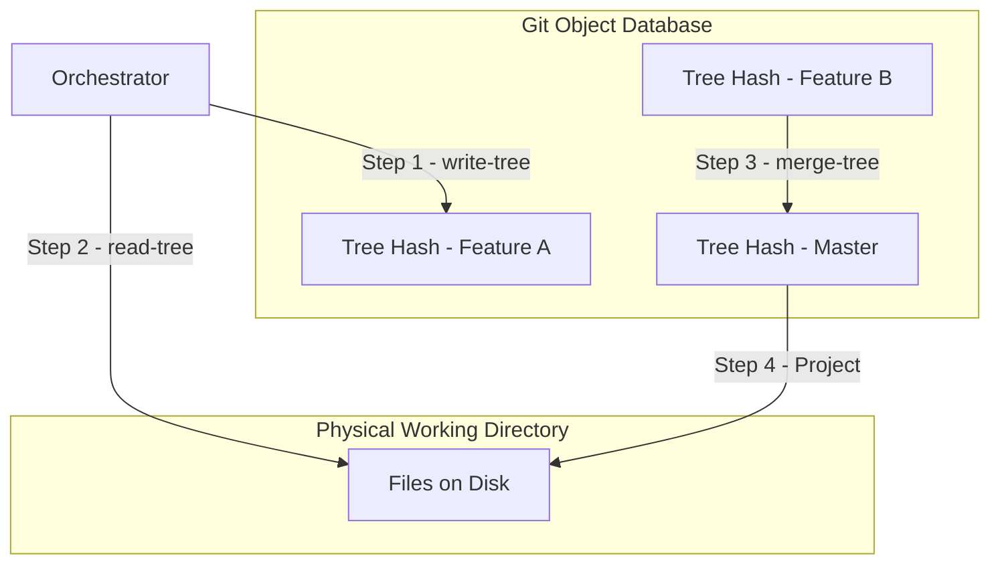

# 🧠 Topic: The Git Shadow Trees Projection Model

> [!abstract] Executive Summary (ELI5)
> Instead of giving every AI agent its own physical folder (Worktree) which is slow and heavy, we give them "Virtual Folders." The agent works in a shared physical space, but the system instantly swaps the files in and out using Git's internal database (Tree Hashes). It's like a movie projector: the screen (the folder) is the same, but the slides (the code versions) change instantly.

---

## 🎯 The "Why"
- **Problem Solved:** 
    1. **Concurrency Bloat:** Standard `git worktrees` create a physical folder for every branch, consuming massive disk space and slowing down I/O.
    2. **Context Pollution:** Agents working in the same folder cause merge conflicts and dirty `git status` logs.
    3. **Slow Backups:** Copying files for "save points" is O(N) where N is project size.
- **Alternatives:** 
    - `git stash`: Limited, hard to manage multiple concurrent tasks.
    - `git worktree`: Heavyweight, leaks into the main repository's metadata.
- **Trade-offs:** 
    - **Pro:** Microsecond snapshots, zero disk bloat, near-instant "reality swapping."
    - **Con:** Requires low-level Git plumbing knowledge; shell command side-effects (like a running server) aren't captured—only files.

## 💡 Mental Model: The Projector Analogy
- **The Screen:** Your physical Working Directory (what you see in VS Code).
- **The Slides:** **Git Tree Objects** stored in the hidden database.
- **The Projector:** The **Harness** (orchestrator) using `read-tree` to "project" a specific slide onto the screen.



## 🛠️ The Flow: Step-by-Step Architecture

### 1. Snapshotting (The "Save Slot")
Before any agent action, we capture the current state of the directory **without creating a commit**.
- **Command:** `git write-tree`
- **Result:** Returns a **Tree Hash** (e.g., `4b825dc...`). This is a 100% accurate representation of the file system stored in Git's blob storage.

### 2. Isolation via Session Pointers
Instead of branches, we use a simple mapping in the Harness memory:
`Session_ID -> Last_Tree_Hash`. 
Each agent "lives" in its own Tree Hash.

### 3. The Projection (Reality Swapping)
When Agent B needs the physical disk (to run tests or a compiler):
- **Command:** `git read-tree --reset -u <Hash_B>`
- **Effect:** Git instantly updates only the files that differ between the current disk state and Hash B. It's much faster than a full checkout.

### 4. Late Binding & Optimistic Merging
When multiple agents finish, we merge their "realities" **in-memory**:
- **Mechanism:** `git merge-tree <Base_Hash> <Hash_A> <Hash_B>`
- **Optimization:** This happens without ever checking out files to disk. It generates a **New Tree Hash** representing the merged state.
- **Conflict Handling:** If `merge-tree` detects a conflict, the Harness projects the *conflicted* state to the disk and asks a specialized "Integrator Agent" to resolve it manually.

## 🏗️ Actual Implementation (Conceptual Rust)
```rust
pub struct ShadowManager {
    pub repo_path: PathBuf,
}

impl ShadowManager {
    /// Captures the disk state and returns a Tree Hash.
    pub fn capture_state(&self) -> String {
        // Low-level Git plumbing: write-tree
        run_cmd("git write-tree")
    }

    /// Projects a specific hash back to the physical disk.
    pub fn project_hash(&self, hash: &str) {
        // read-tree --reset -u is the key for instant "reality swaps"
        run_cmd(&format!("git read-tree --reset -u {}", hash))
    }

    /// Merges two realities without a checkout.
    pub fn virtual_merge(&self, base: &str, a: &str, b: &str) -> MergeResult {
        // merge-tree is a pure-logic merge in the Git DB
        let result = run_cmd(&format!("git merge-tree {} {} {}", base, a, b));
        if result.has_conflicts() {
             MergeResult::Conflict(result.conflict_hash())
        } else {
             MergeResult::Success(result.merged_hash())
        }
    }
}
```

## ⚠️ Pitfalls & Anti-patterns
- **Untracked Files:** Files not in the Git index (e.g., build artifacts) aren't captured by `write-tree`.
- **Race Conditions:** If two processes try to `read-tree` simultaneously on the same folder, the file system will lock or corrupt. **Harness-level locking is mandatory.**

## 🔗 Deep Connections
- [[Adaptive-Context-Compaction-ACC]] (Memory vs. Storage)
- [[Optimistic-Locking-Distributed-Systems]] (Conceptual sibling)

## ❓ Active Recall Questions
> [!faq]- How does this model avoid the "Dirty Git Status" problem for the user?
> Because all snapshots are Tree Objects, not Commits. They don't appear in `git log`. The user's own `.git` history only sees the final, polished result when the Harness finally creates a real commit.

---
