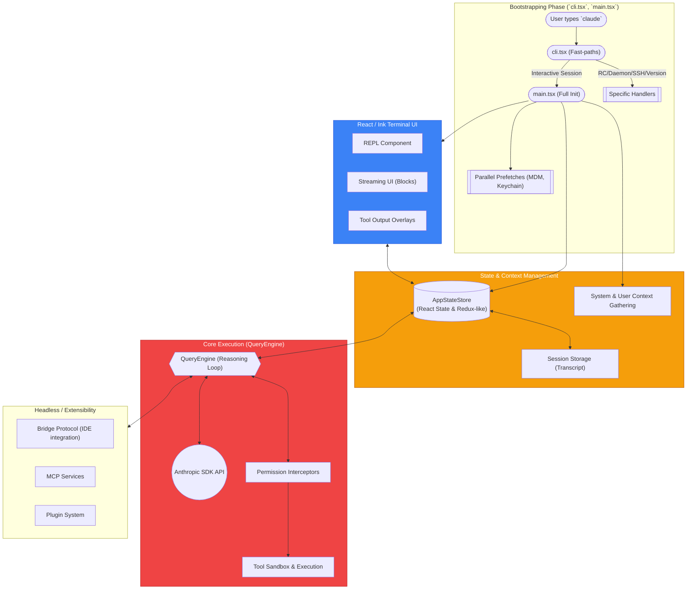

# Claude Code Architecture Map

Этот документ описывает высокоуровневую архитектуру инструмента командной строки **Claude Code**. В отличие от простых скриптов, это полноценное "долгоживущее" приложение (на базе Bun / Node.js), использующее React поверх терминала (Ink) и сложный Event Loop (через асинхронные генераторы) для общения с LLM-бэкендом.

---

## 🏗️ High-Level System Architecture

---

## 🧩 Подсистемы (Subsystems Overview)

Утилита разделена на несколько уровней ответственности. Ниже приведено описание основных слоев:

### 1. Точка входа и Быстрые пути (`cli.tsx` -> `main.tsx`)
Claude Code оптимизирована для быстрого запуска, поскольку работает в терминале (ожидается мгновенный ответ).
*   **Отказ от лишнего:** Многие процессы запускаются паралелльно (`promiseAll`), а тяжелые модули (`OpenTelemetry`, `gRPC`) подгружаются через *Lazy Loading*. 
*   **Fast Paths:** Если пользователь пишет `claude --version`, загрузка всего стейта не происходит (выполняется за доли миллисекунд). Также по-особому обрабатываются процессы, запускаемые IDE (`rc`, `bridge`), и демоны (`daemon`).

### 2. State Management & TUI (`React` + `Ink`)
В отличие от обычных CLI программ (которые просто делают `console.log`), у Claude Code есть полноценный UI, который нужно обновлять:
*   Всё состояние приложения живет в `AppStateStore` (глобальный стейт, аналогичный Redux).
*   Интерфейс отрисовывается в терминале с помощью React (библиотека Ink).
*   Интерфейс подписывается на изменения AppState и обновляет терминальный вывод (анимации размышления, прогресс-бары, диалоги разрешений).

### 3. QueryEngine: Ядро рассуждений (`src/QueryEngine.ts`)
Сердце системы. Вместо монолитного запроса-ответа, QueryEngine работает как асинхронный генератор (`async *submitMessage`), который "стримит" события (сообщения от Claude и результаты).
*   **Цикл Рассуждений (Reasoning Loop):** Отправляет промпт -> Получает ответ со списком действий (Tool Use) -> Исполняет инструменты (`canUseTool`) -> Отправляет результаты назад (Tool Result).
*   **Persistence (History):** Моментально скидывает логи на диск (`~/.claude/sessions/`) на каждом шаге цикла, чтобы при краше/выключении можно было сделать `claude --resume`. 

### 4. Tool Execution & Security Model
У Claude нет безусловного доступа к системе компьютера. Модель безопасности изолирует ИИ:
*   Инструменты инкапсулированы (`BashTool`, `FileEditTool`).
*   Между QueryEngine и Инструментами стоит слой проверки прав `canUseTool` (`Permission Hooks`), который либо спрашивает пользователя (в UI появляются кнопки `[y/N]`), либо разрешает автоматически (в зависимости от `Permission Mode`: Auto / Plan / Default).

### 5. Bridge & IPC (IDE Integration)
Если Claude запущен из плагина внутри VS Code или JetBrains, он работает в специальном "мостовом" режиме (`src/bridge/`):
*   CLI превращается в сервер, который обменивается с IDE JWT-токенами, статусами и запросами на разрешения. IDE отрисовывает UI, а CLI отвечает за выполнение логики и работу с файловой системой.
*   **MCP (Model Context Protocol):** Интеграция со специальным сервером для получения дополнительного контекста или исполнения команд на стороне других сервисов.
