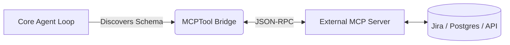

# 🧠 Topic: Plugins and MCP Extensibility

> [!abstract] Executive Summary (ELI5)
> Instead of teaching the AI every single trick in the world (which would make it massive and slow), you give it a "plug socket." When it needs to know how to query a specific weird database, or connect to Jira, you just plug in an adapter designed specifically for that tool.

---

## 🎯 The "Why"
- **Problem Solved:** Hardcoding external integrations (like Jira, GitHub, specific corporate APIs) into the core CLI code causes code bloat, rapid bit-rot as APIs change, and security concerns regarding bundled permissions.
- **Alternatives:** 
  - Having the agent write and execute custom bash scripts for every external API integration on the fly.
  - Hardcoding 500 different tool classes in the source core.
- **Trade-offs:** Emitting a standard protocol (like MCP) allows community-driven development of tools that the CLI can lazily discover and invoke. It offloads complexity but requires maintaining connection and schema translation layers.

## 💡 Mental Model & Analogy
- **Analogy:** "This is like a USB port on a laptop. The operating system doesn't know how to run a 3D resin printer or an old digital camera out of the box, but as long as the device speaks USB (MCP), the OS can interact with it seamlessly."
- **Visual/Diagram:** 


## 🛠️ Core Principles & Code Snippets
- **Model Context Protocol (MCP):** A standardized JSON-RPC interface for requesting resources, reading prompts, and invoking tools over local stdio or SSE.
- **Lazy Discovery:** The agent does not load the massive descriptions of every external tool at boot. It queries the MCP server *only* when it realizes it needs domain-specific capabilities.

```typescript
// MCP Tool Bridge Abstraction
export class MCPTool implements Tool {
  name: string;
  schema: ZodSchema;
  
  constructor(private mcpClient: MCPConnection, toolDef: MCPSchema) {
    this.name = toolDef.name;
    // Map MCP schema dynamically to the Agent's expected schema format
    this.schema = compileMcpToZod(toolDef.inputSchema);
  }

  async execute(args: any) {
    // Pass the payload through the RPC tunnel
    return await this.mcpClient.callTool(this.name, args);
  }
}
```

> [!tip] Implementation Note
> Separate the concept of internal safety from external tool safety. Even if an MCP server says a tool is safe, the core CLI should still apply its own human-in-the-loop review criteria based on the destructive nature of the command payload.

## ⚠️ Pitfalls & Anti-patterns
- **Common Mistakes:** Injecting thousands of MCP tools into the agent's system prompt simultaneously. The context window token count will explode, and the LLM's routing accuracy drops significantly.
- **When NOT to use:** For core filesystem operations (read/write/grep). Use highly optimized, native typescript/bash tools for primary filesystem actions to avoid JSON-RPC serialization overhead.
- **Performance/Security considerations:** Always run MCP servers in sandboxed environments or enforce strict user-consent approvals for external tool execution.

## 🔗 Deep Connections
- **Parent Topic:** [[Agent Tooling]]
- **Related Concepts:** [[Model Context Protocol]], [[Plugin Architectures]]
- **Prerequisites:** Understanding of IPC (Inter-process Communication) and JSON-RPC.

## ❓ Active Recall Questions
> [!faq]- Why translate the MCP schema into Zod/internal schemas?
> The engine requires strict validation and potential UI rendering hints before invocation. Translating guarantees the tool pipeline behaves identically whether the tool is native or external.

> [!faq]- How does this prevent prompt bloat?
> By grouping tools behind a meta-tool (e.g., `ListMcpResourcesTool`), the agent first queries what's available, and only injects the specific tool schemas for the current task into its active prompt loop.
