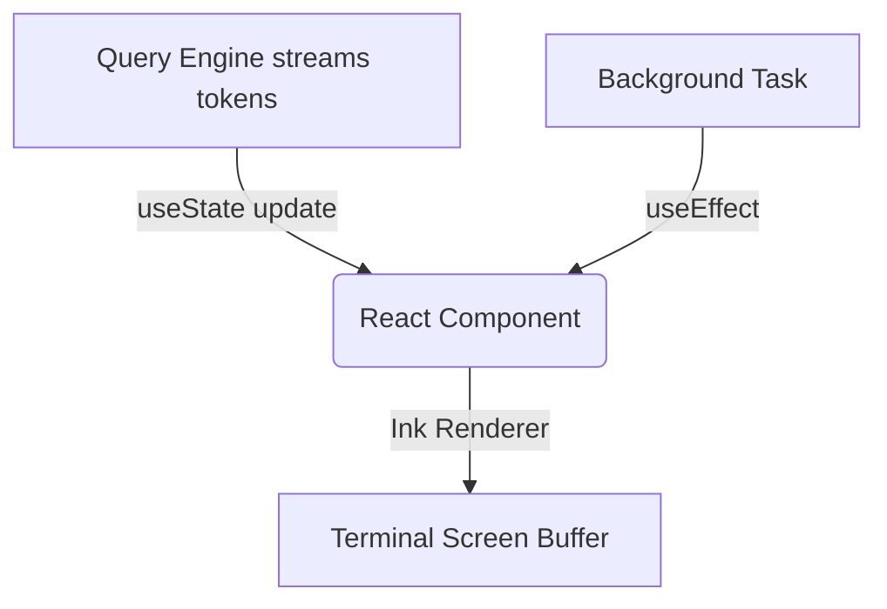

# 🧠 Topic: Reactive TUI Agent Pattern

> [!abstract] Executive Summary (ELI5)
> Imagine typing commands into a terminal, but instead of the text just printing line by line static output, the terminal acts like a breathing webpage. It repaints sections of the screen to show live updates of a robot's thoughts, costs, and progress bars without scrolling endlessly.

---

## 🎯 The "Why"
- **Problem Solved:** Traditional CLI agents output streams of raw text. When an LLM streams tokens, or a long-running process spins, the terminal buffer fills up rapidly. If you need to update a specific line (e.g., total token cost, or a loading spinner for a specific tool), raw stdout streams break down. 
- **Alternatives:** 
  - Standard `readline` sync REPL loops (like typical Python scripts).
  - TUI libraries like Ncurses or Ratatui (Rust).
- **Trade-offs:** Using React (via the Ink library) in a Node.js CLI allows developers to use web-styled component architecture, standard React hooks for state, and simple re-rendering logic for complex overlapping asynchronous token streams, while accepting the overhead of a V8 engine for a CLI.

## 💡 Mental Model & Analogy
- **Analogy:** "This is like building a Single Page Application (SPA), but instead of rendering DOM nodes to a browser pane, the renderer maps components to ANSI escape codes on the terminal grid."
- **Visual/Diagram:** 


## 🛠️ Core Principles & Code Snippets
- Treat the CLI like a React app: Use Context APIs for global state (like configuration, or global cost).
- When the LLM outputs a tool call, a specific `ToolResultMessage` component is rendered locally in the tree, which can conditionally display full output or collapse into a summary.

```typescript
// Example Ink structural pseudocode
const TerminalApp = () => {
  const { currentStream, isThinking } = useAgentStream();
  const cost = useCostTracker();
  
  return (
    <Box flexDirection="column">
      <CostHeader total={cost} />
      <MessageList messages={history} />
      {isThinking && <Spinner label="Agent is planning..." />}
      <LiveTextStream content={currentStream} />
    </Box>
  );
}
```

> [!tip] Implementation Note
> Always remember to manage rendering boundaries. Over-rendering in a terminal is highly CPU intensive. Use debouncing on the text stream updates.

## ⚠️ Pitfalls & Anti-patterns
- **Common Mistakes:** Trying to mix raw `console.log()` outputs while an Ink React tree is active. It will completely corrupt the terminal buffer rendering.
- **When NOT to use:** If the CLI is meant to be piped to other UNIX tools (like `cat file | mycli | grep algo`). React TUIs break traditional UNIX pipe compatibility.
- **Performance/Security considerations:** React in Node.js has a slight startup delay. Not suitable for purely fast automated scripts.

## 🔗 Deep Connections
- **Parent Topic:** [[CLI Architectures]]
- **Related Concepts:** [[Agent Interaction Models]], [[Ink]]
- **Prerequisites:** React lifecycle, ANSI terminal capabilities.

## ❓ Active Recall Questions
> [!faq]- Why can't we use standard stdout while Ink is running?
> Ink hijacks the terminal cursor and buffer to redraw the screen continually. `stdout` writes bypass this system and break the visual state.

> [!faq]- How does this benefit agentic behavior?
> It allows agents to display complex parallel states—such as spinning off background tasks, asking for inline permissions, and showing cost—simultaneously without visually overwhelming the user.
