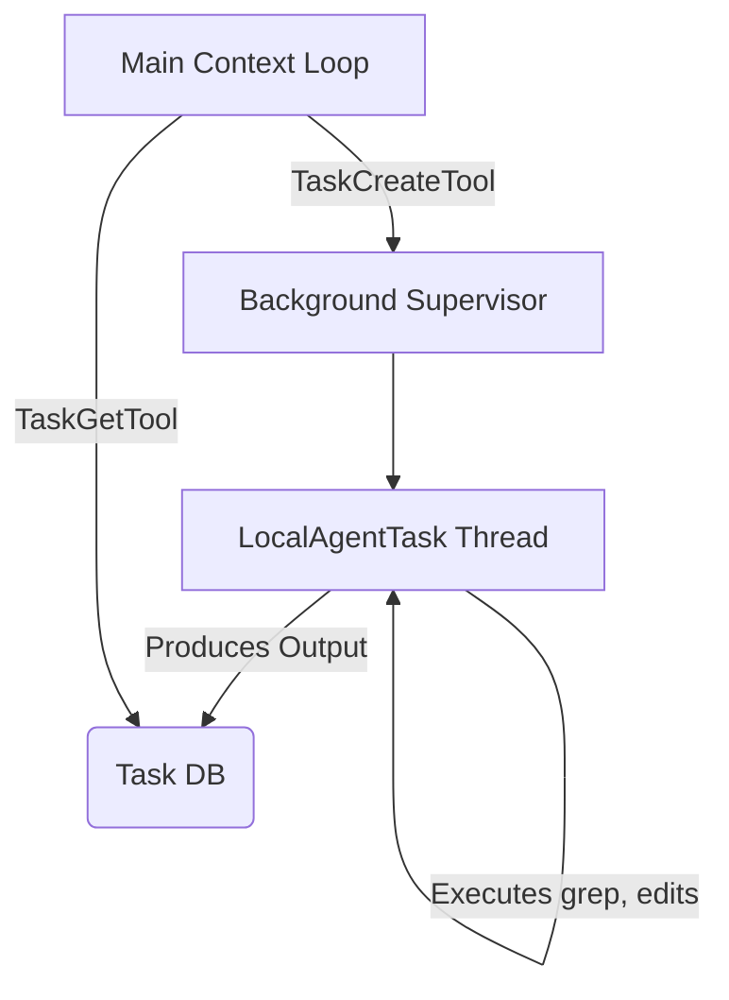

# 🧠 Topic: Subagent and Task Orchestration

> [!abstract] Executive Summary (ELI5)
> Sometimes a task is too big for one robot brain. Instead of getting confused, the main robot assigns parts of the job to smaller, specialized robots working in the background. Once they finish, they hand the summary back to the boss.

---

## 🎯 The "Why"
- **Problem Solved:** LLMs have finite context limits. If a single agent tries to debug a 20-file problem, run thousands of searches, and parse dense log outputs, its context window fills with "junk traces." Additionally, single agents get distracted by sub-tasks.
- **Alternatives:** 
  - Adaptive Context Compaction (summarizing and removing old logs).
  - A single massive context loop.
- **Trade-offs:** Launching subagents or localized task threads segregates memory (keeping the main agent’s context clean) but introduces synchronization and orchestration complexity (polling, pausing, communicating).

## 💡 Mental Model & Analogy
- **Analogy:** "This is like a lead architect assigning a junior developer to investigate a bug in a specific module. The junior developer digs through the logs (getting dirty in the details) and just reports back 'The database query was missing an index', sparing the architect from reading the raw logs."
- **Visual/Diagram:** 


## 🛠️ Core Principles & Code Snippets
- **Forking Context:** A subagent starts with an empty slate or highly restricted context to save token cost.
- **Async Execution:** The main task can return to the user, allowing developers to type other commands while the subagent grinds in the background.
- **Hierarchical Tool Use:** Subagents might be restricted from certain dangerous tools (like `git wipe`) that only the main agent has authorization for.

```typescript
// Subagent execution pseudocode
export const launchSubagent = async (goal: string) => {
  // Create a clean memory slate, devoid of the main chat history
  const mem = new MemoryTree();
  // Restrict to read-only tools or specific capabilities
  const tools = [FileReadTool, GrepTool]; 
  
  const worker = new QueryEngine(mem, tools);
  const result = await worker.run(goal);
  
  return summarize(result); // Return clean summary to parent
}
```

> [!tip] Implementation Note
> When the background agent finishes, it must provide a structured final artifact or summary, not raw logs. The parent agent relies on this abstraction.

## ⚠️ Pitfalls & Anti-patterns
- **Common Mistakes:** Passing the entire parent memory tree into the subagent, immediately blowing the token budget twofold.
- **When NOT to use:** For standard, simple queries where an immediate tool call (like `view_file`) would suffice. Spawning an agent adds overhead and API calls.
- **Performance/Security considerations:** Multiple LLM API calls running concurrently can burn through API quotas (or money) extremely fast.

## 🔗 Deep Connections
- **Parent Topic:** [[Compound AI Systems]]
- **Related Concepts:** [[Agent Layering]], [[Asynchronous Tasks]]
- **Prerequisites:** Promises/Async orchestration, Context window constraints.

## ❓ Active Recall Questions
> [!faq]- Why segment memory between the main agent and subagent?
> To prevent "context pollution," where intermediate garbage loops, error stack traces, and dead ends dilute the main agent's focus and waste token limits.

> [!faq]- How does the main agent know the task is done?
> It uses polling tools (e.g., `TaskGetTool`, `TaskOutputTool`) to periodically inspect the status of the spawned background task while maintaining its own event loop.
