# Modular Block Architecture: Universal Agent System

> [!abstract] Executive Summary (ELI5)
> Any coding agent system can be decomposed into **10 interchangeable blocks**. Each block solves one specific problem. You can study each block independently, swap implementations, and mix-match to build your own agent. Think of it as a LEGO set where each bag builds a different subsystem.

---

## The 10 Blocks

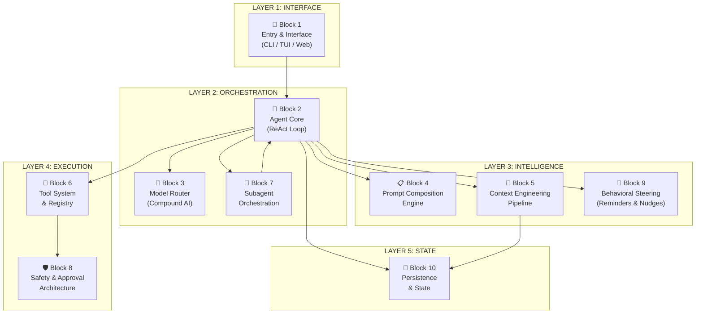

---

## Block Dependency Map

> Which blocks **must** know about each other, and which are truly independent.

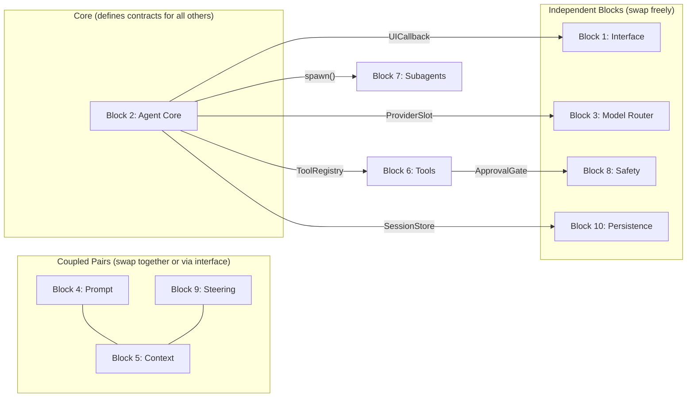

**Key insight:** Block 2 (Agent Core) is the **spine**. Everything else plugs into it via well-defined interfaces. If you want to build a similar system from scratch, start here.

---

## Block 1: Entry & Interface Layer

**Problem:** How does the user interact with the agent?

**Sub-blocks:**

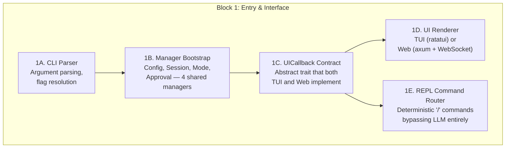

| Sub-block | Responsibility | Why It's Separate |
|---|---|---|
| **1A. CLI Parser** | Parse `--continue`, `--model`, `--working-dir`, positional prompt | Swap for IDE extension or API gateway without touching anything else |
| **1B. Manager Bootstrap** | Create 4 singleton managers (Config, Session, Mode, Approval) and inject into AgentFactory | Centralized dependency construction; all downstream code receives ready-made managers |
| **1C. UICallback Contract** | Abstract interface: `on_agent_message()`, `on_tool_approval()`, `on_status_update()` | **The decoupling point** — agent doesn't know if it's in a terminal or browser |
| **1D. UI Renderer** | Concrete rendering: TUI uses blocking modals, Web uses async polling + WebSocket streaming | Two completely independent implementations of the same contract |
| **1E. REPL Command Router** | Routes `/clear`, `/mode`, `/models`, `/undo`, `/sessions` etc. to 9 handler classes | **No LLM involved** — deterministic, synchronous, immediate; prevents wasting tokens on simple ops |

**Alternatives you could swap in:**
| Alternative | Trade-off |
|---|---|
| Pure CLI (stdin/stdout) | Simplest, no UI framework needed |
| IDE Extension (VS Code) | Richer UX, but vendor lock-in |
| Slack/Discord bot | Collaborative, but latency |
| REST API only | Headless, good for CI/CD pipelines |

**Crate mapping:** `opendev-cli`, `opendev-tui`, `opendev-web`, `opendev-repl`

---

## Block 2: Agent Core (ReAct Loop)

**Problem:** How does the agent reason and act iteratively?

**Sub-blocks:**

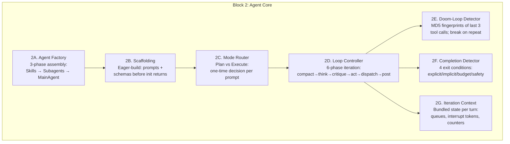

| Sub-block | Responsibility | Why It's Separate |
|---|---|---|
| **2A. Agent Factory** | Single entry point `create_agents()`: discover skills → register subagents → construct MainAgent. Ensures identical setup for TUI and Web | Centralizes all wiring; swap factory to change what agents get created |
| **2B. Scaffolding** | Eager construction of prompts and tool schemas (no lazy init). `BaseAgent` has 4 abstract methods: `build_system_prompt()`, `build_tool_schemas()`, `call_llm()`, `run_sync()` | Prevents lazy-init latency spikes; all dependencies resolved upfront |
| **2C. Mode Router** | Detects `/plan` command or planning-intent heuristic → delegates to Planner subagent (read-only) or proceeds with Normal mode (full access) | Single routing decision per prompt; clean separation of planning from execution |
| **2D. Loop Controller** | Orchestrates the 6-phase cycle: context compaction → thinking (optional, no tools) → self-critique (optional) → action (LLM selects tools) → tool dispatch → post-process (persist, hooks, respond) | The actual engine; each phase independently configurable (e.g., disable thinking, disable critique) |
| **2E. Doom-Loop Detector** | Computes MD5 fingerprint of `(tool_name, args)` tuples. If 3 consecutive identical fingerprints → inject "change strategy" nudge and break | Prevents infinite loops where agent repeats the same failing action; zero LLM cost detection |
| **2F. Completion Detector** | Four exit conditions: (1) explicit `task_complete` tool call, (2) implicit text-only response (no tools), (3) nudge budget exhausted (max 3), (4) iteration safety limit reached | Distinguishes "done" from "stuck" from "out of budget" — each requires different handling |
| **2G. Iteration Context** | Per-turn state bundle: thread-safe bounded queue (maxsize=10) for mid-execution message injection, interrupt tokens for cancellation, step counter, cost accumulator | Isolates mutable per-turn state from agent-level state; enables clean concurrency |

**The Extended ReAct Loop (6 phases per turn):**

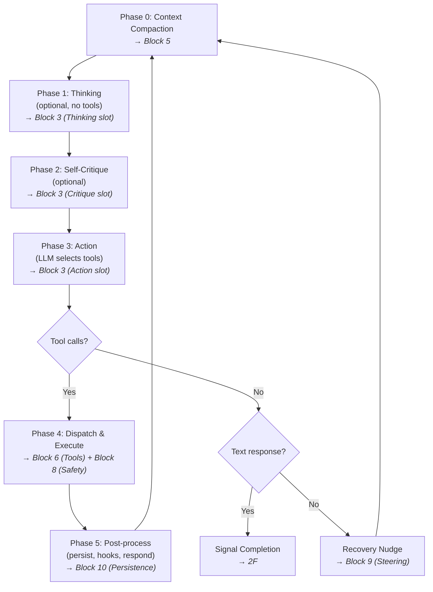

> Notice how each phase delegates to a different block. The Loop Controller (2D) is a **coordinator**, not a monolith — it orchestrates blocks 3, 5, 6, 8, 9, 10.

**Key design decisions:**
- **Single concrete class** (`MainAgent`) — behavioral variation via constructor params, not inheritance
- **Eager scaffolding** — prompts and schemas built before init returns
- **Plan vs Execute routing** — one-time decision per prompt

**Alternatives you could swap in:**
| Alternative | Trade-off |
|---|---|
| ReWOO (Reasoning Without Observation) | Plans all steps upfront, fewer LLM calls, but brittle |
| PDAR (Plan-Do-Assess-Revise) | Explicit planning phase, better for complex tasks |
| Tree-of-Thought | Parallel exploration, expensive but higher quality |
| Simple loop (no thinking/critique) | Faster, cheaper, less reliable |

**Crate mapping:** `opendev-agents` (main_agent.rs, react_loop/)

---

## Block 3: Model Router (Compound AI)

**Problem:** How to use multiple LLMs with different cost/capability profiles?

**Sub-blocks:**

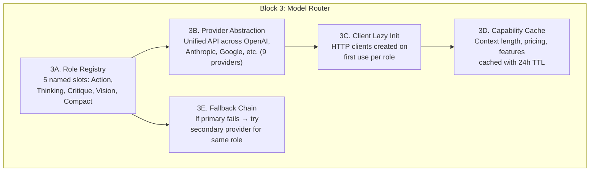

| Sub-block | Responsibility | Why It's Separate |
|---|---|---|
| **3A. Role Registry** | Maps 5 named roles to user-configured model IDs. Each role independently configurable via config | Swap one model without affecting others; e.g., change Thinking from o3 to DeepSeek-R1 |
| **3B. Provider Abstraction** | Unified `call_llm(messages, tools, config) → Response` across 9 providers (OpenAI, Anthropic, Google, Groq, Mistral, Fireworks, DeepInfra, OpenRouter, Azure) | Add a new provider without touching routing logic |
| **3C. Client Lazy Init** | HTTP client for each role created only when first needed. 4 client slots on MainAgent (normal, thinking, critique, VLM) | Avoids establishing connections to providers you never use in a session |
| **3D. Capability Cache** | Stores model capabilities (context_length, supports_vision, pricing) at `~/.opendev/cache/`. Stale-while-revalidate: serve cached, refresh in background. Works offline | Prevents API call on every startup; degrades gracefully without network |
| **3E. Fallback Chain** | If primary model for a role fails (429, 500, timeout) → try configured fallback | Resilience without manual intervention; configurable per role |

**The 5 Roles:**

| Role | Purpose | Typical Model | When Used |
|---|---|---|---|
| **Action** | Primary tool-based reasoning | Claude Sonnet / GPT-4o | Every turn |
| **Thinking** | Extended reasoning, no tools | o3 / DeepSeek-R1 | Start of complex turns |
| **Critique** | Self-evaluation | Sonnet / GPT-4o-mini | After thinking |
| **Vision** | Image/screenshot processing | GPT-4o / Claude | When images present |
| **Compact** | Context summarization | Haiku / GPT-4o-mini | At 99% context pressure |

**Routing logic (deterministic, not learned):**

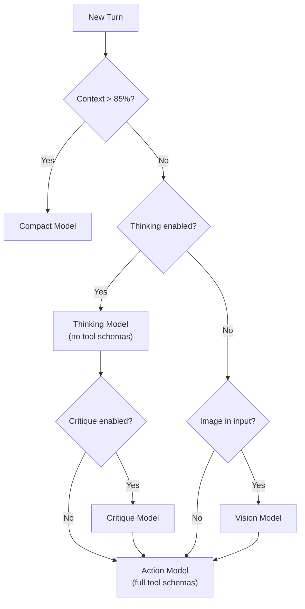

**Alternatives you could swap in:**
| Alternative | Trade-off |
|---|---|
| Single model for everything | Simple, but expensive or weak |
| Learned router (classifier) | Adaptive, but requires training data |
| Cascade (cheap → expensive on failure) | Cost-efficient, but adds latency on hard tasks |
| Local + Cloud hybrid | Privacy + power, but complex deployment |

**Crate mapping:** `opendev-http`, `opendev-config`

---

## Block 4: Prompt Composition Engine

**Problem:** How to assemble the right system prompt for each situation?

**Sub-blocks:**

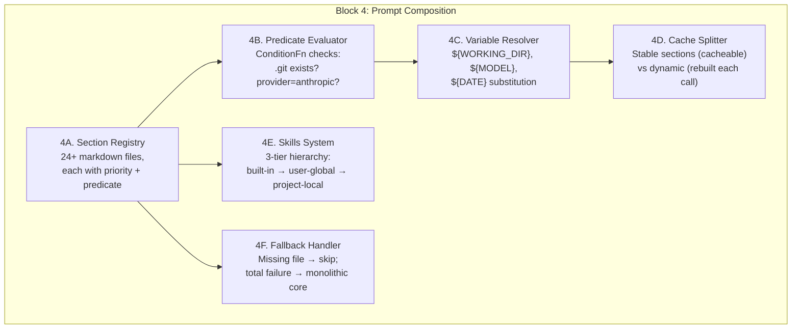

| Sub-block | Responsibility | Why It's Separate |
|---|---|---|
| **4A. Section Registry** | 24+ prompt sections as standalone markdown files, each tagged with `priority` (sort order) and `activation_condition` (when to include). Example sections: tool instructions, safety rules, git rules, coding style | Add/remove behavioral rules by adding/removing a file — no code changes |
| **4B. Predicate Evaluator** | Evaluates `ConditionFn` for each section: "Is this a git repo?", "Is provider Anthropic?", "Is this Plan mode?". Mutually exclusive sections gated on `model_provider` | Prevents loading irrelevant instructions (e.g., no Git rules in non-Git directory) |
| **4C. Variable Resolver** | Substitutes `${WORKING_DIR}`, `${MODEL_NAME}`, `${DATE}` etc. in section templates | Keeps templates generic and reusable across projects |
| **4D. Cache Splitter** | Splits assembled prompt into **stable** (rarely changes, cacheable via Anthropic prompt caching → ~88% cost reduction) and **dynamic** (changes per turn) | Major cost optimization; doesn't affect behavior |
| **4E. Skills System** | Reusable domain-specific prompt modules (e.g., git commit, PR review, checklist). Three-tier discovery: `builtin/` → `~/.opendev/skills/` → `.opendev/skills/`. Two deployment modes: **inline** (inject into current prompt) or **delegated** (spawn subagent) | Add domain knowledge without modifying core agent; project-specific skills override built-in ones |
| **4F. Fallback Handler** | Graceful degradation: missing section file → skip silently; complete composition failure → fall back to single monolithic template | System never crashes due to missing prompt file |

**Pipeline:**

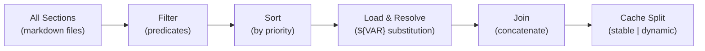

**Alternatives you could swap in:**
| Alternative | Trade-off |
|---|---|
| Static monolithic prompt | Simple, but inflexible and wastes tokens |
| Template engine (Jinja/Handlebars) | More expressive, but overkill for most cases |
| Prompt database (versioned, A/B testable) | Great for production, complex to manage |
| No system prompt (few-shot only) | Minimal, but unreliable behavior |

**Crate mapping:** `opendev-agents` (prompts/)

---

## Block 5: Context Engineering Pipeline

**Problem:** How to sustain 100+ turn conversations within finite context windows?

**Sub-blocks:**

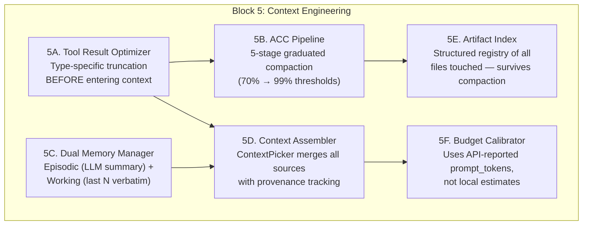

| Sub-block | Responsibility | Why It's Separate |
|---|---|---|
| **5A. Tool Result Optimizer** | Cleans tool outputs **before** they enter context. Per-type rules: file reads → metadata ("142 lines, 4831 chars"); search → match counts; directories → item counts; errors → 200-char truncation. Outputs >8KB offloaded to scratch files with 500-char preview. Auto-cleanup after 7 days | Prevents garbage from entering context in the first place; cheaper than compacting later |
| **5B. ACC Pipeline** | 5-stage graduated compaction triggered by context pressure thresholds. Each stage more aggressive than the last. Protected classes survive pruning: last 40K tokens, critical tool types (skill, plan, read_file, screenshot), last 50 messages always kept verbatim | Core innovation: progressive degradation instead of cliff-edge "context full" failure |
| **5C. Dual Memory Manager** | **Episodic Memory**: LLM-generated summary of full conversation (regenerated every 5 messages, captures strategic goals/findings/paths). **Working Memory**: last N exchanges verbatim (default 6, provides fine-grained operational detail). Thinking context = episodic + working + current query | Separates "what's the big picture" (episodic) from "what just happened" (working); different refresh rates |
| **5D. Context Assembler (ContextPicker)** | Merges system prompt + memory + tool results + history + reminders + current query. Each piece tracked via `ContextPiece` with provenance (source, timestamp, priority) | Single point of assembly; provenance tracking enables debugging "why did the agent see X?" |
| **5E. Artifact Index** | Structured registry of all files touched and symbols found. **Always preserved** during compaction — even when tool outputs are summarized, the index of *what was done* survives | Agent remembers "I edited file X at line 42" even after the actual diff is compacted away |
| **5F. Budget Calibrator** | Calculates context pressure from **API-reported** `prompt_tokens`, not local tokenizer estimates. Calibrates ACC thresholds against actual model limits | Local tokenizers diverge from API by 5-15%; using API numbers prevents premature or late compaction |

**The 5-Stage ACC (Adaptive Context Compaction):**

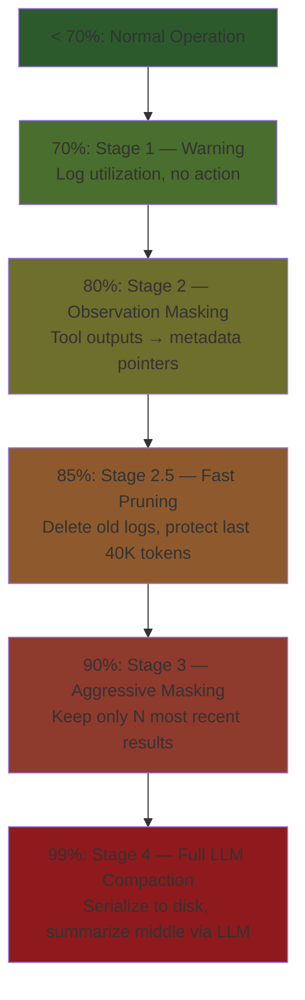

**Alternatives you could swap in:**
| Alternative | Trade-off |
|---|---|
| No compaction (fixed window) | Simple, but agent "forgets" after N turns |
| RAG over conversation history | Retrieval-based, good recall, but noisy |
| Sliding window only | Predictable, but loses strategic context |
| Hierarchical summarization (tree) | Better fidelity, but expensive |

**Crate mapping:** `opendev-context`, `opendev-memory`

---

## Block 6: Tool System & Registry

**Problem:** How to give the agent capabilities (file ops, shell, web, code analysis)?

**Sub-blocks:**

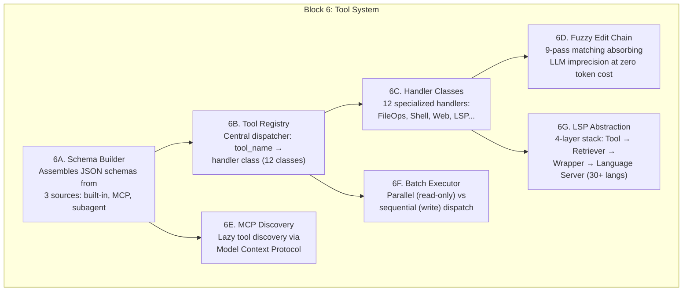

| Sub-block | Responsibility | Why It's Separate |
|---|---|---|
| **6A. Schema Builder** | Assembles JSON schemas from 3 sources: (1) static built-in tool definitions, (2) dynamically discovered MCP tools, (3) subagent tool wrappers. Output = array of JSON schemas sent to LLM | Single point where LLM "learns" what tools exist; controls what's visible (ties to Block 8 safety via schema filtering) |
| **6B. Tool Registry** | Central dispatcher: receives `(tool_name, args)` from LLM, routes to correct handler class. Maps across 12 handler classes | Decouples tool selection (LLM) from tool execution (handler); add a handler without touching the registry |
| **6C. Handler Classes (12)** | Specialized implementations: FileOps (read/write/edit/list/search), Shell (run_command, background), Web (fetch/search/screenshot), LSP/Symbols (find/rename/replace), User (ask_user, todos), Discovery (search_tools), Delegation (spawn_subagent, invoke_skill, batch) | Each handler encapsulates domain logic; e.g., Shell handler manages PTY forking, timeout, output capture independently |
| **6D. Fuzzy Edit Chain** | 9-pass chain-of-responsibility for `edit_file`: Exact → Line-Trimmed → Block-Anchor → Whitespace-Normalized → Indentation-Flexible → Escape-Normalized → Trimmed-Boundary → Context-Aware (LCS >0.5) → Multi-Occurrence. Each pass progressively relaxes matching | **Zero-token-cost error absorption**: LLMs produce ~correct code (trailing whitespace, indentation drift). The tool absorbs imprecision instead of failing and burning tokens on retries |
| **6E. MCP Discovery** | `search_tools` queries MCP servers for available tools. Only schemas for searched/invoked tools are loaded into context. Reduces baseline schema overhead from ~40% to <5% of context budget | Token efficiency: don't tell the LLM about 200 tools when it only needs 3 this turn |
| **6F. Batch Executor** | Classifies tools as read-only or write. Read-only tools (read_file, search, list) dispatched in parallel via asyncio. Write tools (edit, write, run_command) dispatched sequentially to prevent race conditions | Maximizes throughput for exploration; prevents data races during modification |
| **6G. LSP Abstraction** | 4-layer stack: Agent Tool Layer (find_symbol, rename_symbol) → Symbol Retriever (caching, deduplication) → LSP Server Wrapper (JSON-RPC lifecycle) → Concrete Language Server (Pyright, rust-analyzer, etc.). Supports 30+ languages | Semantic code operations (go-to-definition, find references, rename) instead of regex-based hacking; swap language server without touching tool interface |

**Shell Execution Pipeline (6 stages for `run_command`):**
1. **Safety gates** — check against danger rules (→ Block 8)
2. **Preparation** — resolve working directory, environment
3. **Server detection** — 16 patterns (e.g., `npm start`, `flask run`) → auto-background
4. **Fork** — PTY (interactive) or pipe (non-interactive) execution
5. **Output management** — streaming capture, truncation at MAX_LINES/MAX_BYTES
6. **Timeout** — configurable, default 120s, SIGTERM → SIGKILL

**Alternatives you could swap in:**
| Alternative | Trade-off |
|---|---|
| Code execution only (no structured tools) | Flexible, but unsafe and hard to audit |
| OpenAI function calling only | Standard, but limited to API-defined schemas |
| LangChain tools | Large ecosystem, but heavy abstraction |
| Unix philosophy (pipes + scripts) | Composable, but hard for LLM to reason about |

**Crate mapping:** `opendev-tools-core`, `opendev-tools-impl`, `opendev-tools-lsp`, `opendev-tools-symbol`, `opendev-mcp`

---

## Block 7: Subagent Orchestration

**Problem:** How to delegate specialized tasks without polluting the main agent's context?

**Sub-blocks:**

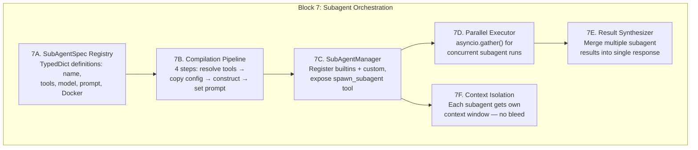

| Sub-block | Responsibility | Why It's Separate |
|---|---|---|
| **7A. SubAgentSpec Registry** | Defines each subagent type as `TypedDict`: `name`, `description`, `system_prompt`, `tool_allowlist`, `model_override`, Docker config. 8 built-in types (Code Explorer, Planner, Web Tools, User Clarification, etc.) + custom | Declarative definitions; add new agent type by adding a spec, not writing code |
| **7B. Compilation Pipeline** | 4-step process: (1) resolve tool allowlist → (2) copy AppConfig with model override → (3) construct MainAgent with filtered ToolRegistry → (4) set `_subagent_system_prompt`. Result: `CompiledSubAgent` sharing parent's tool registry (cheap) | Reuses MainAgent class — behavioral variation through construction, not inheritance |
| **7C. SubAgentManager** | Manages lifecycle: registers built-in + custom agents, exposes `spawn_subagent` as a tool the main agent can call. Bridges permission checks from parent | Single point of subagent creation; ensures all subagents go through same validation |
| **7D. Parallel Executor** | Main agent can request multiple subagents concurrently (e.g., 3 Code Explorers searching different directories). Uses `asyncio.gather()` for parallel execution | Reduces latency for multi-area exploration; each subagent runs independently |
| **7E. Result Synthesizer** | Collects results from parallel subagents and merges into a single structured response for the main agent to consume | Main agent sees one coherent result, not N separate streams |
| **7F. Context Isolation** | Each subagent gets its **own context window** — intermediate search results, failed attempts, exploration noise stays isolated. Only the final result returns to parent | **Core value proposition**: prevents 50 search results from a code exploration from polluting the main agent's context where it's writing code |

**Subagent Prompt Refinements:**
- Explicit termination conditions ("stop when evidence is clear")
- Anti-loop instructions (prevent subagent from going on tangents)
- Scoped system prompt (narrower than main agent's)

**Alternatives you could swap in:**
| Alternative | Trade-off |
|---|---|
| No subagents (single agent) | Simple, but context pollution on complex tasks |
| Multi-agent with shared memory | Collaborative, but coordination overhead |
| Pipeline (agent chain) | Sequential, predictable, but slow |
| Peer-to-peer (agent swarm) | Emergent behavior, but hard to debug |

**Crate mapping:** `opendev-agents` (subagents/, agent_types/)

---

## Block 8: Safety & Approval Architecture

**Problem:** How to let an agent run shell commands without destroying your system?

**Sub-blocks:**

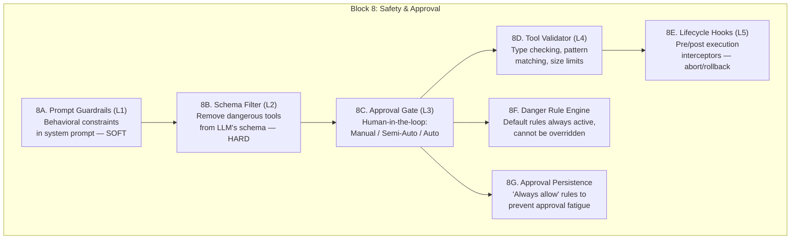

| Sub-block | Responsibility | Why It's Separate |
|---|---|---|
| **8A. Prompt Guardrails (L1)** | Behavioral constraints embedded in system prompt ("never run destructive commands", "always confirm before deleting"). **Soft constraint** — model CAN ignore | First line of defense; catches most cases via instruction following; costs zero runtime |
| **8B. Schema Filter (L2)** | Removes dangerous tools entirely from JSON schemas sent to LLM. Model literally **cannot call** a tool it doesn't know exists. **Most robust layer** | Hard constraint at the knowledge level; no prompt injection can bypass a non-existent tool |
| **8C. Approval Gate (L3)** | Three modes: **Manual** (every call needs approval), **Semi-Auto** (safe tools auto-approved via allowlist, dangerous ones gated), **Auto** (everything passes — for CI/CD). Renders approval dialog via UICallback | Human oversight at the execution boundary; the checkpoint where user sees exactly what will happen |
| **8D. Tool Validator (L4)** | Per-tool validation: type checking of args against schema, pattern matching (e.g., reject `rm -rf /`), file size limits, forbidden file extensions, path traversal detection | Catches malformed or dangerous arguments that passed approval (e.g., user approved `run_command` but args contain injection) |
| **8E. Lifecycle Hooks (L5)** | User-defined scripts triggered at events: `PreToolUse` (can abort), `PostToolUse` (can rollback), `SessionStart`, `UserPromptSubmit`. External scripts observe/intercept the agent | Extensibility point: users add custom safety logic (e.g., "log all file writes to audit trail", "block writes to production config") |
| **8F. Danger Rule Engine** | Hardcoded rules that are **always active and cannot be overridden** by user config: `rm -rf /`, writes to system directories, network access to internal IPs | Last resort protection; even in Auto mode, these rules block |
| **8G. Approval Persistence** | "Always allow" markers saved per tool+pattern combination. Once user approves "run_command: npm test", it won't ask again in this session | Prevents **approval fatigue** — the #1 reason users switch to Auto mode (bypassing all safety) |

**The 5 Layers (defense-in-depth):**

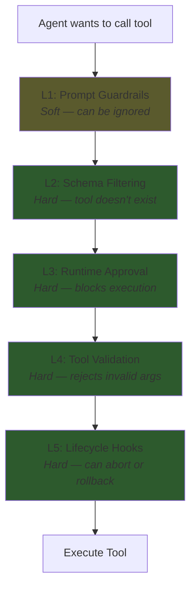

**Alternatives you could swap in:**
| Alternative | Trade-off |
|---|---|
| Sandbox only (Docker/VM) | Strong isolation, but heavy and slow |
| Allowlist only (no deny rules) | Simple, but can't handle unknown tools |
| LLM self-evaluation ("is this safe?") | Flexible, but unreliable |
| No safety (YOLO mode) | Fast, but... don't |

**Crate mapping:** `opendev-runtime` (permissions/, approval/), `opendev-hooks`, `opendev-plugins`

---

## Block 9: Behavioral Steering (Reminders & Nudges)

**Problem:** How to keep the agent following instructions over 100+ turn conversations?

**Sub-blocks:**

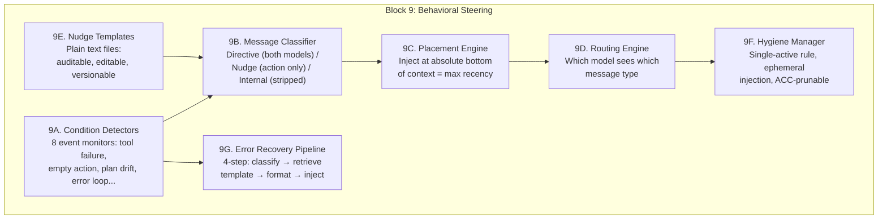

| Sub-block | Responsibility | Why It's Separate |
|---|---|---|
| **9A. Condition Detectors** | 8 event monitors evaluating state between tool execution and next LLM call: (1) Tool Failure, (2) Empty Action (reasoning but no tool calls), (3) Plan Drift (intent="finish" but todos remain), (4) Error Loop (3 identical errors), (5) Step Pressure (>80% budget), (6) Exploration Spiral, (7) Premature Completion, (8) Context Threshold | Each detector independently testable; add new behavioral rules by adding a detector |
| **9B. Message Classifier** | Classifies generated messages into 3 types: **Directive** (strategy change → sent to BOTH thinking and action models), **Nudge** (behavioral guardrail → action model ONLY), **Internal** (diagnostic → stripped from all LLM calls) | Different messages need different routing; thinking model shouldn't see tactical nudges |
| **9C. Placement Engine** | Injects reminders at **absolute bottom** of context (last message before LLM call). Exploits transformer attention bias: recent tokens get disproportionate attention | The "why" behind effectiveness: a reminder at position -1 is ~10x more influential than one at position -1000 |
| **9D. Routing Engine** | Determines which model slot receives which message. Directives → both thinking + action. Nudges → action only. Internal → neither | Prevents tactical noise from corrupting strategic reasoning in the thinking model |
| **9E. Nudge Templates** | Plain text files defining nudge content. Auditable, editable by users, versionable in git. Context variables injected at render time | Content separated from infrastructure; change what the nudge says without touching delivery code |
| **9F. Hygiene Manager** | Three rules: (1) **Single-Active-Nudge** — only the most recent version of each nudge type exists (no stacking), (2) **Ephemeral Injection** — inserted milliseconds before call, then discarded (no permanent context pollution), (3) **ACC Integration** — old nudges pruned first at 85% threshold | Prevents nudge accumulation from consuming the context budget they're trying to protect |
| **9G. Error Recovery Pipeline** | Specialized 4-step flow for tool errors: (1) Classify error type (permission, not_found, mismatch, timeout, etc.), (2) Retrieve corresponding recovery template, (3) Format with context (file path, error message, available alternatives), (4) Inject as system message at maximum recency | Turns generic errors into actionable recovery instructions; agent-aware (suggests "delegate to Code Explorer" when appropriate) |

**The 8 Trigger Conditions:**

| Trigger | Condition | Generated Nudge |
|---|---|---|
| Empty Action | Reasoning present but no tools called | "Take action — use a tool" |
| Plan Drift | Intent is "finish" but plan has open todos | "Verify completion against plan" |
| Error Loop | Last 3 results are identical errors | "Change strategy or tool parameters" |
| Step Pressure | Step count > 80% of budget | "Converge on solution now" |
| Tool Failure | Tool returned error | Error-specific recovery hint |
| Exploration Spiral | Agent reading files without progress | "Stop exploring, start implementing" |
| Premature Completion | Agent signals done before goal met | "Review original request" |
| Context Threshold | Context > 85% budget | "Be concise, summarize where possible" |

**Alternatives you could swap in:**
| Alternative | Trade-off |
|---|---|
| No steering (trust system prompt) | Simple, works for short sessions, fails for long ones |
| Full conversation rewrite | High quality, but extremely expensive |
| External supervisor agent | Powerful, but doubles cost |
| Rule-based state machine | Predictable, but rigid |

**Crate mapping:** `opendev-runtime` (error_handler.rs), `opendev-agents` (prompts/)

---

## Block 10: Persistence & State

**Problem:** How to save/restore agent state, enable undo, manage configuration?

**Sub-blocks:**

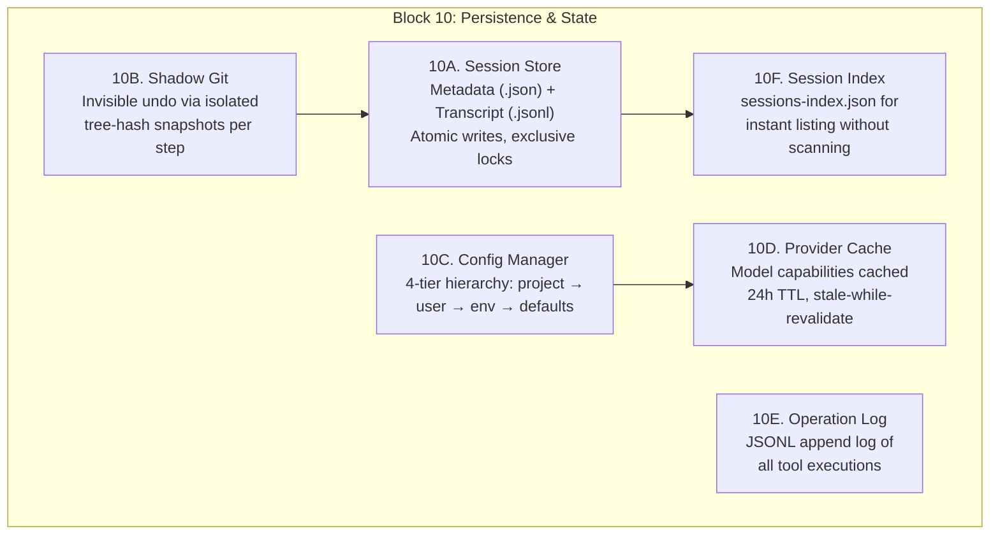

| Sub-block | Responsibility | Why It's Separate |
|---|---|---|
| **10A. Session Store** | Two files per conversation: **Metadata** (`.json`: session ID, timestamps, working dir, title, LLM-generated summary) and **Transcript** (`.jsonl`: one message per line — role, content, tool calls, token counts). Safety: atomic rename via `os.rename()` (no partial writes), exclusive locks via `fcntl.flock` (no concurrent corruption), auto-save every 5 turns | Enables `--continue` (resume sessions), session listing, and cost tracking. JSONL = append-only, crash-safe |
| **10B. Shadow Git** | Shadow repository at `~/.opendev/snapshot/<project_id>/` completely isolated from user's `.git`. Records **tree hash** (not full commit) at every agent step — lighter and faster. `/undo` command: diffs current state against shadow, restores. Projects mapped via `DefaultHasher` on absolute path. Respects `.gitignore` | Agent undo without polluting user's git history; tree hashes are cheaper than commits. **Limitation**: only tracks files, not side effects (curl calls, DB migrations) |
| **10C. Config Manager** | 4-tier hierarchy (top overrides bottom): (1) Project-local `.opendev/settings.json`, (2) User-global `~/.opendev/settings.json`, (3) Environment variables (API keys, CI/CD overrides), (4) Built-in defaults. Context window limits auto-derived from model capabilities | Familiar pattern (like CSS cascade); project settings override user settings; env vars for CI/CD without touching config files |
| **10D. Provider Cache** | Stores model capabilities (context_length, supports_vision, supports_thinking, pricing_per_1k_tokens) at `~/.opendev/cache/`. **Stale-while-revalidate**: serve cached data immediately, refresh in background after 24h TTL. Works fully offline | Prevents "what can this model do?" API call on every startup; degrades gracefully without network |
| **10E. Operation Log** | Append-only JSONL log of every tool execution: timestamp, tool_name, args, result_status, duration_ms, token_cost. Used for cost tracking, debugging, and replay analysis | Audit trail; enables post-session analysis of "what did the agent do and how much did it cost?" |
| **10F. Session Index** | `sessions-index.json` — lightweight index of all sessions: ID, title, timestamp, working_dir. Updated on session create/close. **Self-healing**: if index is missing or corrupt, regenerated by scanning session files | Instant session listing without scanning hundreds of JSONL files; loss triggers regeneration, not failure |

**Directory Layout:**
```
~/.opendev/
├── settings.json           # User-global config (10C)
├── cache/                  # Provider capabilities (10D)
│   └── models.json
├── snapshot/               # Shadow git (10B)
│   └── <project_id>/
├── sessions/               # Session storage (10A)
│   ├── sessions-index.json # Session index (10F)
│   └── <session_id>/
│       ├── metadata.json
│       └── transcript.jsonl
└── tool-output/            # Offloaded tool results (from Block 5)
    └── tool_<timestamp>_<uuid>
```

**Alternatives you could swap in:**
| Alternative | Trade-off |
|---|---|
| SQLite | Better querying, but more complex |
| Redis/in-memory | Fast, but volatile |
| Cloud storage (S3) | Shareable, but requires network |
| No persistence (ephemeral) | Simplest, but no resume or undo |

**Crate mapping:** `opendev-history`, `opendev-config`

---

## Study Order: The Learning Path

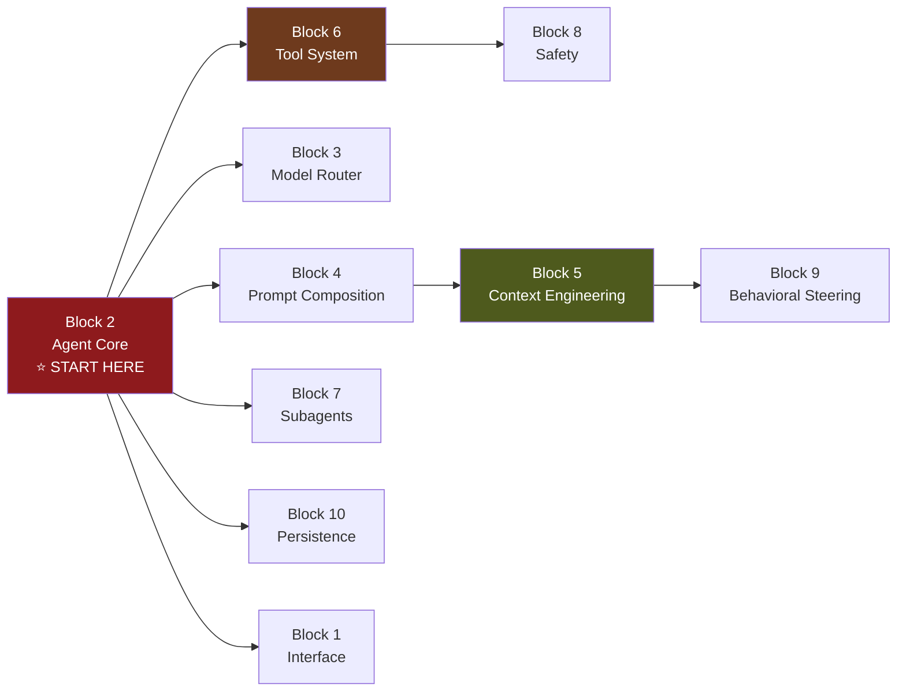

**Recommended order:**
1. **Block 2 (Agent Core)** — the spine, everything hangs off this
2. **Block 6 (Tools)** — what the agent can actually *do*
3. **Block 8 (Safety)** — how to not destroy things
4. **Block 3 (Model Router)** — cost/capability optimization
5. **Block 4 (Prompt Composition)** — how to tell the agent *who it is*
6. **Block 5 (Context Engineering)** — the hardest and most innovative block
7. **Block 9 (Behavioral Steering)** — keeping the agent on track
8. **Block 7 (Subagents)** — scaling via delegation
9. **Block 10 (Persistence)** — saving state
10. **Block 1 (Interface)** — least interesting architecturally, most visible to users

---

## The Universal Formula

Any agent system you'll encounter can be decomposed into these same blocks:

```
Agent System = Core Loop × (Model Routing + Prompt Engine + Context Management + Tools + Safety + Steering + Delegation + Persistence + Interface)
```

When studying a new system, ask:
1. What's the **core loop**? (ReAct? PDAR? Tree-of-Thought?)
2. How does it **route to models**? (single? compound? cascade?)
3. How does it **compose prompts**? (static? dynamic? learned?)
4. How does it **manage context**? (sliding window? compaction? RAG?)
5. What **tools** does it have? (function calling? code exec? MCP?)
6. How is **safety** enforced? (sandbox? approval? schema filtering?)
7. How does it **steer behavior** over time? (reminders? rewrite? nothing?)
8. Can it **delegate**? (subagents? pipeline? swarm?)
9. How does it **persist state**? (files? DB? memory?)
10. What's the **interface**? (CLI? IDE? API? chat?)

> [!tip] The Interchangeability Test
> For each block, ask: "Can I replace this implementation without touching the other 9 blocks?" If yes, the block is properly isolated. If no, there's hidden coupling to investigate.
