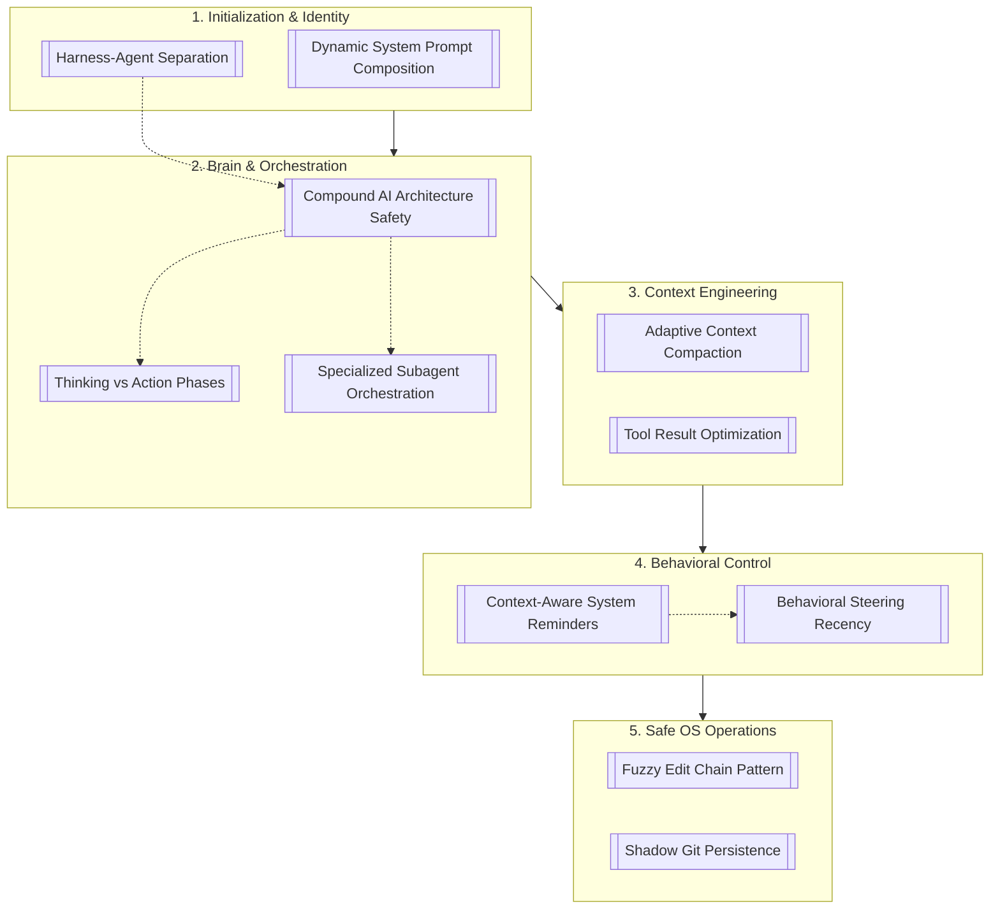

# 🗺️ OpenDev 2026: Master Architecture Map

> [!abstract] Executive Summary (ELI5)
> This is the central Map of Content (MOC) for the OpenDev Harness architecture. It connects all the individual engineering concepts into a single cohesive pipeline: from how the agent boots up, to how it thinks, manages its memory, safely edits code, and gets corrected when it misbehaves.

---

## 📊 System Architecture Flow
This diagram shows how the 11 core patterns interact during a single agent lifecycle.

---

## 📚 The Concept Vault (Index)

### 1. Initialization & Identity
- **[[Dynamic-System-Prompt-Composition]]**: The "Lego System" for building the initial prompt. It dynamically loads only the necessary rules (Git, Rust, etc.) and leverages Anthropic/OpenAI prompt caching to save costs.
- **[[OpenDev-Harness-Agent-Separation]]**: The foundational architectural split. The Agent is just a pure reasoning loop, while the Harness acts as the OS, holding state, memory, and executing tools.

### 2. Brain & Orchestration (Routing)
- **[[Compound-AI-Architecture-Safety]]**: The routing engine that directs tasks to the right model. Uses cheap models for compaction, heavy models (o2/R2) for planning, and fast models (Sonnet 4.6) for action, protected by 5 layers of safety.
- **[[Thinking-vs-Action-Phases]]**: The separation of the ReAct loop into distinct phases. Stops the agent from rushing into coding before establishing a solid architectural plan.
- **[[Specialized-Subagent-Orchestration]]**: The delegation system. Instead of one bloated agent doing everything, the Harness spawns specialized experts (e.g., Code Explorer, Bug Hunter) to preserve the main session's context window.

### 3. Context Engineering (Memory)
- **[[Adaptive-Context-Compaction-ACC]]**: The 5-stage token management system (Warning -> Mask -> Prune -> Aggressive -> Compact). It actively defends the 40k "golden" token budget from overflowing.
- **[[Tool-Result-Optimization]]**: The filter between the terminal and the LLM. It truncates massive logs, masks sensitive data, and summarizes errors before they pollute the context.

### 4. Behavioral Control (Steering)
- **[[Context-Aware-System-Reminders]]**: The infrastructure layer (the "Pipes"). It defines how and when to dynamically inject messages into the agent's context to prevent instruction fade-out.
- **[[Behavioral-Steering-Recency]]**: The tactical layer (the "Water"). Uses specific Nudges (like "Empty Action" or "Error Loop" warnings) injected at the very bottom of the context to exploit the model's Recency Bias.

### 5. Safe OS Operations (Execution)
- **[[Fuzzy-Edit-Chain-Pattern]]**: The robust file modification engine. Uses a 9-pass matching algorithm (including LCS) to safely apply code replacements even when the LLM hallucinates line numbers or indentation.
- **[[Shadow-Git-Persistence-Pattern]]**: The ultimate undo button. Takes invisible local git tree snapshots before every agent action, allowing atomic rollbacks without polluting the user's actual Git history.
