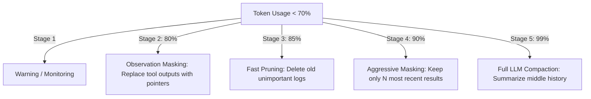

# 🧠 Topic: Adaptive Context Compaction (ACC)

> [!abstract] Executive Summary (ELI5)
> Imagine your brain has a limited "scratchpad" for notes. When it gets full, you don't just stop thinking; you first try to write smaller, then you erase old useless details, and finally, you summarize a whole page into one sentence so you have room for new ideas.

---

## 🎯 The "Why"
- **Problem Solved:** Long-running agent sessions eventually hit the model's token limit (Context Bloat), leading to "dementia" where the agent forgets instructions or gets stuck in loops.
- **Alternatives:** Fixed window sliding (loses old context entirely), Full RAG (loses sequence/flow).
- **Trade-offs:** 
    - **Pro:** Sustains 100+ turn conversations; preserves critical "anchors."
    - **Con:** Requires complex state management; LLM-based summarization is expensive.

## 💡 Mental Model & Analogy
- **Analogy:** "The Progressive Sieve." As pressure increases, the holes in the sieve get smaller, letting only the most important "chunks" of information through.
- **Visual/Diagram:** 


## 🛠️ Core Principles (Actual Rust Implementation)
The `opendev-context` crate defines specific thresholds and protected classes to prevent "Information Entropy" (semantic loss).

```rust
// Thresholds from crates/opendev-context/src/compaction/mod.rs
pub const STAGE_WARNING: f64    = 0.70; // Stage 1: Warning
pub const STAGE_MASK: f64       = 0.80; // Stage 2: Observation Masking
pub const STAGE_PRUNE: f64      = 0.85; // Stage 3: Fast Pruning
pub const STAGE_AGGRESSIVE: f64 = 0.90; // Stage 4: Aggressive Masking
pub const STAGE_COMPACT: f64    = 0.99; // Stage 5: Full LLM Compaction

// "Safe Anchors" protected from pruning (recent tool outputs)
pub const PRUNE_PROTECTED_TOKENS: u64 = 40_000;

// Critical tool types whose outputs survive Stage 3 pruning
pub const PROTECTED_TOOL_TYPES: &[&str] = &[
    "skill", "invoke_skill", "present_plan", 
    "read_file", "web_screenshot", "vlm"
];
```

1. **Multi-Stage Degradation:** Don't jump to expensive summarization immediately.
2. **Observation Masking (80%):** Replaces raw tool outputs (like a 1000-line file read) with compact metadata pointers.
3. **Fast Pruning (85%):** Deletes old tool outputs but **protects** the most recent 40,000 tokens and critical tool types like `read_file` or `present_plan`.
4. **Sliding Window (500+ messages):** Always keeps the most recent 50 messages verbatim to maintain operational flow.
5. **Artifact Index:** Always keep a list of "files touched" and "symbols found" outside the summary so the agent never forgets *what* it knows even if it forgets *how* it learned it.


## ⚠️ Pitfalls & Anti-patterns
- **Instruction Deletion:** Never compact the System Prompt or the current User Query.
- **Recursive Summarization:** Summarizing a summary of a summary leads to "Information Entropy" (semantic degradation). Always summarize from original logs if possible.

## 🔗 Deep Connections
- **Parent Topic:** [[Context Engineering]]
- **Related Concepts:** [[Tokenization]], [[RAG]], [[Memory Systems]]

## ❓ Active Recall Questions
> [!faq]- What is the primary "fuel" for context bloat in coding agents?
> Raw tool outputs (compilation logs, file contents, search results).

> [!faq]- Why is "Observation Masking" more efficient than simple truncation?
> It preserves the *fact* that an action happened (and its metadata) while removing the token-heavy content.

---
