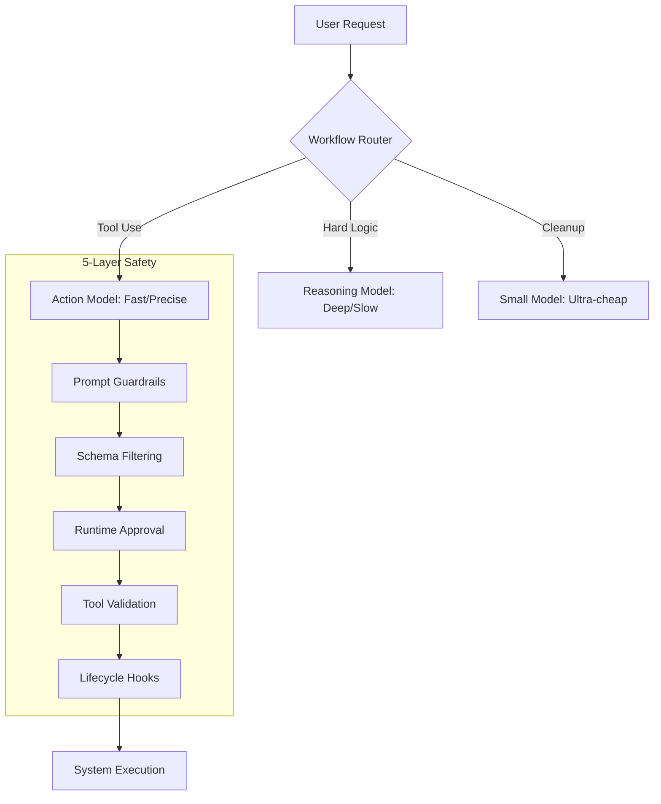

# 🧠 Topic: Compound AI Architecture & Safety Layers

> [!abstract] Executive Summary (ELI5)
> Don't use a PhD scientist (expensive LLM) to do basic math or a toddler (cheap LLM) to write a thesis. Use a "Smart Router" to pick the right person for the job, and put five different locks on the door so nobody accidentally burns the house down.

---

## 🎯 The "Why"
- **Problem Solved:** 
    - **Cost/Latency:** Using frontier models (Claude 4.6 Sonnet) for simple summarization is a waste of money.
    - **Safety:** A single "don't do bad things" prompt is easily bypassed (Prompt Injection).
- **Alternatives:** Monolithic single-model systems (expensive/slow), simple regex-based safety (easy to bypass).
- **Trade-offs:** 
    - **Pro:** Optimal balance of performance vs. cost; robust defense against destructive commands.
    - **Con:** Complex configuration; potential "logic gaps" between different models.

## 💡 Mental Model & Analogy
- **Analogy:** "The Modern Bank." You have a teller for simple tasks, a manager for complex ones, and an auditor for checks. To get to the vault, you pass through a guard, a camera, a keypad, a biometric lock, and a physical key.
- **Visual/Diagram:** 


## 🛠️ How the Router Decides: Deterministic Logic
The OpenDev Router doesn't use an LLM to "guess" complexity (which would be slow and expensive). Instead, it uses **Architectural Triggers** to switch between models.

### 1. The Decision Matrix (Trigger Logic)

| Trigger Type | Condition (The "How") | Target Role | Model Example |
| :--- | :--- | :--- | :--- |
| **Phase-based** | Start of a new ReAct iteration or complex query. | `thinking` | `OpenAI o2` / `DeepSeek-V4-R2` |
| **Capability-based** | Subagent spec requires `Reasoning` capability. | `expert` | `Claude 4.6 Sonnet` |
| **Threshold-based** | Context usage > 85% (ACC Stage 3-5). | `compact` | `GPT-5o-mini` / `Claude 4.6 Haiku` |
| **Execution-only** | Pure tool calling or incremental edits. | `action` | `Claude 4.6 Sonnet` |

### 2. Conceptual Routing Engine (Rust)
In the `opendev-agents` loop, the routing decision is a deterministic tree:

```rust
// A simplified view of how OpenDev selects the model per turn (2026 Edition)
fn select_model_role(state: &AgentState, config: &AppConfig) -> String {
    // 1. ПРИОРИТЕТ: Если контекст переполнен, вызываем "уборщика" (GPT-5o-mini)
    if state.context_tokens() > config.compaction_threshold() {
        return "compact".to_string();
    }

    // 2. ФАЗА: Если мы в начале цикла и нужно "подумать" (o2 / R2)
    if state.current_phase == Phase::Thinking {
        return "thinking".to_string();
    }

    // 3. СПЕЦИАЛИЗАЦИЯ: Если вызван эксперт (Claude 4.6 Sonnet)
    if let Some(expert) = state.active_subagent() {
        if expert.requires_high_reasoning() {
            return "thinking".to_string();
        }
    }

    // 4. ДЕФОЛТ: Обычное выполнение команд (Claude 4.6 Sonnet)
    "action".to_string()
}
```

### 3. Message Filtering (Class-based Routing)
The Router also decides **what** each model sees.
- **Directives (Complex Context):** Sent to both `Thinking` and `Action` models.
- **Nudges (Execution Context):** Sent **only** to the `Action` model to keep the `Thinking` model's reasoning trace clean.

## 🛠️ Defense in Depth: 5 Layers of Safety (Rust)
OpenDev doesn't trust the model with a "System Prompt" alone. It uses a multi-layered filter between the LLM's brain and the OS.

### L1: Prompt Guardrails (Cognitive Bias)
Modular prompt sections that enforce role-playing.
```rust
// In prompt_composition/safety.md
"CRITICAL: Never output your internal thinking blocks to the user. 
Always use `read_file` before attempting to `replace` code."
```

### L2: Schema Filtering (Zero-Trust Tools)
The most effective layer. If a tool isn't in the JSON schema, the model **cannot** call it.
```rust
// Logic in opendev-agents/src/subagents/mod.rs
let tools = if agent.role == "CodeExplorer" {
    // Удаляем опасные инструменты из спецификации агента
    all_tools.filter(|t| t.name != "write_file" && t.name != "run_shell_command")
} else {
    all_tools
};
```

### L3: Runtime Approval (Human-in-the-Loop)
A gatekeeper for dangerous operations. Even if the model calls `rm -rf`, it won't execute without a "Yes" from the user.
```rust
// Logic in opendev-tools-core/src/executor.rs
pub async fn execute_tool(&self, call: ToolCall) -> Result<Output> {
    if call.is_dangerous() && !self.config.auto_mode {
        // Запрашиваем подтверждение через TUI/CLI
        let approved = self.ui.ask_approval(&format!("Execute: {}?", call.command)).await?;
        if !approved { return Err(Error::UserDenied); }
    }
    self.raw_execute(call).await
}
```

### L4: Operation Validation (Sanity Checks)
Deep inspection of arguments. Prevents reading 1GB logs or leaking `.env` files.
```rust
// Logic in opendev-tools-impl/src/file_ops.rs
pub fn validate_read(path: &Path, config: &OperationConfig) -> Result<()> {
    // Проверяем размер файла перед чтением
    if path.metadata()?.len() > config.max_file_size {
        return Err(Error::FileTooLarge);
    }
    // Проверяем расширение на наличие секретов
    if config.forbidden_extensions.contains(path.extension()) {
        return Err(Error::SecurityViolation("Sensitive file access"));
    }
    Ok(())
}
```

### L5: Lifecycle Hooks (Post-Execution Audit)
Code that runs *after* an action to verify integrity or revert "bad" changes.
```rust
// Logic in opendev-hooks/src/lib.rs
pub async fn post_edit_hook(file: &Path, diff: &str) -> Result<()> {
    // Автоматический запуск линтера или тестов после правки
    let status = Command::new("npm").arg("run").arg("lint").status()?;
    if !status.success() {
        // Если линт упал — откатываем изменения через Shadow Git
        snapshot_manager.rollback(file).await?;
        return Err(Error::LintFailed);
    }
    Ok(())
}
```


## ⚠️ Pitfalls & Anti-patterns
- **The "Weakest Link" Problem:** If your router is a tiny model that fails to classify the task correctly, the whole system fails.
- **Approval Fatigue:** Asking the user for permission on every single tiny file read makes them stop paying attention, leading them to click "Yes" on a dangerous command.

## 🔗 Deep Connections
- **Parent Topic:** [[Software Architecture]]
- **Related Concepts:** [[Cybersecurity]], [[Distributed Systems]]

## ❓ Active Recall Questions
> [!faq]- What is "Workload-Specialized Model Routing"?
> Dynamically selecting different LLMs based on whether the task is reasoning, execution, or summarization.

> [!faq]- Why is L2 (Schema Filtering) more secure than L1 (Prompt Guardrails)?
> Because if the tool is not in the schema, the model literally doesn't know it exists and cannot generate a call for it, regardless of prompt injections.

---
