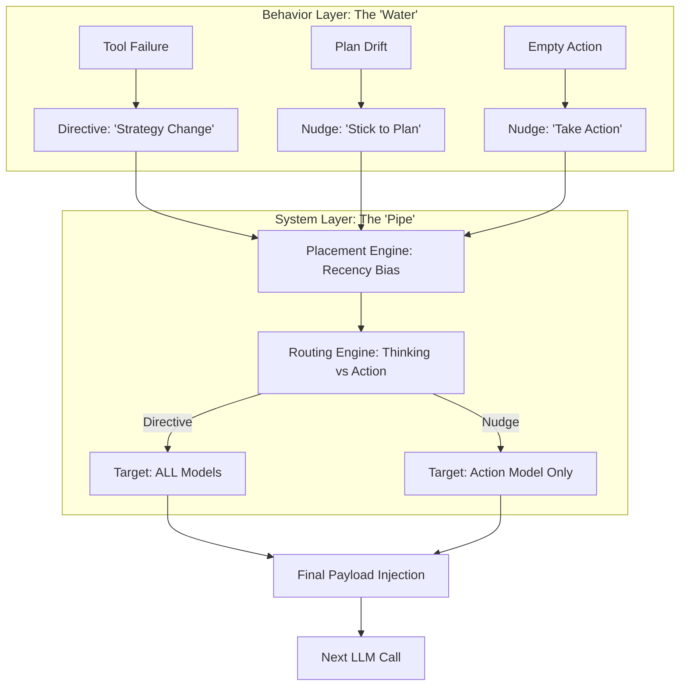

# 🧠 Topic: Context-Aware System Reminders

> [!abstract] Executive Summary (ELI5)
> Imagine you're working on a huge project and you start to forget the rules your boss gave you this morning. A "System Reminder" is like a sticky note that pops up right when you're about to make a decision, saying "Hey, remember to check the tests first!"

---

## 🎯 The "Why"
- **Problem Solved:** "Instruction Fade-out" (or Attention Decay). In long conversations, the model's influence from the initial System Prompt weakens as the history grows.
- **Alternatives:** Re-sending the entire System Prompt every turn (expensive/bloated), or doing nothing (agent starts breaking rules).
- **Trade-offs:** 
    - **Pro:** High compliance with rules in turns 50+; very low token cost compared to full prompt re-injection.
    - **Con:** Can become "noisy" if triggered too often; requires careful event detection logic.
## 💡 System vs. Behavior: The Core Distinction
To understand OpenDev's harness, you must distinguish between the **Mechanism** and the **Message**.

- **The System (The "Pipe"):** `System Reminders` are the **Infrastructure**. This is the code that decides *when* to inject a message, *where* to place it (bottom of context), and *which* model sees it (Thinking vs. Action). 
    - *Analogy:* The **Radio Link**. It's the technology that allows communication with the soldier.
- **The Behavior (The "Water"):** `Nudges` are the **Specific Content**. This is the tactical instruction aimed at steering the agent's immediate actions (e.g., "Don't loop," "Use JSON").
    - *Analogy:* The **Order** shouted over the radio. "Duck!" or "Flank left!"

| Component | Role | Responsibility |
| :--- | :--- | :--- |
| **System Reminder** | **The Infrastructure** | Delivery, Placement, Routing, Token Management. |
| **Nudge** | **The Content** | Behavioral Correction, Anti-looping, Rule Reinforcement. |

### 📊 The Injection Flow (2026 Edition)


---

## 🛠️ Core Principles (Actual Rust Implementation)
...
The `opendev-agents` crate manages reminders through a classification system that determines which models see the message.

```rust
// Examples from crates/opendev-agents/src/prompts/reminders.rs

pub enum MessageClass {
    /// Strategy changes — reaches BOTH thinking and action models.
    Directive,
    /// Behavioral guardrails — reaches ONLY the action model.
    Nudge,
    /// Raw diagnostics — stripped from all LLM calls.
    Internal,
}

pub fn inject_system_message(
    messages: &mut Vec<serde_json::Value>,
    content: &str,
    class: MessageClass,
) {
    // Injects message with a hidden metadata tag `_msg_class`
    let mut msg = serde_json::json!({
        "role": "system",
        "content": content,
        "_msg_class": class.as_str(),
    });
    messages.push(msg);
}
```

1. **Recency is King:** Reminders are injected as the *very last* message before the next LLM call.
2. **The "User" Role Trick:** While the code uses `role: "system"`, it tags them with `_msg_class`, allowing the payload formatter to dynamically decide whether to present them as `system` or `user` messages to maximize compliance.
3. **Event-Driven Classification:**
    - **Directive:** Used for tool failures or plan changes to ensure the "Thinker" model stays in sync.
    - **Nudge:** Used for "Don't forget the todo list" or "Format as JSON" to keep the "Actor" model on track without bloating the thinker's context.

## 🧹 Context Hygiene: Preventing Message Bloat
Adding reminders every turn would quickly "pollute" the context. OpenDev (2026) uses three strategies to keep the history clean:

### 1. The "Single-Active-Nudge" Rule (Deduplication)
The `CompositionEngine` ensures that only the **most relevant** version of a specific nudge exists in the current payload. If a new nudge is triggered, the old one is replaced or removed.
- **Analogy:** You don't keep three "Watch your step" signs on the same stairs. You just put one right where the person is looking.

### 2. Ephemeral Injection (On-the-fly)
Reminders are often **not persisted** in the permanent `Shadow Git` history. 
- They are injected into the message array **milliseconds before** the LLM call.
- Once the model responds, the reminder is discarded from the active session state, though its effect is captured in the model's output.

### 3. ACC Integration (Pruning Priority)
When the context hits the **85% (Stage 3: Prune)** threshold, the `ContextCompactor` identifies all messages tagged with `_msg_class: Nudge` that are older than *N* turns and deletes them first.
- **Logic:** Tactical advice from 10 steps ago is usually irrelevant noise now.

```rust
// Conceptual logic for Context Hygiene in opendev-context
pub fn prepare_payload(history: &Vec<Message>, active_nudges: Vec<Nudge>) -> Vec<Message> {
    let mut payload = history.clone();

    // 1. Remove ANY existing system reminders from the history to avoid duplicates
    payload.retain(|m| m.metadata.get("_msg_class") != Some(&"Nudge".to_string()));

    // 2. Inject ONLY the latest, most relevant nudges at the absolute bottom
    for nudge in active_nudges {
        payload.push(nudge.into_message());
    }

    // 3. Apply ACC if we are over the token budget
    if tokens_count(&payload) > BUDGET_85_PERCENT {
        prune_old_reminders(&mut payload);
    }

    payload
}
```

## ⚠️ Pitfalls & Anti-patterns
...
- **Reminder Fatigue:** Injecting too many reminders makes the model ignore all of them. Limit to 1 per turn.
- **Conflicting Instructions:** A reminder that says "Do X" while the System Prompt says "Do Y" will cause the model to hallucinate or stall.

## 🔗 Deep Connections
- **Parent Topic:** [[Context Engineering]]
- **Related Concepts:** [[Prompt Engineering]], [[Recency Bias]]

## ❓ Active Recall Questions
> [!faq]- Why is injecting a reminder as 'User' more effective than as 'System'?
> Because models are trained to prioritize the latest user instructions, and it breaks the "passive" flow of the conversation history.

---
