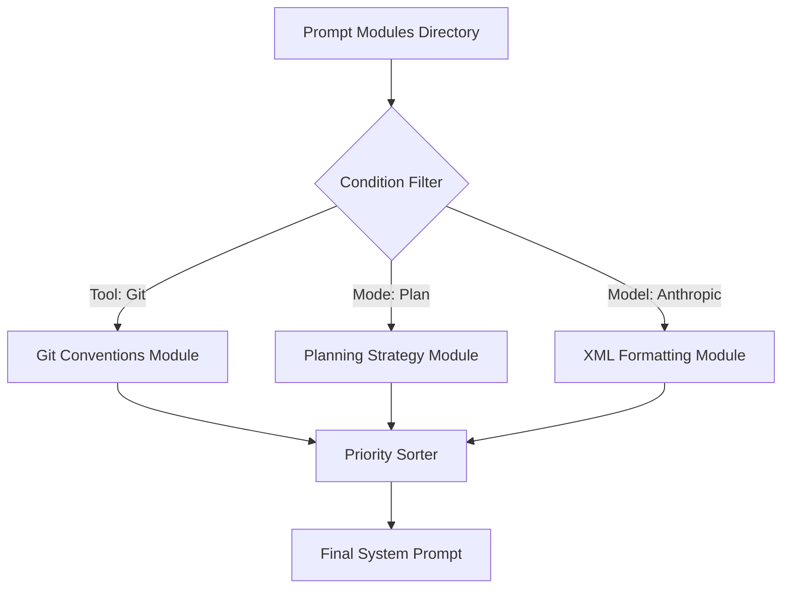

# 🧠 Topic: Dynamic Prompt Composition

> [!abstract] Executive Summary (ELI5)
> Instead of giving an agent one giant, confusing instruction manual, you give it a binder with different pages. You only put the pages in the binder that are actually needed for the current task, and you always put the most important pages at the top.

---

## 🎯 The "Why"
- **Problem Solved:** "Prompt Fatigue/Fade-out." Models ignore instructions when the system prompt is too long. It also reduces token costs.
- **Alternatives:** Monolithic hardcoded prompts (hard to maintain), simple template strings.
- **Trade-offs:** 
    - **Pro:** Modular, easy to A/B test specific behaviors, model-specific optimization.
    - **Con:** Complexity in managing priority-ordering and conditional logic.

## 💡 Mental Model & Analogy
- **Analogy:** "The Lego Instruction Manual." You build the instructions based on which set (tools/mode) you are currently playing with.
- **Visual/Diagram:** 


## 🧩 Module Types (2026 Edition)
1. **Core Identity (Static):** Basic personality and mission. Always loaded.
2. **Environment (Auto-loaded):** Rules for Git, Docker, etc., loaded only if specific files/folders exist in the workspace.
3. **Task-Specific Skills (On-demand):** Deep technical manuals (e.g., Mermaid diagrams, Kubernetes specs). These are "plugged in" via `activate_skill` or when the plan requires them.
## 🚀 Skill Deployment Strategies: Inline vs. Delegated
In 2026, the OpenDev Harness avoids "bloating" the agent's mind by choosing the right delivery method for specialized instructions.

### 1. Inline Skills ("The Swiss Army Knife")
Used for **tactical, low-context tasks** (e.g., drawing a diagram, parsing a PDF).
- **How:** The instructions (e.g., `mermaid-diagrams.md`) are injected directly into the **current** agent's system prompt.
- **Goal:** Speed and cost-efficiency. No need for a separate subagent session.
- **Model:** Handled by the active **Claude 4.6 Sonnet** (Action model).

### 2. Delegated Subagents ("The Specialist Squad")
Used for **strategic, high-context or "messy" tasks** (e.g., full security audit, complex refactoring).
- **How:** The Harness spawns a **new subagent session** with its own fresh context. Only the final result is returned to the main agent.
- **Goal:** Context isolation. Prevents logs, errors, and intermediate steps from polluting the main strategist's memory.
- **Model:** Initiated by **OpenAI o2** (Thinking model) and executed by a specialized **Claude 4.6 Sonnet** instance.

| Feature | Inline Skill | Delegated Subagent |
| :--- | :--- | :--- |
| **Context** | Shared (Main Session) | Isolated (New Session) |
| **Tokens** | Added to current prompt | Fresh context window |
| **Use Case** | Single-tool execution | Multi-step investigation |

---

## 🛠️ Decision Logic: How the Harness Knows
The selection of modules and strategies uses **Hybrid Intelligence**:

1. **Deterministic Detection (Fast/Free):** 
    - The Harness scans the file system (e.g., `if .git exists -> load git_rules.md`).
    - Handled by Rust's `ConditionFn` in `opendev-agents/src/prompts/composer/conditions.rs`.
2. **LLM-Driven Delegation (Smart/Paid):** 
    - The **Thinking Model (o2)** analyzes the task and decides: *"This requires a deep dive, I will call the SecurityExpert subagent."*
    - The Harness then updates the `PromptContext` for the new session, and the `PromptComposer` automatically assembles the expert's identity.

## 🛠️ Core Principles (Actual Rust Implementation)
...
The `opendev-agents` crate uses a `PromptComposer` to assemble the system prompt from modular `PromptSection` structs, each with its own loading priority and inclusion logic.

```rust
// Examples from crates/opendev-agents/src/prompts/composer/mod.rs

pub struct PromptSection {
    pub name: String,
    pub section_type: SectionType, // Identity, Environment, or Skill
    pub file_path: String,
    pub condition: Option<ConditionFn>, // Predicate for inclusion
    pub priority: i32, // Lower = earlier in prompt
    pub cacheable: bool, // Support for Anthropic Prompt Caching
}

impl PromptComposer {
    /// Composes the final system prompt by filtering and sorting sections.
    pub fn compose(&self, ctx: &PromptContext) -> String {
        let mut active_sections: Vec<&PromptSection> = self.sections
            .iter()
            .filter(|s| s.condition.as_ref().map_or(true, |c| c(ctx)))
            .collect();
            
        active_sections.sort_by_key(|s| s.priority);
        // ... reads files, substitutes variables, and joins ...
    }
}
```

1. **Priority-Ordered Sections:** Assign integers to modules (e.g., Identity=10, Safety=100, Tooling=50). Sort ascending.
2. **Conditional Loading:** Uses `ConditionFn` predicates to check the environment (e.g., "only load Git module if `.git` folder exists").
3. **Skill Injections:** When a specific skill (like Mermaid) is needed, its instruction set is dynamically added to the list of `active_sections` for the next LLM call.
4. **Variable Substitution:** Support for `{{variable_name}}` placeholders resolved at runtime via `PromptContext`.
5. **Cache-Aware Architecture:** Sections are marked as `cacheable` to leverage provider-level prompt caching (e.g., Anthropic), significantly reducing input token costs for stable parts of the prompt.


## ⚠️ Pitfalls & Anti-patterns
- **Circular Dependencies:** Modules that require other modules, leading to infinite loops during assembly.
- **Over-segmentation:** Breaking the prompt into *too many* tiny files makes it impossible for a human to read the "final" result.

## 🔗 Deep Connections
- **Parent Topic:** [[Prompt Engineering]]
- **Related Concepts:** [[Context Engineering]], [[Software Modularity]]

## ❓ Active Recall Questions
> [!faq]- Why use the 'User' role for system reminders?
> LLMs pay more attention to recent messages and messages from the User. It feels like a "live" instruction rather than a distant "pre-set" rule.

---
