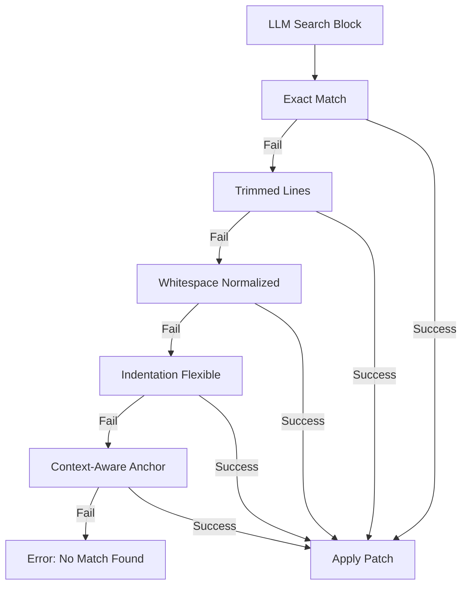

# 🧠 Topic: Fuzzy Edit Chain (9-Pass Matching)

> [!abstract] Executive Summary (ELI5)
> LLMs are like talented writers who are really bad at counting spaces and tabs. A "Fuzzy Edit Chain" is a smart editor that takes what the LLM *meant* to change and finds the right spot in the file, even if the LLM forgot a space or messed up the indentation.

---

## 🎯 The "Why"
- **Problem Solved:** "Literal Match Failure." LLMs often fail to produce an exact string match for a file block due to whitespace drift, trailing newlines, or indentation errors, causing `edit_file` tools to crash.
- **Alternatives:** Full-file overwrites (dangerous/heavy), Regex (too rigid), LLM-based patching (expensive/slow).
- **Trade-offs:** 
    - **Pro:** Massive increase in successful file edits; zero token cost (done in code).
    - **Con:** High implementation complexity; risk of "false positive" matches in repetitive files.

## 💡 Mental Model & Analogy
- **Analogy:** "The Skeleton Key." If the first key (Exact Match) doesn't work, you try a slightly thinner one, then a shorter one, until one finally turns the lock.
- **Visual/Diagram:** 


## 🛠️ The 9-Pass Chain (Actual Rust Implementation)
The `opendev-tools-impl` crate implements this as a sequence of fallback strategies. Each pass tries to find the `old_string` in the `original` file content using increasing levels of "fuzziness."

```rust
// Examples from crates/opendev-tools-impl/src/edit_replacers/passes.rs

// Pass 2: LineTrimmed — ignore leading/trailing whitespace on each line
pub(super) fn line_trimmed_find(original: &str, old_content: &str) -> Option<String> {
    let old_trimmed: Vec<&str> = old_content.split('\n').map(|l| l.trim()).collect();
    // ... iterates through original lines comparing trimmed versions ...
}

// Pass 4: WhitespaceNormalized — collapse multiple spaces/tabs into one
static WS_RE: LazyLock<Regex> = LazyLock::new(|| Regex::new(r"\s+").unwrap());
fn ws_normalize(s: &str) -> String {
    s.split('\n')
        .map(|ln| WS_RE.replace_all(ln, " ").trim().to_string())
        .collect::<Vec<_>>().join("\n")
}

// Pass 8: ContextAware — uses Longest Common Subsequence (LCS) similarity
pub(super) fn context_aware_find(original: &str, old_content: &str) -> Option<String> {
    // Finds anchors (first/last non-empty lines) and calculates similarity
    let sim = similarity(old_content.trim(), candidate.trim());
    if sim > 0.5 { Some(candidate) } else { None }
}
```

### The Full Chain Order:
1. **Exact**: Byte-for-byte match.
2. **Line-Trimmed**: `original_lines[i].trim() == old_trimmed[0]`.
3. **Block-Anchor**: First and last lines must match exactly (trimmed), middle can vary.
4. **Whitespace-Normalized**: Collapses all internal whitespace to a single space.
5. **Indentation-Flexible**: Skips blank lines and ignores leading indentation.
6. **Escape-Normalized**: Converts `\n`, `\t`, `\\` to literals before matching.
7. **Trimmed-Boundary**: Trims start/end of the block to handle LLM "extra newline" issues.
8. **Context-Aware**: Uses a similarity threshold (>0.5) based on LCS.
9. **Multi-Occurrence**: Last resort line-by-line trimmed match.

## 🛡️ The Safety Net: Post-Edit Validation
Fuzzy matching (especially Level 8/LCS) is powerful but risky. In 2026, the responsibility shifts from **Perfect Input Matching** to **Rigorous Output Verification**.

- **The Philosophy:** "Allow the edit, then verify the intent." We accept that models hallucinate details (variable names, spacing) but we trust the environment to catch them.
- **The Guardians:**
    1. **L4 Validation:** Sanity checks on the resulting file structure.
    2. **L5 Hooks:** Immediate execution of `cargo check`, `npm run lint`, or `pytest`.
    3. **Shadow Git:** If any guardian fails, the Harness performs an **Atomic Rollback** and feeds the error back to the agent for a retry.

---

## 🔬 Case Studies: The 9-Pass Chain in Action

### Case 1: Level 1 — The Perfect Shot (Exact Match)
- **Problem:** Model provides a 100% byte-for-byte match.
- **Result:** Pass 1 succeeds instantly. The "Happy Path."

### Case 2: Level 3 — The Indentation Gap (Leading Whitespace)
- **Problem:** Model uses 2 spaces; the file uses 8.
- **Solution:** Pass 3 strips leading whitespace from both and matches the "silhouette" of the code.
- **Result:** Success. Harness re-calculates the correct indentation for the replacement.

### Case 3: Level 5 — The Messy Room (Whitespace/Newline Insensitive)
- **Problem:** Model adds extra newlines or misses spaces between operators.
- **Solution:** Pass 5 "compresses" the code into a single character string (no spaces/newlines).
- **Result:** Success. The logical sequence of characters matches despite the "mess."

### Case 4: Level 8 — The Surgeon's Hallucination (LCS Similarity)
- **Problem:** Model hallucinates a variable name (`cfg` instead of `config`) or misses a small argument.
- **Solution:** Pass 8 uses **Longest Common Subsequence** algorithm. If similarity > 0.5, it identifies the block as the intended target.
- **Result:** Success, but highly dependent on **L5 Hooks** to catch any broken syntax introduced by the hallucination.

## ⚠️ Pitfalls & Anti-patterns
...
- **Over-Greediness:** A fuzzy matcher that is *too* flexible might replace the wrong `if (x) {` block in a file with 10 identical blocks.
- **Performance:** Running 9 regex passes on a 10,000-line file can be slow. Use early-exit strategies.

## 🔗 Deep Connections
- **Parent Topic:** [[Tool Systems]]
- **Related Concepts:** [[Fuzzy Searching]], [[String Similarity Algorithms]]

## ❓ Active Recall Questions
> [!faq]- Why is indentation flexibility the most common failure point for LLM edits?
> Because LLMs often mix tabs and spaces or lose track of the nesting depth when generating long code blocks.

---
