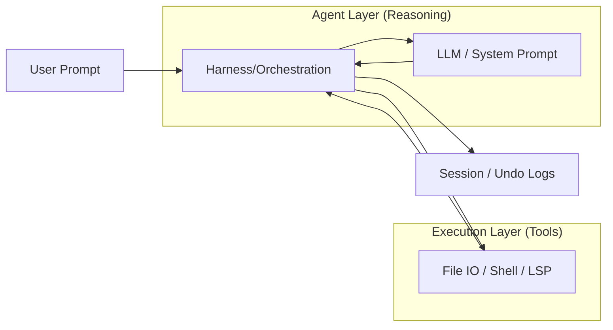

# 🧠 Topic: Agent vs. Harness Separation

> [!abstract] Executive Summary (ELI5)
> Think of an AI agent like a driver (the LLM) and the harness like the car (the steering wheel, brakes, GPS, and sensors). The driver decides where to go, but the car provides the tools and safety limits to actually get there safely and efficiently.

---

## 🎯 The "Why"
- **Problem Solved:** Prevents "monolithic agent" mess where prompt logic, tool execution, and safety are all tangled together.
- **Alternatives:** Simple ReAct loops (stateless, hard to scale) or tightly coupled IDE plugins.
- **Trade-offs:** 
    - **Pro:** High testability, reusable "harness" for different models, clear safety boundaries.
    - **Con:** Higher initial engineering overhead to build the "scaffolding."

## 💡 Mental Model & Analogy
- **Analogy:** "The Actor-Stage Model." The Agent is the Actor (script/reasoning), but the Harness is the Stage (lighting, props, safety nets, and floor directions).
- **Visual/Diagram:** 


## 🛠️ Core Principles (Actual Rust Implementation)
The `opendev-agents` crate implements this separation through the `BaseAgent` trait and the `AgentResult` struct, mirroring the "Actor-Stage" pattern.

```rust
// Examples from crates/opendev-agents/src/traits.rs

#[async_trait::async_trait]
pub trait BaseAgent: Send + Sync {
    /// Returns the compiled system prompt.
    fn system_prompt(&self) -> &str;
    
    /// Returns the filtered tool schemas for this specific agent.
    fn tool_schemas(&self) -> &Vec<serde_json::Value>;
    
    /// Executes the full ReAct loop (The Harness logic).
    async fn run_sync(
        &self,
        messages: Vec<serde_json::Value>,
        interrupt: Option<InterruptToken>,
    ) -> Result<AgentResult, AgentError>;
}

pub struct AgentResult {
    pub content: String,
    pub success: bool,
    pub interrupted: bool,
    pub backgrounded: bool, // Support for long-running tasks
    pub messages: Vec<serde_json::Value>, // Final conversation state
}
```

1. **Eager Scaffolding:** The agent instance holds a pre-compiled `system_prompt` and `tool_schemas`. There is no "lazy" assembly during the critical execution path.
2. **The Harness Responsibilities:**
    - **ReAct Loop Orchestration:** Managing the `run_sync` cycle.
    - **Interrupt Handling:** Supporting `InterruptToken` for safe cancellation.
    - **State Transition:** Turning raw LLM tool calls into `AgentResult` with backgrounding support.
    - **Persistence:** Ensuring `messages` are captured and returned for the next session.


## ⚠️ Pitfalls & Anti-patterns
- **Monolithic Prompts:** Putting tool implementation details into the system prompt instead of the tool schema.
- **Lazy Initialization:** Delaying prompt building until the first call causes unpredictable latency and "first-turn" bugs.

## 🔗 Deep Connections
- **Parent Topic:** [[Software Architecture]]
- **Related Concepts:** [[Design Patterns]], [[Clean Code]], [[ReAct Pattern]]
- **Prerequisites:** Understanding LLM Tool Calling and System Prompts.

## ❓ Active Recall Questions
> [!faq]- What is the difference between Scaffolding and Harness?
> Scaffolding is the *construction* of the agent (prompts, schemas); Harness is the *runtime* orchestration (execution, safety, context).

---
## 📝 How to use this template effectively
*Derived from OpenDev's "Transparency over Magic" principle.*
