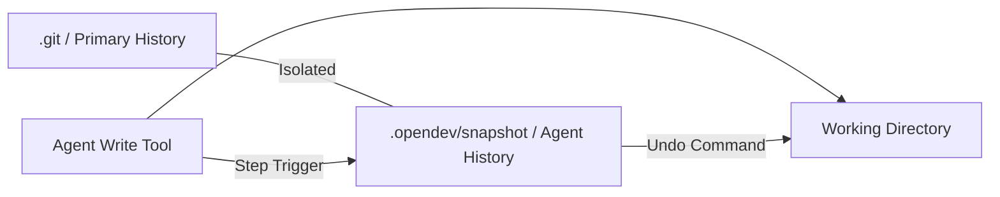

# 🧠 Topic: Shadow Git Snapshots

> [!abstract] Executive Summary (ELI5)
> It's like having a secret "undo" button that records everything you do in a hidden folder. If you mess up your project, you can jump back in time to exactly how it was 5 minutes ago, without messing up your actual work history or the "Save" points you made yourself.

---

## 🎯 The "Why"
- **Problem Solved:** Agents often make destructive mistakes (deleting files, broken refactors). Standard `git` is for *user* commits; we shouldn't force the user to commit every time an agent runs a tool.
- **Alternatives:** Manual file backups (slow, storage heavy), `git stash` (limited).
- **Trade-offs:** 
    - **Pro:** Near-instant undo of any agent action; zero interference with user's git history.
    - **Con:** Additional disk space for the shadow repo; complexity in tracking shell command side-effects.

## 💡 Mental Model & Analogy
- **Analogy:** "The Invisible Carbon Copy." Every time the agent writes something, a hidden clerk makes a photocopy and puts it in a secret drawer.
- **Visual/Diagram:** 


## 🛠️ Core Principles (Actual Rust Implementation)
The `opendev-history` crate manages snapshots through a `SnapshotManager` that operates independently of the project's own `.git` folder.

```rust
// Examples from crates/opendev-history/src/snapshot.rs

pub struct SnapshotManager {
    project_dir: String,
    project_id: String,
    shadow_dir: PathBuf, // Usually ~/.opendev/snapshot/<project_id>/
    snapshots: Vec<String>, // List of git tree hashes
    initialized: bool,
}

impl SnapshotManager {
    pub fn new(project_dir: &str) -> Self {
        let project_id = encode_project_id(project_dir);
        let shadow_dir = dirs::home_dir()
            .join(".opendev")
            .join("snapshot")
            .join(&project_id);
        // ... initializes a hidden git repo in shadow_dir ...
    }
}
```

1. **Isolation:** The shadow repository lives in a global cache folder (`~/.opendev/snapshot/`), NOT inside the project's own `.git` folder.
2. **Stable Project IDs:** Projects are mapped to unique IDs via `DefaultHasher` on the absolute path, ensuring consistency across restarts.
3. **Tree Hash Snapshots:** Instead of full commits with messages, it captures the complete `git tree hash` at every turn, which is faster and lighter.
4. **Universal Undo:** The `/undo` command retrieves the previous tree hash and performs a `git checkout <hash> -- .` to restore the working directory state.


## ⚠️ Pitfalls & Anti-patterns
- **Snapshotting Large Binary Files:** Ensure `.gitignore` is respected or explicitly exclude `node_modules`, `dist`, and large assets to prevent disk bloat.
- **Side Effects Outside Files:** Shadow Git only tracks *files*. It cannot undo a `curl` request or a database migration.

## 🔗 Deep Connections
- **Parent Topic:** [[Version Control Systems]]
- **Related Concepts:** [[Safety Engineering]], [[State Management]]

## ❓ Active Recall Questions
> [!faq]- Why not just use the user's existing Git repository for snapshots?
> To avoid polluting the user's `git log` with hundreds of "Agent Turn" commits and to prevent conflicts with the user's uncommitted changes.

---
