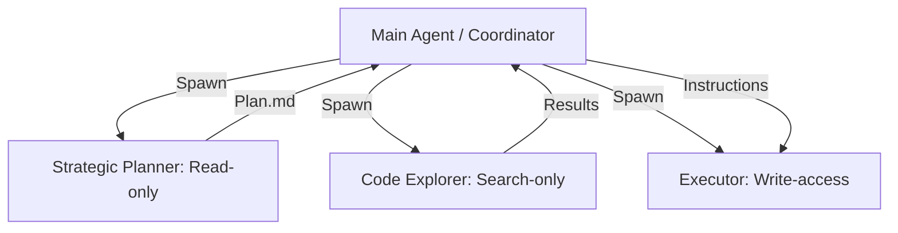

# 🧠 Topic: Specialized Subagent Orchestration

> [!abstract] Executive Summary (ELI5)
> Instead of one "Smart Boss" trying to do everything, the Boss hires specialized helpers: a "Searcher" who only finds files, a "Planner" who only writes the to-do list, and an "Executor" who only types the code. This keeps everyone focused and prevents the Boss's brain from getting cluttered.

---

## 🎯 The "Why"
- **Problem Solved:** "Context Dilution." If one agent does search, planning, and coding, its context gets filled with search results, making it forget the plan.
- **Alternatives:** Single-agent ReAct (bloated context), Hardcoded state machines (too rigid).
- **Trade-offs:** 
    - **Pro:** Clean context windows, higher success rates for complex tasks, parallel execution.
    - **Con:** Latency (spawning agents takes time), "Tele-game" effect (information lost between agents).

## 💡 Mental Model & Analogy
- **Analogy:** "The Surgical Team." You don't want the surgeon also mopping the floor and answering the phone. Each person has a specific toolset and a specific zone.
- **Visual/Diagram:** 


## 🛠️ Core Principles (Actual Rust Implementation)
The `opendev-agents` crate implements this filtering via the `SubAgentSpec` system, hard-coding tool allow-lists for each role.

```rust
// Examples from crates/opendev-agents/src/subagents/spec/builtins.rs

// Role 1: Code Explorer (Read-only + Exploration)
pub const CODE_EXPLORER_TOOLS: &[&str] = &[
    "read_file", "search", "list_files", "run_command"
];

// Role 2: Strategic Planner (Read + Plan Writing)
pub const PLANNER_TOOLS: &[&str] = &[
    "read_file", "search", "list_files", "write_file", "edit_file"
];

// Role 3: General Executor (Broad access for task completion)
pub const GENERAL_TOOLS: &[&str] = &[
    "read_file", "search", "list_files", "write_file", "edit_file",
    "multi_edit", "run_command", "web_fetch", "web_search", "patch", "git"
];
```

1. **Tool Filtering:** Capabilities are restricted at the **Schema Level**. A `Code Explorer` physically cannot write files because its tool schema does not include `write_file`.
2. **Context Isolation:** Subagents have their own "fresh" message history. They only return the final synthesized answer to the Main Agent, keeping the coordinator's history clean.
3. **Task-Specific Prompts:** Each spec (e.g., `code_explorer()`, `planner()`) includes a specialized system prompt override to focus the model on its specific zone.
4. **Parallelism:** The Main Agent can spawn multiple subagents (e.g., 3 explorers searching different crates) concurrently via `spawn_subagent`.


## ⚠️ Pitfalls & Anti-patterns
- **Deep Nesting:** Subagents spawning subagents (leads to "Inception" style cost and latency spirals).
- **Information Bottlenecks:** Main Agent failing to pass a critical piece of info to the subagent, causing it to "hallucinate" in a vacuum.

## 🔗 Deep Connections
- **Parent Topic:** [[Agentic Workflows]]
- **Related Concepts:** [[Separation of Concerns]], [[Parallel Computing]]

## ❓ Active Recall Questions
> [!faq]- Why is Tool Filtering better than just telling an agent "don't write files" in the prompt?
> Because it's a hard constraint. Even if the agent tries to write, the tool doesn't exist in its schema, so it's impossible to fail.

---
