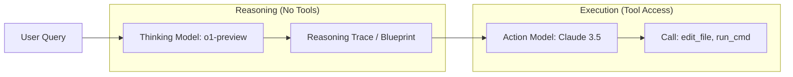

# 🧠 Topic: Thinking vs. Action Phase Separation

> [!abstract] Executive Summary (ELI5)
> It's the "Look Before You Leap" rule for AI. Instead of letting the AI start typing code immediately, we force it to write out its thoughts and plan in a separate step where it isn't allowed to touch any tools. This makes the final action much more accurate.

---

## 🎯 The "Why"
- **Problem Solved:** "Impulsive Tool Use." Models often jump into a `write_file` or `run_command` without fully understanding the codebase, leading to "exploration spirals" or destructive errors.
- **Alternatives:** In-line "Chain of Thought" (mixing thoughts and tool calls in one response).
- **Trade-offs:** 
    - **Pro:** Higher quality reasoning; prevents tool hallucination; allows the use of a "Thinking" model (like o1) before an "Action" model.
    - **Con:** Double latency (two LLM calls instead of one); higher token cost.

## 💡 Mental Model & Analogy
- **Analogy:** "The Architect and the Builder." The Architect draws the blueprints (Thinking Phase) without touching a hammer. The Builder then follows the blueprints (Action Phase) to do the work.
- **Visual/Diagram:** 

## 🔄 The Handover: Standardized Plan Protocol (SPP)
The most critical moment is the transition between phases. We use a structured protocol to ensure the Action model (Sonnet 4.6) follows the Thinking model's (o2) strategy exactly.

### 1. The Output of Thinking Phase (o2)
The Thinking model is prompted to produce a strictly structured `Plan` object at the end of its reasoning trace.
```json
{
  "strategy": "Refactor UserAuth to use Async/Await",
  "steps": [
    { "id": 1, "task": "Update Cargo.toml with tokio dependency", "status": "todo" },
    { "id": 2, "task": "Change UserAuth trait methods to async", "status": "todo" },
    { "id": 3, "task": "Implement async trait in DatabaseProvider", "status": "todo" }
  ],
  "risk_assessment": "Potential deadlocks in connection pool if not handled correctly."
}
```

### 2. The Input for Action Phase (Sonnet 4.6)
The Harness **strips** the massive internal reasoning blocks (`<thinking>...</thinking>`) from the o2 response and injects **only** the JSON Plan into the system prompt of the Action model.

### 3. Phase Switching Logic (Rust)
The `ReactLoop` manages the transition as a state machine:

```rust
// Logic in crates/opendev-agents/src/react_loop/mod.rs
match self.current_phase {
    Phase::Thinking => {
        let response = self.call_thinking_model(o2).await?;
        if let Some(plan) = response.extract_plan() {
            self.state.update_plan(plan);
            self.current_phase = Phase::Action; // Переключаем фазу
        }
    },
    Phase::Action => {
        let task = self.state.next_todo_item()?;
        let result = self.call_action_model(sonnet_4_6, task).await?;
        // ... execute tool, validate, and repeat ...
    }
}
```

## 🛠️ Core Principles (Actual Rust Implementation)
...
The `opendev-agents` crate supports native reasoning models (like o1 or DeepSeek-R1) by extracting `reasoning_content` and managing `reasoning_effort`.

```rust
// Examples from crates/opendev-agents/src/llm_calls/mod.rs

pub struct LlmCallConfig {
    pub model: String,
    pub reasoning_effort: Option<String>, // "low", "medium", "high"
}

impl LlmCaller {
    /// Parse an action response, extracting both text and reasoning traces.
    pub fn parse_action_response(&self, body: &Value) -> LlmResponse {
        let message = &body["choices"][0]["message"];
        
        // Native support for 'reasoning_content' from models like o1/DeepSeek
        let reasoning_content = message.get("reasoning_content")
            .and_then(|r| r.as_str())
            .map(|s| s.to_string());
            
        let mut resp = LlmResponse::ok(cleaned_content, message.clone());
        resp.reasoning_content = reasoning_content;
        resp
    }
}
```

1. **Native Reasoning Support:** Instead of a separate API call, the system leverages models that provide a hidden `reasoning_content` field, allowing the "thinking" to happen within the same turn but isolated from the "action" text.
2. **Effort Control:** The `reasoning_effort` parameter allows the harness to dynamically scale the thinking budget based on task complexity (e.g., "high" for planning, "low" for execution).
3. **Clean Context Transfer:** The `LlmCaller` ensures that reasoning traces are preserved in the conversation history (for the agent's self-awareness) but can be selectively filtered or masked during context compaction.
4. **Multi-Model Fallback:** If a model doesn't support native reasoning, the `ReactLoop` can be configured to perform a two-step call: first to a "Thinker" model (with no tools) and then to an "Actor" model (with the thinking trace injected).


## ⚠️ Pitfalls & Anti-patterns
- **Thinking in a Vacuum:** If the thinking phase doesn't have enough context (file paths, current state), the plan will be based on hallucinations.
- **Plan-Action Disconnect:** The Action model might ignore the Thinking model's plan if it isn't injected with high enough priority.

## 🔗 Deep Connections
- [[ReAct Pattern]]
- [[Prompt Engineering]]
- [[Chain of Thought (CoT)]]

## ❓ Active Recall Questions
> [!faq]- What is the main benefit of removing tool schemas during the Thinking phase?
> It prevents the model from "thinking" in terms of JSON blocks and forces it to reason in natural language about the actual problem.

---
