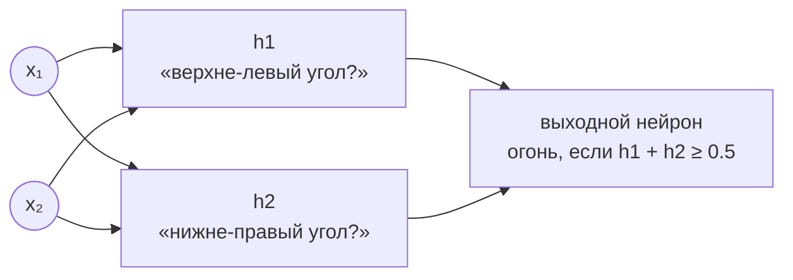

# Скрытый слой: новые координаты и чёрная точка

Related: [[Perceptron-Basics]] · [[XOR-Impossibility]] · [[Perceptron-in-JS]]

> [!summary] TL;DR
> Скрытые нейроны h1 и h2 — детекторы двух углов. Пара их ответов становится **новыми координатами** входа. На новом графике входы [0,0] и [1,1] слипаются в одну точку (0,0) — та самая «чёрная точка» — а цветные [0,1] и [1,0] встают по одну сторону, и выходной нейрон отделяет их **одной прямой**. Главная идея глубокого обучения: не хитрая линия, а переезд точек туда, где простая линия работает.

## 1. Каждый нейрон — своя тройка чисел и своя линия

Любая тройка `(w1, w2, b)` — отдельный нейрон со своей прямой (см. [[Perceptron-Basics]], §3). Знакомимся:

| нейрон | числа (w1, w2, b) | его линия | вопрос |
|--------|-------------------|-----------|--------|
| h1 | (−0.3, +0.3, −0.15) | `x2 = x1 + 0.5` | «это верхне-левый угол (0,1)?» |
| h2 | (+0.3, −0.3, −0.15) | `x2 = x1 − 0.5` | «это нижне-правый угол (1,0)?» |

Ответы h1 на четыре входа: (0,0)→0, (1,0)→0, (0,1)→**1**, (1,1)→0. «Да» ровно одному углу — h1 работает как детектор: суммарно его вопрос формулируется одной фразой.

## 2. Пара ответов = новые координаты

Берём новый лист бумаги: по горизонтали откладываем «что сказал h1», по вертикали — «что сказал h2». Каждый из четырёх входов переезжает на новый адрес:

| вход | h1 сказал | h2 сказал | новые координаты | XOR |
|------|-----------|-----------|------------------|-----|
| [0,0] | 0 | 0 | **(0, 0)** | 0 |
| [0,1] | 1 | 0 | (1, 0) | 1 |
| [1,0] | 0 | 1 | (0, 1) | 1 |
| [1,1] | 0 | 0 | **(0, 0)** | 0 |

## 3. Чёрная точка — это две точки друг на друге

Первая и последняя строки: **[0,0] и [1,1] оба получили «нет, нет» от обоих нейронов** и свалились в один адрес (0,0). На графике они выглядят одной точкой — но под ней их *две*.

Выходной нейрон физически не может их различить: скрытый слой отрапортовал про обе одинаково. И это **фича, а не баг** — им обоим нужен одинаковый ответ 0, различать их незачем. Скрытый слой выбросил лишнюю для ответа информацию.

Оси правого графика сидят только в 0/1 (скрытые нейроны отвечают да/нет), поэтому все точки — в углах единичного квадрата новой плоскости.

## 4. Выходному нейрону остаётся простейшая задача

В новой картинке цветные точки ([0,1] и [1,0]) стоят по одну сторону, чёрный угол (0,0) — в противоположном. Правило `h1 + h2 ≥ 0.5` — прямая, отрезающая угол (0,0): обе цветные дают `+0.5 ≥ 0.5` → 1, чёрная даёт `−0.5 < 0` → 0.

Задача, невозможная для одной линии в старых координатах ([[XOR-Impossibility]]), стала тривиальной в новых.

> [!important] Самый важный график в глубоком обучении
> Сеть не придумывает хитрую линию — она **перевозит точки на новую плоскость, где простая линия работает**. Скрытый слой = смена координат (каждый нейрон — одна новая ось, один «вопросик» про вход). Выходной нейрон = старый знакомый перцептрон поверх их ответов. Ещё один скрытый слой — смена координат над сменой координат. Вся «глубина» — композиция таких переездов.

Кстати, в целом это объясняет, почему в реальных сетях между слоями нужна **нелинейность** активации: если каждый слой только линейно перекладывает координаты, вся стопка схлопывается в одну прямую — и ничего нового не разделишь.
