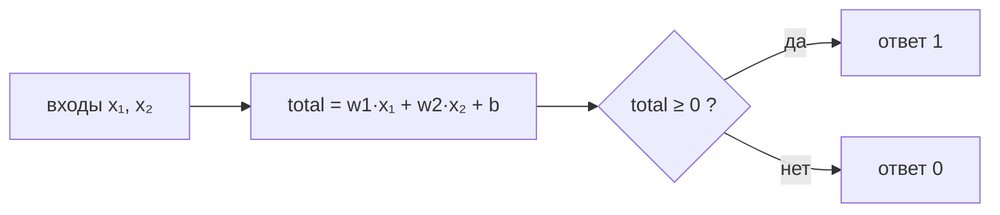

# Перцептрон с нуля: три числа и одна линия

Related: [[XOR-Impossibility]] · [[Hidden-Layer-New-Coordinates]] · [[Perceptron-in-JS]] · [[Perceptron-Flashcards]]

> [!summary] TL;DR
> Весь «интеллект» перцептрона — три числа: веса `w1`, `w2` и `bias` (b). `predict` считает взвешенную сумму `total` и отвечает 0/1 по её знаку. Геометрически эти три числа задают прямую, а предсказание — проверка «точка выше или ниже линии». Обучение — подтягивание линии на маленький шаг после каждой ошибки.

## 1. Вход — это точка на плоскости

Пара чисел `[1, 0]` — это координаты точки: первое число — вправо, второе — вверх (как x/y в canvas). Входы урока — два бита, «выключено/включено», поэтому комбинаций ровно 2 × 2 = 4, и все они — углы единичного квадрата:

| вход | где на плоскости |
|------|------------------|
| `[0,0]` | левый нижний угол (начало координат) |
| `[1,0]` | правый нижний |
| `[0,1]` | левый верхний |
| `[1,1]` | правый верхний |

## 2. Модель — три числа и одна формула

```javascript
const model = { w1: 0.3, w2: 0.2, b: -0.4 }; // вся «начинка»

function predict(x1, x2) {
  const total = model.w1 * x1 + model.w2 * x2 + model.b;
  return total >= 0 ? 1 : 0;
}
```

Два движения:

1. **Посчитать одно число** `total` — может быть каким угодно: −100, −0.4, +0.1, +50.
2. **Посмотреть на знак**: `total ≥ 0` → ответ `1` («да»), иначе `0` («нет»). Ноль в ответе — не «число ноль», а метка «нет». `predict` возвращает **только 0 или 1, никогда −1** — минус единица живёт в обучающем цикле и называется `error` (см. §5).



## 3. Линия — это граница, где ответ переворачивается

> **Определение.** Линия нейрона — множество всех точек, где `total = 0` ровно:
> `w1·x1 + w2·x2 + b = 0`. Выше линии `total > 0` → ответ 1; ниже `total < 0` → ответ 0.

Из тройки чисел уравнение линии получается школьной алгеброй («выразить x2»):

```text
w1·x1 + w2·x2 + b = 0
w2·x2 = −w1·x1 − b
x2 = (−w1/w2)·x1 + (−b/w2)     ← это y = k·x + m
```

- **k = −w1/w2** — наклон (на сколько поднимается линия за шаг вправо);
- **m = −b/w2** — где линия пересекает вертикальную ось.

Пример: у h1 с числами `(−0.3, 0.3, −0.15)` линия `x2 = x1 + 0.5` — здесь **0.5 = −b/w2 = 0.15/0.3**, просто bias, делённый на второй вес. Проверка подстановкой: точка (0; 0.5) даёт `total = 0.3·0.5 − 0.15 = 0` ✓ — ровно на границе.

Сам нейрон уравнение линии **никогда не считает** — он смотрит только знак `total`. Переписывание в «y = kx + m» — трюк для людей, чтобы увидеть глазами, где его граница.

## 4. Прогон AND

| точка | total = 0.3·x1 + 0.2·x2 − 0.4 | ответ |
|-------|-------------------------------|-------|
| (0,0) | −0.4 | 0 |
| (1,0) | −0.1 | 0 |
| (0,1) | −0.2 | 0 |
| (1,1) | **+0.1** | **1** |

Три угла ниже линии, один выше — модель с этими числами уже решает AND. Обучение нужно только чтобы **найти такие три числа автоматически**.

Замечания:
- Веса **не уникальны**: подошло бы и (0.2, 0.1, −0.2), которое нашёл `train` в уроке. Учится поведение, а не конкретные числа.
- Обучение останавливается, как только всё правильно, — веса сидят «на грани», без запаса. В реальном запуске `(1,0)` даже выжил только благодаря float-погрешности (bias был −0.20000000000000004).

## 5. Обучение: error и правило обновления

`error = target − prediction` — три значения:

| предсказали | правильный | error | смысл |
|---|---|---|---|
| 1 | 0 | **−1** | «сказал да, надо нет» — придавить веса |
| 0 | 1 | **+1** | «сказал нет, надо да» — подтолкнуть вверх |
| угадал | — | 0 | ничего не трогать |

Правило (lr — learning rate, размер шага):

```javascript
weights[i] += lr * error * inputs[i];
bias       += lr * error;
```

Две детали, которые делают правило умным:

- **Умножение на `x`** — «вини только голосовавших»: вход 0 не внёс вклад в ошибку, и его вес не двигается (×0 обнуляет шаг).
- **Bias без `x`** — это вес фиктивного входа, который *всегда равен 1*, поэтому получает полный шаг. Интуитивно bias — порог: отрицательный bias = «нужно много доказательств, чтобы сработать».

**Эпоха** — один проход по всем примерам. Train повторяет эпохи, пока в какой-то из них не будет ноль ошибок — это и есть «сошёлся».

## 6. Что дальше

AND, OR, NOT линейно разделимы — одной прямой отделяются, и перцептрон их выучивает. XOR — нет, и это не «пока не научились», а математическая невозможность → [[XOR-Impossibility]]. Выход — сменить координаты скрытым слоем → [[Hidden-Layer-New-Coordinates]].
