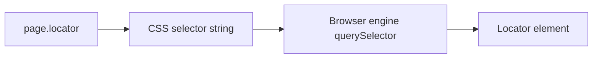

# 🧠 Topic: CSS Selectors

> [!abstract] Executive Summary (ELI5)
> CSS selectors are a way to tell Playwright "grab the element that looks like this" using the same patterns you use to style a web page: tag names, class names, IDs, attributes, and parent-child relationships.

---

## 🎯 The "Why"

- **Problem Solved:** You need to find a specific element in the DOM to click, fill, or assert against. CSS selectors are the most common and readable way to express that target.
- **Alternatives:** [[XPath Selectors]], Playwright user-facing locators (`getByRole`, `getByText`, `getByTestId`), and `page.locator` with custom selector engines.
- **Trade-offs:** CSS selectors are fast, well-understood, and concise, but they can break when developers refactor class names or change the DOM structure. They also cannot select by text content or traverse upward in the tree.

## 💡 Mental Model & Analogy

- **Analogy:** A CSS selector is like telling a friend to pick up a book by describing its shelf location and cover color: "the red paperback on the second shelf." If the bookstore rearranges the shelves, the directions stop working.
- **Visual/Diagram:**



## 🛠️ Core Principles & Code Snippets

### Basic Syntax

Playwright uses the `css=` selector engine by default, so you can omit the prefix.

```typescript
import { test, expect } from '@playwright/test';

test('basic CSS selectors', async ({ page }) => {
  await page.goto('/login');

  // Tag selector
  await page.locator('button').click();

  // Class selector
  await page.locator('.primary').click();

  // ID selector
  await page.locator('#submit').click();

  // Attribute selector
  await page.locator('[type="submit"]').click();

  // Combined selector
  await page.locator('button.primary[type="submit"]').click();
});
```

### Parent-Child and Structural Selectors

```typescript
// Direct child
await page.locator('nav > a').click();

// Any descendant
await page.locator('form input').fill('alice@example.com');

// Adjacent sibling
await page.locator('label + input').fill('password');

// Nth child
await page.locator('.todo-list li:nth-child(2)').click();

// First/last
await page.locator('.item:first-child').click();
await page.locator('.item:last-child').click();
```

### Pseudo-classes That Work in Playwright

Most standard CSS pseudo-classes work, but not all browser-specific pseudo-elements.

```typescript
// Visible elements only
await page.locator('button:visible').click();

// Has text (Playwright-specific pseudo-class)
await page.locator('button:has-text("Submit")').click();

// Has another element inside (Playwright-specific)
await page.locator('article:has(.badge)').click();
```

### Best Practices

```typescript
// ✅ Prefer stable, semantic attributes
await page.locator('[data-testid="login-button"]').click();

// ✅ Avoid classes generated by CSS-in-JS or build tools
// ❌ await page.locator('.sc-bdvvtL').click();

// ✅ Prefer user-facing attributes when test IDs are not available
await page.locator('[type="email"]').fill('alice@example.com');
```

> [!tip] Implementation Note
> Prefer `data-testid` or semantic attributes over visual classes. Designers refactor CSS classes far more often than they change test IDs.

## ⚠️ Pitfalls & Anti-patterns

- **Chaining too many selectors:** `.main > div:nth-child(3) > table > tbody > tr:nth-child(5) > td > button` is fragile. Break it into a role-based locator or add a test ID.
- **Relying on auto-generated classes:** CSS-in-JS frameworks like styled-components or emotion generate class names that change between builds.
- **Using CSS selectors for text matching:** CSS cannot select by text. Use `getByText` or `page.locator('text=Submit')` instead.
- **Forgetting that CSS selectors are rightward-only:** You cannot traverse up to a parent. Use XPath or Playwright's `locator.filter` for those cases.
- **Over-selecting with tag names:** `page.locator('div')` will match many elements and may resolve to an unexpected one.

## 🔗 Deep Connections

- **Parent Topic:** [[Playwright-Test-Object-and-Fixtures]]
- **Related Concepts:** [[XPath Selectors]], Playwright locators (`getByRole`, `getByTestId`, `getByText`)
- **Prerequisites:** Basic CSS, DOM tree structure, Playwright locators.

## ❓ Active Recall Questions

> [!faq]- Why are `data-testid` attributes usually the most stable selector strategy?
> They are added explicitly for testing and are not tied to visual styling or layout changes.

> [!faq]- What is the main limitation of CSS selectors when compared to XPath?
> CSS selectors cannot traverse upward in the DOM tree or select elements based on their text content.

> [!faq]- What happens if a CSS selector matches multiple elements in Playwright?
> Playwright returns a Locator that represents all matches. Many actions use the first match by default, but assertions such as `toHaveCount` consider the full set.

---

## 📝 Related Notes

- [[XPath Selectors]]
- [[Playwright-Test-Object-and-Fixtures]]
