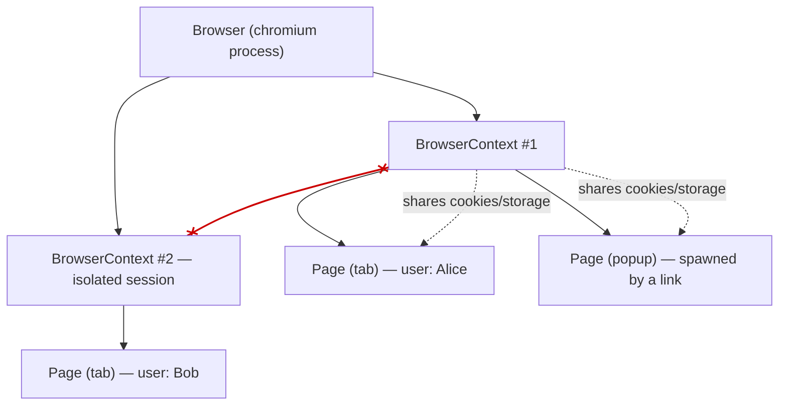

# 🧠 Topic: Playwright Browser & BrowserContext

> [!abstract] Executive Summary (ELI5)
> Playwright is organized in three layers: **Browser** (a running Chrome/Firefox process) → **BrowserContext** (an incognito-style session with its own cookies/storage) → **Page** (a single tab). Most tests only ever touch `page`. But when you need two users in one test, or a link that opens a new tab, you need to create contexts and handle pages explicitly.

> [!warning] The #1 surprise
> When a click opens a new tab/popup, Playwright does **not** switch to it for you. The new tab is a *future event* — it doesn't exist at the moment you click. You must **capture it with `waitForEvent` before (or around) the click**, otherwise you lose the handle forever.

---

## 🎯 The "Why"

- **Problem Solved:** A test often needs more than one tab: OAuth redirects, "open in new tab" links, two users interacting, or a file picker that spawns a dialog. The single `page` fixture can't represent those, so Playwright gives you the full `Browser → BrowserContext → Page` hierarchy to drive them.
- **Alternatives:** In Selenium you switch with `driver.switchTo().window(handle)`. Playwright deliberately has **no global "active tab"** — every `Page` object is independent, and you never "switch" the session. You just keep references to the pages you care about.
- **Trade-offs:** More power, more bookkeeping. You are responsible for awaiting spawned pages and closing contexts you opened manually.

## 💡 Mental Model & Analogy

- **Analogy:** Think of the **Browser** as the browser application (Chrome.exe). A **BrowserContext** is like opening an incognito window — it has its own cookies, localStorage, and cache, isolated from everything else. A **Page** is one tab inside that incognito window. You can open many tabs in one incognito window, and many incognito windows in one browser.



Two pages in the **same** context share cookies and localStorage (useful for one user with multiple tabs). Two **different** contexts are fully isolated (useful for two different users).

## 🛠️ Core Principles & Code Snippets

### 1. The hierarchy: `browser` → `context` → `page`

In the test runner, `browser`, `context`, and `page` are all fixtures. Normally you only destructure `page`. But you can grab the others when needed:

```typescript
import { test, expect } from '@playwright/test';

test('the full hierarchy', async ({ browser }) => {
  // 1. Browser is shared per worker (expensive process).
  // 2. Create your OWN context — an isolated incognito session.
  const context = await browser.newContext();

  // 3. Create a page inside that context.
  const page = await context.newPage();
  await page.goto('/');

  await expect(page).toHaveTitle(/Welcome/);

  // 4. You opened it, you close it.
  await context.close();
});
```

You rarely do this in the test runner (it already gives you a fresh `context` per test). You do it when the default context isn't enough — see below.

### 2. Creating a new context — and *why*

Three reasons to make your own context:

**(a) Two users in one test.** Each context is a separate incognito session, so login state in one doesn't leak into the other.

```typescript
test('Alice and Bob in the same test', async ({ browser }) => {
  const aliceCtx = await browser.newContext();
  const bobCtx = await browser.newContext();

  const alicePage = await aliceCtx.newPage();
  const bobPage = await bobCtx.newPage();

  await alicePage.goto('/login');
  await alicePage.getByLabel('Email').fill('alice@example.com');
  // ... Alice logs in ...

  await bobPage.goto('/login');
  // Bob starts with NO cookies — contexts are fully isolated.
  await expect(bobPage).not.toHaveURL(/dashboard/);

  await aliceCtx.close();
  await bobCtx.close();
});
```

**(b) Pre-seeded auth with `storageState`.** Log in once (in a global setup), save the cookies/localStorage to a JSON file, then spawn many contexts that start already authenticated — no per-test login.

```typescript
const context = await browser.newContext({
  storageState: 'playwright/.auth/user.json',
});
const page = await context.newPage();
await page.goto('/dashboard'); // already logged in
```

**(c) Custom options per context** — geolocation, permissions, locale, viewport, color scheme — without polluting the global config.

```typescript
const mobileFr = await browser.newContext({
  viewport: { width: 390, height: 844 },
  locale: 'fr-FR',
  geolocation: { latitude: 48.85, longitude: 2.35 },
  permissions: ['geolocation'],
});
```

### 3. Handling popups and new tabs — `waitForEvent` + `Promise.all`

This is the trickiest part. When a click or form submit opens a new tab, **the new `Page` does not exist at the instant of the click**. If you await the click first, the popup has already opened and Playwright can't hand you the handle from the future.

The fix is `page.waitForEvent('popup')`, which returns a promise that resolves **when** the popup appears. You must start listening *before* the action that triggers it. Because the action and the wait run concurrently, wrap them in `Promise.all`:

```typescript
test('link opens a new tab', async ({ page }) => {
  await page.goto('/docs');

  // ❌ WRONG: by the time the click resolves, the popup event is gone.
  //   `popup` below is never caught; you lost the new tab.
  // await page.getByText('Open in new tab').click();
  // const popup = await page.waitForEvent('popup');

  // ✅ RIGHT: kick off the wait and the click in parallel.
  const [popup] = await Promise.all([
    page.waitForEvent('popup'),   // resolve when the new tab appears
    page.getByText('Open in new tab').click(), // the action that opens it
  ]);

  // `popup` is a full Page object. Wait for it to load, then assert.
  await popup.waitForLoadState();
  await expect(popup).toHaveTitle(/External Doc/);
});
```

**Why `Promise.all` is mandatory here:** the click and the popup emission are two concurrent events. If you `await` the click first, its resolution races past the popup event, and `waitForEvent('popup')` registered *afterwards* will hang until the next popup (which never comes). `Promise.all` registers the listener and triggers the action in the same tick.

> **Form submit vs. link:** the same pattern applies to a form that opens the result in `target="_blank"`, and to `window.open()` calls — anything that spawns a page.

### 4. `context.waitForEvent('page')` vs `page.waitForEvent('popup')`

Both capture a newly spawned page, but at different layers:

| API | Listens on | Fires when |
|---|---|---|
| `page.waitForEvent('popup')` | a specific page | that page opens a popup (`window.open`, `target=_blank` from it) |
| `context.waitForEvent('page')` | the whole context | **any** page in the context is created, including popups |

Use `context.on('page', ...)` or `context.waitForEvent('page')` when a new tab might come from anywhere in the context (e.g., a background script or an unknown origin) and you want a single funnel for all of them.

```typescript
// Collect every tab opened in this context
context.on('page', async (newPage) => {
  await newPage.waitForLoadState();
});

const [newPage] = await Promise.all([
  context.waitForEvent('page'),
  page.getByRole('link', { name: 'Terms' }).click(),
]);
```

### 5. Switching between pages — there is no "switch"

There is **no** `switchTo().window()` like in Selenium. Every `Page` object is independent and can be driven directly. To enumerate open pages, use `context.pages`:

```typescript
// context.pages returns the array of currently open pages
const pages = context.pages;
expect(pages.length).toBe(2);

// Just use whichever Page you kept a reference to — no switching.
await pages[1].getByRole('button', { name: 'Accept' }).click();
await pages[0].reload(); // operate on the original tab in parallel
```

You "switch" simply by **holding a reference** to the page you want and calling methods on it. Keep the references you obtained from `waitForEvent`/`newPage` in well-named variables and operate on them directly.

### 6. Cleanup

Anything you create manually, you close manually. The test runner cleans up its own `context`/`page` fixtures, but `browser.newContext()` is your responsibility:

```typescript
test('cleanup', async ({ browser }) => {
  const context = await browser.newContext();
  try {
    const page = await context.newPage();
    // ... test logic ...
  } finally {
    await context.close(); // closes all pages inside it too
  }
});
```

`context.close()` cascades — it closes every page inside that context. You don't need to close pages individually first.

> [!tip] Implementation Note
> Prefer the **`context` fixture** over `browser.newContext()` whenever the default isolation is enough. Reach for manual contexts only for multi-user scenarios, `storageState` seeding, or per-context options. And always wrap the whole thing so `context.close()` runs even on test failure.

## ⚠️ Pitfalls & Anti-patterns

- **Awaiting the click before `waitForEvent('popup')`:** the popup event fires during the click; by the time you register the listener it's already in the past, and the test hangs. Always wrap click + wait in `Promise.all`.
- **Losing the popup handle:** if you don't capture the new page immediately, there is no API to "recover" it later except `context.pages` — and by then the page may have navigated away. Capture eagerly.
- **Forgetting to `context.close()`:** leaks browser resources, slows the suite, and on long runs can exhaust file descriptors. Manual `newContext` → manual `close`.
- **Treating two pages in the same context as isolated:** they are NOT — they share cookies and localStorage. If you need isolation, make a **new context**, not just a new page.
- **Expecting a "switch tab" API:** there isn't one. If you're searching for `page.switchTo`, stop — keep page references and call methods on them directly.
- **Using `context.waitForEvent('page')` for a single known popup:** it works, but `page.waitForEvent('popup')` is more precise — it ties the wait to the specific page that will spawn it. Reserve the context-level listener for "any tab, unknown origin."

## 🔗 Deep Connections

- **Parent Topic:** [[Playwright-Test-Object-and-Fixtures]] — the `context`, `page`, and `browser` fixtures ARE this hierarchy, managed for you per test.
- **Related Concepts:** [[Playwright-Configuration]] (`storageState` and `projects` are built on top of contexts), [[Playwright-Assertions]], [[Playwright Locators]]
- **Prerequisites:** async/await, `Promise.all`, the fixtures model from [[Playwright-Test-Object-and-Fixtures]].

## ❓ Active Recall Questions

> [!faq]- What is the `Browser` → `BrowserContext` → `Page` hierarchy, and what does each layer represent?
> `Browser` is the running browser process (shared, expensive). `BrowserContext` is an isolated incognito session with its own cookies/storage (cheap, created per test). `Page` is a single tab inside a context.

> [!faq]- Why do you wrap `page.waitForEvent('popup')` and the click in `Promise.all`?
> The popup is a future event — it doesn't exist at the instant of the click. If you await the click first, the popup event fires before you register the listener, and the test hangs. `Promise.all` starts the listener and the action in the same tick.

> [!faq]- How do you run two users (Alice and Bob) in a single test without their login state leaking?
> Create two separate `BrowserContext`s via `browser.newContext()`. Each context is a fully isolated incognito session, so cookies/localStorage in one are invisible to the other.

> [!faq]- How do you "switch" to a newly opened tab in Playwright?
> You don't switch — there is no global active-tab concept. You capture the new `Page` with `waitForEvent('popup')` (or `context.waitForEvent('page')`), keep the reference in a variable, and call methods on it directly.

> [!faq]- What's the difference between `page.waitForEvent('popup')` and `context.waitForEvent('page')`?
> `page.waitForEvent('popup')` listens for a popup spawned by a specific page. `context.waitForEvent('page')` listens for ANY new page created anywhere in the context. Use the page-level one for known popups, the context-level one when the origin is unknown.

> [!faq]- What does `context.close()` do, and do you need to close pages first?
> It closes the context and cascades — every page inside it is closed automatically. You do not need to close pages individually before closing the context.

---

## 📝 Related Notes

- [[Playwright-Test-Object-and-Fixtures]]
- [[Playwright-Configuration]]
- [[Playwright-Assertions]]
- [[Playwright Locators]]
