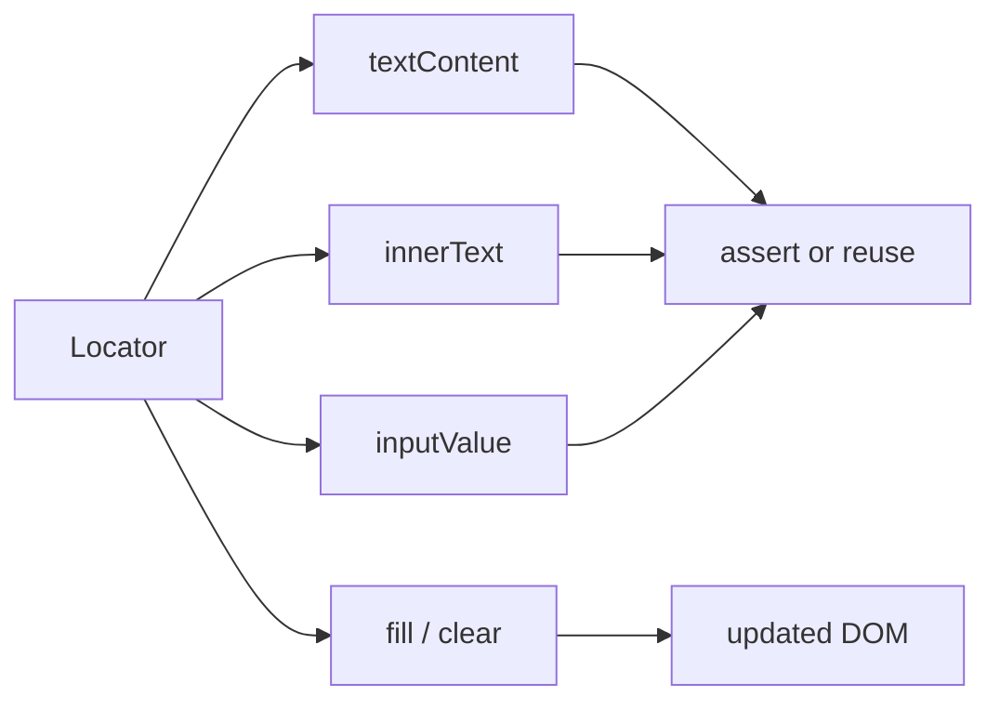

# 🧠 Topic: Playwright Content Methods

> [!abstract] Executive Summary (ELI5)
> Playwright gives you several ways to read and change what a page says. `textContent` reads the raw text, `innerText` reads only the visible text, and methods like `fill` and `clear` let you type into or remove text from form fields.

---

## 🎯 The "Why"

- **Problem Solved:** Tests need to verify what a user actually sees (or what the page stores) and interact with editable elements. Content methods bridge the gap between locators and assertions.
- **Alternatives:** You can use `page.evaluate` to read values directly, or rely on web-first assertions (`toHaveText`, `toHaveValue`) instead of reading values into variables.
- **Trade-offs:** Reading content into a variable is useful for snapshots and transformations, but assertions like `toHaveText` are more stable because they retry automatically.

## 💡 Mental Model & Analogy

- **Analogy:** A locator is the address of a house. Content methods are what you do once you arrive: read the mailbox label, look through the window, or write a note and leave it inside.
- **Visual/Diagram:**



## 🛠️ Core Principles & Code Snippets

### Reading Text

Use `textContent()` when you want all text including hidden elements, or `innerText()` when you only want what the user sees.

```typescript
import { test, expect } from '@playwright/test';

test('reading text content', async ({ page }) => {
  await page.goto('/profile');

  const name = await page.locator('[data-testid="name"]').textContent();
  // textContent may return null if the element is not yet attached
  expect(name).toBe('Alice');

  const visibleName = await page.locator('[data-testid="name"]').innerText();
  // innerText returns text as rendered, respecting visibility and CSS
  expect(visibleName).toBe('Alice');
});
```

### Reading Form Values

```typescript
const emailInput = page.locator('[name="email"]');
await emailInput.fill('alice@example.com');

const value = await emailInput.inputValue();
expect(value).toBe('alice@example.com');

// For checkboxes, radio buttons, and selects
const checked = await page.locator('[name="tos"]').isChecked();
const selectedText = await page.locator('select').inputValue();
```

### Reading Attributes

```typescript
const href = await page.locator('a[href]').getAttribute('href');
const src = await page.locator('img').getAttribute('src');
```

### Writing Text

```typescript
// fill replaces the full value, triggers change/input events, and works with inputs and textareas
await page.locator('[name="email"]').fill('alice@example.com');

// type simulates keystrokes one by one, useful for testing keyboard interactions
await page.locator('[name="search"]').type('playwright');
await page.locator('[name="search"]').press('Enter');

// clear removes the current value before you fill it
await page.locator('[name="email"]').clear();
await page.locator('[name="email"]').fill('bob@example.com');
```

### Selecting Text

```typescript
// Select all text inside an input or textarea
await page.locator('[name="email"]').selectText();
// Then type to replace it
await page.locator('[name="email"]').type('replaced@example.com');
```

### Web-First Assertions for Content

Prefer these over manual reads when you can, because they retry automatically.

```typescript
// Full text match
await expect(page.locator('h1')).toHaveText('Welcome');

// Substring match
await expect(page.locator('h1')).toContainText('Welcome');

// Multiple elements
await expect(page.locator('.todo')).toHaveText(['Buy milk', 'Walk dog']);

// Form value
await expect(page.locator('[name="email"]')).toHaveValue('alice@example.com');

// Attribute
await expect(page.locator('a')).toHaveAttribute('href', '/dashboard');
```

> [!tip] Implementation Note
> Prefer `toHaveText` or `toHaveValue` over reading content manually. They retry until the expected value appears, which removes timing-related flakiness.

## ⚠️ Pitfalls & Anti-patterns

- **Using `textContent` when visibility matters:** `textContent` returns hidden text too. Use `innerText` or `toHaveText` for user-visible checks.
- **Forgetting that content methods return `Promise`:** Always `await` them or the test will compare a Promise instead of a string.
- **Reading content just to assert equality:** A direct `expect(await ...).toBe(...)` fails on the first mismatch and is not retrying. Use web-first assertions instead.
- **Using `type` when you only need `fill`:** `type` is slower and can trigger per-key validation. Use `fill` unless you need to simulate keystrokes.
- **Assuming `inputValue` works on non-inputs:** `inputValue` only works on `<input>`, `<textarea>`, and `<select>` elements. Use `textContent` for other elements.
- **Ignoring whitespace in text assertions:** `toHaveText` supports string, regex, and arrays. Use regex when whitespace is unpredictable.

## 🔗 Deep Connections

- **Parent Topic:** [[Playwright-Test-Object-and-Fixtures]]
- **Related Concepts:** [[Playwright-Assertions]], [[CSS Selectors]], [[XPath Selectors]]
- **Prerequisites:** Locators, async/await, basic DOM concepts.

## ❓ Active Recall Questions

> [!faq]- What is the difference between `textContent` and `innerText`?
> `textContent` returns the raw text content of the node, including hidden text. `innerText` returns only the rendered, visible text.

> [!faq]- When should you use `fill` instead of `type`?
> Use `fill` when you want to set the final value quickly. Use `type` when you need to simulate individual keystrokes or test keyboard behavior.

> [!faq]- What is the main advantage of using `toHaveText` over reading `textContent` and asserting manually?
> `toHaveText` is a web-first assertion that retries automatically until the condition passes or the timeout is reached, which makes tests more stable.

> [!faq]- Which method do you use to read the current value of an input field?
> `inputValue()` returns the current value of an `<input>`, `<textarea>`, or `<select>` element.

---

## 📝 Related Notes

- [[Playwright-Assertions]]
- [[Playwright-Test-Object-and-Fixtures]]
- [[CSS Selectors]]
- [[XPath Selectors]]
