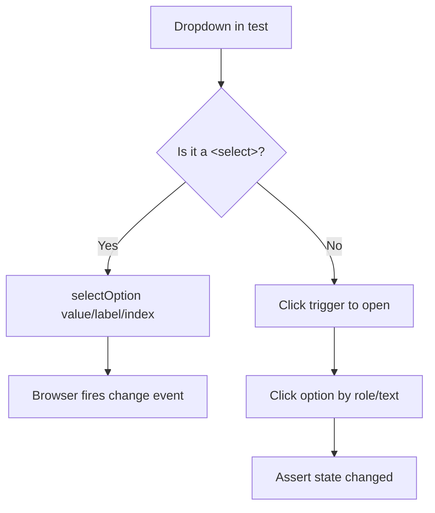

# 🧠 Topic: Playwright Dropdowns & Select Controls

> [!abstract] Executive Summary (ELI5)
> There are two kinds of dropdowns on the web, and Playwright treats them very differently. A **native `<select>`** is part of the browser — you tell Playwright "pick this value" and it just works. A **custom dropdown** is built from plain `div`s and buttons to look fancy — Playwright can't "select" it directly, so you drive it like a user: open it, then click the option.

> [!warning] The #1 mistake
> People reach for `selectOption` on a custom dropdown and it throws `Error: Not a <select> element`. `selectOption` only works on real `<select>` tags. Everything else is "click to open, click to choose."

---

## 🎯 The "Why"

- **Problem Solved:** Forms are full of dropdowns, and they come in two incompatible flavors. You need the right tool for each, otherwise your test either throws or silently clicks the wrong thing.
- **Alternatives:** Raw `page.evaluate(el => el.value = 'x')` — bypasses events and React/Vue wrappers, so the framework never sees the change. Almost always wrong.
- **Trade-offs:** `selectOption` is robust and fires all the right `change`/`input` events for native selects, but it is useless for custom widgets. Custom dropdowns are flexible visually, but you pay for it with more (and more fragile) test steps.

## 💡 Mental Model & Analogy

- **Analogy:** A native `<select>` is a vending machine with labeled buttons — you press "C3" and out comes the snack. A custom dropdown is a person you talk to: you have to get their attention (open it), tell them what you want (click the option), and trust they heard you (assert the result).



## 🛠️ Core Principles & Code Snippets

### 1. Native `<select>` — use `selectOption`

`selectOption` matches options by **value, label, or index**. Each is a different match strategy, so pick the one that matches what you care about.

```typescript
import { test, expect } from '@playwright/test';

test('native single select', async ({ page }) => {
  await page.goto('/signup');

  const country = page.getByRole('combobox', { name: 'Country' });

  // By option value (the value="" attribute) — most stable
  await country.selectOption('ca');

  // By visible label text — reads like a user
  await country.selectOption({ label: 'Canada' });

  // By index (0-based) — brittle, avoid if the list reorders
  await country.selectOption({ index: 3 });

  // It returns the selected values, handy for a quick assertion
  const chosen = await country.selectOption('ca');
  expect(chosen).toEqual(['ca']);
});
```

### 2. Native multi-select (`<select multiple>`)

Pass an array. Passing an empty array clears the selection.

```typescript
const toppings = page.locator('#toppings'); // <select multiple>

// Select several by value
await toppings.selectOption(['cheese', 'olives']);

// Mix strategies — each element is an independent matcher
await toppings.selectOption([
  { label: 'Mushrooms' },
  { value: 'pepperoni' },
]);

// Clear everything
await toppings.selectOption([]);
```

### 3. Assert the selection

Use the dedicated value assertions, not a manual text check.

```typescript
// Single select
await expect(country).toHaveValue('ca');

// Multi-select — order matters, must match exactly
await expect(toppings).toHaveValues(['cheese', 'olives']);
```

### 4. Custom (non-native) dropdown — drive it like a user

`selectOption` throws on anything that isn't a `<select>`. Instead, open the widget and click the option. Prefer `getByRole` with `option`/`listbox` so it works regardless of styling.

```typescript
test('custom dropdown', async ({ page }) => {
  await page.goto('/settings');

  // Step 1: open it. The trigger is usually a button or combobox.
  const trigger = page.getByRole('combobox', { name: 'Time zone' });
  await trigger.click();

  // Step 2: pick the option from the now-visible listbox.
  await page.getByRole('option', { name: 'UTC' }).click();

  // Step 3: assert — custom widgets usually show the choice as text
  await expect(trigger).toHaveText('UTC');
});
```

### 5. When the listbox is detached/slow

If the options render after the click, scope the option search to the listbox container so you don't match an option from a different dropdown, and let auto-waiting handle the timing.

```typescript
const timezoneField = page.locator('field:has(label:has-text("Time zone"))');

await timezoneField.getByRole('combobox').click();
await timezoneField.getByRole('option', { name: 'UTC' }).click();
```

> [!tip] Implementation Note
> Always assert the result, never trust the click. For native selects use `toHaveValue`/`toHaveValues`; for custom dropdowns assert the trigger's displayed text. The assertion is what makes the test auto-wait until the framework has actually committed the change.

## ⚠️ Pitfalls & Anti-patterns

- **Calling `selectOption` on a custom dropdown:** throws `Error: Not a <select> element`. If you see this, switch to the click-open / click-option pattern.
- **Setting `.value` via `page.evaluate`:** bypasses framework event handling (React `onChange`, Vue `v-model`), so the UI thinks nothing changed. Use `selectOption` or real clicks.
- **Matching options by visible text with `selectOption({ label })` when the value differs:** label and value are independent. `selectOption('Canada')` matches `value="Canada"`, not the label "Canada" — for the label use `{ label: 'Canada' }`.
- **Trusting the click without an assertion:** custom dropdowns can close without selecting (animation, focus loss). Always assert the chosen value/text afterward.
- **Matching an option globally with `page.getByText`:** can click an option from the wrong dropdown. Scope to the field container or use `getByRole('option', ...)`.
- **Relying on index for dynamic lists:** if the list is sorted or filtered, index 3 today is something else tomorrow. Match by value or label.

## 🔗 Deep Connections

- **Parent Topic:** [[Playwright Locators]]
- **Related Concepts:** [[Playwright-Assertions]], [[Playwright Content Methods]], [[Playwright-Test-Object-and-Fixtures]]
- **Prerequisites:** locators, `getByRole`, auto-waiting, the difference between native and custom form widgets.

## ❓ Active Recall Questions

> [!faq]- Which method selects an option in a native `<select>`, and what does it throw if used on a custom dropdown?
> `locator.selectOption(...)`. On a non-`<select>` element it throws `Error: Not a <select> element`.

> [!faq]- What's the difference between `selectOption('ca')` and `selectOption({ label: 'Canada' })`?
> The string form matches the option's `value` attribute; the `{ label }` form matches the visible text. They are independent match strategies.

> [!faq]- How do you clear a `<select multiple>` selection?
> Call `await locator.selectOption([])` — an empty array clears all selected options.

> [!faq]- How do you test a custom (non-native) dropdown?
> Click the trigger to open it, then click the desired option by role/text, then assert the trigger shows the chosen value — because `selectOption` doesn't apply.

> [!faq]- Which assertions verify a select's value, and how do they differ?
> `toHaveValue(value)` for a single select and `toHaveValues([...])` for a multi-select. `toHaveValues` is order-sensitive and must match exactly.

---

## 📝 Related Notes

- [[Playwright Locators]]
- [[Playwright-Assertions]]
- [[Playwright Content Methods]]
- [[Playwright-Test-Object-and-Fixtures]]
