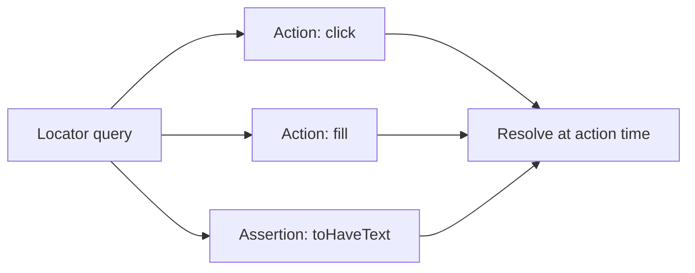

# 🧠 Topic: Playwright Locators

> [!abstract] Executive Summary (ELI5)
> A locator is a way to tell Playwright "here is the element I want to work with." It does not point to a single element right away; instead, it stores the query and resolves to the current matching element every time you use it. This makes tests resilient to DOM changes and timing issues.

---

## 🎯 The "Why"

- **Problem Solved:** Tests need to find elements to click, type, or assert against. Locators separate the query from the action so the same query can be reused and automatically retried against the current page state.
- **Alternatives:** Raw `page.$` / `page.$$` (element handles) and direct DOM queries in `page.evaluate`. These are less resilient because they snapshot elements at one point in time.
- **Trade-offs:** Locators are abstract and slightly higher-level. They require understanding that the DOM query is lazy and re-evaluated, which can surprise you if you expect a stable reference.

## 💡 Mental Model & Analogy

- **Analogy:** A locator is like a recipe for finding a dish in a buffet, not the plate itself. Every time you walk up to the buffet, the recipe tells you where the dish is now. If the buffet layout changes, the recipe still works as long as the description still matches.
- **Visual/Diagram:**



## 🛠️ Core Principles & Code Snippets

### Creating a Locator

```typescript
import { test, expect } from '@playwright/test';

test('basic locators', async ({ page }) => {
  await page.goto('/login');

  // By selector string (CSS by default)
  const submit = page.locator('button[type="submit"]');
  await submit.click();

  // By test ID
  const email = page.locator('[data-testid="email"]');
  await email.fill('alice@example.com');
});
```

### Built-in User-Facing Locators

Prefer these over raw selectors because they mirror how users interact with the page.

```typescript
// Role-based (preferred when possible)
await page.getByRole('button', { name: 'Submit' }).click();
await page.getByRole('textbox', { name: 'Email' }).fill('alice@example.com');

// Text-based
await page.getByText('Welcome back').waitFor();
await page.getByText('Dashboard', { exact: true }).click();

// Label, placeholder, alt, title
await page.getByLabel('Password').fill('secret');
await page.getByPlaceholder('Search...').fill('playwright');
await page.getByAltText('Company logo').click();
await page.getByTitle('Close').click();

// Test ID (most stable when roles are not available)
await page.getByTestId('login-button').click();
```

### Locators Matching Multiple Elements

A locator can match zero, one, or many elements. Playwright treats the whole set as a single locator object.

```typescript
// Count the matches
await expect(page.locator('.todo')).toHaveCount(3);

// Pick one by index
const second = page.locator('.todo').nth(1);
await second.click();

// First and last helpers
await page.locator('.todo').first().click();
await page.locator('.todo').last().click();

// Read all text contents into an array
const texts = await page.locator('.todo').allTextContents();
expect(texts).toEqual(['Buy milk', 'Walk dog', 'Read book']);

// Read all inner texts into an array
const visibleTexts = await page.locator('.todo').allInnerTexts();

// Get an array of locator handles for per-element logic
const todos = await page.locator('.todo').all();
for (const todo of todos) {
  await expect(todo).toBeVisible();
}
```

### Filtering Locators

```typescript
// Filter by text
const submitButton = page.locator('button').filter({ hasText: 'Submit' });
await submitButton.click();

// Filter by exact text
const primary = page.locator('button').filter({ hasText: /^Submit$/ });

// Filter by child element
const cardWithBadge = page.locator('.card').filter({ has: page.locator('.badge') });
await cardWithBadge.click();

// Filter by visibility
const visibleButton = page.locator('button').filter({ visible: true });
await visibleButton.click();
```

### Chaining Locators

Narrow down the search space by chaining from a parent.

```typescript
// Find an input inside a specific form
const email = page.locator('form#login').locator('input[name="email"]');
await email.fill('alice@example.com');

// Equivalent with getByRole inside a container
const loginForm = page.locator('form#login');
await loginForm.getByRole('textbox', { name: 'Email' }).fill('alice@example.com');
await loginForm.getByRole('button', { name: 'Submit' }).click();
```

### Strict Mode

By default, Playwright throws if a locator resolves to more than one element and the action expects a single target. This is called strict mode and catches accidental broad selectors.

```typescript
// If there are multiple buttons on the page, this throws
await page.locator('button').click();

// Fix: narrow the locator or pick one explicitly
await page.locator('button').filter({ hasText: 'Submit' }).click();
await page.locator('button').first().click();
```

### Shadow DOM and Frames

```typescript
// Piercing shadow DOM with CSS selector
const shadowInput = page.locator('my-input').locator('input');
await shadowInput.fill('value');

// Working inside a frame
const frame = page.frameLocator('#my-frame');
await frame.getByRole('button', { name: 'Accept' }).click();
```

> [!tip] Implementation Note
> Prefer `getByRole` over `getByTestId` when possible, and `getByTestId` over raw CSS/XPath. This ordering best matches user intent and test stability.

## ⚠️ Pitfalls & Anti-patterns

- **Using overly broad selectors:** `page.locator('div')` will match many elements and likely trigger strict mode or unexpected actions.
- **Thinking locators are element snapshots:** A locator is a query, not a fixed element. Storing a locator in a variable is fine, but do not assume the element was resolved when the variable was created.
- **Calling `.first()` or `.nth()` when the list is dynamic:** Indexing can target the wrong element if the list is still loading or reordering. Prefer filtering by text or test ID.
- **Mixing element handles with locators:** `page.$` returns an element handle that is stale after navigation. Use locators instead.
- **Ignoring `hasText` and `filter` for multiple matches:** Instead of writing a complex CSS selector, filter an existing locator by text or by a descendant.

## 🔗 Deep Connections

- **Parent Topic:** [[Playwright-Test-Object-and-Fixtures]]
- **Related Concepts:** [[CSS Selectors]], [[XPath Selectors]], [[Playwright-Assertions]], [[Playwright Content Methods]]
- **Prerequisites:** DOM tree, CSS basics, async/await.

## ❓ Active Recall Questions

> [!faq]- What makes a Playwright locator "lazy"?
> A locator stores the query but does not resolve to a DOM element until an action or assertion is executed. It re-evaluates the query every time.

> [!faq]- What happens when a locator matches multiple elements and you call `.click()` on it?
> Playwright throws a strict mode violation because the action is ambiguous. You must narrow the locator, use `.first()`, `.last()`, or `.nth()`.

> [!faq]- Which built-in locator should you usually try first?
> `getByRole`, because it mirrors how assistive technologies and users identify interactive elements.

> [!faq]- What is the difference between `allTextContents()` and `allInnerTexts()`?
> `allTextContents()` returns the raw text content of every match, including hidden text. `allInnerTexts()` returns the rendered visible text of every match.

> [!faq]- How do you select a specific element inside a list of dynamic items?
> Filter by text or a stable descendant rather than relying on index, because the index can change as the list updates.

---

## 📝 Related Notes

- [[Playwright-Test-Object-and-Fixtures]]
- [[CSS Selectors]]
- [[XPath Selectors]]
- [[Playwright-Assertions]]
- [[Playwright Content Methods]]
