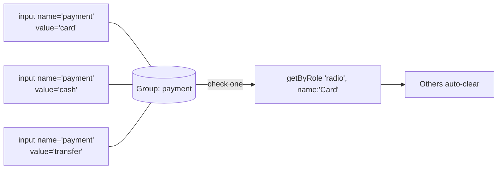

# 🧠 Topic: Playwright Radio Buttons

> [!abstract] Executive Summary (ELI5)
> A radio button is a "pick exactly one" control — like the preset buttons on an old radio, where pressing one pops the others out. In Playwright you don't really care about the HTML, you care about the **group**: all radios sharing the same `name` form one group, and your job is to select one member of it with `check()`.

> [!warning] The #1 mistake
> People do `page.getByRole('radio').check()` and hit a **strict mode violation** — that locator matches the *whole group* (every radio), not one option. Always pin a single radio with `{ name: '...' }` before acting on it.

---

## 🎯 The "Why"

- **Problem Solved:** Radio groups are the standard "choose one of N" input. The DOM quirk that trips people up is that a group is defined **implicitly** by a shared `name` attribute — there's no `<radiogroup>` element. Playwright's `check()` and `getByRole('radio')` paper over that, but you still have to target *one* radio, not the set.
- **Alternatives:** `click()` works on radios, but `check()` is the right tool — it is **idempotent** (no-op if already checked) and waits for the radio to be actionable. `click()` on an already-checked radio can re-fire handlers in some frameworks.
- **Trade-offs:** `check()` is robust and declarative ("I want this one selected"), but it only works on real checkbox/radio inputs and elements with `role="radio"`/`role="checkbox"`. For exotic custom widgets you fall back to clicks.

## 💡 Mental Model & Analogy

- **Analogy:** A radio group is a row of elevator buttons for the same shaft — pushing floor 5 cancels floor 3. The buttons aren't connected by a container, they're connected by **belonging to the same shaft** (the shared `name`). To test it, you never "press the group"; you press *floor 5*.



The group is invisible in the DOM tree — it exists only because the three inputs share `name="payment"`.

## 🛠️ Core Principles & Code Snippets

### 1. Select one radio with `check()`

Pin a single radio by its accessible name, then call `check()`.

```typescript
import { test, expect } from '@playwright/test';

test('select a payment method', async ({ page }) => {
  await page.goto('/checkout');

  // Right: target ONE radio by its label
  await page.getByRole('radio', { name: 'Credit card' }).check();

  // getByLabel also works when the <input> is wrapped by a <label>
  await page.getByLabel('Cash on delivery').check();
});
```

### 2. Why `check()` and not `click()`

`check()` is designed for radios/checkboxes and behaves correctly:

```typescript
const card = page.getByRole('radio', { name: 'Credit card' });

await card.check();  // selects it; waits for actionable, idempotent
await card.check();  // no-op — already checked, no error, no duplicate event

// click() also works, but it is NOT idempotent in intent:
await card.click();  // fine when unchecked; on an already-checked radio
                     // it can re-trigger framework handlers unexpectedly
```

> Rule of thumb: **`check()` for radios and checkboxes, `click()` for buttons and links.** The method name should match the *kind* of control.

### 3. Assert which radio is selected

```typescript
const card = page.getByRole('radio', { name: 'Credit card' });
const cash = page.getByRole('radio', { name: 'Cash on delivery' });

// The chosen one is checked
await expect(card).toBeChecked();

// The others are not
await expect(cash).not.toBeChecked();

// Negated form reads naturally: "cash is NOT the selected option"
await expect(cash).toBeChecked({ checked: false });
```

### 4. Read the group's current value directly

Scope to the group with the `name` attribute and use the `:checked` CSS pseudo-class. `inputValue()` returns the `value` of the checked member.

```typescript
// What's selected right now?
const selected = await page.locator('input[name="payment"]:checked').inputValue();
expect(selected).toBe('card');

// Assert via toHaveValue on the checked member
await expect(page.locator('input[name="payment"]:checked')).toHaveValue('card');
```

### 5. Custom radio group (non-`<input>`)

Modern UIs often render radios as styled buttons with ARIA. If they used `role="radio"` correctly, the same API works unchanged.

```typescript
// ARIA radio group — still getByRole('radio'), same check()
await page.getByRole('radio', { name: 'Standard shipping' }).check();
await expect(page.getByRole('radio', { name: 'Standard shipping' })).toBeChecked();
```

If the widget skipped ARIA entirely (rare, badly built), fall back to clicking the trigger — but first file a bug, because the widget isn't accessible.

> [!tip] Implementation Note
> Radios **cannot be unchecked** by clicking them — that's HTML behavior, not a Playwright limitation. The only way to "deselect" is to check another member of the same group. Don't reach for `uncheck()` on a radio; it has no sensible meaning there.

## ⚠️ Pitfalls & Anti-patterns

- **Acting on the whole group:** `page.getByRole('radio').check()` matches every radio in the group → strict mode violation. Always narrow with `{ name: '...' }`.
- **Using `click()` on an already-checked radio:** not idempotent; can re-fire framework handlers or toggle custom widgets into a bad state. Prefer `check()`.
- **Trying to `uncheck()` a radio:** radios are single-select-by-design; there's nothing to uncheck. Select a different member instead.
- **Asserting the wrong radio is checked:** with multiple groups on one page, `input[name="..."]:checked` scopes to the right group — a bare `getByRole('radio')` does not. Always qualify by group `name`.
- **Forgetting radios are mutually exclusive:** if your test checks "Card" then expects "Cash" still available, remember the "Cash" radio is now unchecked automatically — assert `not.toBeChecked()`, don't assume it stayed as-is.
- **Matching by value string vs. label:** `getByRole('radio', { name: 'Card' })` matches the accessible (visible) label, not the `value="card"` attribute. They are independent — don't mix them up.

## 🔗 Deep Connections

- **Parent Topic:** [[Playwright Locators]]
- **Related Concepts:** [[Playwright-Assertions]], [[Playwright Dropdowns]], [[Playwright Content Methods]], [[Playwright-Test-Object-and-Fixtures]]
- **Prerequisites:** locators, `getByRole`, auto-waiting/actionability, the difference between radio (single-select) and checkbox (multi-select).

## ❓ Active Recall Questions

> [!faq]- Why does `page.getByRole('radio').check()` throw a strict mode violation?
> That locator matches every radio in the group, not one. `check()` needs a single target, so you must narrow with `{ name: '...' }` to pick a specific option.

> [!faq]- Why prefer `check()` over `click()` for radio buttons?
> `check()` is idempotent — calling it on an already-checked radio is a no-op. `click()` is not idempotent and can re-fire framework handlers on an already-checked radio.

> [!faq]- How do you read which radio in a group is currently selected?
> Scope to the group and use the `:checked` pseudo-class: `await page.locator('input[name="payment"]:checked').inputValue()` returns the checked option's value.

> [!faq]- Can you uncheck a radio button? What's the right approach?
> No — radios are single-select by HTML design and can't be unchecked directly. To "deselect," check a different radio in the same group instead.

> [!faq]- What does `toBeChecked({ checked: false })` assert, and when is it useful?
> It asserts the radio is NOT checked — the explicit, readable negated form. Useful for confirming the other members of a group cleared after you checked a different one.

---

## 📝 Related Notes

- [[Playwright Locators]]
- [[Playwright-Assertions]]
- [[Playwright Dropdowns]]
- [[Playwright Content Methods]]
- [[Playwright-Test-Object-and-Fixtures]]
