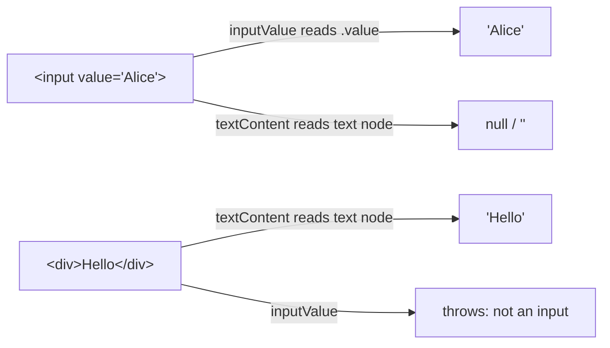

# 🧠 Topic: `inputValue()` vs `textContent()`

> [!abstract] Executive Summary (ELI5)
> Two completely different data stores in the DOM. `inputValue()` reads the `.value` **property** of a form field (what the user typed). `textContent()` reads the **text node** (the characters written *between* tags, like `<div>hello</div>`). Mixing them up is the most common "why is my value empty?" bug.

> [!warning] The #1 bug
> You type `Alice` into an `<input>`, then call `textContent()` on it and get **`null`/empty string** — not `"Alice"`. The text you typed lives in the field's `.value` property, not in a text node. You must use `inputValue()`. It works the other way too: `inputValue()` on a `<div>` throws.

---

## 🎯 The "Why"

- **Problem Solved:** The DOM stores "what's inside an element" in two places depending on the element type, and the two Playwright methods map 1:1 to those stores. Knowing which store you're reading from prevents silent wrong values.
- **Alternatives:** `page.evaluate(el => el.value)` — same as `inputValue()` but raw and clunkier. Web-first assertions `toHaveValue`/`toHaveText` are preferred when you only want to assert.
- **Trade-offs:** `inputValue()` is type-restricted (throws on non-form elements) but correct. `textContent()` is universal but returns the wrong thing for form fields.

## 💡 Mental Model & Analogy

- **Analogy:** A form field is a **whiteboard with a marker** — the written content is `.value`, what you'd read by looking at the board. A `<div>` is a **printed poster** — the content is baked into the print itself (the text node). `inputValue()` reads the whiteboard; `textContent()` reads the poster. Asking for the poster text of a whiteboard gives you nothing, because nothing is printed on it.



## 🛠️ Core Principles & Code Snippets

### `inputValue()` — the form-field reader

Reads the `.value` **property**. Works **only** on `<input>`, `<textarea>`, and `<select>`. Throws on anything else.

```typescript
const email = page.getByRole('textbox', { name: 'Email' });
await email.fill('alice@example.com');

// Reads the .value property — 'alice@example.com'
const val = await email.inputValue();
expect(val).toBe('alice@example.com');

// For <select>, returns the selected option's value
const country = page.getByRole('combobox', { name: 'Country' });
await country.selectOption('ca');
expect(await country.inputValue()).toBe('ca');

// For <select multiple>, returns an array of selected values
const toppings = page.locator('#toppings');
expect(await toppings.inputValue()).toEqual(['cheese', 'olives']);
```

### `textContent()` — the DOM-text reader

Reads the **text node** (characters between tags), including hidden text. Returns `null` if the element has no text node.

```typescript
// <div class="name">Alice</div>  → text node is 'Alice'
const name = await page.locator('.name').textContent();
expect(name).toBe('Alice');

// <input value="Alice">  → NO text node, value lives in .value
const empty = await page.locator('input[name="name"]').textContent();
// empty === null  ← the classic bug

// Includes text from hidden descendants (unlike innerText)
// <div>Visible <span style="display:none">Hidden</span></div>
const all = await page.locator('div').textContent();
// all === 'Visible Hidden'
```

### The decision in one line

```typescript
// Is it a form field (input/textarea/select)?  → inputValue()
// Is it anything else (div/span/p/h1/label)?    → textContent()
```

### Prefer assertions over manual reads

Both methods are **snapshots** (no retry). When you only need to verify, use the matching web-first assertion — it auto-waits:

```typescript
await expect(email).toHaveValue('alice@example.com');   // pairs with inputValue()
await expect(name).toHaveText('Alice');                 // pairs with textContent()
```

## ⚠️ Pitfalls & Anti-patterns

- **`textContent()` on an `<input>`:** returns `null`/empty — the typed value is in `.value`, not a text node. Use `inputValue()`.
- **`inputValue()` on a `<div>`/`<span>`:** throws `Error: Node is not an <input>, <textarea>, or <select> element`. Use `textContent()`.
- **`textContent()` returns `null`:** it's typed as `string | null`. Always null-check or coalesce before asserting, or you'll compare against `null`.
- **Reading then asserting manually (no retry):** `expect(await loc.inputValue()).toBe(...)` is a one-shot snapshot. Prefer `toHaveValue` / `toHaveText` for auto-waiting.
- **Expecting `textContent` to reflect user input on a contenteditable div:** it won't reliably. Contenteditable is its own edge case — test with `toHaveText`/`textContent` carefully.

## 🔗 Deep Connections

- **Parent Topic:** [[Playwright Content Methods]] — the broader catalog of content readers; this note zooms into the one comparison that causes the most bugs.
- **Related Concepts:** [[Playwright-Assertions]] (`toHaveValue` / `toHaveText` — the auto-retrying pairs), [[Playwright Dropdowns]] (`inputValue()` on a `<select>`), [[Playwright Radio Buttons]] (`inputValue()` to read the selected group member)
- **Prerequisites:** DOM `.value` property vs text node distinction.

## ❓ Active Recall Questions

> [!faq]- You type `Alice` into an `<input>`, then call `textContent()` — what do you get, and why?
> `null` (or empty string). The typed value lives in the field's `.value` property, not in a text node. `textContent()` reads text nodes; you need `inputValue()` for `.value`.

> [!faq]- What does `inputValue()` throw on a `<div>`, and what should you use instead?
> It throws `Error: Node is not an <input>, <textarea>, or <select> element`. Use `textContent()` for non-form elements.

> [!faq]- What does `inputValue()` return for a `<select multiple>`, vs a single `<select>`?
> For `<select multiple>` it returns an **array** of selected values; for a single `<select>` it returns one **string**.

> [!faq]- Why does `textContent()` potentially return `null`?
> It's typed `string | null` — it returns `null` when the element has no text node (e.g., an empty element or an `<input>`). Always null-check or use `??`.

> [!faq]- Which auto-retrying assertions pair with these two methods?
> `toHaveValue(...)` pairs with `inputValue()` (form fields); `toHaveText(...)` pairs with `textContent()` (display text).

---

## 📝 Related Notes

- [[Playwright Content Methods]]
- [[Playwright-Assertions]]
- [[Playwright Dropdowns]]
- [[Playwright Radio Buttons]]
