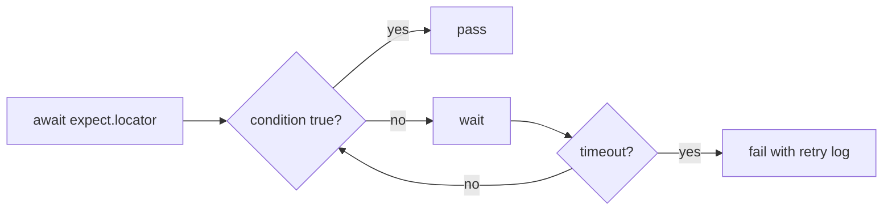

# 🧠 Topic: Playwright Assertions

> [!abstract] Executive Summary (ELI5)
> Playwright assertions are "web-first": instead of checking the DOM once and failing immediately, they keep retrying until the expected condition becomes true or a timeout runs out. This removes most manual `waitFor` calls and makes tests stable against timing issues.

---

## 🎯 The "Why"

- **Problem Solved:** Browser tests are asynchronous. Elements may appear, update, or animate after an action. Hard assertions that check once create flaky tests.
- **Alternatives:** You can write explicit `await page.waitForSelector()` or polling loops, but that is verbose and error-prone compared to built-in retrying assertions.
- **Trade-offs:** Retrying assertions wait until the test `expect.timeout` or the configured timeout. If a selector is wrong, the failure is delayed rather than instant, so good error messages and traces matter.

## 💡 Mental Model & Analogy

- **Analogy:** A web-first assertion is like a security guard checking ID at a concert entrance. Instead of looking once and sending everyone away, the guard keeps watching the door until the guest arrives or the show starts. If the guest never shows, only then does the guard report a missing person.
- **Visual/Diagram:**



## 🛠️ Core Principles & Code Snippets

### Web-First vs Standard Assertions

```typescript
import { test, expect } from '@playwright/test';

test('web-first vs standard', async ({ page }) => {
  await page.goto('/');

  // ❌ Standard assertion: evaluates once, likely flaky
  const text = await page.locator('.status').textContent();
  expect(text).toBe('Ready');

  // ✅ Web-first assertion: retries until true or timeout
  await expect(page.locator('.status')).toHaveText('Ready');
});
```

Web-first assertions start with `await expect(...)` and accept locators, pages, or API responses.

### Common Locator Assertions

```typescript
// Visibility and presence
await expect(page.locator('.spinner')).toBeVisible();
await expect(page.locator('.spinner')).toBeHidden();
await expect(page.locator('.spinner')).not.toBeVisible();

// Text content
await expect(page.locator('h1')).toHaveText('Welcome');
await expect(page.locator('h1')).toContainText('Welcome');

// Form values and state
await expect(page.locator('[name="email"]')).toHaveValue('user@example.com');
await expect(page.locator('[name="tos"]')).toBeChecked();
await expect(page.locator('button[type="submit"]')).toBeEnabled();
await expect(page.locator('button')).toBeDisabled();

// Attributes and classes
await expect(page.locator('button')).toHaveAttribute('aria-expanded', 'true');
await expect(page.locator('button')).toHaveClass(/primary/);

// Count
await expect(page.locator('.todo-item')).toHaveCount(3);

// Page-level assertions
await expect(page).toHaveTitle(/Dashboard/);
await expect(page).toHaveURL('/dashboard');
```

### Negation with `.not`

```typescript
await expect(page.locator('.error')).not.toBeVisible();
await expect(page.locator('.success')).toHaveCount(0);
```

### Soft Assertions

By default, a failed assertion stops the test. Soft assertions continue and report all failures at the end:

```typescript
import { test, expect } from '@playwright/test';

test('soft assertions', async ({ page }) => {
  await expect.soft(page.locator('.name')).toHaveText('Alice');
  await expect.soft(page.locator('.email')).toHaveText('alice@example.com');
  await expect.soft(page.locator('.role')).toHaveText('Admin');

  // Mandatory check at the end if you want to fail the test on soft failures
  expect(test.info().errors).toHaveLength(0);
});
```

Use soft assertions when validating many independent fields on a form or a dashboard, but avoid them for preconditions that later steps depend on.

### Polling for Non-UI Conditions

When the condition is not tied to a DOM element, use `expect.poll`:

```typescript
await expect.poll(async () => {
  const response = await page.request.get('/api/health');
  return response.status();
}).toBe(200);
```

### Configuring Assertion Timeout

Set the default in `playwright.config.ts`:

```typescript
export default defineConfig({
  expect: {
    timeout: 10_000,
  },
});
```

Or pass a one-off timeout:

```typescript
await expect(page.locator('.slow')).toHaveText('Done', { timeout: 30_000 });
```

> [!tip] Implementation Note
> Prefer `toHaveText` over `toBeVisible` when the visible text is what actually matters. A loader icon can be visible while the wrong data is shown.

## ⚠️ Pitfalls & Anti-patterns

- **Mixing standard and web-first assertions for DOM state:** Use web-first assertions for anything that can change asynchronously. Save standard assertions for pure data values.
- **Over-relying on soft assertions:** Soft failures are easy to miss in logs. Always surface them explicitly with `expect(test.info().errors).toHaveLength(0)` when the test outcome depends on them.
- **Excessive timeouts:** Raising `expect.timeout` to fix flakiness masks real timing bugs. Fix the underlying wait condition or application behavior first.
- **Using page-level assertions for element state:** `expect(page).toHaveURL` is fine, but `expect(page.locator).toBeVisible` is more precise than parsing the whole page.

## 🔗 Deep Connections

- **Parent Topic:** [[Playwright-Test-Object-and-Fixtures]]
- **Related Concepts:** [[Playwright-Configuration]], [[Playwright-CLI-Commands]]
- **Prerequisites:** Locators, async/await, basic testing concepts.

## ❓ Active Recall Questions

> [!faq]- What makes Playwright assertions "web-first"?
> They automatically retry the condition until it passes or the assertion timeout is reached, instead of evaluating the DOM only once.

> [!faq]- When should you use soft assertions?
> Use them when you want to collect multiple independent failures in one run, such as validating many fields on a settings page.

> [!faq]- What is the difference between `toHaveText` and `toContainText`?
> `toHaveText` checks the full text content. `toContainText` checks that the text includes the given substring.

---

## 📝 Related Notes

- [[Playwright-Test-Object-and-Fixtures]]
- [[Playwright-Configuration]]
- [[Playwright-CLI-Commands]]
